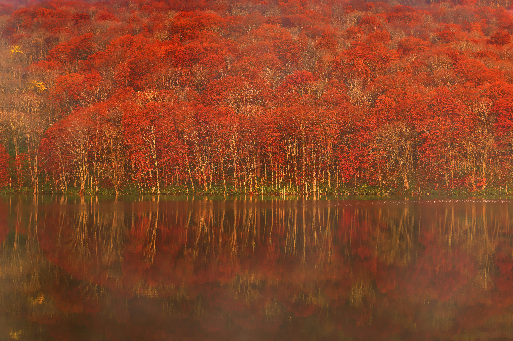
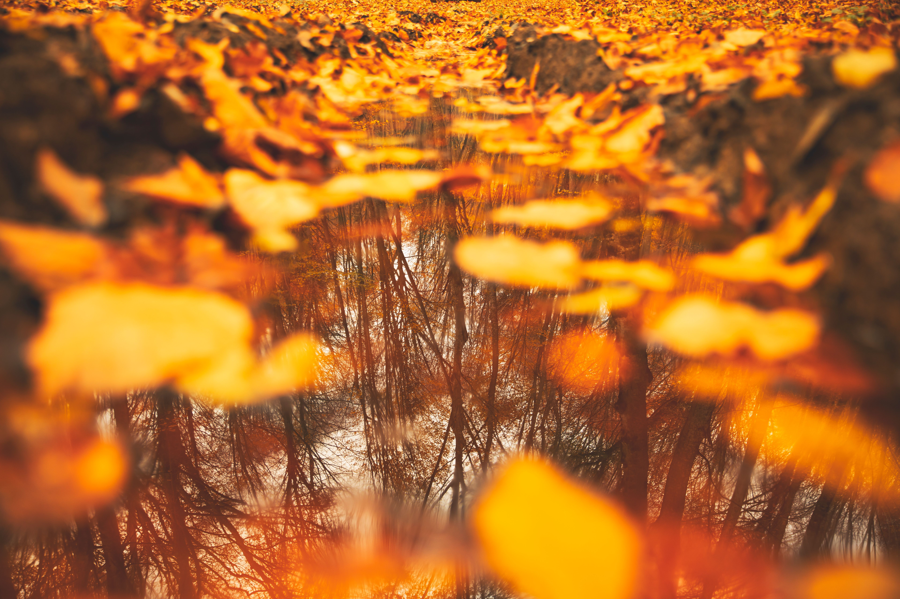
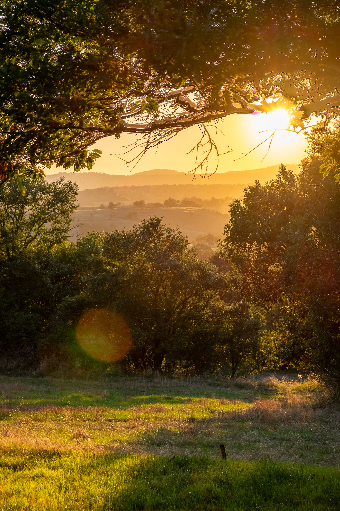
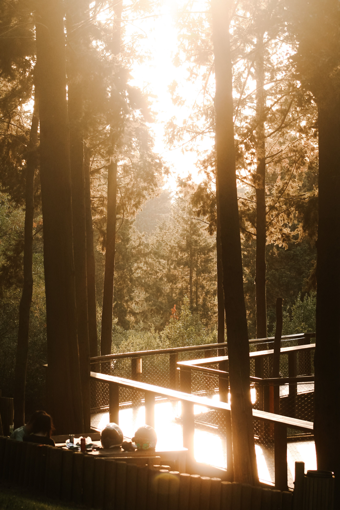
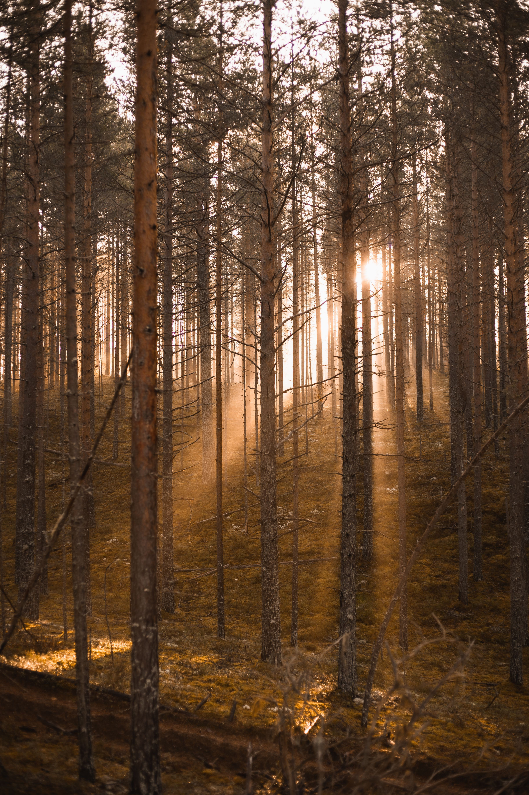
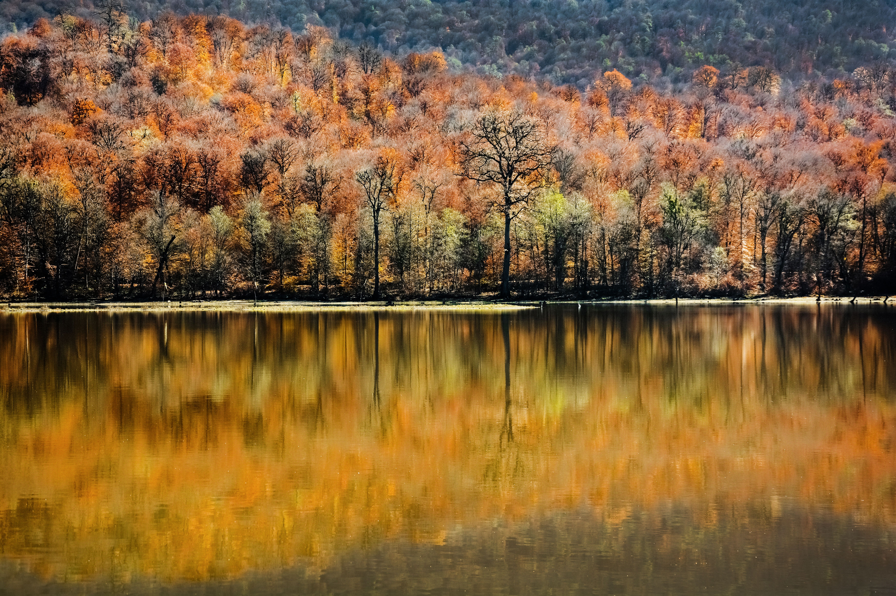
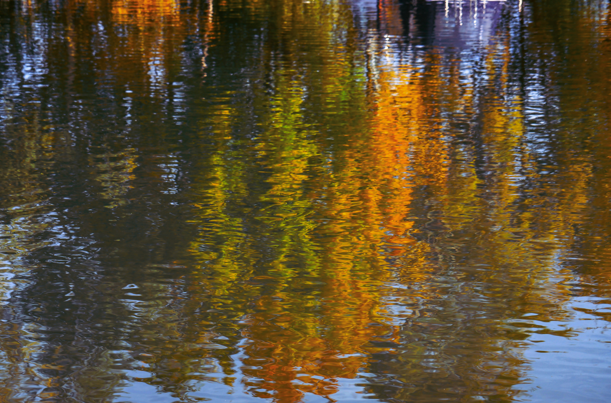
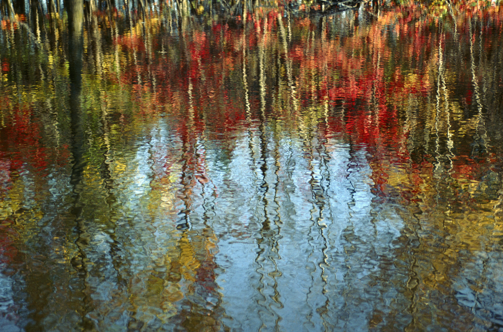

# Осень, растворённая в отражении

## Золотая осень в городских парках

**Творческое предложение для заказчика и съёмочной команды**

> Осенние краски постепенно растворяются в воде, как акварель.

Развитие второй идеи из [ДЗ 2](./Last%20of%20gold%20autumn.md).

Формат: художественная пейзажная серия для туристических публикаций и социальных сетей.

---

## 01. Концепция и задача

**Мы показываем осень через её отражение.** Лёгкая рябь меняет очертания деревьев: узнаваемый пейзаж постепенно превращается в текучие золотистые, медные и голубые пятна.

Это визуальная метафора осени, растворяющейся в воде. Эффект возникает в реальном пейзаже, без добавления красок в воду и без имитации живописи фильтрами. Основную насыщенность и тепло изображению придаёт низкий естественный свет, а не интенсивная цветокоррекция.

- **Для кого:** жители Петербурга и туристы, которым близки прогулки и спокойный отдых.
- **Задача для заказчика:** показать парк как место, где можно замедлиться и заметить красоту привычного пространства.
- **Эмоция:** тишина, созерцательность, лёгкое удивление.
- **Творческий метод:** изменение точки зрения и ассоциация «рябь на воде напоминает растворяющуюся акварель».

---

## 02. Общий мудборд

<table>
    <tr>
        <td align="center"><b>01</b></td>
        <td align="center"><b>02</b></td>
    </tr>
    <tr>
        <td></img></td>
        <td></img></td>
    </tr>
    <tr>
        <td align="center"><b>03</b></td>
        <td align="center"><b>04</b></td>
    </tr>
    <tr>
        <td></img></td>
        <td></img></td>
    </tr>
</table>

- **01** · Узнаваемый берег и его отражение: начало визуальной истории.  
- **02** · Листья на поверхности и отражённые деревья: сочетание двух пространственных слоёв.  
- **03** · Рябь дробит вертикали стволов: переход от пейзажа к абстракции.  
- **04** · Золотистые и голубые потоки: главный ориентир для образа «осенней акварели».

---

## 03. Локация

Нужна точка, где одновременно есть:

- золотистые деревья у противоположного берега;
- отражение крон и небольшого участка неба;
- открытая вода с лёгкой рябью и защищённый от сильного ветра участок;
- безопасная сухая дорожка, с которой можно снимать, не спускаясь к воде;
- возможность исключить из кадра мусор, ограждения и случайных прохожих.

**Предлагаемая локация:** 

- пруды Елагина острова, ЦПКиО им. С. М. Кирова, Санкт-Петербург.
- пруды Московского парка Победы. 

---

## 04. Модель, одежда и макияж

**Модель не требуется**. Главные действующие элементы: отражение, рябь, осенняя листва и свет.

**Одежда команды**: Тёплая непромокаемая одежда, обувь с нескользящей подошвой, неброские цвета во избежание ярких отражений.

Случайные прохожие не становятся героями серии.

---

## 05. Свет

**Основной свет:** тёплый естественный свет в золотой час — вскоре после восхода или незадолго до заката. Низкое солнце просвечивает осеннюю листву, усиливает её золотистые и медные оттенки и создаёт цветные отражения на воде.

- Используем боковой и контровой свет, чтобы листья просвечивали и отделялись от более тёмных стволов.
- Снимаем отражение освещённых деревьев с берега, где можно сохранить насыщенность цвета и избежать крупных пересвеченных бликов на воде.
- Меняем угол съёмки, чтобы найти баланс между отражением листвы, небом и бликами и по возможности убрать отражение фотографа.
- Проверяем гистограмму и предупреждение о пересветах, особенно при съёмке навстречу солнцу; при необходимости немного уменьшаем экспозицию, сохраняя детали в светлых участках.
- Пасмурный свет используем как запасной вариант для спокойной, естественной версии серии. Если важен именно тёплый золотой свет, при плотной облачности переносим съёмку на подходящее утро или вечер.

Вспышка, студийные приборы и отражатели не нужны: цвет и настроение должны создаваться естественным светом.

**Референсы света**

<table>
    <tr>
        <td> </td>
        <td> </td>
        <td> </td>
    </tr>
</table>

---

## 06. Оборудование и настройки

Предлагаемый комплект подбирается из доступной техники, без привязки к неподтверждённой модели камеры.

| Оборудование | Назначение |
|---|---|
| Камера Sony A6700 | Контроль выдержки, экспозиции и последующей обработки. |
| Объектив Sigma 18-50mm F2.8 DC DN | От общего отражения к отдельным цветовым фрагментам. Более длинный объектив опционален. |
| Штатив и таймер / дистанционный спуск | Неподвижная камера при экспериментах с выдержкой. |
| Бленда, салфетка, дождевой чехол | Защита от бокового света, капель и влажности. |
| Запасной аккумулятор и карта памяти | Непрерывность съёмки. |
| ND-фильтр, опционально | Удлинение выдержки при ярком свете. Поляризатор по умолчанию не используем: он может убрать нужное отражение. |

**Стартовые параметры, не жёсткий рецепт:** RAW, ISO 100–400, f/5.6–f/8. Для рисунка ряби пробуем 1/125–1/500 с; для мягкого движения цвета, со штатива, 1/8–1/2 с. Экспозицию корректируем по свету и скорости воды.

---

## 07. Позы и ракурсы: постановка кадра

<table>
  <tr>
    <td><b>01. «Зеркало»</b></td>
    <td><b>02. «Два слоя»</b></td>
  </tr>
  <tr>
    <td></td>
    <td></td>
  </tr>
  <tr>
    <td>Общий план берега с отражением, спокойная композиция.</td>
    <td>Реальная поверхность и отражённое пространство встречаются.</td>
  </tr>
  <tr>
    <td><b>03. «Рябь»</b></td>
    <td><b>04. «Акварель»</b></td>
  </tr>
  <tr>
    <td></td>
    <td></td>
  </tr>
  <tr>
    <td>Более тесное кадрирование, берег исключён, вертикали стволов искажены водой.</td>
    <td>Фрагмент отражения с золотистыми и голубыми потоками, цвет словно растворяется.</td>
  </tr>
</table>

**Фокус:** для отражений наводимся на видимые отражённые детали, а не автоматически на ближайшую поверхность воды. В кадрах с плавающими листьями осознанно выбираем главный слой и проверяем глубину резкости.

Камера остаётся неподвижной: в основном варианте серии изображение преобразует вода, а не движение камеры. 

---

## 08. Цвет и обработка

**Цветовая логика:** тёплая листва на фоне прохладных отражений неба и глубоких теней.

  

    

    
<strong>Золотистая охра</strong> <code>#DCA63A</code> Основной осенний цвет.

  

  

    

    
<strong>Медный</strong> <code>#B86A28</code> Глубина и тёплые акценты.

  

  

    

    
<strong>Приглушённый голубой</strong> <code>#738F9F</code> Воздух и прохладный контраст.

  

  

    

    
<strong>Тёмный сине-зелёный</strong> <code>#18252A</code> Стволы, тени, структура.

  

**Обработка:** работаем с RAW и ограничиваемся базовой коррекцией экспозиции, баланса белого, светов и теней. Сохраняем естественное тепло света, реальные оттенки листвы, воды и неба; выравниваем фотографии между собой, не усиливая цвет ради искусственной «золотой» картинки.

Избегаем чрезмерной насыщенности и контраста, перекрашивания отдельных оттенков, «акварельных» фильтров и искусственного добавления ряби. Живописность создаётся природой, светом и движением воды, а обработка лишь бережно подчёркивает исходный кадр.

---

## 09. Время съёмки и координация

**Сезон:** период золотой листвы, ориентировочно октябрь; фактическое состояние деревьев важнее календарной даты.

**Рабочее окно:** планируем съёмку примерно за 30–45 минут до заката и завершаем с уходом тёплого света. Альтернативный вариант — начать вскоре после восхода, когда солнце уже освещает листву. Точное время уточняем для выбранной даты, прогноза и режима доступа к парку.

| Когда | Действие и ответственность |
|---|---|
| За 2–3 дня | Фотограф проверяет доступ места, купить билет если нужно |
| За сутки | Фотограф проверяет прогноз, ветер, заряд техники и маршрут |
| Первые 15 минут | Проверка света, воды и безопасности, тестовые кадры. |
| Следующие 30 минут | Общие отражения и кадры с листьями на поверхности. |
| Следующие 45 минут | Основная съёмка ряби и «акварели», сравнение выдержек. |
| Последние 30 минут | Дополнительные ракурсы, вертикальные версии, проверка резкости и полноты серии. |

Минимальная команда: один фотограф, отвечающий за подготовку, съёмку и обработку. 

---

## 10. Форс-мажоры

| Ситуация | Действие |
|---|---|
| Плохая погода | При этом переносим съёмку. |
| Закрытый доступ или ограничения на съёмку | Используем заранее проверенную резервную локацию; не обходим запреты. |
| Листва уже опала | Ждем до следующего года : ( |

---

## 11. Что получает заказчик

**Предлагаемый результат:** 4 качесвеных обработанных фотографий

- 1 общий кадр: парк и отражение.
- 1 многослойный кадр: листья и отражённые деревья.
- 1 кадра с выразительной рябью.
- 1 более абстрактных кадра: «осенняя акварель».

**Передача:** полноразмерные JPEG в sRGB и облегчённые версии для веб-публикации.
