# Тема проекта: «Золотая осень в городских парках Петербурга»

## 1. Описание кейса

### Контекст проекта

Осенью городские парки Петербурга приобретают особую атмосферу благодаря золотистым листьям, мягкому естественному свету, отражениям в воде и живописным аллеям. Это время года позволяет показать город с другой стороны — не только через архитектуру и улицы, но и через красоту природы и возможности для отдыха на свежем воздухе.

### Целевая аудитория

- Туристы, планирующие посетить Санкт-Петербург осенью.
- Жители города, интересующиеся прогулками и отдыхом на природе.
- Любители пейзажной фотографии и красивых городских пространств.

### Цель проекта

Создать серию художественных фотографий, раскрывающих красоту золотой осени в городских парках Санкт-Петербурга. Фотографии должны передавать атмосферу осеннего города, привлекать внимание к природным достопримечательностям и мотивировать зрителей посещать парки и проводить больше времени на природе.

### Основная идея

Городской парк — это место, где человек может замедлиться, отдохнуть от повседневной суеты и почувствовать связь с природой, не покидая города.

### Предполагаемое использование фотографий

Фотографии могут использоваться в туристических публикациях, социальных сетях, рекламных материалах и информационных проектах, посвящённых осеннему Петербургу.

### Визуальный стиль

Естественные осенние цвета, мягкий свет, выразительная композиция, сочетание общих планов и деталей. Люди могут присутствовать в кадре как элементы окружающей среды, подчёркивающие масштаб пространства и атмосферу прогулки, но не должны становиться главными объектами съёмки.

## 2. Пять творческих идей

### Идея 1. «Золотой коридор»

**Метод генерации идеи:** ассоциации.

**Концепция**

Осенняя аллея воспринимается как вход в золотой мир природы. Деревья образуют естественный коридор, а дорожка ведёт взгляд зрителя в глубину парка, словно уводя его из городского шума в спокойное осеннее пространство. Фотография должна создавать ощущение присутствия и вызывать желание самому пройти по этой аллее, чтобы ненадолго оставить повседневную суету позади.

**Настроение и визуальный образ**

Тепло, спокойствие, уют, ощущение перехода из шумной городской среды в тихую осеннюю природу. Основные визуальные элементы — золотистые кроны, уходящая вдаль дорожка, мягкий солнечный свет и выразительная перспектива.

**Приёмы съёмки**

- Использовать широкоугольное положение объектива, примерно 18–24 мм.
- Применять линейную перспективу: дорожка и ряды деревьев направляют взгляд к точке схода.
- Использовать естественное обрамление кадра ветвями и кронами деревьев.
- При возможности снимать при боковом или контровом свете, подчёркивающем прозрачность осенней листвы.

**Визуальные референсы**

Показать

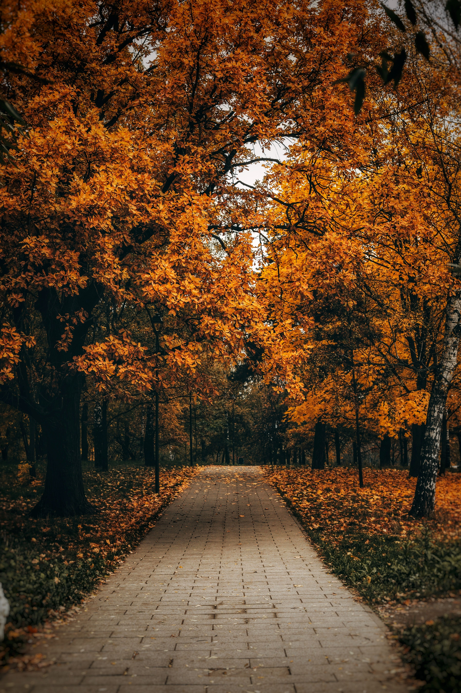

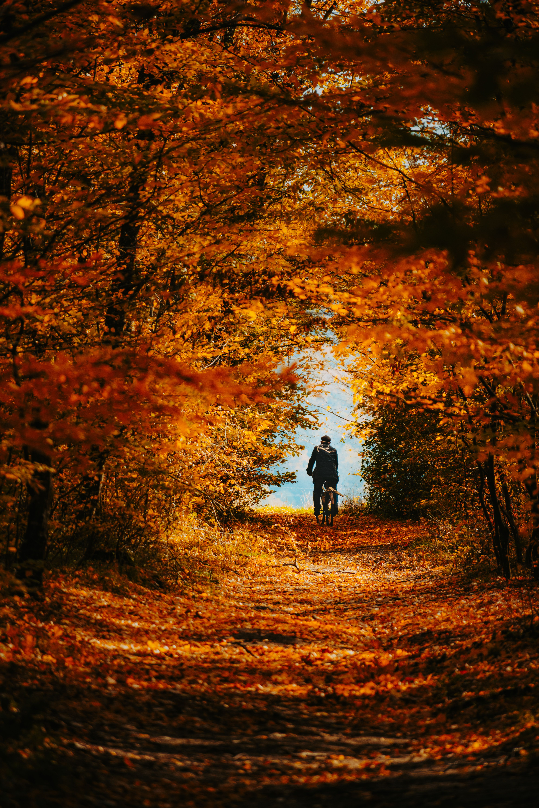

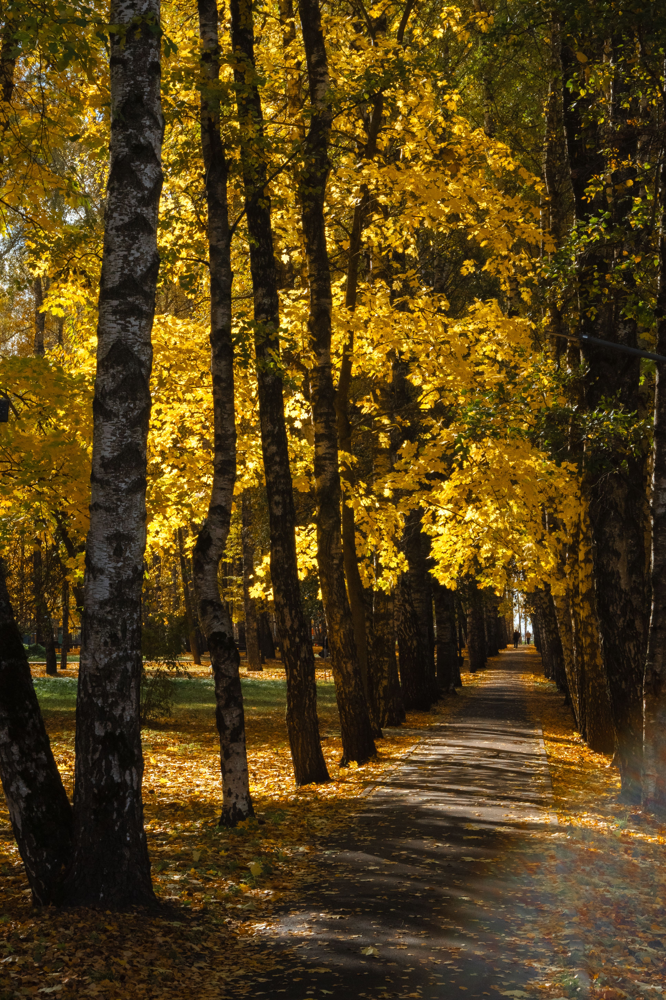

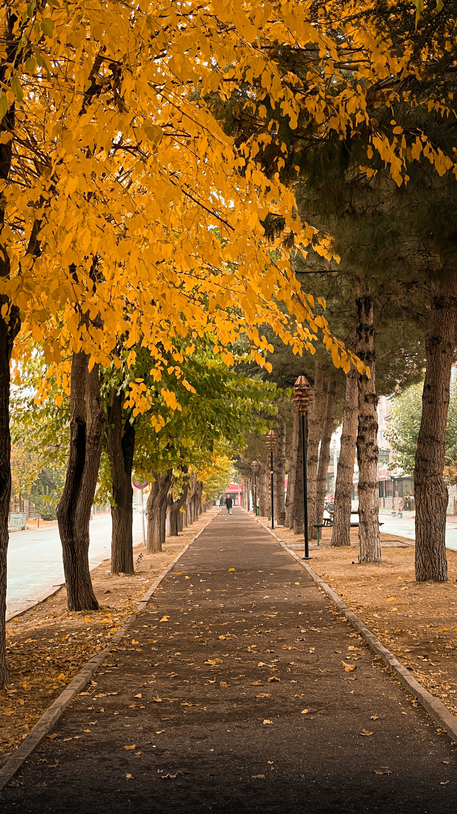

**Ожидаемый результат**

Выразительный пейзажный кадр с сильным ощущением глубины, который не только показывает красоту парка, но и вызывает желание уйти из городского ритма в осеннюю тишину.

---

### Идея 2. «Осень, растворённая в отражении»

**Метод генерации идеи:** инверсия и изменение точки зрения.

**Концепция**

Осень можно показать не только напрямую через деревья и листья, но и через отражение на поверхности воды. Особенно важны не идеально гладкие отражения, а лёгкая рябь и колебания озера, из-за которых осенние цвета словно растворяются в воде, как акварельная краска. Такой подход превращает привычный пейзаж в более живую, текучую и почти живописную композицию.

**Настроение и визуальный образ**

Созерцательность, тишина, лёгкая загадочность и живописность. Важную роль играют не только симметрия и цветовые пятна, но и рябь на воде, из-за которой деревья и листья теряют чёткие контуры и превращаются в мягкие потоки цвета.

**Приёмы съёмки**

- Искать пруды и водоёмы, в которых отражаются деревья и небо.
- Снимать как спокойные отражения, так и моменты с лёгкой рябью, когда отражение начинает визуально «растворяться».
- Попробовать снять только отражение или включить в кадр листья на поверхности воды, чтобы усилить эффект многослойности.
- Использовать фокусное расстояние примерно 35–85 мм для упрощения кадра и исключения лишних деталей.
- При съёмке с поляризационным фильтром учитывать, что он может ослабить отражение на поверхности воды.

**Визуальные референсы**

Показать

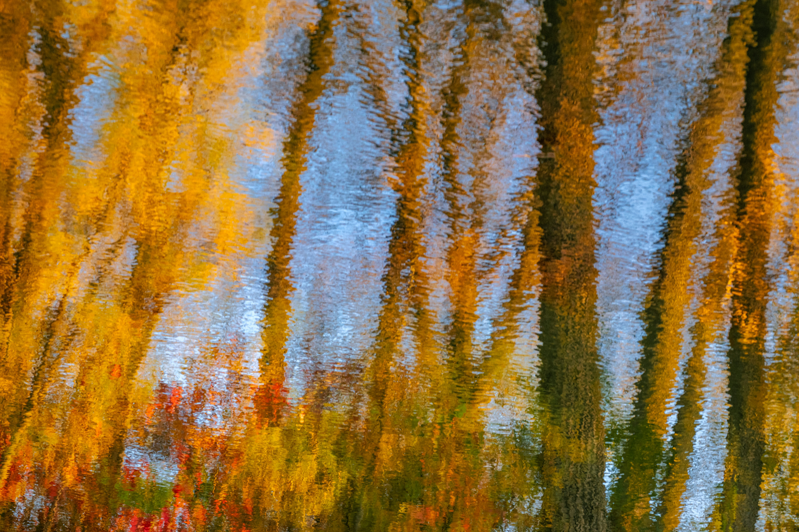

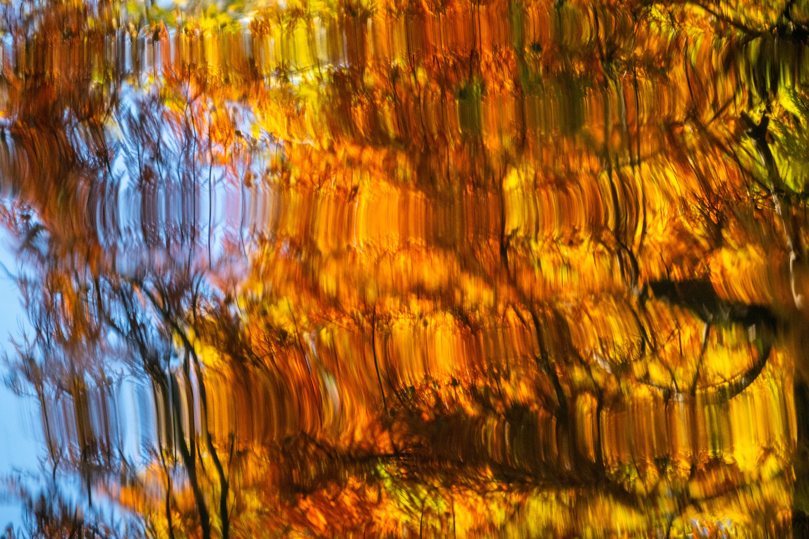

**Ожидаемый результат**

Художественная серия, которая показывает осень с необычной точки зрения и передаёт ощущение, будто осенние краски постепенно растворяются в отражении воды.

---

### Идея 3. «Мир глазами одного листа»

**Метод генерации идеи:** изменение масштаба наблюдения.

**Концепция**

Идея строится не просто вокруг изображения одного листа, а вокруг взгляда на окружающий мир как будто от лица этого листа. Лист становится точкой входа в кадр и способом показать пространство вокруг: ветку, скамейку, дорожку, землю, другие листья и свет. Такой подход позволяет передать не только красоту самого листа, но и среду, в которой он находится.

**Настроение и визуальный образ**

Близость к земле, погружение, деликатность и внимательное наблюдение. Основные визуальные элементы — лист как главный герой переднего плана, низкая точка съёмки, окружающее пространство в фоне и ощущение, что зритель смотрит на парк изнутри самой осенней среды.

**Приёмы съёмки**

- Снимать с очень низкой точки, на уровне лежащего или висящего листа, чтобы лист задавал точку зрения всего кадра.
- Использовать фокусное расстояние около 35–50 мм и открытую диафрагму, например f/2.8–f/4, чтобы отделить лист от окружения, но сохранить читаемость среды.
- Выбирать листья с выразительной формой и размещать их так, чтобы через них раскрывались окружающие линии, фактуры и свет.
- Использовать скамейки, дорожки, ветки, опавшую листву и другие элементы окружения как часть истории кадра.
- Следить за точностью фокусировки: резкость должна приходиться на лист, а фон должен поддерживать ощущение пространства, а не исчезать полностью.

**Визуальные референсы**

Показать

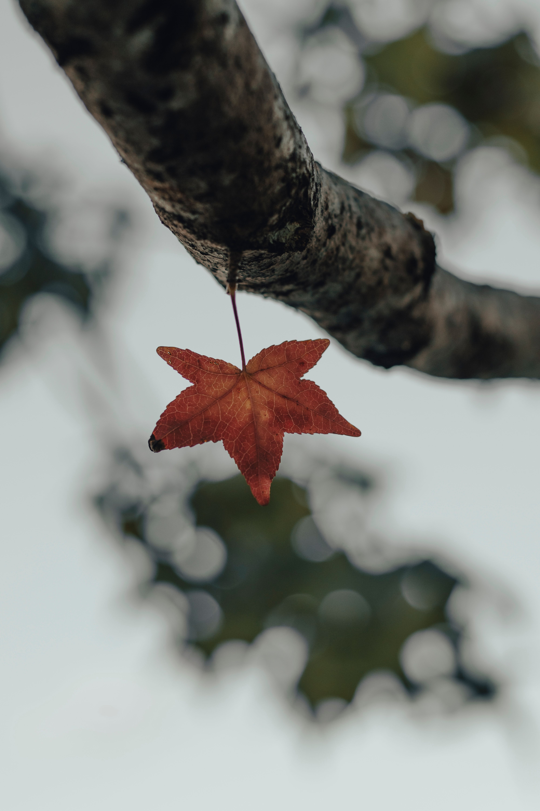

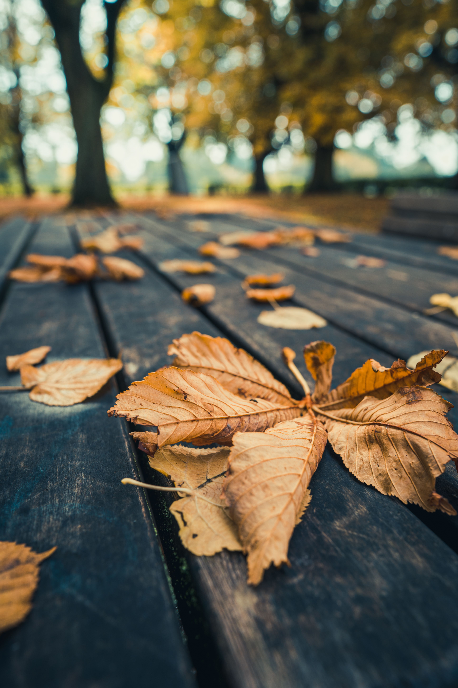

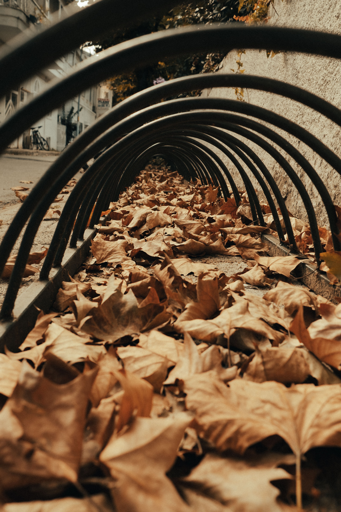

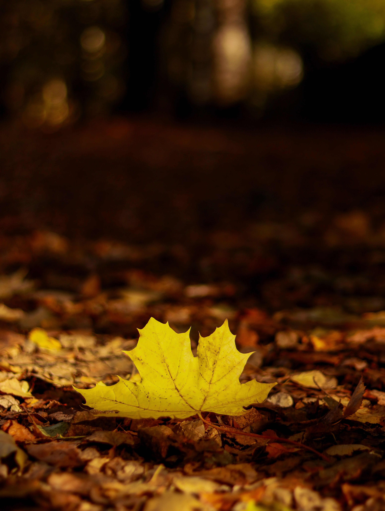

**Ожидаемый результат**

Выразительные фотографии, в которых один лист становится проводником в осеннее пространство и помогает показать окружающую среду через маленькую природную деталь.

---

### Идея 4. «Время для себя»

**Метод генерации идеи:** метафора.

**Концепция**

Парк представлен как пространство отдыха от повседневной суеты. Пустая скамейка под золотыми деревьями, тихая дорожка или небольшая поляна становятся визуальными метафорами спокойствия и возможности побыть наедине с природой.

Для передачи этой идеи необязательно фотографировать людей крупным планом. Само пространство может вызывать у зрителя желание представить себя в этом месте.

**Настроение и визуальный образ**

Умиротворение, простота, комфорт и созерцательность. Композиция должна быть спокойной, без избыточного количества объектов и визуальных отвлекающих элементов.

**Приёмы съёмки**

- Найти скамейку, окружённую осенними деревьями, или тихую парковую дорожку.
- Использовать фокусное расстояние примерно 24–35 мм, чтобы показать объект вместе с окружающей средой.
- Применять минималистичную композицию и оставлять свободное пространство вокруг главного объекта.
- Использовать естественные линии дорожек и ветвей для направления взгляда.
- При необходимости включить в кадр небольшую фигуру человека на расстоянии, чтобы подчеркнуть масштаб пространства и атмосферу прогулки.

**Визуальные референсы**

Показать

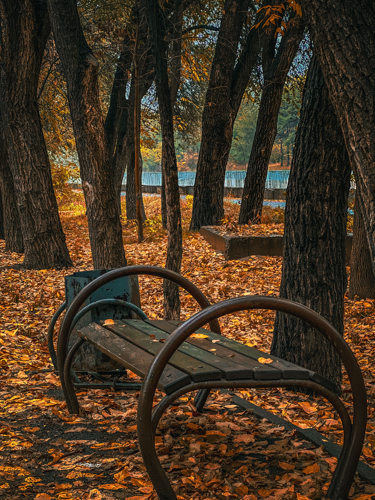

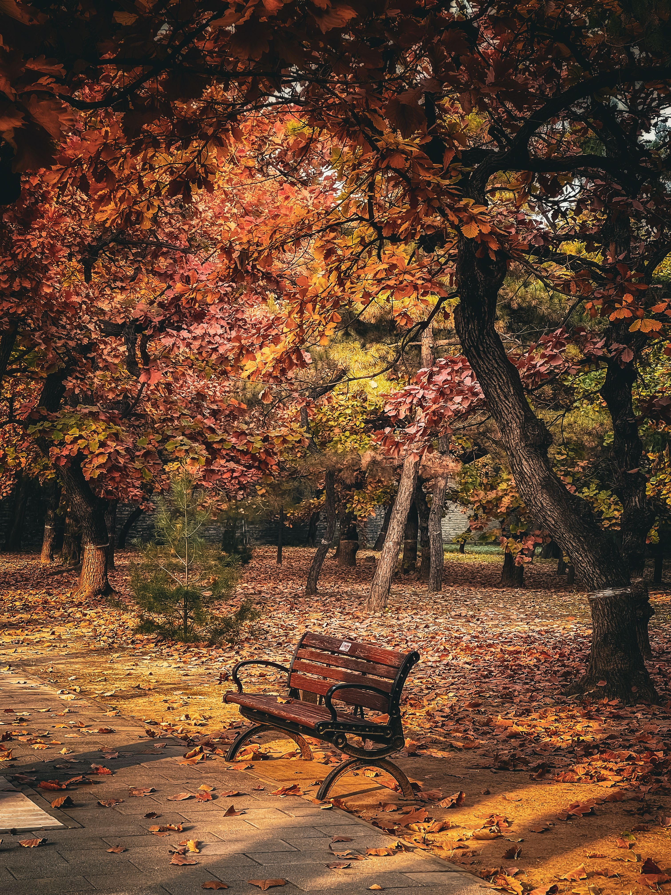

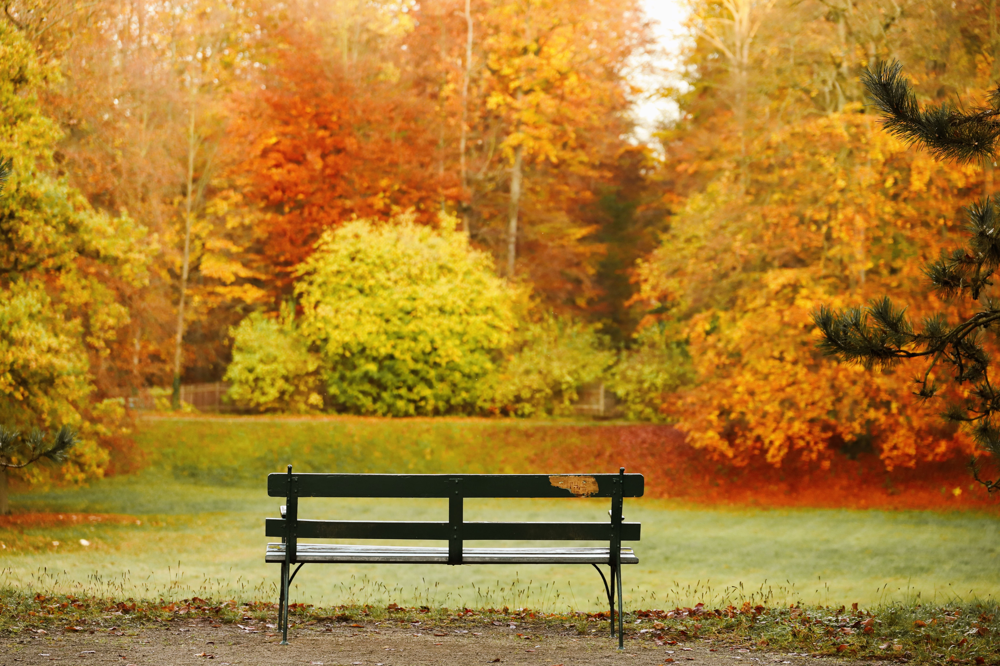

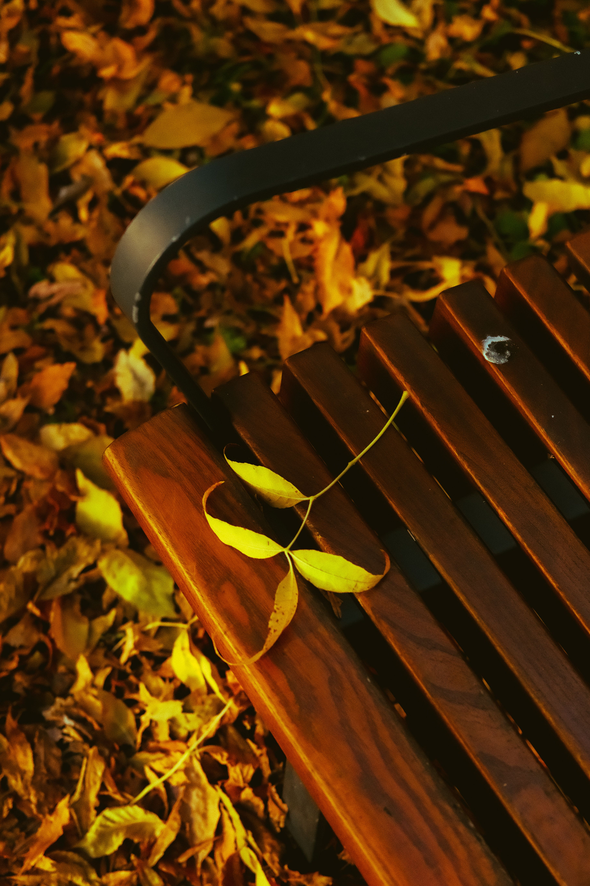

**Ожидаемый результат**

Эмоциональная серия, передающая идею отдыха и близости к природе. Она непосредственно поддерживает основную цель проекта — мотивировать людей посещать городские парки.

---

### Идея 5. «Тёплая природа, далёкий город»

**Метод генерации идеи:** контраст.

**Концепция**

Идея строится на взгляде из осенней природной среды в сторону далёкого города. Передний план формируется из ветвей, листьев и других природных элементов, которые словно обнимают и частично скрывают городские здания вдали. За счёт этого город воспринимается как что-то удалённое и холодное, а зритель остаётся внутри тёплого, защищённого осеннего пространства.

**Настроение и визуальный образ**

Тепло, дистанция, лёгкая отстранённость от городской суеты. Важен контраст между мягкими золотистыми листьями на переднем плане и более холодными, голубовато-серыми зданиями на заднем плане.

**Приёмы съёмки**

- Использовать ветви, листья и кроны на переднем плане для естественного обрамления далёких городских зданий.
- Строить кадр из нескольких пространственных слоёв: мягкий природный передний план, более читаемый средний план и удалённый городской фон.
- Использовать более открытые значения диафрагмы, чтобы слегка размыть золотистые листья на переднем плане и сохранить внимание на дальнем городе.
- Подбирать точку съёмки так, чтобы тёплые природные оттенки контрастировали с более холодными голубовато-серыми зданиями.
- Использовать средние или длинные фокусные расстояния, когда нужно визуально приблизить город и сохранить эффект «взгляда сквозь природу».

**Визуальные референсы**

Показать

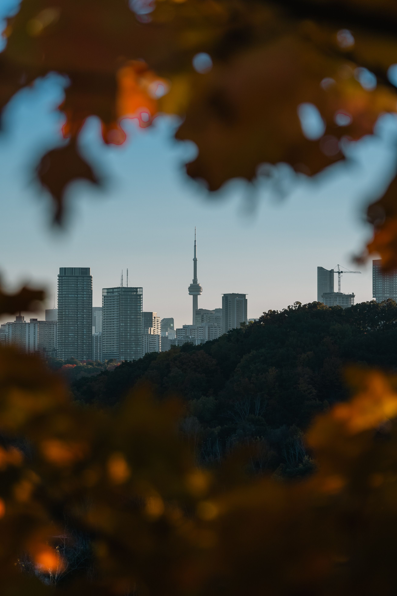

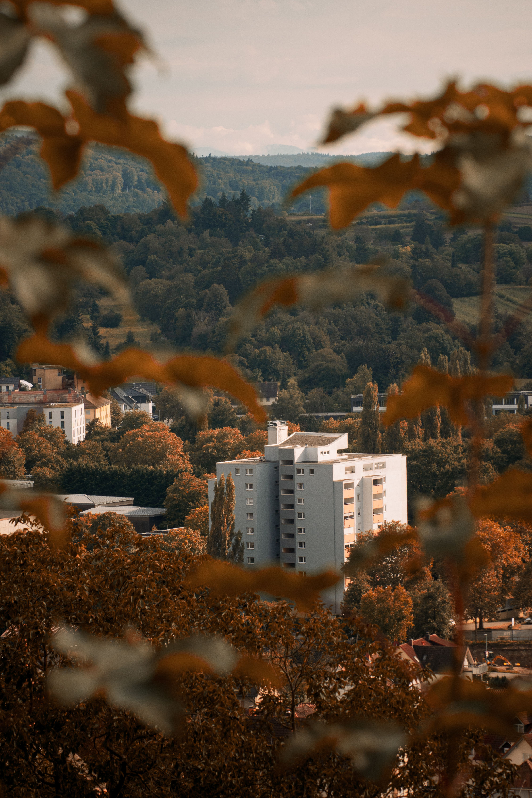

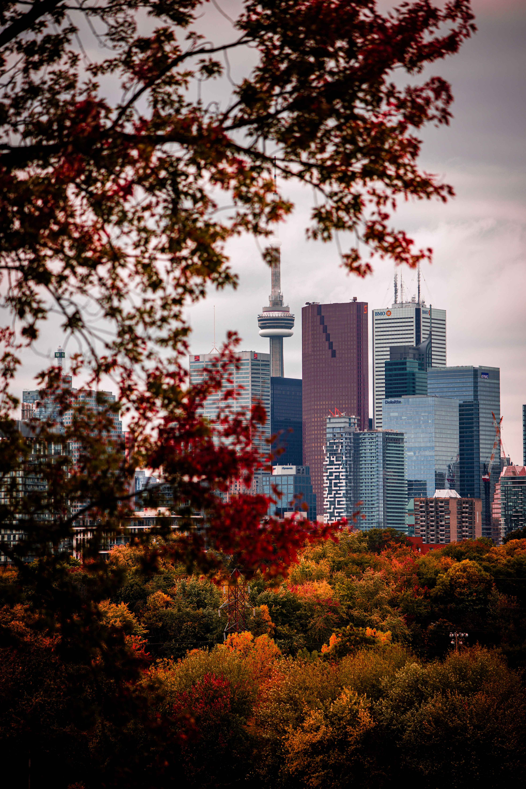

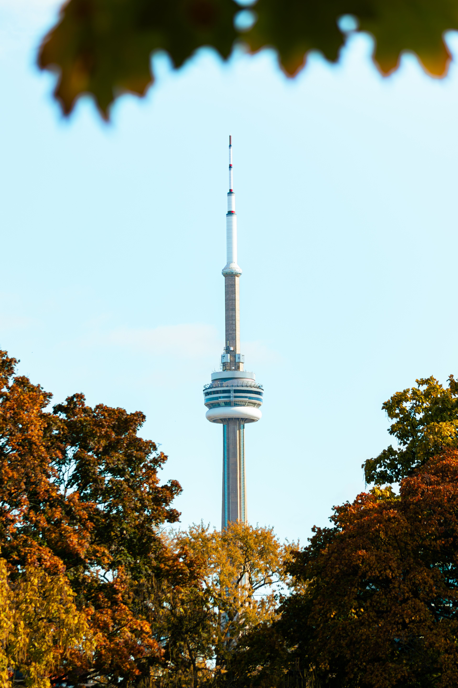

**Ожидаемый результат**

Фотографии, в которых город ощущается далёким и немного чужим, а тёплая осенняя природа на переднем плане передаёт чувство укрытия от городской суеты.

---

### 3. Общая концепция серии

Пять идей раскрывают одну тему с разных визуальных сторон:

1. «Золотой коридор» — привлекает внимание и приглашает зрителя войти в пространство парка.
2. «Осень, растворённая в отражении» — показывает осенний парк через воду, рябь и живописное растворение цвета.
3. «Мир глазами одного листа» — раскрывает окружающую среду через точку зрения маленькой природной детали.
4. «Время для себя» — передаёт эмоциональную ценность отдыха на природе.
5. «Тёплая природа, далёкий город» — строит эмоциональный контраст между уютом осеннего парка и удалённостью городской среды.

Вместе эти идеи позволяют создать визуально разнообразную серию, в которой сочетаются пейзажная фотография, художественное наблюдение и туристическая коммуникация.
