# Natural Language Processing and LLMs Lecture 03: Text Classification and Artificial Neural Networks (CNNs)<!-- omit in toc -->

Valentin Malykh, MWS AI

Autumn 2026

The course is delivered at MIPT, HSE (Moscow), ITMO (Saint Petersburg), and IITU (Almaty)

- [1 Text Classification](#1-text-classification)
  - [Applications](#applications)
  - [HuffPost News Category Dataset](#huffpost-news-category-dataset)
  - [Procedure](#procedure)
  - [Text preprocessing](#text-preprocessing)
  - [Stop words](#stop-words)
  - [Feature extraction (Bag of Words)](#feature-extraction-bag-of-words)
  - [Weighting of words in document vectors](#weighting-of-words-in-document-vectors)
  - [Algorithms](#algorithms)
  - [Further topics](#further-topics)
- [2 Artificial neural networks (ANNs)](#2-artificial-neural-networks-anns)
  - [Limitation of linear classifiers](#limitation-of-linear-classifiers)
  - [Exclusive-or function](#exclusive-or-function)
  - [Artificial Neural networks (ANNs)](#artificial-neural-networks-anns)
  - [Neuron](#neuron)
  - [Neuron, myelinated axon, and the signal flow](#neuron-myelinated-axon-and-the-signal-flow)
- [3 Multilayer perceptron (MLP)](#3-multilayer-perceptron-mlp)
  - [Multilayer perceptron](#multilayer-perceptron)
    - [Perceptron – simplest artificial neuron](#perceptron--simplest-artificial-neuron)
    - [Improved perceptron – logistic regression](#improved-perceptron--logistic-regression)
    - [From linear classifier to non-linear classifier](#from-linear-classifier-to-non-linear-classifier)
    - [Multilayer perceptrons](#multilayer-perceptrons)
    - [Activation functions](#activation-functions)
    - [Fully connected layers](#fully-connected-layers)
    - [Output layer](#output-layer)
  - [Backpropagation](#backpropagation)
    - [Recap: Gradient Descent](#recap-gradient-descent)
    - [Univariate Chain Rule](#univariate-chain-rule)
    - [Multivariate Chain Rule](#multivariate-chain-rule)
    - [Backpropagation](#backpropagation-1)
    - [Computational Cost](#computational-cost)
    - [Backpropagation](#backpropagation-2)
  - [Capacity of multilayer perceptron](#capacity-of-multilayer-perceptron)
- [4 Convolutional neural networks (CNNs)](#4-convolutional-neural-networks-cnns)
  - [Bag of words](#bag-of-words)
    - [An Example Prediction Problem: Sentence Classification](#an-example-prediction-problem-sentence-classification)
    - [A First Try: Bag of Words (BOW)](#a-first-try-bag-of-words-bow)
    - [Build It, Break It](#build-it-break-it)
    - [Continuous Bag of Words (CBOW)](#continuous-bag-of-words-cbow)
    - [Deep CBOW](#deep-cbow)
    - [What do Our Vectors Represent?](#what-do-our-vectors-represent)
  - [Handling Combinations](#handling-combinations)
    - [Bag of n-grams](#bag-of-n-grams)
    - [Why Bag of n-grams?](#why-bag-of-n-grams)
    - [What Problems w/ Bag of n-grams?](#what-problems-w-bag-of-n-grams)
  - [Convolutional Neural Networks](#convolutional-neural-networks)
    - [1-dimensional Convolutions / Time-delay Networks](#1-dimensional-convolutions--time-delay-networks)
    - [2-dimensional Convolutional Networks](#2-dimensional-convolutional-networks)
    - [CNNs for Text (Collobert and Weston 2011)](#cnns-for-text-collobert-and-weston-2011)
    - [CNNs for Sentence Modeling](#cnns-for-sentence-modeling)
    - [Standard conv2d Function](#standard-conv2d-function)
    - [Padding](#padding)
    - [Striding](#striding)
    - [Pooling](#pooling)
    - [Stacked Convolution](#stacked-convolution)
  - [Non-linear Activation Functions](#non-linear-activation-functions)
    - [Non-linear Functions](#non-linear-functions)
  - [An example](#an-example)
    - [A 1D convolution for text](#a-1d-convolution-for-text)
    - [1D convolution for text with padding](#1d-convolution-for-text-with-padding)
    - [3 channel 1D convolution with padding = 1](#3-channel-1d-convolution-with-padding--1)
    - [conv1d, padded with max pooling over time](#conv1d-padded-with-max-pooling-over-time)
    - [conv1d, padded with ave pooling over time](#conv1d-padded-with-ave-pooling-over-time)
    - [Other less useful notions: stride = 2](#other-less-useful-notions-stride--2)
    - [Less useful: local max pool, stride = 2](#less-useful-local-max-pool-stride--2)
    - [conv1d, k-max pooling over time, k = 2](#conv1d-k-max-pooling-over-time-k--2)
- [5 Convolutional Networks for Text Classification](#5-convolutional-networks-for-text-classification)
  - [Single Layer CNN for Sentence Classification](#single-layer-cnn-for-sentence-classification)
  - [Single Layer CNN for Sentence Classification](#single-layer-cnn-for-sentence-classification-1)
  - [Single layer CNN](#single-layer-cnn)
  - [Single Layer CNN for Sentence Classification](#single-layer-cnn-for-sentence-classification-2)
  - [Experiments](#experiments)
- [6 Neural Networks Tips and Tricks](#6-neural-networks-tips-and-tricks)
  - [We have models with many params! Regularization!](#we-have-models-with-many-params-regularization)
  - [Dropout](#dropout)
  - [Vectorization](#vectorization)
  - [Non-linearities: The starting points](#non-linearities-the-starting-points)
  - [Non-linearities: The new world order](#non-linearities-the-new-world-order)
  - [Which Non-linearity Should I Use?](#which-non-linearity-should-i-use)
  - [Parameter Initialization](#parameter-initialization)
  - [Optimizers](#optimizers)
  - [Learning Rates](#learning-rates)
- [Content](#content)


## 1 Text Classification

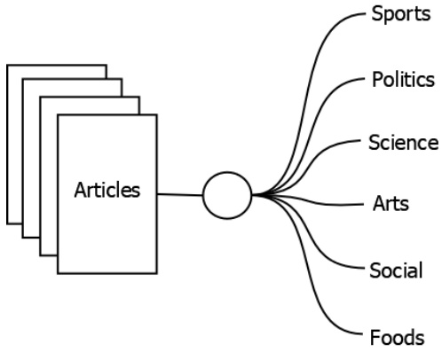

<details>
<summary>flowchart</summary>

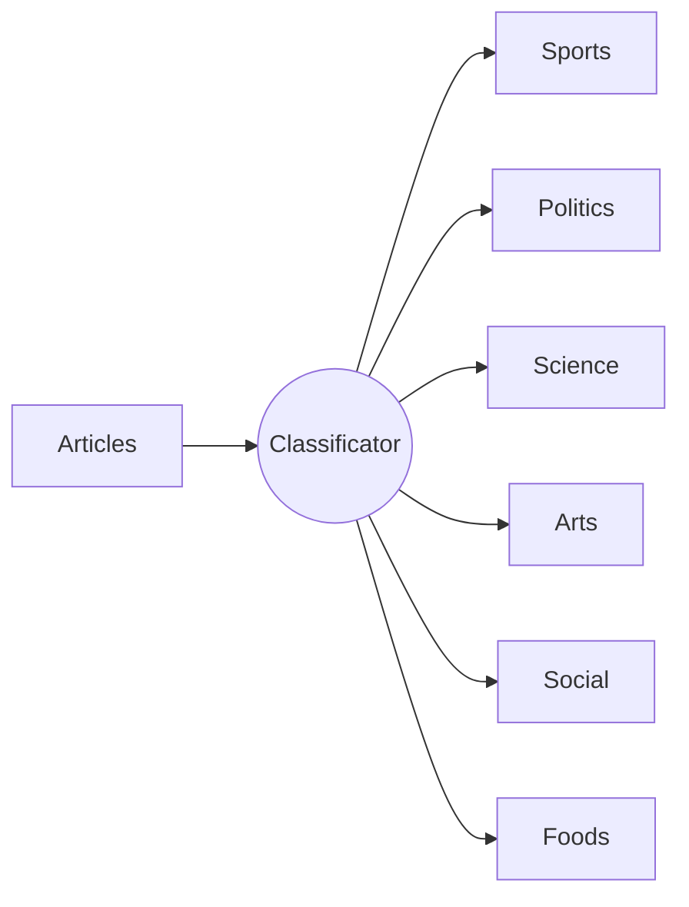
</details>

---

### Applications

- Junk email filtering
- News topic classification
- Authorship attribution
- Sentiment analysis
- Genre classification
- Offensive language identification
- Language identification

---

### HuffPost News Category Dataset

This dataset contains around 200k news headlines from the year 2012 to 2018 obtained from HuffPost.

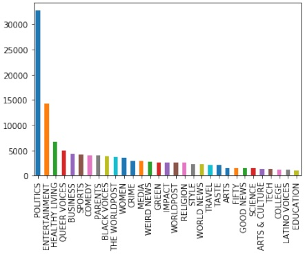

<details>
<summary>bar</summary>

| Category | Value |
| --- | --- |
| POLITICS | ~32500 |
| ENTERTAINMENT | ~14500 |
| HEALTHYALVING | ~7000 |
| QUEER VOICES | ~5200 |
| BUSINESS | ~4500 |
| SPORTS | ~4300 |
| COMEDY | ~4200 |
| PARENTS | ~4100 |
| BLACK VOICES | ~4000 |
| THE WORLDPOST | ~3900 |
| WOMEN | ~3800 |
| CRIME | ~3500 |
| MEDIA | ~3200 |
| WEIRD NEWS | ~3000 |
| GREEN | ~2800 |
| IMPACT | ~2700 |
| WORLDPOST | ~2700 |
| RELIGION | ~2700 |
| STYLE | ~2500 |
| WORLD NEWS | ~2400 |
| TRAVEL | ~2300 |
| TASTE | ~2200 |
| ARTS | ~1800 |
| FIFTY | ~1600 |
| GOOD NEWS | ~1500 |
| SCIENCE | ~1500 |
| ARTS & CULTURE | ~1400 |
| TECH | ~1300 |
| COLLEGE | ~1200 |
| LATINO VOICES | ~1100 |
| EDUCATION | ~1000 |
</details>

> https://www.kaggle.com/rmisra/news-category-dataset

---

Sneak peek of the news dataset — fields: `authors, category, date, headline, short_description`:

| authors | category | date | headline | short_description |
| --- | --- | --- | --- | --- |
|  | ENTERTAINMENT | 2014-10-09 | Eek! Mario Lopez Admits He Never Loved Ex-Wife... |  |
| Sarah Ruiz-Grossman | BLACK VOICES | 2018-04-06 | Protesters Demand Justice For Sa-heed Vassell, ... | “They murdered my son, and I want justice,” hi... |
| Lee Moran | CRIME | 2016-02-26 | Police Hunt For Man Traveling The Midwest And ... | The suspect, who is bald, reportedly has taken... |
| Michael Carosone | QUEER VOICES | 2014-09-07 | She Inspired Me: My Tribute to Joan Rivers | I never met Joan Rivers; I always wanted to, b... |
| Amanda Pena | STYLE | 2017-11-08 | 21 Affordable Holiday Gifts That Look Really E... | Our idea of luxury won’t break the bank. |
| Zahara Hill | BLACK VOICES | 2017-03-06 | Viola Davis Gives (Another) Moving Speech As H... | “I want people to be seen. I want them to feel... |

---

### Procedure

- Text preprocessing
- Feature extraction
- Model training
- Model application
- Evaluation

---

### Text preprocessing

- Text cleaning (removing HTML/XML tags, figures, formulas, etc.)
- Removing stop words
- Tokenization
- Stemming

---

### Stop words

- A stop word is a commonly used word (such as “the”, “a”, “an”, “in”).

- Stop words are not helpful for text classification because they occur in almost all documents.

- Stop words are normally removed before applying a text classification algorithm.

---

### Feature extraction (Bag of Words)

- Each document is represented as a vector in order to apply a classification algorithm.

- Each dimension of the input vector is called a feature.

- In text classification, the most straightforward idea is to use words as features.

| doc_id | book | read | music | go |
| --- | --- | --- | --- | --- |
| doc1 | 3 | 1 | 0 | 5 |
| doc2 | 2 | 5 | 3 | 0 |
| doc3 | 0 | 0 | 7 | 2 |

---

### Weighting of words in document vectors

- **Term** - a word or a collocation.

- **Document** - a sequence of terms.

- **Corpus** - a set of documents.

---

**Boolean weighting:** $w_{ik} = \begin{cases} 1 &\text{if}\quad f_{ik} > 0\\ 0 &\text{Otherwise} \end{cases}$  
**Word frequency weighting:** $w_{ik} = f_{ik}$  
**TF-IDF weighting:** $w_{ik}=f_{ik}\times\log\dfrac{N}{n_i}$  

- $i$: word index  
- $k$: document index  
- $f_{ik}$ : word frequency in a document  
- $N$: number of documents in the corpus  
- $n_{i}$ : number of documents containing the word  

---

- TF-IDF - short for term frequency–inverse document frequency, is a numerical statistic that is intended to reflect how important a word is to a document in a collection or corpus.

- The assumption behind the use of the inverse document frequency is: the more documents where a word (term) occurs, the less important the word is to that document.

- TF-IDF is proposed in information retrieval but also used in other areas including NLP.

- Which word weighting method is the best for text classification: no universal answer. It empirically depends on the data and the classification algorithm you use.

---

### Algorithms

- Logistic regression
- Nearest neighbor
- Decision trees
- Support vector machines
- Neural networks

---

### Further topics

- Feature selection

- Dimension reduction

- Document embeddings

---

## 2 Artificial neural networks (ANNs)

### Limitation of linear classifiers

- Logistic regression is a linear classifier, which means its decision boundary is a hyperplane:

Decision Boundary Hyperplane

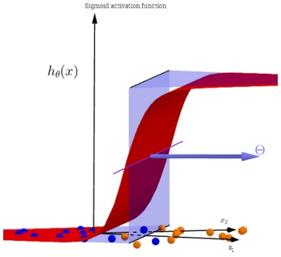

> Figure source: https://stats.stackexchange.com/questions/291492/

---

- However, some classification problems are not linearly separable:

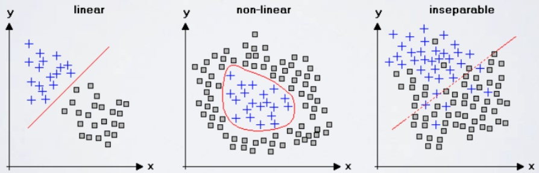

> Figure source: http://dingyancs.blogspot.com/2017/10/mle-linear-classification.html

---

### Exclusive-or function

- A typical linearly-inseparable problem is the exclusive-or function:

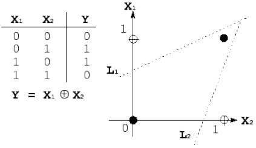

> Figure source: http://www.ece.utep.edu/research/webfuzzy/docs/kk-thesis/kk-thesis-html/node19.html

---

### Artificial Neural networks (ANNs)

- Neural networks (NNs), or artificial neural networks (ANNs), provide an efficient way to solve non-linearly separable problems.  

- Artificial neural networks (ANNs) or connectionist systems are computing systems vaguely inspired by the biological neural networks that constitute animal brains. — Wikipedia

  - An ANN is based on a collection of connected units or nodes called artificial neurons, which loosely model the neurons in a biological brain.  
  
  - Each connection, like the synapses in a biological brain, can transmit a signal to other neurons.  
  
  - An artificial neuron that receives a signal then processes it and can signal neurons connected to it.

---

### Neuron

Structure of a neuron

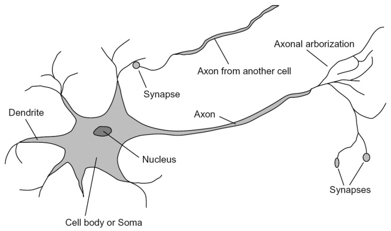

---

### Neuron, myelinated axon, and the signal flow

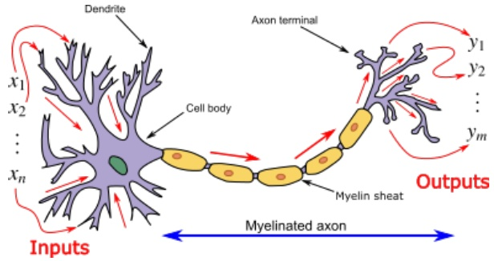

Neuron and myelinated axon, with signal flow from inputs at dendrites to outputs at axon terminals

> By Egm4313.s12 (Prof. Loc Vu-Quoc) - Own work, CC BY-SA 4.0, https://commons.wikimedia.org/w/index.php?curid=72816083

---

## 3 Multilayer perceptron (MLP)

- Multilayer perceptron

- Backpropagation

- Capacity of multilayer perceptron

---

### Multilayer perceptron

#### Perceptron – simplest artificial neuron

$$
f(x) = \begin{cases} 
  0, & \text{if}\quad\sum_{i} w_{i}x_{i} + b \leq 0 \\
  1, & \text{otherwise} 
\end{cases}
$$

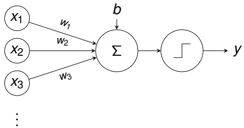

<details>
<summary>flowchart</summary>

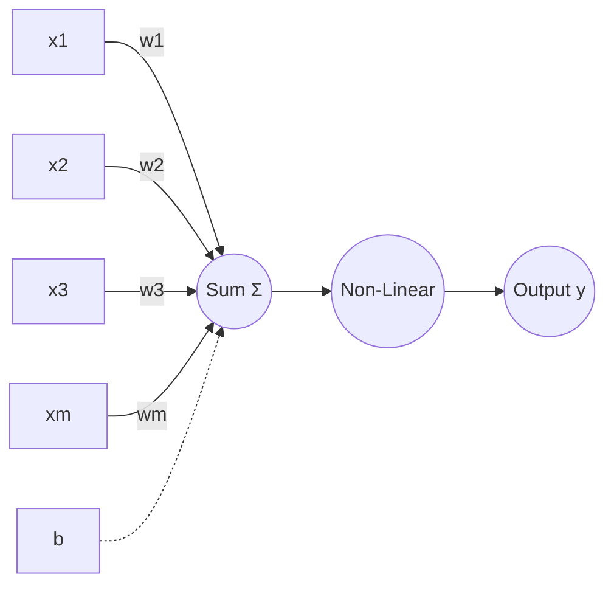
</details>

---

#### Improved perceptron – logistic regression

- Perceptron is also an effective linear classifier but we cannot apply the gradient descent algorithm to train it.  

- Logistic regression can be regarded as an improved version of perceptron to which gradient descent training can be applied.

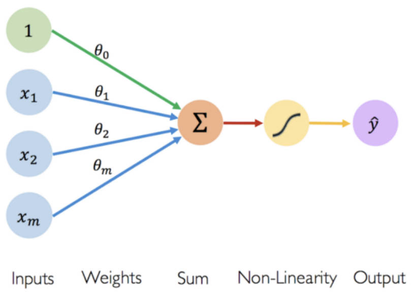

Activation Functions

$$
\hat {y} = g (\theta_{0} + \boldsymbol {X}^{T} \boldsymbol {\theta})
$$

• Example: sigmoid function

$$
g(z) = \sigma(z) = \frac{1}{1 + e^{-z}}
$$

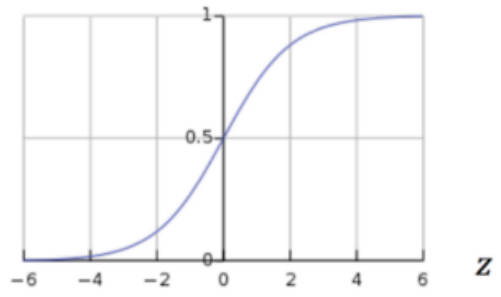

> MIT: Alexander Amini, 2018 introtodeeplearning.com

---

#### From linear classifier to non-linear classifier

- Perceptrons (including logistic regression classifiers) are linear classifiers, which do not work for non-linearly separable problems.

- Multilayer perceptrons are proposed to solve non-linearly separable problems.

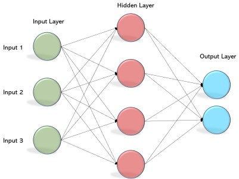

> Figure source: https://becominghuman.ai/multi-layer-perceptron-mlp-models-on-real-world-banking-data-f6dd3d7e998f

---

#### Multilayer perceptrons

- An MLP consists of at least three layers of nodes: an input layer, a hidden layer and an output layer.  

- Except for the input nodes, each node is a neuron that uses a nonlinear activation function.  

- MLP utilizes a supervised learning technique called backpropagation for training.  

- Its multiple layers and non-linear activation distinguish MLP from a linear perceptron.  

- It can distinguish data that is not linearly separable.  

---

#### Activation functions

Logistic: $f(x) = \dfrac {1}{1 + e ^ {- x}}$

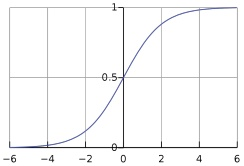

Hyperbolic tangent: $f(x) = \dfrac{e^{x} - e^{-x}}{e^{x} + e^{-x}}$

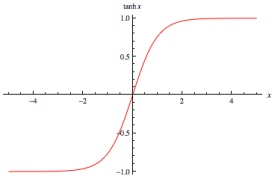

Rectifier: $f (x) = \max (0, x)$

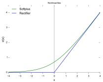

---

#### Fully connected layers

- The MLP consists of three or more layers (an input and an output layer with one or more hidden layers) of nonlinearly-activating nodes.  

- Since MLPs are fully connected, each node in one layer connects with a certain weight $w _ { i i }$ to every node in the following layer.

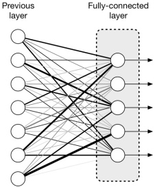

> Figure source: https://mc.ai/fully-connected-layer-with-dynamic-input-shape/

---

#### Output layer

- The output layer may use activation functions that differ from those of the hidden layers, depending on the nature of the task.  

- For classification problems, typically, a softmax function is used in the output layer.

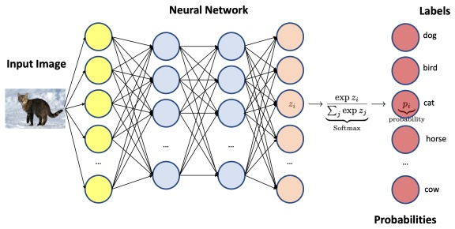

Figure source: https://gab41.lab41.org/entropic-ghosts-35670292bc87

---

### Backpropagation

#### Recap: Gradient Descent

- Recall: gradient descent moves opposite the gradient (the direction of steepest descent)

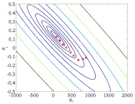

- Weight space for a multilayer neural net: one coordinate for each weight or bias of the network, in all the layers

- Conceptually, not any different from what we’ve seen so far — just higher dimensional and harder to visualize!

- We want to compute the cost gradient dE/dw, which is the vector of partial derivatives.

  - This is the average of dL/dw over all the training examples, so in this lecture we focus on computing dL/dw.

> A figure from: Roger Grosse, University of Toronto CSC321 (2019), Lecture 6: Backpropagation

---

#### Univariate Chain Rule

- We’ve already been using the univariate Chain Rule.  

- Recall: if $f(x)$ and $x(t)$ are univariate functions, then

$$
\frac {d}{d t} f (x (t)) = \frac {d f}{d x} \frac {d x}{d t}
$$

---

- Consider a univariate logistic least squares model:

$$
z = w x + b \quad y = \sigma (z) \quad L = \frac {1}{2} (y - t) ^ {2}
$$

- Let’s compute the loss derivatives.

---

How you would have done it in calculus class:

$$
L = \frac {1}{2} \big (\sigma (w x + b) - t \big) ^2
$$

$$
\frac {\partial L}{\partial b} = \frac {\partial}{\partial  b} \frac {1}{2} (\sigma (w x + b) - t) ^ {2} = (\sigma (w x + b) - t) \sigma^ {\prime} (w x + b),
$$

$$
\frac {\partial L}{\partial w} = \frac {\partial}{\partial w} \frac {1}{2} (\sigma (w x + b) - t) ^ {2} = (\sigma (w x + b) - t) \sigma^ {\prime} (w x + b) x
$$

- What are the disadvantages of this approach?

---

A more structured way to do it:

Computing the loss:

$$
\begin{split}
  z &= w x + b\\
  y &= \sigma (z)\\
  L &= \frac {1}{2} (y - t) ^ {2}
\end{split}
$$

Computing the derivatives:

$$
\begin{split}
  \frac {d L}{d y} &= y - t\\
  \frac {d L}{d z} &= \frac {d L}{d y} \sigma^ {\prime} (z)\\
  \frac {\partial L}{\partial w} &= \frac {d L}{d z} x\\
  \frac {\partial L}{\partial b} &= \frac {d L}{d z}\\
\end{split}

$$

- Remember, the goal isn’t to obtain closed-form solutions, but to be able to write a program that efficiently computes the derivatives.

---

- We can diagram out the computations using a computation graph.  

- The nodes represent all the inputs and computed quantities, and the edges represent which nodes are computed directly as a function of which other nodes.

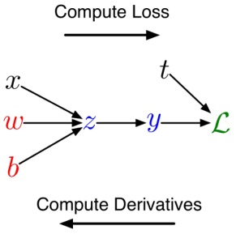

> A figure from: Roger Grosse, University of Toronto CSC321 (2019), Lecture 6: Backpropagation

---

A convenient notation:

- Use $\bar { y }$ to denote the derivative $\frac { d L } { d y }$ , sometimes called the error signal.  

- This emphasizes that the error signals are just values our program is computing (rather than a mathematical operation).  

- This is not a standard notation, but I couldn’t find another one that I liked.

Computing the loss:

$$
\begin{split}
  z &= w x + b\\
  y &= \sigma (z)\\
  L &= \frac {1}{2} (y - t) ^ {2}
\end{split}
$$

Computing the derivatives:

$$
\begin{split}
  \bar {y} &= y - t\\
  \bar {z} &= \bar {y} \sigma' (z)\\
  \bar {w} &= \bar {z} X\\
  \bar {b} &= \bar {z}\\
\end{split}
$$

---

#### Multivariate Chain Rule

- Problem: what if the computation graph has fan-out > 1?  

- This requires the multivariate Chain Rule!

**L2-Regularized regression**

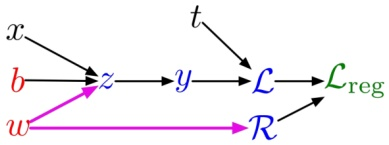

<details>
<summary>flowchart</summary>

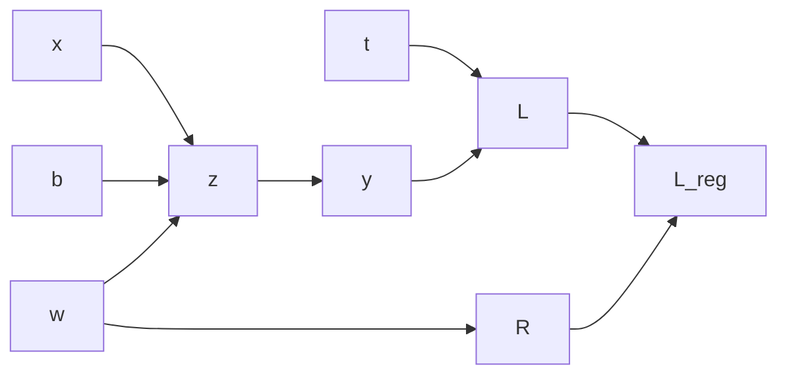
</details>

$$
\begin{split}
  z &= w x + b\\
  y &= \sigma (z)\\
  L &= \frac {1}{2} (y - t) ^ {2}\\
  R &= \frac {1}{2} w ^ {2}\\
  L_{\text {reg}} &= L + \lambda R\\
\end{split}

$$

Multiclass logistic regression

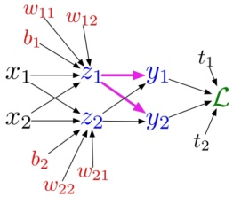

<details>
<summary>flowchart</summary>

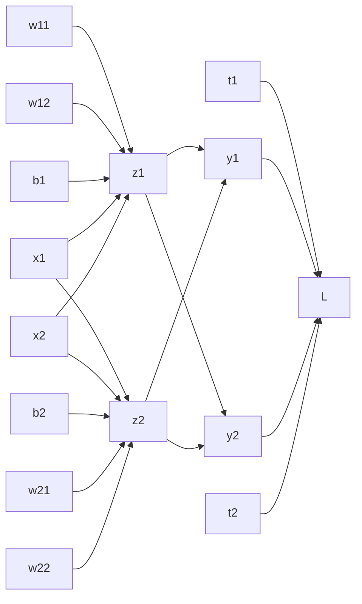
</details>

$$
\begin{split}
  z _ {\ell} &= \sum_ {j} w _ {t j} x _ {j} + b _ {\ell}\\
  y _ {k} &= \frac {e ^ {z _ {k}}}{\sum_ {\ell} e ^ {z _ {\ell}}}\\
  L &= - \sum_ {k} t _ {k} \log y _ {k}\\
\end{split}

$$

> Figures from: Roger Grosse, University of Toronto CSC321 (2019), Lecture 6: Backpropagation

---

#### Backpropagation

- Full backpropagation algorithm:  
- Let $v _ { 1 } , \ldots , v _ { N }$ be a topological ordering of the computation graph (i.e. parents come before children.)  
- $v _ { N }$ denotes the variable we’re trying to compute derivatives of (e.g. loss).

$$
\begin{split}
  \textbf{forward pass} &\left[\quad
  \begin{split}
    &\text{For}\ i = 1, \cdots, N\\
    &\quad \text{Compute } v_i \text{ as a function of } \text{Pa}(v_{i})\\
  \end{split}
  \right.\\

  \textbf{backward pass}&\left[\quad
  \begin{split}
    &\bar {v} _ {N} = 1\\
    &\text{For } i = N - 1, \cdots, 1\\
    &\quad\bar {v} _ {i} = \sum_ {j \in \operatorname{Ch} \left(v _ {i}\right)} \bar {v} _ {j} \frac {\partial v _ {j}}{\partial v _ {i}}
  \end{split}
  \right.
\end{split}
$$

---

Multilayer Perceptron (multiple outputs):

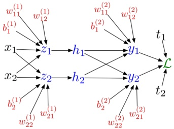

Forward pass:

$$
\begin{split}
  z _ {i} &= \sum_ {j} w _ {i j} ^ {(1)} x _ {j} + b _ {i} ^ {(1)}\\
  h _ {i} &= \sigma (z _ {i})\\
  y _ {k} &= \sum_ {i} w _ {k i} ^ {(2)} h _ {i} + b _ {k} ^ {(2)}\\
  L &= \frac {1}{2} \sum_ {k} (y _ {k} - t _ {k}) ^ {2}
\end{split}
$$

Backward pass:

$$
\begin{split}
  \bar {L} &= 1\\
  \bar {y} _ {k} &= \bar {L} (y _ {k} - t _ {k})\\
  \bar {w} _ {k i} ^ {(2)} &= \bar {y} _ {k} h _ {i}\\
  \overline {b} _ {k} ^ {(2)} &= \bar {y} _ {k}\\
  \bar {h} _ {i} &= \sum_ {k} \bar {y} _ {k} w _ {k i} ^ {(2)}\\
  \bar {z} _ {i} &= \bar {h} _ {i} \sigma^ {\prime} (z _ {i})\\
  \bar {w} _ {i j} ^ {(1)} &= \bar {z} _ {i} x _ {j}\\
  \bar {b} _ {i} ^ {(1)} &= \bar {z} _ {i}
\end{split}
$$

> A figure from: Roger Grosse, University of Toronto CSC321 (2019), Lecture 6: Backpropagation

---

In vectorized form:

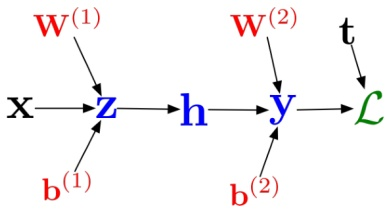

<details>
<summary>flowchart</summary>

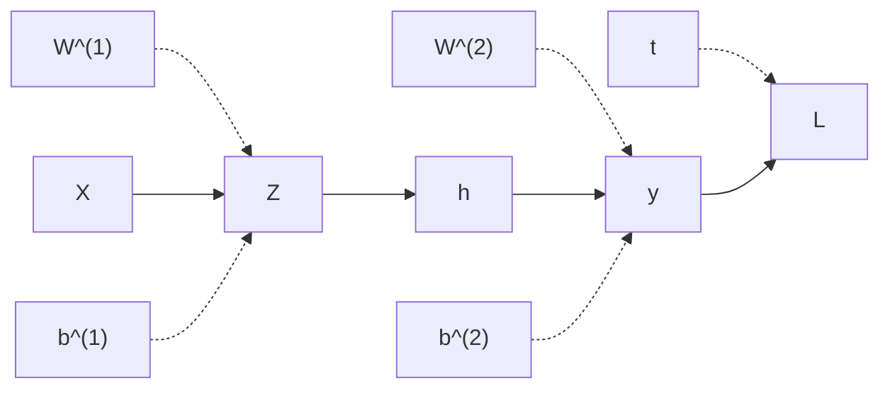
</details>

Forward pass:

$$
\begin{split}
  z &= W ^ {(1)} x + b ^ {(1)}\\
  h &= \sigma (z)\\
  y &= W ^ {(2)} h + b ^ {(2)}\\
  L &= \frac {1}{2} \| t - y \| ^ 2
\end{split}
$$

Backward pass:

$$
\begin{split}
  \bar {L} &= 1\\
  \bar {y} &= \bar {L} (y - t)\\
  \bar {W} ^ {(2)} &= \bar {y} h ^ {\top}\\
  \bar {b} ^ {(2)} &= \bar {y}\\
  \bar {h} &= W ^ {(2) \top} \bar {y}\\
  \bar {z} &= \bar {h} \circ \sigma^ {\prime} (z)\\
  \bar {W} ^ {(1)} &= \bar {z} x ^ {\top}\\
  \bar {b} ^ {(1)} &= \bar {z}
\end{split}
$$

> A figure from: Roger Grosse, University of Toronto CSC321 (2019), Lecture 6: Backpropagation

---

Backprop as message passing:

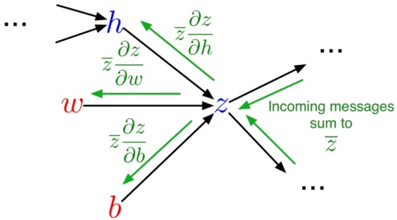

- Each node receives a bunch of messages from its children, which it aggregates to get its error signal. It then passes messages to its parents.  

- This provides modularity, since each node only has to know how to compute derivatives with respect to its arguments, and doesn’t have to know anything about the rest of the graph.

> A figure from: Roger Grosse, University of Toronto CSC321 (2019), Lecture 6: Backpropagation

---

#### Computational Cost

- Computational cost of forward pass: one add-multiply operation per weight

$$
z _ {i} ^ {(1)} = \sum_ {j} w _ {i j} ^ {(1)} x _ {j} + b _ {i} ^ {(1)}
$$

- Computational cost of backward pass: two add-multiply operations per weight

$$
\bar {w} _ {k i} ^ {(2)} = \bar {y} _ {k} h _ {i} \quad \bar {h} _ {i} = \sum_ {k} \bar {y} _ {k} w _ {k i} ^ {(2)}
$$

- Rule of thumb: the backward pass is about as expensive as two forward passes.

- For a multilayer perceptron, this means the cost is linear in the number of layers, quadratic in the number of units per layer.

---

#### Backpropagation

- Backprop is used to train the overwhelming majority of neural nets today.

- Even optimization algorithms much fancier than gradient descent (e.g. second-order methods) use backprop to compute the gradients.

- Despite its practical success, backprop is believed to be neurally implausible.

  - No evidence for biological signals analogous to error derivatives.

  - All the biologically plausible alternatives we know about learn much more slowly (on computers).

- So how on earth does the brain learn?

---

### Capacity of multilayer perceptron

Topics: single hidden layer neural network

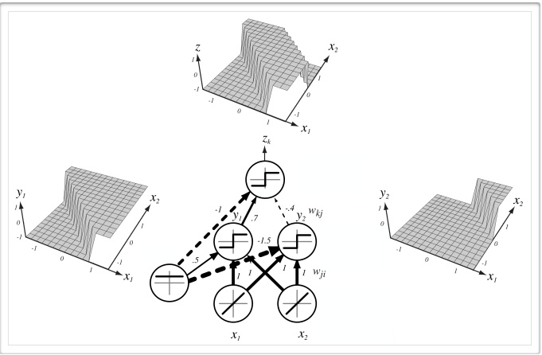

> (from Pascal Vincent’s slides), Hugo Larochelle, Neural Networks, at Deep Learning Summer School 2016

---

Topics: single hidden layer neural network

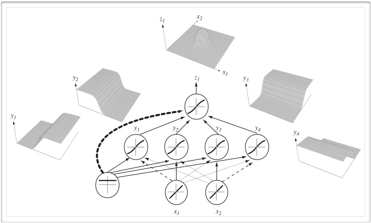

> (from Pascal Vincent’s slides), Hugo Larochelle, Neural Networks, at Deep Learning Summer School 2016

---

Topics: single hidden layer neural network

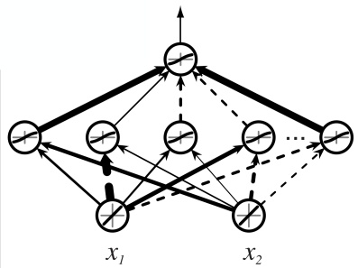

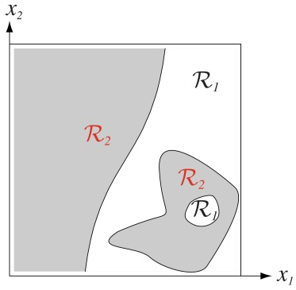

> (from Pascal Vincent’s slides), Hugo Larochelle, Neural Networks, at Deep Learning Summer School 2016

---

**Universal approximation theorem (Hornik, 1991)**

“a single hidden layer neural network with a linear output unit can approximate any continuous function arbitrarily well, given enough hidden units”

- The result applies for sigmoid, tanh and many other hidden layer activation functions

- This is a good result, but it doesn’t mean there is a learning algorithm that can find the necessary parameter values!

## 4 Convolutional neural networks (CNNs)

- Bag of words

- Handling Combinations

- Convolutional Neural Networks

- Non-linear Activation Functions

- An example

---

### Bag of words

#### An Example Prediction Problem: Sentence Classification

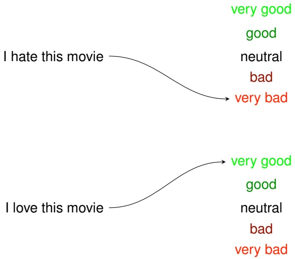

---

#### A First Try: Bag of Words (BOW)

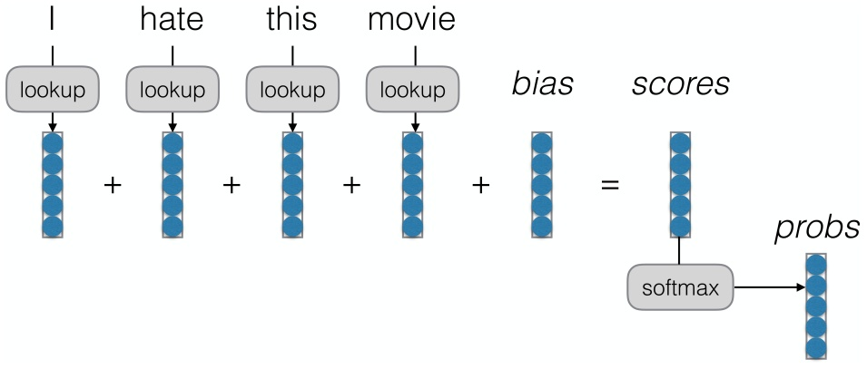

> A figure from Graham Neubig’s CS11-747 Neural Networks for NLP at CMU, 2019

---

#### Build It, Break It

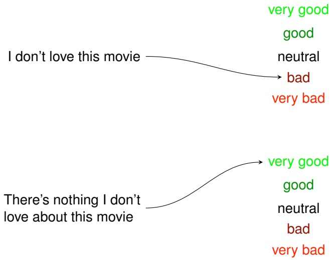

---

#### Continuous Bag of Words (CBOW)

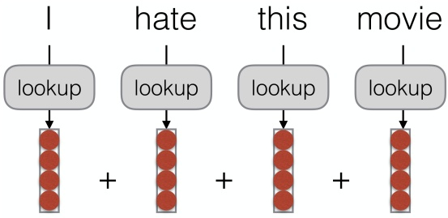

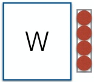

> A figure from Graham Neubig’s CS11-747 Neural Networks for NLP at CMU, 2019

---

#### Deep CBOW

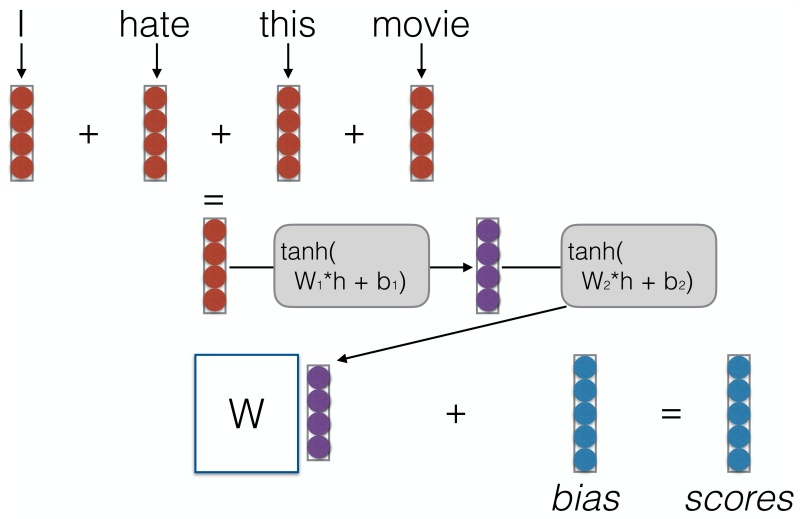

> A figure from Graham Neubig’s CS11-747 Neural Networks for NLP at CMU, 2019

---

#### What do Our Vectors Represent?

- We can learn feature combinations (a node in the second layer might be “feature 1 AND feature 5 are active”)
  
  - e.g. capture things such as “not” AND “hate”

- BUT! Cannot handle “not hate”

---

### Handling Combinations

#### Bag of n-grams

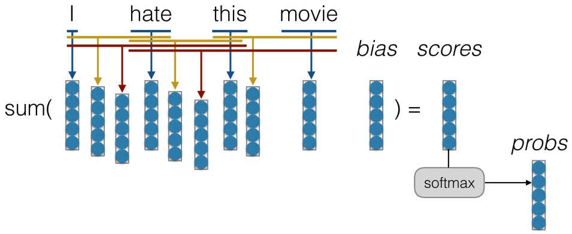

> A figure from Graham Neubig’s CS11-747 Neural Networks for NLP at CMU, 2019

---

#### Why Bag of n-grams?

- Allow us to capture combination features in a simple way “don’t love”, “not the best”  
  
- Works pretty well

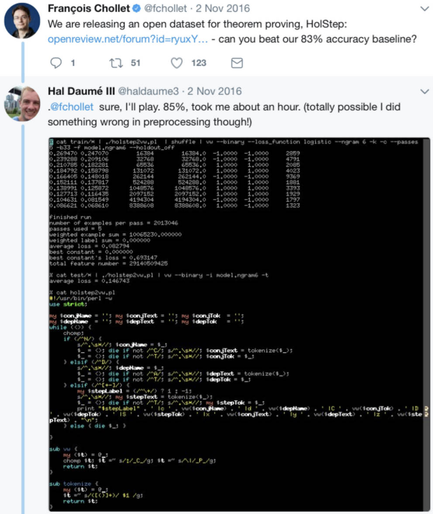

---

#### What Problems w/ Bag of n-grams?

- Same as before: parameter explosion

- No sharing between similar words/n-grams

---

### Convolutional Neural Networks

#### 1-dimensional Convolutions / Time-delay Networks

(Waibel et al. 1989)

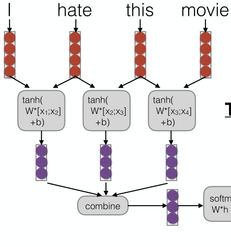

These are soft 2-grams!

> A figure from Graham Neubig’s CS11-747 Neural Networks for NLP at CMU, 2019

---

#### 2-dimensional Convolutional Networks

(LeCun et al. 1997)

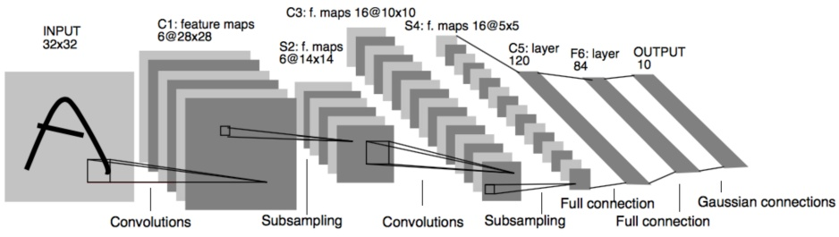

Parameter extraction performs a 2D sweep, not 1 D

---

#### CNNs for Text (Collobert and Weston 2011)

- Generally based on 1 D convolutions

- But often uses terminology/functions borrowed from image processing for historical reasons

- Two main paradigms:

  - Context window modeling: For tagging, etc. get the surrounding context before tagging  
  
  - Sentence modeling: Do convolution to extract n-grams, pooling to combine over whole sentence

#### CNNs for Sentence Modeling

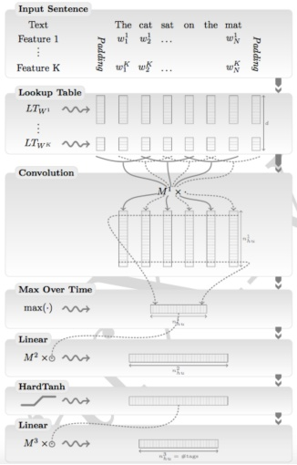

(Collobert and Weston 2011)

---

#### Standard conv2d Function

- 2D convolution function takes input + parameters

- Input: 3D tensor
  - rows (e.g. words), columns, features (“channels”)

- Parameters/Filters: 4D tensor
  - rows, columns, input features, output features

---

#### Padding

- After convolution, the rows and columns of the output tensor are either

  - = to rows/columns of input tensor (“same” convolution)  
  - = to rows/columns of input tensor minus the size of the filter plus one (“valid” or “narrow”)  
  - = to rows/columns of input tensor plus filter minus one (“wide”)

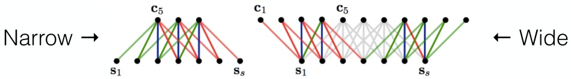

> Image: Kalchbrenner et al. 2014

---

#### Striding

- Skip some of the outputs to reduce length of extracted feature vector

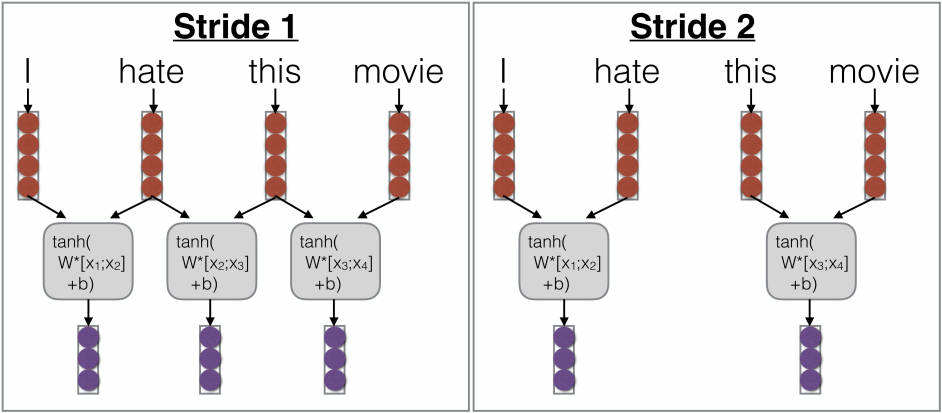

> A figure from Graham Neubig’s CS11-747 Neural Networks for NLP at CMU, 2019

---

#### Pooling

- Pooling is like convolution, but calculates some reduction function feature-wise

- Max pooling: “Did you see this feature anywhere in the range?” (most common)
Average pooling: “How prevalent is this feature over the entire range”

- k-Max pooling: “Did you see this feature up to k times?”

- Dynamic pooling: “Did you see this feature in the beginning? In the middle? In the end?”

---

#### Stacked Convolution

- Feeding in convolution from previous layer results in larger area of focus for each feature

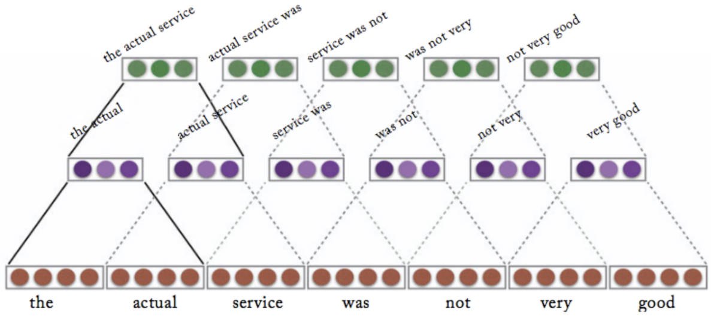

> Image Credit: Goldberg Book

---

### Non-linear Activation Functions

#### Non-linear Functions

- Proper choice of a non-linear function is essential in stacked networks

- Functions such as RelU or softplus allegedly better at preserving gradients

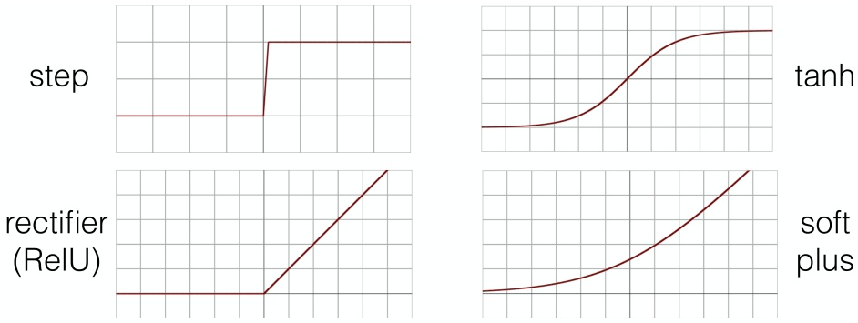

> Image: Wikipedia

---

### An example


<details>
<summary>seal</summary>

Stanford University
S
NLP
Natural Language Processing
</details>

#### A 1D convolution for text

|     |     |     |     |     |
| --- | --- | --- | --- | --- |
| tentative | 0.2 | 0.1 | -0.3 | 0.4 |
| deal | 0.5 | 0.2 | -0.3 | -0.1 |
| reached | -0.1 | -0.3 | -0.2 | 0.4 |
| to | 0.3 | -0.3 | 0.1 | 0.1 |
| keep | 0.2 | -0.3 | 0.4 | 0.2 |
| government | 0.1 | 0.2 | -0.1 | -0.1 |
| open | -0.4 | -0.4 | 0.2 | 0.3 |

|     |     |
| --- | --- |
| t,d,r | -1.0 |
| d,r,t | -0.5 |
| r,t,k | -3.6 |
| t,k,g | -0.2 |
| k,g,o | 0.3 |

Apply a **filter** (or **kernel**) of size 3

|   |   |   |   |
| --- | --- | --- | --- |
| 3 | 1 | 2 | -3 |
| -1 | 2 | 1 | -3 |
| 1 | 1 | -1 | 1 |

10

> Christopher Manning, Natural Language Processing with Deep Learning, Stanford U. CS224n

---

#### 1D convolution for text with padding

|     |     |     |     |     |
| --- | --- | --- | --- | --- |
| ∅ | 0.0 | 0.0 | 0.0 | 0.0 |
| tentative | 0.2 | 0.1 | -0.3 | 0.4 |
| deal | 0.5 | 0.2 | -0.3 | -0.1 |
| reached | -0.1 | -0.3 | -0.2 | 0.4 |
| to | 0.3 | -0.3 | 0.1 | 0.1 |
| keep | 0.2 | -0.3 | 0.4 | 0.2 |
| government | 0.1 | 0.2 | -0.1 | -0.1 |
| open | -0.4 | -0.4 | 0.2 | 0.3 |
| ∅ | 0.0 | 0.0 | 0.0 | 0.0 |

|     |     |
| --- | --- |
| ∅,t,d | -0.6 |
| t,d,r | -1.0 |
| d,r,t | -0.5 |
| r,t,k | -3.6 |
| t,k,g | -0.2 |
| k,g,o | 0.3 |
| g,o,∅ | -0.5 |

Apply a **filter** (or **kernel**) of size 3

|   |   |   |    |
| --- | --- | --- | --- |
| 3 | 1 | 2 | -3 |
| -1 | 2 | 1 | -3 |
| 1 | 1 | -1 | 1 |

11

> Christopher Manning, Natural Language Processing with Deep Learning, Stanford U. CS224n

---

#### 3 channel 1D convolution with padding = 1

|   |   |   |   |   |
| --- | --- | --- | --- | --- |
| ∅ | 0.0 | 0.0 | 0.0 | 0.0 |
| tentative | 0.2 | 0.1 | -0.3 | 0.4 |
| deal | 0.5 | 0.2 | -0.3 | -0.1 |
| reached | -0.1 | -0.3 | -0.2 | 0.4 |
| to | 0.3 | -0.3 | 0.1 | 0.1 |
| keep | 0.2 | -0.3 | 0.4 | 0.2 |
| government | 0.1 | 0.2 | -0.1 | -0.1 |
| open | -0.4 | -0.4 | 0.2 | 0.3 |
| ∅ | 0.0 | 0.0 | 0.0 | 0.0 |

|     |     |     |     |
| --- | --- | --- | --- |
| ∅,t,d | -0.6 | 0.2 | 1.4 |
| t,d,r | -1.0 | 1.6 | -1.0 |
| d,r,t | -0.5 | -0.1 | 0.8 |
| r,t,k | -3.6 | 0.3 | 0.3 |
| t,k,g | -0.2 | 0.1 | 1.2 |
| k,g,o | 0.3 | 0.6 | 0.9 |
| g,o,∅ | -0.5 | -0.9 | 0.1 |

Apply 3 **filters** of size 3

<table>
  <tr><td>3</td><td>1</td><td>2</td><td>-3</td><td rowspan="3"></td><td>1</td><td>0</td><td>0</td><td>1</td><td rowspan="3"></td><td>1</td><td>-1</td><td>2</td><td>-1</td></tr>
  <tr><td>-1</td><td>2</td><td>1</td><td>-3</td><td>1</td><td>0</td><td>-1</td><td>-1</td><td>1</td><td>0</td><td>-1</td><td>3</td></tr>
  <tr><td>1</td><td>1</td><td>-1</td><td>1</td><td>0</td><td>1</td><td>0</td><td>1</td><td>0</td><td>2</td><td>2</td><td>1</td></tr>
</table>

Could also use (zero)  
padding = 2  
Also called “wide convolution”

> Christopher Manning, Natural Language Processing with Deep Learning, Stanford U. CS224n

---

#### conv1d, padded with max pooling over time

|     |     |     |     |     |
| --- | --- | --- | --- | --- |
| ∅ | 0.0 | 0.0 | 0.0 | 0.0 |
| tentative | 0.2 | 0.1 | -0.3 | 0.4 |
| deal | 0.5 | 0.2 | -0.3 | -0.1 |
| reached | -0.1 | -0.3 | -0.2 | 0.4 |
| to | 0.3 | -0.3 | 0.1 | 0.1 |
| keep | 0.2 | -0.3 | 0.4 | 0.2 |
| government | 0.1 | 0.2 | -0.1 | -0.1 |
| open | -0.4 | -0.4 | 0.2 | 0.3 |
| ∅ | 0.0 | 0.0 | 0.0 | 0.0 |

|     |     |     |     |
| --- | --- | --- | --- |
| ∅,t,d | -0.6 | 0.2 | 1.4 |
| t,d,r | -1.0 | 1.6 | -1.0 |
| d,r,t | -0.5 | -0.1 | 0.8 |
| r,t,k | -3.6 | 0.3 | 0.3 |
| t,k,g | -0.2 | 0.1 | 1.2 |
| k,g,o | 0.3 | 0.6 | 0.9 |
| g,o,∅ | -0.5 | -0.9 | 0.1 |

|     |     |     |     |
| --- | --- | --- | --- |
| max p | 0.3 | 1.6 | 1.4 |


Apply 3 **filters** of size 3

<table>
  <tr><td>3</td><td>1</td><td>2</td><td>-3</td><td rowspan="3"></td><td>1</td><td>0</td><td>0</td><td>1</td><td rowspan="3"></td><td>1</td><td>-1</td><td>2</td><td>-1</td></tr>
  <tr><td>-1</td><td>2</td><td>1</td><td>-3</td><td>1</td><td>0</td><td>-1</td><td>-1</td><td>1</td><td>0</td><td>-1</td><td>3</td></tr>
  <tr><td>1</td><td>1</td><td>-1</td><td>1</td><td>0</td><td>1</td><td>0</td><td>1</td><td>0</td><td>2</td><td>2</td><td>1</td></tr>
</table>

> Christopher Manning, Natural Language Processing with Deep Learning, Stanford U. CS224n

---

#### conv1d, padded with ave pooling over time

|     |     |     |     |     |
| --- | --- | --- | --- | --- |
| ∅ | 0.0 | 0.0 | 0.0 | 0.0 |
| tentative | 0.2 | 0.1 | -0.3 | 0.4 |
| deal | 0.5 | 0.2 | -0.3 | -0.1 |
| reached | -0.1 | -0.3 | -0.2 | 0.4 |
| to | 0.3 | -0.3 | 0.1 | 0.1 |
| keep | 0.2 | -0.3 | 0.4 | 0.2 |
| government | 0.1 | 0.2 | -0.1 | -0.1 |
| open | -0.4 | -0.4 | 0.2 | 0.3 |
| ∅ | 0.0 | 0.0 | 0.0 | 0.0 |

|     |     |     |     |
| --- | --- | --- | --- |
| ∅,t,d | -0.6 | 0.2 | 1.4 |
| t,d,r | -1.0 | 1.6 | -1.0 |
| d,r,t | -0.5 | -0.1 | 0.8 |
| r,t,k | -3.6 | 0.3 | 0.3 |
| t,k,g | -0.2 | 0.1 | 1.2 |
| k,g,o | 0.3 | 0.6 | 0.9 |
| g,o,∅ | -0.5 | -0.9 | 0.1 |

|     |     |     |     |
| --- | --- | --- | --- |
| ave p | -0.87 | 0.26 | 0.53 |

Apply 3 **filters** of size 3

<table>
  <tr><td>3</td><td>1</td><td>2</td><td>-3</td><td rowspan="3"></td><td>1</td><td>0</td><td>0</td><td>1</td><td rowspan="3"></td><td>1</td><td>-1</td><td>2</td><td>-1</td></tr>
  <tr><td>-1</td><td>2</td><td>1</td><td>-3</td><td>1</td><td>0</td><td>-1</td><td>-1</td><td>1</td><td>0</td><td>-1</td><td>3</td></tr>
  <tr><td>1</td><td>1</td><td>-1</td><td>1</td><td>0</td><td>1</td><td>0</td><td>1</td><td>0</td><td>2</td><td>2</td><td>1</td></tr>
</table>

> Christopher Manning, Natural Language Processing with Deep Learning, Stanford U. CS224n

---

#### Other less useful notions: stride = 2

|     |     |     |     |     |
| --- | --- | --- | --- | --- |
| ∅ | 0.0 | 0.0 | 0.0 | 0.0 |
| tentative | 0.2 | 0.1 | -0.3 | 0.4 |
| deal | 0.5 | 0.2 | -0.3 | -0.1 |
| reached | -0.1 | -0.3 | -0.2 | 0.4 |
| to | 0.3 | -0.3 | 0.1 | 0.1 |
| keep | 0.2 | -0.3 | 0.4 | 0.2 |
| government | 0.1 | 0.2 | -0.1 | -0.1 |
| open | -0.4 | -0.4 | 0.2 | 0.3 |
| ∅ | 0.0 | 0.0 | 0.0 | 0.0 |

|     |     |     |     |
| --- | --- | --- | --- |
| ∅,t,d | -0.6 | 0.2 | 1.4 |
| d,r,t | -0.5 | -0.1 | 0.8 |
| t,k,g | -0.2 | 0.1 | 1.2 |
| g,o,∅ | -0.5 | -0.9 | 0.1 |

Apply 3 **filters** of size 3

<table>
<tr><td>3</td><td>1</td><td>2</td><td>-3</td><td rowspan="3"></td><td>1</td><td>0</td><td>0</td><td>1</td><td rowspan="3"></td><td>1</td><td>-1</td><td>2</td><td>-1</td></tr>
<tr><td>-1</td><td>2</td><td>1</td><td>-3</td><td>1</td><td>0</td><td>-1</td><td>-1</td><td>1</td><td>0</td><td>-1</td><td>3</td></tr>
<tr><td>1</td><td>1</td><td>-1</td><td>1</td><td>0</td><td>1</td><td>0</td><td>1</td><td>0</td><td>2</td><td>2</td><td>1</td></tr>
</table>

> Christopher Manning, Natural Language Processing with Deep Learning, Stanford U. CS224n

---

#### Less useful: local max pool, stride = 2

|     |     |     |     |     |
| --- | --- | --- | --- | --- |
| ∅ | 0.0 | 0.0 | 0.0 | 0.0 |
| tentative | 0.2 | 0.1 | -0.3 | 0.4 |
| deal | 0.5 | 0.2 | -0.3 | -0.1 |
| reached | -0.1 | -0.3 | -0.2 | 0.4 |
| to | 0.3 | -0.3 | 0.1 | 0.1 |
| keep | 0.2 | -0.3 | 0.4 | 0.2 |
| government | 0.1 | 0.2 | -0.1 | -0.1 |
| open | -0.4 | -0.4 | 0.2 | 0.3 |
| ∅ | 0.0 | 0.0 | 0.0 | 0.0 |

|     |     |     |     |
| --- | --- | --- | --- |
| ∅,t,d | -0.6 | 0.2 | 1.4 |
| t,d,r | -1.0 | 1.6 | -1.0 |
| d,r,t | -0.5 | -0.1 | 0.8 |
| r,t,k | -3.6 | 0.3 | 0.3 |
| t,k,g | -0.2 | 0.1 | 1.2 |
| k,g,o | 0.3 | 0.6 | 0.9 |
| g,o,∅ | -0.5 | -0.9 | 0.1 |
| ∅ | -Inf | -Inf | -Inf |

Apply 3 **filters** of size 3

<table>
<tr><td>3</td><td>1</td><td>2</td><td>-3</td><td rowspan="3"></td><td>1</td><td>0</td><td>0</td><td>1</td><td rowspan="3"></td><td>1</td><td>-1</td><td>2</td><td>-1</td></tr>
<tr><td>-1</td><td>2</td><td>1</td><td>-3</td><td>1</td><td>0</td><td>-1</td><td>-1</td><td>1</td><td>0</td><td>-1</td><td>3</td></tr>
<tr><td>1</td><td>1</td><td>-1</td><td>1</td><td>0</td><td>1</td><td>0</td><td>1</td><td>0</td><td>2</td><td>2</td><td>1</td></tr>
</table>

|     |     |     |     |
| --- | --- | --- | --- |
| ∅,t,d,r | -0.6 | 1.6 | 1.4 |
| d,r,t,k | -0.5 | 0.3 | 0.8 |
| t,k,g,o | 0.3 | 0.6 | 1.2 |
| g,o,∅,∅ | -0.5 | -0.9 | 0.1 |

> Christopher Manning, Natural Language Processing with Deep Learning, Stanford U. CS224n

---

#### conv1d, k-max pooling over time, k = 2

|     |     |     |     |     |
| --- | --- | --- | --- | --- |
| ∅ | 0.0 | 0.0 | 0.0 | 0.0 |
| tentative | 0.2 | 0.1 | -0.3 | 0.4 |
| deal | 0.5 | 0.2 | -0.3 | -0.1 |
| reached | -0.1 | -0.3 | -0.2 | 0.4 |
| to | 0.3 | -0.3 | 0.1 | 0.1 |
| keep | 0.2 | -0.3 | 0.4 | 0.2 |
| government | 0.1 | 0.2 | -0.1 | -0.1 |
| open | -0.4 | -0.4 | 0.2 | 0.3 |
| ∅ | 0.0 | 0.0 | 0.0 | 0.0 |

|     |     |     |     |
| --- | --- | --- | --- |
| ∅,t,d | -0.6 | 0.2 | 1.4 |
| t,d,r | -1.0 | 1.6 | -1.0 |
| d,r,t | -0.5 | -0.1 | 0.8 |
| r,t,k | -3.6 | 0.3 | 0.3 |
| t,k,g | -0.2 | 0.1 | 1.2 |
| k,g,o | 0.3 | 0.6 | 0.9 |
| g,o,∅ | -0.5 | -0.9 | 0.1 |

|     |     |     |     |
| --- | --- | --- | --- |
| 2-max p | -0.2 | 1.6 | 1.4 |
|  | 0.3 | 0.6 | 1.2 |

Apply 3 **filters** of size 3

<table>
<tr><td>3</td><td>1</td><td>2</td><td>-3</td><td rowspan="3"></td><td>1</td><td>0</td><td>0</td><td>1</td><td rowspan="3"></td><td>1</td><td>-1</td><td>2</td><td>-1</td></tr>
<tr><td>-1</td><td>2</td><td>1</td><td>-3</td><td>1</td><td>0</td><td>-1</td><td>-1</td><td>1</td><td>0</td><td>-1</td><td>3</td></tr>
<tr><td>1</td><td>1</td><td>-1</td><td>1</td><td>0</td><td>1</td><td>0</td><td>1</td><td>0</td><td>2</td><td>2</td><td>1</td></tr>
</table>

> Christopher Manning, Natural Language Processing with Deep Learning, Stanford U. CS224n

---

## 5 Convolutional Networks for Text Classification

### Single Layer CNN for Sentence Classification

- Yoon Kim (2014): Convolutional Neural Networks for Sentence Classification. EMNLP 2014.  
  [https://arxiv.org/pdf/1408.5882.pdf](https://arxiv.org/pdf/1408.5882.pdf)

  - Code: [https://arxiv.org/pdf/1408.5882.pdf](https://arxiv.org/pdf/1408.5882.pdf) [Theano!, etc.]

- A variant of convolutional NNs of Collobert, Weston et al. (2011)  

- Goal: Sentence classification:  
  - Mainly positive or negative sentiment of a sentence  
  - Other tasks like:  
    - Subjective or objective language sentence  
    - Question classification: about person, location, number, . . .

---

### Single Layer CNN for Sentence Classification

- A simple use of one convolutional layer and pooling  
- Word vectors: $\mathbf { x } _ { j } \in \mathbb { R } ^ { k }$  
- Sentence: ${ \mathbf { x } } _ { 1 : n } = { \mathbf { x } } _ { 1 } \oplus { \mathbf { x}  } _ { 2 } \oplus \cdots \oplus { \mathbf { x } } _ { n }$ (vectors concatenated)  
- Concatenation of words in range: $\mathbf { x } _ { i : i + j }$ (symmetric more common)  
- Convolutional filter: $\boldsymbol { \mathsf { w } } \in \mathbb { R } ^ { h k }$ (over window of h words)  
- Note, filter is a vector!  
- Filter could be of size 2, 3, or 4:

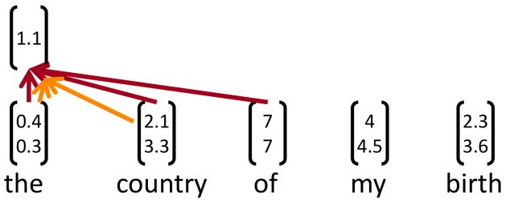

> A figure from Christopher Manning, Natural Language Processing with Deep Learning, Stanford U. CS224n

---

### Single layer CNN

- Filter $\mathbf {w}$ is applied to all possible windows (concatenated vectors)  
- To compute feature (one channel) for CNN layer:

$$
c _ {i} = f (\mathbf {w} ^ {T} \mathbf {x} _ {i: i + h - 1} + b)
$$

- Sentence: ${ \mathbf { x } } _ { 1 : n } = { \mathbf { x } } _ { 1 } \oplus { \mathbf { x } } _ { 2 } \oplus \cdots \oplus { \mathbf { x } } _ { n }$  
- All possible windows of length $h$: $\{ \pmb { x } _ { 1 : h } , \pmb { x } _ { 2 : h + 1 } , \dots , \pmb { x } _ { n - h + 1 : n } \}$  
- Result is a feature map: $\mathbf { c } = [ { \pmb { c } } _ { 1 } , { \pmb { c } } _ { 2 } , \dots , { \pmb { c } } _ { n - h + 1 } ] \in \mathbb { R } ^ { n - h + 1 }$

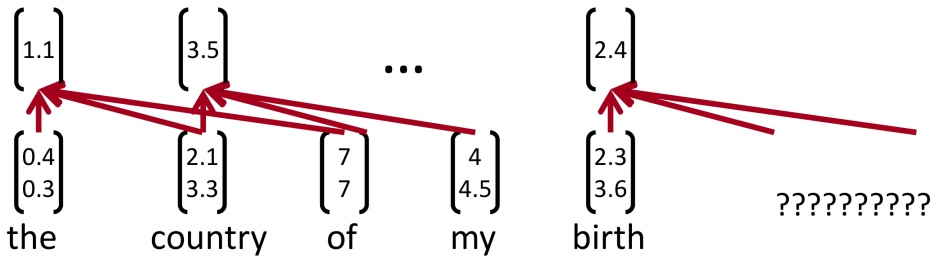

> A figure from Christopher Manning, Natural Language Processing with Deep Learning, Stanford U. CS224n

---

- Filter $\mathbf {w}$ is applied to all possible windows (concatenated vectors)  
- To compute feature (one channel) for CNN layer:

$$
c _ {i} = f (\mathbf {w} ^ {T} \mathbf {x} _ {i: i + h - 1} + b)
$$

- Sentence: ${ \mathbf { x } } _ { 1 : n } = { \mathbf { x } } _ { 1 } \oplus { \mathbf { x } } _ { 2 } \oplus \cdots \oplus { \mathbf { x } } _ { n }$  
- All possible windows of length h: $\{ \pmb { x } _ { 1 : h } , \pmb { x } _ { 2 : h + 1 } , \dots , \pmb { x } _ { n - h + 1 : n } \}$  
- Result is a feature map: $\mathbf { c } = [ { \pmb { c } } _ { 1 } , { \pmb { c } } _ { 2 } , \dots , { \pmb { c } } _ { n - h + 1 } ] \in \mathbb { R } ^ { n - h + 1 }$

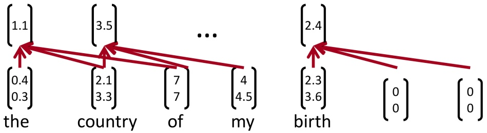

> A figure from Christopher Manning, Natural Language Processing with Deep Learning, Stanford U. CS224n

---

### Single Layer CNN for Sentence Classification

- Pooling: max-over-time pooling (Collobert et al., 2011) is applied to each feature map  
  - Idea: capture the most important feature — one with the highest value — for each feature map  
  - From feature map $\mathbf { c } = [ c _ { 1 } , c _ { 2 } , \ldots , c _ { n - h + 1 } ]$ with $\pmb { \mathsf { c } } \in \mathbb { R } ^ { n - h + 1 }$ , the pooled feature $\hat { c } = \max \{ \mathbf { c } \}$  
  - This pooling scheme naturally deals with variable sentence lengths

- Dropout: penultimate layer with a constraint on $l_2$-norms of weight vectors (Hinton et al., 2012)  
  - Dropout prevents co-adaptation of hidden units by randomly dropping out — i.e., setting to zero — a proportion $p$ of the hidden units during forward/backpropagation

- Use multiple filter weights w (each producing a feature map), instead of a single filter  
  - Useful to have different window sizes h: filters that look at unigrams, bigrams, tri-grams, 4-grams, etc.

---

- First one convolution, followed by one max-pooling  
  - Used 100 maps each of sizes 3, 4, 5

- Simple final softmax layer for output unit $y$

- In forward propagation, dropout uses:

$$
y = \mathbf {w} \cdot (\mathbf {z} \circ \mathbf {r}) + b
$$

- $\circ$ is the element-wise multiplication operator and $\mathbf { r } \in \mathbb { R } ^ { m }$ is a ‘masking’ vector of Bernoulli random variables with probability p of being 1

- Gradients are backpropagated only through the unmasked units

- At test time, the learned weight vectors are scaled by $p$ such that $\hat { \mathsf { w } } = p \mathsf { w }$

---


> From: Zhang and Wallace (2015) A Sensitivity Analysis of (and Practitioners’ Guide to) Convolutional Neural Networks for Sentence Classification  
> https://arxiv.org/pdf/1510.03820.pdf  
> (follow on paper, not famous, but a nice picture)

---

### Experiments

| Model | MR | SST-1 | SST-2 | Subj | TREC | CR | MPQA |
| --- | --- | --- | --- | --- | --- | --- | --- |
| CNN-rand | 76.1 | 45.0 | 82.7 | 89.6 | 91.2 | 79.8 | 83.4 |
| CNN-static | 81.0 | 45.5 | 86.8 | 93.0 | 92.8 | 84.7 | 89.6 |
| CNN-non-static | 81.5 | 48.0 | 87.2 | 93.4 | 93.6 | 84.3 | 89.5 |
| CNN-multichannel | 81.1 | 47.4 | 88.1 | 93.2 | 92.2 | 85.0 | 89.4 |
| RAE (Socher et al., 2011) | 77.7 | 43.2 | 82.4 | - | - | - | 86.4 |
| MV-RNN (Socher et al., 2012) | 79.0 | 44.4 | 82.9 | - | - | - | - |
| RNTN (Socher et al., 2013) | - | 45.7 | 85.4 | - | - | - | - |
| DCNN (Kalchbrenner et al., 2014) | - | 48.5 | 86.8 | - | 93.0 | - | - |
| Paragraph-Vec (Le and Mikolov, 2014) | - | 48.7 | 87.8 | - | - | - | - |
| CCAE (Hermann and Blunsom, 2013) | 77.8 | - | - | - | - | - | 87.2 |
| Sent-Parser (Dong et al., 2014) | 79.5 | - | - | - | - | - | 86.3 |
| NBSVM (Wang and Manning, 2012) | 79.4 | - | - | 93.2 | - | 81.8 | 86.3 |
| MNB (Wang and Manning, 2012) | 79.0 | - | - | 93.6 | - | 80.0 | 86.3 |
| G-Dropout (Wang and Manning, 2013) | 79.0 | - | - | 93.4 | - | 82.1 | 86.1 |
| F-Dropout (Wang and Manning, 2013) | 79.1 | - | - | 93.6 | - | 81.9 | 86.3 |
| Tree-CRF (Nakagawa et al., 2010) | 77.3 | - | - | - | - | 81.4 | 86.1 |
| CRF-PR (Yang and Cardie, 2014) | - | - | - | - | - | 82.7 | - |
| SVMS (Silva et al., 2011) | - | - | - | - | 95.0 | - | - |

---

## 6 Neural Networks Tips and Tricks

### We have models with many params! Regularization!

- Really a full loss function in practice includes regularization over all parameters θ, e.g., L2 regularization:

$$
J (\theta) = \frac {1}{N} \sum_ {i = 1} ^ {N} - \log \left(\frac {e ^ {f _ {y _ {i}}}}{\sum_ {c = 1} ^ {C} e ^ {f _ {c}}}\right) + \lambda \sum_ {k} \theta_ {k} ^ {2}
$$

- Regularization produces models that generalize well when we have a lot of features (or later a very powerful/deep model, ++)

- We do not care that our models overfit on the training data


> A figure from Christopher Manning, Natural Language Processing with Deep Learning, Stanford U. CS224n

---

### Dropout

**(Srivastava, Hinton, Krizhevsky, Sutskever, & Salakhutdinov 2012/JMLR 2014)**

**Preventing Feature Co-adaptation = Regularization**

- Training time: at each instance of evaluation (in online SGD-training), randomly set 50% of the inputs to each neuron to 0

- Test time: halve the model weights (now twice as many)

- This prevents feature co-adaptation: A feature cannot only be useful in the presence of particular other features

- In a single layer: A kind of middle-ground between Naïve Bayes (where all feature weights are set independently) and logistic regression models (where weights are set in the context of all others)

- Can be thought of as a form of model bagging

- Nowadays usually thought of as a strong, feature-dependent regularizer [Wager, Wang, & Liang 2013]

---

### Vectorization

- E.g., looping over word vectors versus concatenating them all into one large matrix and then multiplying the softmax weights with that matrix

**Code:**

```python
from numpy import random

N = 500  # number of windows to classify
d = 300  # dimensionality of each window
C = 5  # number of classes
W = random.rand(C, d)
wordvectors_list = [random.rand(d, 1) for i in range(N)]
wordvectors_one_matrix = random.rand(d, N)

# timeit [W.dot(wordvectors_list[i]) for i in range(N)]
# timeit W.dot(wordvectors_one_matrix)
```

- 1000 loops, best of 3: 639 µs per loop  
  10000 loops, best of 3: 53.8 µs per loop

---

**Code:**

```python
from numpy import random

N = 500  # number of windows to classify
d = 300  # dimensionality of each window
C = 5  # number of classes
W = random.rand(C, d)
wordvectors_list = [random.rand(d, 1) for i in range(N)]
wordvectors_one_matrix = random.rand(d, N)

# timeit [W.dot(wordvectors_list[i]) for i in range(N)]
# timeit W.dot(wordvectors_one_matrix)
```

- The (10x) faster method is using a C x N matrix  
- Always try to use vectors and matrices rather than for loops!  
- You should speed-test your code a lot too!!  
- These differences go from 1 to 2 orders of magnitude with GPUs  
- tl;dr: Matrices are awesome!!!

---

### Non-linearities: The starting points

logistic (“sigmoid”) $f (z) = \dfrac {1}{1 + e ^ {- z}}$


$f(z)=\tanh(z)=\dfrac{e^z - e^{-z}}{e^z + e^{-z}}$


$\text{HardTanh}(z)=\begin{cases}
  -1, z\lt -1\\
  z, -1\le z \le 1\\
  1, z \gt 1
\end{cases}$


tanh is just a rescaled and shifted sigmoid $( 2 \times$ as steep, $[−1, 1])$:

$$
\tanh (z) = 2 \text {logistic} (2 z) - 1
$$

Both logistic and tanh are still used in particular uses, but are no longer the defaults for making deep networks

> A figure from Christopher Manning, Natural Language Processing with Deep Learning, Stanford U. CS224n

---

### Non-linearities: The new world order

ReLU (rectified linear unit)

$\operatorname{rect} (z) = \max (z, 0)$


Leaky ReLU / hard tanh


Swish / Parametric ReLU

[Ramachandran, Zoph & Le 2017]


- For building a deep feed-forward network, the first thing you should try is ReLU — it trains quickly and performs well due to good gradient backflow

---

### Which Non-linearity Should I Use?

- Ultimately an empirical question

- Many new functions proposed, but search by Eger et al. (2018) over NLP tasks found that standard functions such as tanh and relu quite robust

|     |     |
| --- | --- |
| sigmoid | $f(x) = \sigma(x) = 1/(1 + \exp(-x))$ |
| swish | $f(x) = x \cdot \sigma(x)$ |
| maxsig | $f(x) = \max\{x, \sigma(x)\}$ |
| cosid | $f(x) = \cos(x) - x$ |
| minsin | $f(x) = \min\{x, \sin(x)\}$ |
| arctid | $f(x) = \arctan(x)^2 - x$ |
| maxtanh | $f(x) = \max\{x, \tanh(x)\}$ |
|---------|------------------------------|
| lrelu-0.01 | $f(x) = \max\{x, 0.01x\}$ |
| lrelu-0.30 | $f(x) = \max\{x, 0.3x\}$ |
| penalized tanh | $f(x) = \begin{cases} \tanh(x) & x > 0 \\ 0.25 \tanh(x) & x \leq 0 \end{cases}$ |

|     |     |
| --- | --- |
| best | penalized tanh (6), swish (6), elu (4), relu (4), Irelu-0.01 (4) |
| mean | penalized tanh (16), tanh (13) sin (10) |

Top-3 winner statistics. In brackets: number of times within top-3, keeping only functions with four or more top-3 rankings.

---

### Parameter Initialization

- You normally must initialize weights to small random values  
  - To avoid symmetries that prevent learning/specialization

- Initialize hidden layer biases to 0 and output (or reconstruction) biases to optimal value if weights were 0 (e.g. mean target or inverse sigmoid of mean target)

- Initialize all other weights ∼ Uniform(−r, r), with r chosen so numbers get neither too big or too small

- Xavier initialization has variance inversely proportional to fan-in $n_{in}$ (previous layer size) and fan-out $n_{out}$ (next layer size):

$$
\text {Var} (W _ {i}) = \frac {2}{n _ {i n} + n _ {o u t}}
$$

---

### Optimizers

- Usually, plain SGD will work just fine

- However, getting good results will often require hand-tuning the learning rate (next slide)

- For more complex nets and situations, you often do better with more sophisticated “adaptive” optimizers that scale the parameter adjustment by an accumulated gradient

- Popular choices today:

  - AdamW — the long-time industry default for LLM training: stable and robust to hyperparameters  
  - Muon — a recent matrix-preconditioned optimizer, used to train Kimi K2 and Moonlight (∼2× compute efficiency)  
  - SOAP, Shampoo — the matrix-preconditioned family  
  - Adagrad — the classic that started adaptive methods  
  - . . .

- The fastest optimizers precondition gradients with matrices rather than scalars — but their speedup shrinks with model scale (1.4× at 0.1 B → 1.1× at 1.2B parameters)

---

### Learning Rates

- You can just use a constant learning rate. Start around $Ir = 0.001?$

- It must be order of magnitude right — try powers of 10  
  - Too big: model may diverge or not converge  
  - Too small: your model may not have trained by the deadline

- Better results are generally obtained with warmup + decay:  
  - Warmup: ramp lr up from $\approx 0$ to $Ir _ { 0 }$ over the first ∼1% of steps — crucial for stable transformer training  
  - Cosine decay to $h _ { m i n }$ is the modern default:  
    $Ir _ {t} = Ir _ {\min} + \frac {1}{2} (I r _ {0} - Ir _ {\min}) (1 + \cos (\pi t / T))$  
  - Classic alternatives: halve the lr every k epochs, exponential decay $Ir = Ir _ { 0 }   e ^ { - k t }$ ; warmup-stable-decay (WSD) is a recent popular schedule

- An epoch = a pass through the data (shuffled or sampled)

- Fancier optimizers still use a learning rate but it may be an initial rate that the optimizer shrinks — so may need to start high

## Content

1. **Text Classification**

2. **Artificial neural networks (ANNs)**

3. **Multilayer perceptron (MLP)**

4. **Convolutional neural networks (CNNs)**

5. **Convolutional Networks for Text Classification**

6. **Neural Networks Tips and Tricks**