## Natural Language Processing and LLMs Lecture 03: Text Classification and Artificial Neural Networks (CNNs)

Valentin Malykh, MWS AI


<details>
<summary>text_image</summary>

M W
S
</details>

Autumn 2026

The course is delivered at MIPT, HSE (Moscow), ITMO (Saint Petersburg), and IITU (Almaty)

## Content

1 Text Classification
2 Artificial neural networks (ANNs)
3 Multilayer perceptron (MLP)
4 Convolutional neural networks (CNNs)
5 Convolutional Networks for Text Classification
6 Neural Networks Tips and Tricks

## Content

1 Text Classification
2 Artificial neural networks (ANNs)
3 Multilayer perceptron (MLP)
4 Convolutional neural networks (CNNs)
5 Convolutional Networks for Text Classification
6 Neural Networks Tips and Tricks

## Text classification


<details>
<summary>flowchart</summary>

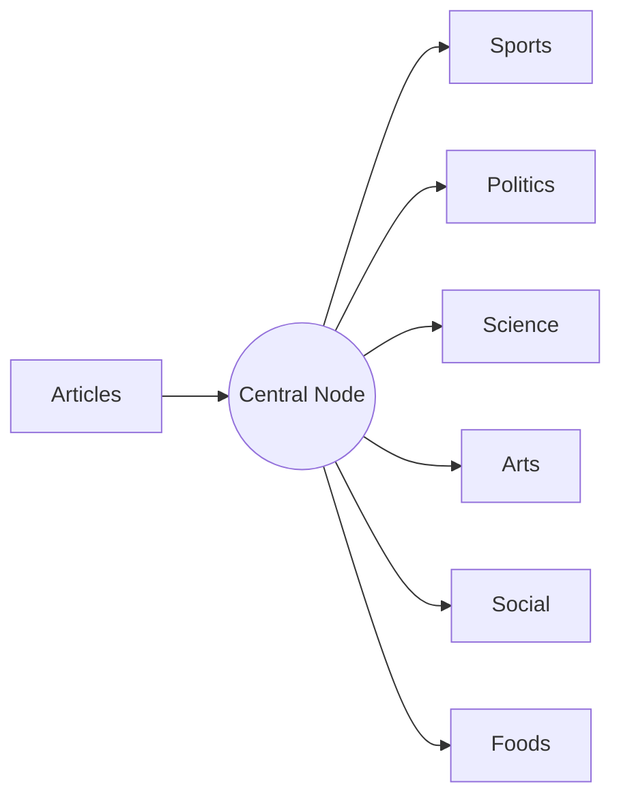
</details>

## Applications

Junk email filtering
News topic classification
Authorship attribution
Sentiment analysis
Genre classification
Offensive language identification
Language identification

## HuffPost News Category Dataset

This dataset contains around 200k news headlines from the year 2012 to 2018 obtained from HuffPost.


<details>
<summary>bar</summary>

| Category | Value |
| --- | --- |
| POLITICS | ~32500 |
| ENTERTAINMENT | ~14500 |
| HEALTHYALVING | ~7000 |
| QUEER VOICES | ~5200 |
| BUSINESS | ~4500 |
| SPORTS | ~4300 |
| COMEDY | ~4200 |
| PARENTS | ~4100 |
| BLACK VOICES | ~4000 |
| THE WORLDPOST | ~3900 |
| WOMEN | ~3800 |
| CRIME | ~3500 |
| MEDIA | ~3200 |
| WEIRD NEWS | ~3000 |
| GREEN | ~2800 |
| IMPACT | ~2700 |
| WORLDPOST | ~2700 |
| RELIGION | ~2700 |
| STYLE | ~2500 |
| WORLD NEWS | ~2400 |
| TRAVEL | ~2300 |
| TASTE | ~2200 |
| ARTS | ~1800 |
| FIFTY | ~1600 |
| GOOD NEWS | ~1500 |
| SCIENCE | ~1500 |
| ARTS & CULTURE | ~1400 |
| TECH | ~1300 |
| COLLEGE | ~1200 |
| LATINO VOICES | ~1100 |
| EDUCATION | ~1000 |
</details>

https://www.kaggle.com/rmisra/news-category-dataset

## HuffPost News Category Dataset

Sneak peek of the news dataset — fields: authors, category, date, headline, short\_description:

| authors | category | date | headline | short_description |
| --- | --- | --- | --- | --- |
|  | ENTERTAINMENT | 2014-10-09 | Eek! Mario Lopez Admits He Never Loved Ex-Wife... |  |
| Sarah Ruiz-Grossman | BLACK VOICES | 2018-04-06 | Protesters Demand Justice For Sa-heed Vassell, ... | “They murdered my son, and I want justice,” hi... |
| Lee Moran | CRIME | 2016-02-26 | Police Hunt For Man Traveling The Midwest And ... | The suspect, who is bald, reportedly has taken... |
| Michael Carosone | QUEER VOICES | 2014-09-07 | She Inspired Me: My Tribute to Joan Rivers | I never met Joan Rivers; I always wanted to, b... |
| Amanda Pena | STYLE | 2017-11-08 | 21 Affordable Holiday Gifts That Look Really E... | Our idea of luxury won’t break the bank. |
| Zahara Hill | BLACK VOICES | 2017-03-06 | Viola Davis Gives (Another) Moving Speech As H... | “I want people to be seen. I want them to feel... |

## Procedure

Text preprocessing
Feature extraction
Model training
Model application
Evaluation

## Text preprocessing

Text cleaning (removing HTML/XML tags, figures, formulas, etc.)
Removing stop words
Tokenization
Stemming

## Stop words

A stop word is a commonly used word (such as “the”, “a”, “an”, “in”).
Stop words are not helpful for text classification because they occur in almost all documents.
Stop words are normally removed before applying a text classification algorithm.

## Feature extraction (Bag of Words)

Each document is represented as a vector in order to apply a classification algorithm.
Each dimension of the input vector is called a feature.
In text classification, the most straightforward idea is to use words as features.

| doc_id | book | read | music | go |
| --- | --- | --- | --- | --- |
| doc1 | 3 | 1 | 0 | 5 |
| doc2 | 2 | 5 | 3 | 0 |
| doc3 | 0 | 0 | 7 | 2 |

## Weighting of words in document vectors

**Term** - a word or a collocation.
**Document** - a sequence of terms.
**Corpus** - a set of documents.

## Weighting of words in document vectors

**Boolean weighting:** $w _ { i k } = \left\{ \begin{aligned} & 1 & &  if   f _ { i k } > 0 \\ & 0 & &  Otherwise  \end{aligned} \right.$ 4V
**Word frequency weighting:** $w _ { i k } = f _ { i k }$
**TF-IDF weighting:** $\begin{array} { r } { w _ { i k } = f _ { i k } \times \log \frac { N } { \eta _ { i } } } \end{array}$

i: word index

k: document index

$f _ { j k }$ : word frequency in a document

N: number of documents in the corpus

$n _ { j } )$ : number of documents containing the word

## Weighting of words in document vectors

TF-IDF - short for term frequency–inverse document frequency, is a numerical statistic that is intended to reflect how important a word is to a document in a collection or corpus.
The assumption behind the use of the inverse document frequency is: the more documents where a word (term) occurs, the less important the word is to that document.
TF-IDF is proposed in information retrieval but also used in other areas including NLP.
Which word weighting method is the best for text classification: no universal answer. It empirically depends on the data and the classification algorithm you use.

## Algorithms

Logistic regression
Nearest neighbor
Decision trees
Support vector machines
Neural networks

## Further topics

Feature selection
Dimension reduction
Document embeddings

## Content

1 Text Classification
2 Artificial neural networks (ANNs)
3 Multilayer perceptron (MLP)
4 Convolutional neural networks (CNNs)
6 Neural Networks Tips and Tricks

5 Convolutional Networks for Text Classification

## Limitation of linear classifiers

Logistic regression is a linear classifier, which means its decision boundary is a hyperplane:

Decision Boundary Hyperplane


<details>
<summary>text_image</summary>

Sigmoid activation function
hθ(x)
Θ
x₂
x₁
</details>

Figure source: https://stats.stackexchange.com/questions/291492/

## Limitation of linear classifiers

However, some classification problems are not linearly separable:


Figure source: http://dingyancs.blogspot.com/2017/10/mle-linear-classification.html

## Exclusive-or function

A typical linearly-inseparable problem is the exclusive-or function:


<details>
<summary>text_image</summary>

X₁ X₂ | Y
0 0 0
0 1 1
1 0 1
1 1 0
Y = X₁ ⊕ X₂
</details>

Figure source: http://www.ece.utep.edu/research/webfuzzy/docs/kk-thesis/kk-thesis-html/node19.html

## Artificial Neural networks (ANNs)

Neural networks (NNs), or artificial neural networks (ANNs), provide an efficient way to solve non-linearly separable problems.
Artificial neural networks (ANNs) or connectionist systems are computing systems vaguely inspired by the biological neural networks that constitute animal brains. — Wikipedia

An ANN is based on a collection of connected units or nodes called artificial neurons, which loosely model the neurons in a biological brain.
Each connection, like the synapses in a biological brain, can transmit a signal to other neurons.
An artificial neuron that receives a signal then processes it and can signal neurons connected to it.

## Neuron


<details>
<summary>text_image</summary>

Axonal arborization
Axon from another cell
Synapse
Dendrite
Axon
Nucleus
Synapses
Cell body or Soma
</details>

Structure of a neuron

## Neuron, myelinated axon, and the signal flow


<details>
<summary>flowchart</summary>

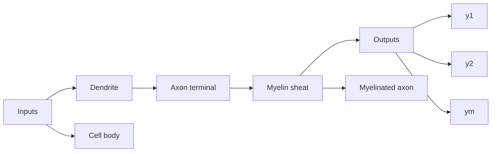
</details>

Neuron and myelinated axon, with signal flow from inputs at dendrites to outputs at axon terminals

By Egm4313.s12 (Prof. Loc Vu-Quoc) - Own work, CC BY-SA 4.0, https://commons.wikimedia.org/w/index.php?curid=72816083

## Content

1 Text Classification
2 Artificial neural networks (ANNs)
3 Multilayer perceptron (MLP)
4 Convolutional neural networks (CNNs)
6 Neural Networks Tips and Tricks

5 Convolutional Networks for Text Classification

## Content


## Multilayer perceptron (MLP)

Multilayer perceptron
Backpropagation
Capacity of multilayer perceptron

## Perceptron – simplest artificial neuron

$$
f (x) = \left\{ \begin{array}{l l} 0, & \text {if} \sum_ {i} w _ {i} x _ {i} + b \leq 0 \\ 1, & \text {otherwise} \end{array} \right.
$$


<details>
<summary>flowchart</summary>

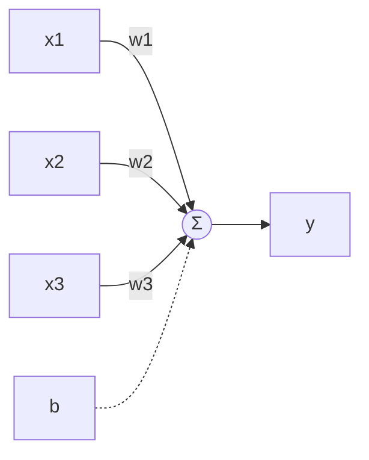
</details>

## Improved perceptron – logistic regression

Perceptron is also an effective linear classifier but we cannot apply the gradient descent algorithm to train it.
Logistic regression can be regarded as an improved version of perceptron to which gradient descent training can be applied.


<details>
<summary>flowchart</summary>

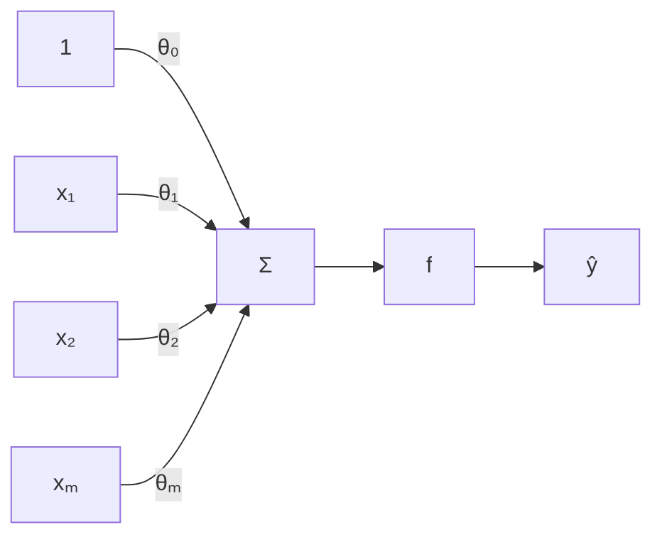
</details>

Inputs

Weights

Sum

Non-Linearity

Output

Activation Functions

$$
\hat {y} = g \left(\theta_ {0} + \boldsymbol {X} ^ {T} \boldsymbol {\theta}\right)
$$

• Example: sigmoid function

$$
g (z) = \sigma (z) = \frac {1}{1 + e ^ {- z}}
$$


<details>
<summary>line</summary>

| Z | T |
| --- | --- |
| -6 | ~0.02 |
| -4 | ~0.05 |
| -2 | ~0.25 |
| 0 | 0.5 |
| 2 | ~0.85 |
| 4 | ~0.98 |
| 6 | ~1.0 |
</details>

MIT: Alexander Amini, 2018 introtodeeplearning.com

## From linear classifier to non-linear classifier

Perceptrons (including logistic regression classifiers) are linear classifiers, which do not work for non-linearly separable problems.
Multilayer perceptrons are proposed to solve non-linearly separable problems.


<details>
<summary>flowchart</summary>

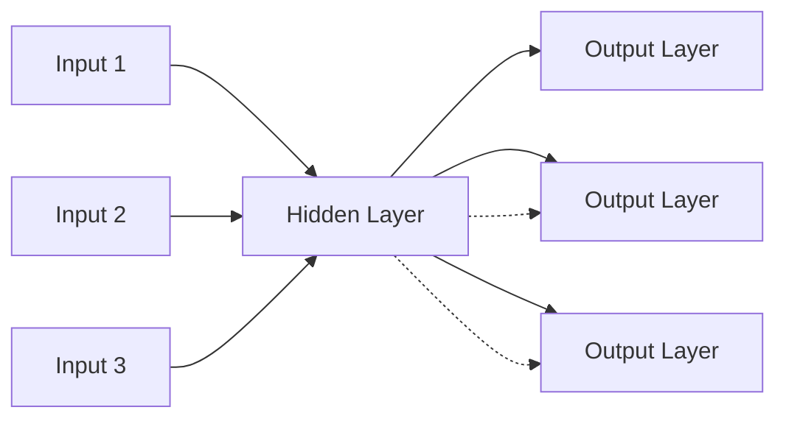
</details>

Figure source: https://becominghuman.ai/multi-layer-perceptron-mlp-models-on-real-world-banking-data-f6dd3d7e998f

## Multilayer perceptrons

An MLP consists of at least three layers of nodes: an input layer, a hidden layer and an output layer.
Except for the input nodes, each node is a neuron that uses a nonlinear activation function.
MLP utilizes a supervised learning technique called backpropagation for training.
Its multiple layers and non-linear activation distinguish MLP from a linear perceptron.
It can distinguish data that is not linearly separable.

## Activation functions

Logistic:

$$
f (x) = \frac {1}{1 + e ^ {- x}}
$$


<details>
<summary>line</summary>

| X | Y |
| --- | --- |
| -6 | ~0 |
| -4 | ~0.02 |
| -2 | ~0.15 |
| 0 | 0.5 |
| 2 | ~0.85 |
| 4 | ~0.98 |
| 6 | 1 |
</details>

Hyperbolic tangent:

$$
f (x) = \frac {e ^ {x} - e ^ {- x}}{e ^ {x} + e ^ {- x}}
$$


<details>
<summary>line</summary>

| X | tanh(x) |
| --- | --- |
| -5 | ~-1.0 |
| -4 | ~-1.0 |
| -3 | ~-0.9 |
| -2 | ~-0.7 |
| -1 | ~-0.4 |
| 0 | 0 |
| 1 | ~0.4 |
| 2 | ~0.8 |
| 3 | ~0.95 |
| 4 | ~0.98 |
| 5 | ~1.0 |
</details>

Rectifier:

$$
f (x) = \max (0, x)
$$


<details>
<summary>line</summary>

| X | Softplus | Radcliner |
| --- | --- | --- |
| -4 | ~0.05 | ~0.01 |
| -2 | ~0.3 | ~0.02 |
| 0 | 0.7 | 0.02 |
| 2 | ~2.5 | ~2.5 |
| 4 | 4.0 | 4.0 |
</details>

## Fully connected layers

The MLP consists of three or more layers (an input and an output layer with one or more hidden layers) of nonlinearly-activating nodes.
Since MLPs are fully connected, each node in one layer connects with a certain weight $w _ { i i }$ to every node in the following layer.


<details>
<summary>flowchart</summary>

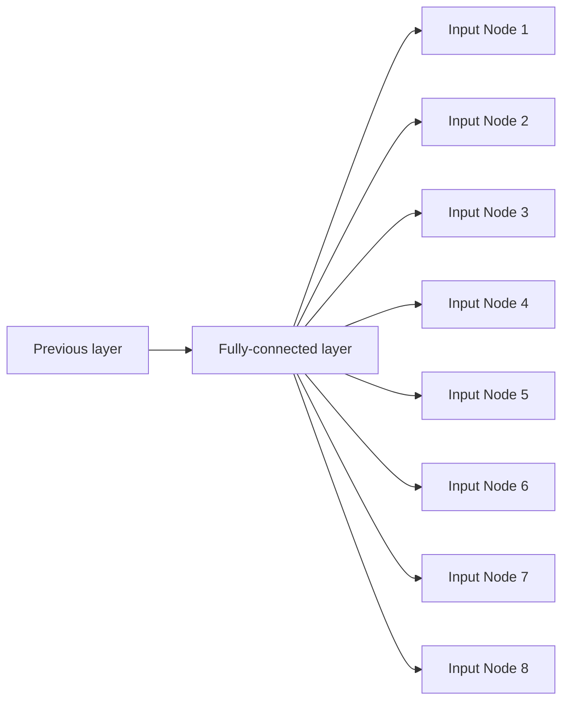
</details>

Figure source: https://mc.ai/fully-connected-layer-with-dynamic-input-shape/

## Output layer

The output layer may use activation functions that differ from those of the hidden layers, depending on the nature of the task.
For classification problems, typically, a softmax function is used in the output layer.


<details>
<summary>flowchart</summary>

This diagram illustrates a neural network architecture for object detection, showing how input images are processed through various nodes to generate predictions and output labels.
</details>

Figure source: https://gab41.lab41.org/entropic-ghosts-35670292bc87

## Content


## Multilayer perceptron (MLP)

Multilayer perceptron
Backpropagation
Capacity of multilayer perceptron

## Recap: Gradient Descent

Recall: gradient descent moves opposite the gradient (the direction of steepest descent)


<details>
<summary>contour</summary>

| \(\delta_{1}\) | \(\delta_{2}\) | Value |
| --- | --- | --- |
| ~0 | ~0 | ~0.15 |
| ~100 | ~100 | ~0.12 |
| ~200 | ~200 | ~0.08 |
| ~300 | ~300 | ~0.05 |
| ~400 | ~400 | ~0.02 |
| ~500 | ~500 | 0 |
| ~600 | ~600 | -0.02 |
| ~700 | ~700 | -0.08 |
| ~800 | ~800 | -0.13 |
| ~900 | ~900 | -0.15 |
</details>

Weight space for a multilayer neural net: one coordinate for each weight or bias of the network, in all the layers
Conceptually, not any different from what we’ve seen so far — just higher dimensional and harder to visualize!
We want to compute the cost gradient dE/dw, which is the vector of partial derivatives.

This is the average of dL/dw over all the training examples, so in this lecture we focus on computing dL/dw.

A figure from: Roger Grosse, University of Toronto CSC321 (2019), Lecture 6: Backpropagation

## Univariate Chain Rule

We’ve already been using the univariate Chain Rule.
Recall: if $f ( x )$ and $x ( t )$ are univariate functions, then

$$
\frac {d}{d t} f (x (t)) = \frac {d f}{d x} \frac {d x}{d t}
$$

## Univariate Chain Rule

Consider a univariate logistic least squares model:

$$
z = w x + b \quad y = \sigma (z) \quad L = \frac {1}{2} (y - t) ^ {2}
$$

Let’s compute the loss derivatives.

## Univariate Chain Rule

How you would have done it in calculus class:

$$
L = \frac {1}{2} \big (\sigma (w x + b) - t \big) ^ {2}
$$

$$
\frac {\partial L}{\partial \boldsymbol {b}} = \frac {\partial}{\partial \boldsymbol {b}} \frac {1}{2} (\sigma (\boldsymbol {w x} + \boldsymbol {b}) - t) ^ {2} = (\sigma (\boldsymbol {w x} + \boldsymbol {b}) - t) \sigma^ {\prime} (\boldsymbol {w x} + \boldsymbol {b}),
$$

$$
\frac {\partial L}{\partial w} = \frac {\partial}{\partial w} \frac {1}{2} (\sigma (w x + b) - t) ^ {2} = (\sigma (w x + b) - t) \sigma^ {\prime} (w x + b) x
$$

What are the disadvantages of this approach?

## Univariate Chain Rule

A more structured way to do it:

Computing the derivatives:

Computing the loss:

$$
z = w x + b
$$

$$
y = \sigma (z)
$$

$$
L = \frac {1}{2} (y - t) ^ {2}
$$

$$
\frac {d L}{d y} = y - t
$$

$$
\frac {d L}{d z} = \frac {d L}{d y} \sigma^ {\prime} (z)
$$

$$
\frac {\partial L}{\partial w} = \frac {d L}{d z} x
$$

$$
\frac {\partial L}{\partial b} = \frac {d L}{d z}
$$

Remember, the goal isn’t to obtain closed-form solutions, but to be able to write a program that efficiently computes the derivatives.

## Univariate Chain Rule

We can diagram out the computations using a computation graph.
The nodes represent all the inputs and computed quantities, and the edges represent which nodes are computed directly as a function of which other nodes.


<details>
<summary>flowchart</summary>

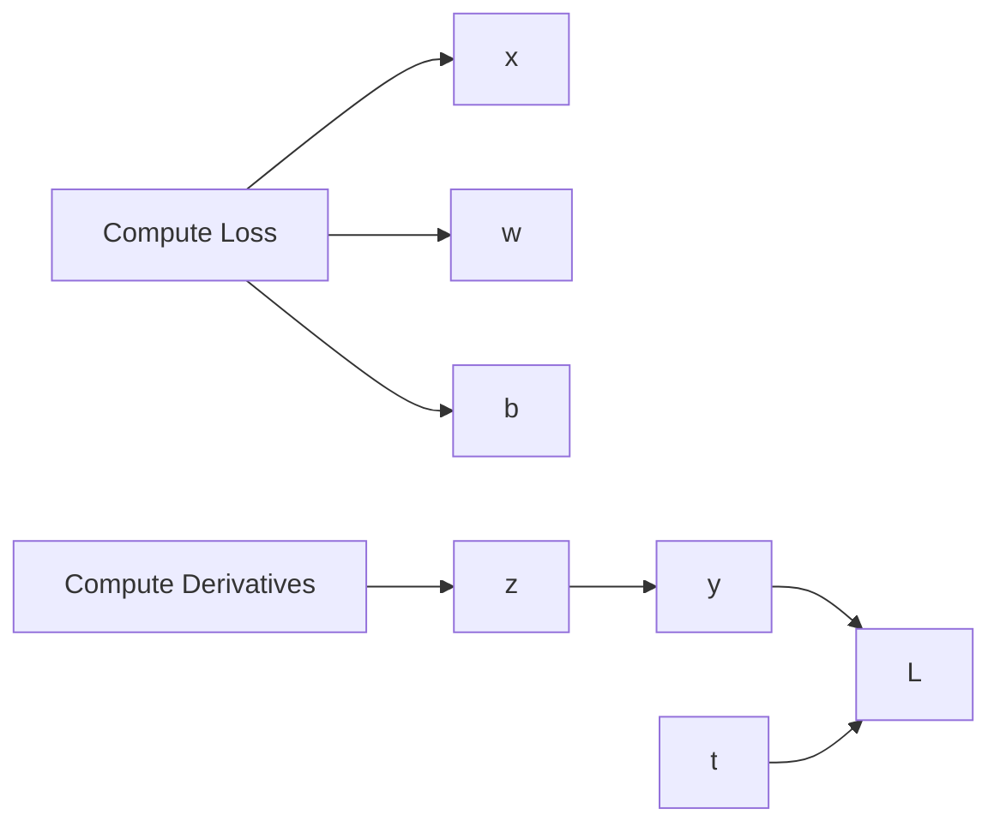
</details>

A figure from: Roger Grosse, University of Toronto CSC321 (2019), Lecture 6: Backpropagation

## Univariate Chain Rule

## A convenient notation:

Use $\bar { y }$ to denote the derivative $\frac { d L } { d y }$ , sometimes called the error signal.
This emphasizes that the error signals are just values our program is computing (rather than a mathematical operation).
This is not a standard notation, but I couldn’t find another one that I liked.

Computing the loss:

$$
z = w x + b
$$

$$
y = \sigma (z)
$$

$$
L = \frac {1}{2} (y - t) ^ {2}
$$

Computing the derivatives:

$$
\bar {y} = y - t
$$

$$
\bar {z} = \bar {y} \sigma^ {\prime} (z)
$$

$$
\bar {W} = \bar {Z} X
$$

$$
\bar {b} = \bar {z}
$$

## Multivariate Chain Rule

Problem: what if the computation graph has fan-out $> 1 2$
This requires the multivariate Chain Rule!

L2-Regularized regression


<details>
<summary>flowchart</summary>

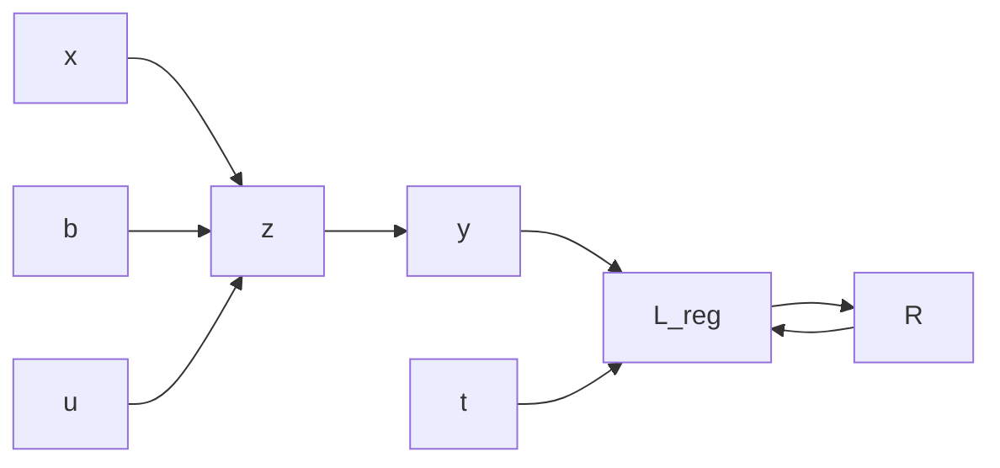
</details>

$$
z = w x + b
$$

$$
y = \sigma (z)
$$

$$
L = \frac {1}{2} (y - t) ^ {2}
$$

$$
R = \frac {1}{2} w ^ {2}
$$

$$
L _ {\text {reg}} = L + \lambda R
$$

Multiclass logistic regression


<details>
<summary>flowchart</summary>

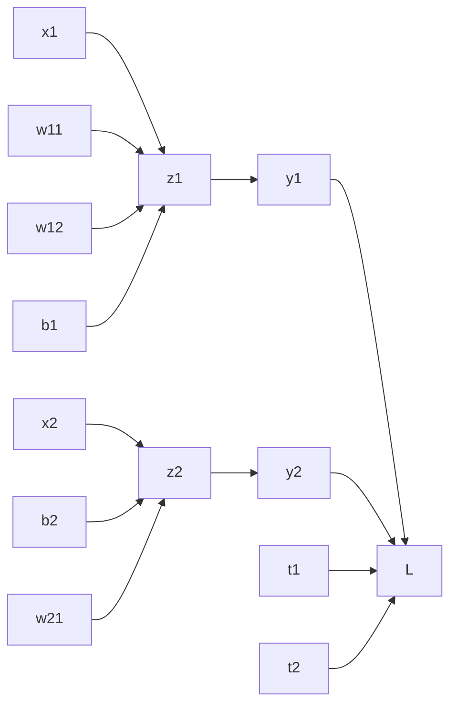
</details>

$$
z _ {\ell} = \sum_ {j} w _ {t j} x _ {j} + b _ {\ell}
$$

$$
y _ {k} = \frac {e ^ {z _ {k}}}{\sum_ {\ell} e ^ {z _ {\ell}}}
$$

$$
L = - \sum_ {k} t _ {k} \log y _ {k}
$$

Figures from: Roger Grosse, University of Toronto CSC321 (2019), Lecture 6: Backpropagation

## Backpropagation

Full backpropagation algorithm:
Let $v _ { 1 } , \ldots , v _ { N }$ be a topological ordering of the computation graph (i.e. parents come before children.)
$v _ { N }$ denotes the variable we’re trying to compute derivatives of (e.g. loss).

forward pass

Compute $v _ { i }$ as a function of $\operatorname { P a } ( v _ { i } )$

backward pass

$$
\bar {v} _ {N} = 1
$$

$$
\bar {v} _ {i} = \sum_ {j \in \operatorname{Ch} \left(v _ {i}\right)} \bar {v} _ {j} \frac {\partial v _ {j}}{\partial v _ {i}}
$$

## Backpropagation

## Multilayer Perceptron (multiple outputs):


<details>
<summary>flowchart</summary>

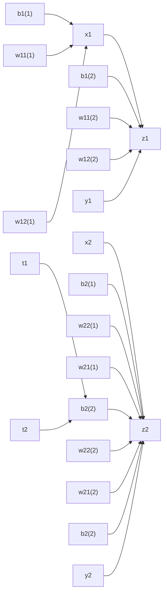
</details>

Forward pass:

$$
z _ {i} = \sum_ {j} w _ {i j} ^ {(1)} x _ {j} + b _ {i} ^ {(1)}
$$

$$
h _ {i} = \sigma (z _ {i})
$$

$$
y _ {k} = \sum_ {i} w _ {k i} ^ {(2)} h _ {i} + b _ {k} ^ {(2)}
$$

$$
L = \frac {1}{2} \sum_ {k} (y _ {k} - t _ {k}) ^ {2}
$$

Backward pass:

$$
\bar {L} = 1
$$

$$
\bar {y} _ {k} = \bar {L} (y _ {k} - t _ {k})
$$

$$
\bar {w} _ {k i} ^ {(2)} = \bar {y} _ {k} h _ {i}
$$

$$
\overline {{b}} _ {k} ^ {(2)} = \bar {y} _ {k}
$$

$$
\bar {h} _ {i} = \sum_ {k} \bar {y} _ {k} w _ {k i} ^ {(2)}
$$

$$
\bar {z} _ {i} = \bar {h} _ {i} \sigma^ {\prime} (z _ {i})
$$

$$
\bar {w} _ {i j} ^ {(1)} = \bar {z} _ {i} x _ {j}
$$

$$
\bar {b} _ {i} ^ {(1)} = \bar {z} _ {i}
$$

A figure from: Roger Grosse, University of Toronto CSC321 (2019), Lecture 6: Backpropagation

## Backpropagation

In vectorized form:


<details>
<summary>flowchart</summary>

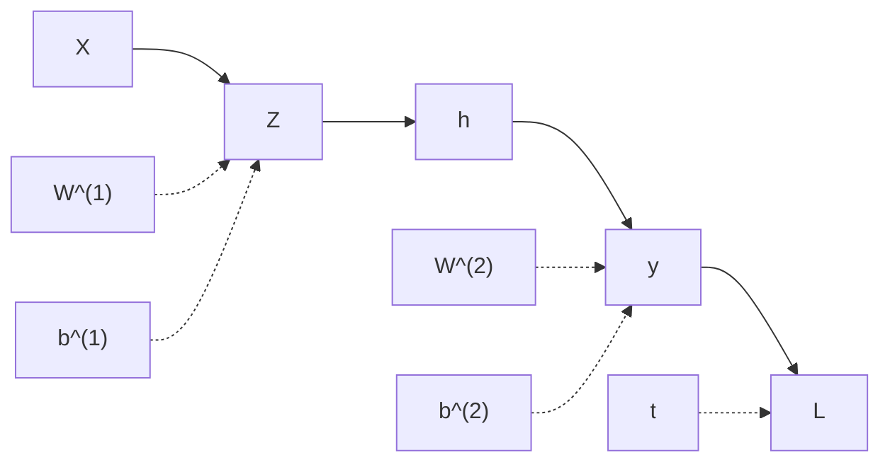
</details>

Forward pass:

$$
z = W ^ {(1)} x + b ^ {(1)}
$$

$$
h = \sigma (z)
$$

$$
y = W ^ {(2)} h + b ^ {(2)}
$$

$$
L = \frac {1}{2} \| t - y \| ^ {2}
$$

Backward pass:

$$
\bar {L} = 1
$$

$$
\bar {y} = \bar {L} (y - t)
$$

$$
\bar {W} ^ {(2)} = \bar {y} h ^ {\top}
$$

$$
\bar {b} ^ {(2)} = \bar {y}
$$

$$
\bar {h} = W ^ {(2) \top} \bar {y}
$$

$$
\bar {z} = \bar {h} \circ \sigma^ {\prime} (z)
$$

$$
\bar {W} ^ {(1)} = \bar {z} x ^ {\top}
$$

$$
\bar {b} ^ {(1)} = \bar {z}
$$

A figure from: Roger Grosse, University of Toronto CSC321 (2019), Lecture 6: Backpropagation

## Backpropagation

Backprop as message passing:


<details>
<summary>flowchart</summary>

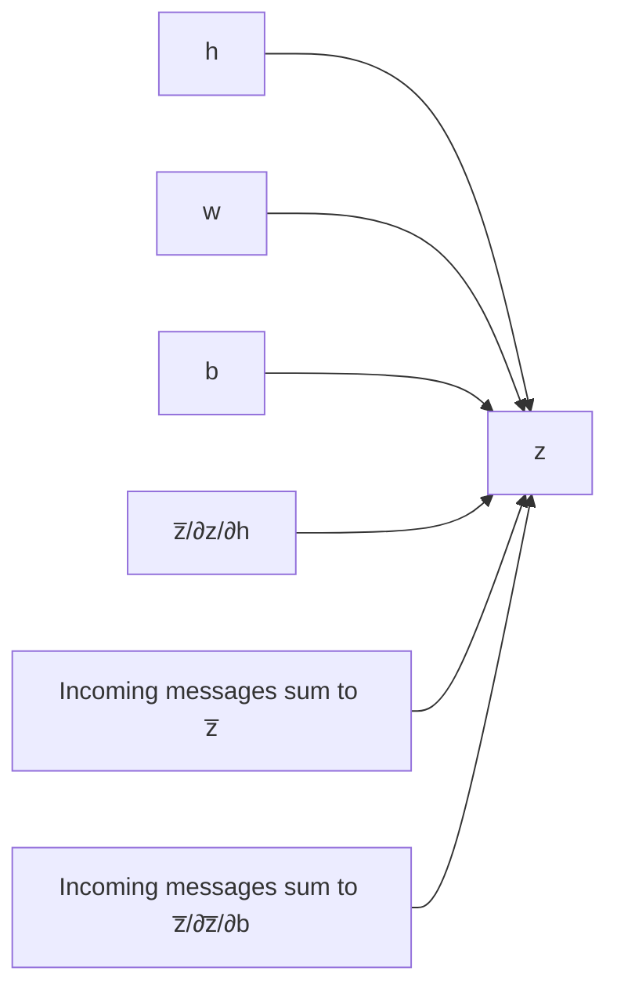
</details>

Each node receives a bunch of messages from its children, which it aggregates to get its error signal. It then passes messages to its parents.
This provides modularity, since each node only has to know how to compute derivatives with respect to its arguments, and doesn’t have to know anything about the rest of the graph.

A figure from: Roger Grosse, University of Toronto CSC321 (2019), Lecture 6: Backpropagation

## Computational Cost

Computational cost of forward pass: one add-multiply operation per weight

$$
z _ {i} ^ {(1)} = \sum_ {j} w _ {i j} ^ {(1)} x _ {j} + b _ {i} ^ {(1)}
$$

Computational cost of backward pass: two add-multiply operations per weight

$$
\bar {w} _ {k i} ^ {(2)} = \bar {y} _ {k} h _ {i} \quad \bar {h} _ {i} = \sum_ {k} \bar {y} _ {k} w _ {k i} ^ {(2)}
$$

Rule of thumb: the backward pass is about as expensive as two forward passes.
For a multilayer perceptron, this means the cost is linear in the number of layers, quadratic in the number of units per layer.

## Backpropagation

Backprop is used to train the overwhelming majority of neural nets today.
Even optimization algorithms much fancier than gradient descent (e.g. second-order methods) use backprop to compute the gradients.
Despite its practical success, backprop is believed to be neurally implausible.
No evidence for biological signals analogous to error derivatives.
All the biologically plausible alternatives we know about learn much more slowly (on computers).
So how on earth does the brain learn?

## Content


## Multilayer perceptron (MLP)

Multilayer perceptron
Backpropagation
Capacity of multilayer perceptron

## Capacity of multilayer perceptron

Topics: single hidden layer neural network


<details>
<summary>flowchart</summary>

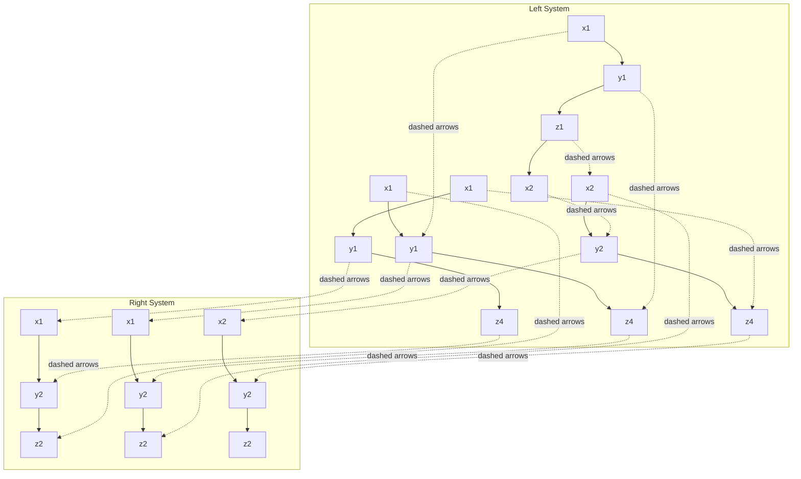
</details>

(from Pascal Vincent’s slides), Hugo Larochelle, Neural Networks, at Deep Learning Summer School 2016

## Capacity of multilayer perceptron

Topics: single hidden layer neural network


<details>
<summary>flowchart</summary>

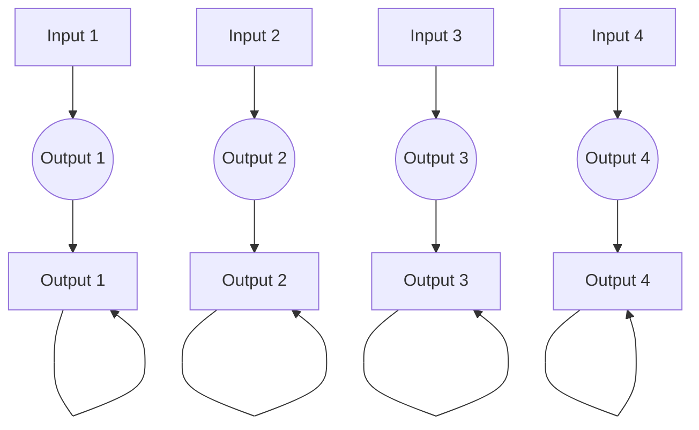
</details>

(from Pascal Vincent’s slides), Hugo Larochelle, Neural Networks, at Deep Learning Summer School 2016

## Capacity of multilayer perceptron

Topics: single hidden layer neural network


<details>
<summary>flowchart</summary>

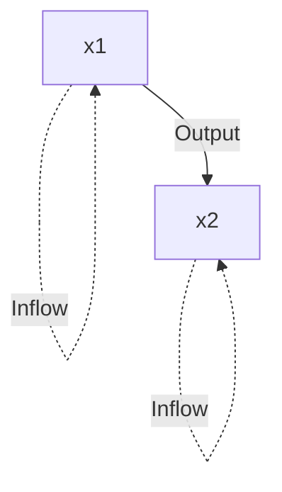
</details>


<details>
<summary>text_image</summary>

x₂
R₁
R₂
R₂
R₁
x₁
</details>

(from Pascal Vincent’s slides), Hugo Larochelle, Neural Networks, at Deep Learning Summer School 2016

## Capacity of multilayer perceptron

## Universal approximation theorem (Hornik, 1991)

“a single hidden layer neural network with a linear output unit can approximate any continuous function arbitrarily well, given enough hidden units”

The result applies for sigmoid, tanh and many other hidden layer activation functions
This is a good result, but it doesn’t mean there is a learning algorithm that can find the necessary parameter values!

## Content

1 Text Classification
2 Artificial neural networks (ANNs)
3 Multilayer perceptron (MLP)
4 Convolutional neural networks (CNNs)
6 Neural Networks Tips and Tricks

5 Convolutional Networks for Text Classification

## Content


## Convolutional neural networks (CNNs)

Bag of words
Handling Combinations
Convolutional Neural Networks
Non-linear Activation Functions
An example

## An Example Prediction Problem: Sentence Classification


<details>
<summary>flowchart</summary>

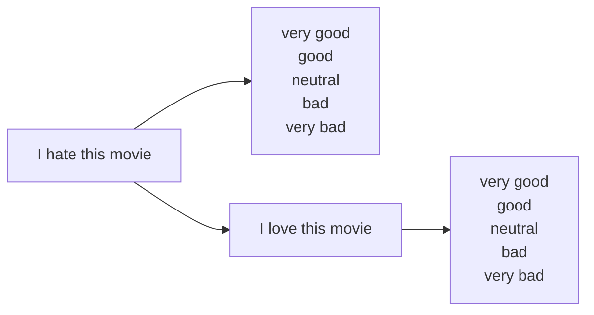
</details>

## A First Try: Bag of Words (BOW)


<details>
<summary>flowchart</summary>

```mermaid
graph LR
  A["I: lookup"] --> B["+"]
  C["hate: lookup"] --> D["+"]
  E["this: lookup"] --> F["+"]
  G["movie: lookup"] --> H["+"]
  I["bias"] --> J["="]
  K["scores"] --> L["softmax"]
  M["probs"] --> N[""]
```
</details>

A figure from Graham Neubig’s CS11-747 Neural Networks for NLP at CMU, 2019

## Build It, Break It


<details>
<summary>flowchart</summary>

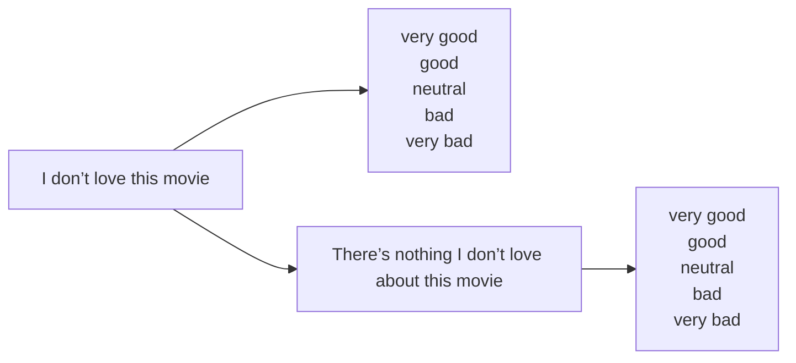
</details>

## Continuous Bag of Words (CBOW)


<details>
<summary>flowchart</summary>

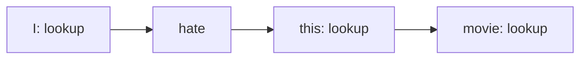
</details>


<details>
<summary>text_image</summary>

W
</details>

+

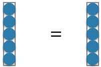

<details>
<summary>text_image</summary>

=
</details>

A figure from Graham Neubig’s CS11-747 Neural Networks for NLP at CMU, 2019

## Deep CBOW


<details>
<summary>flowchart</summary>

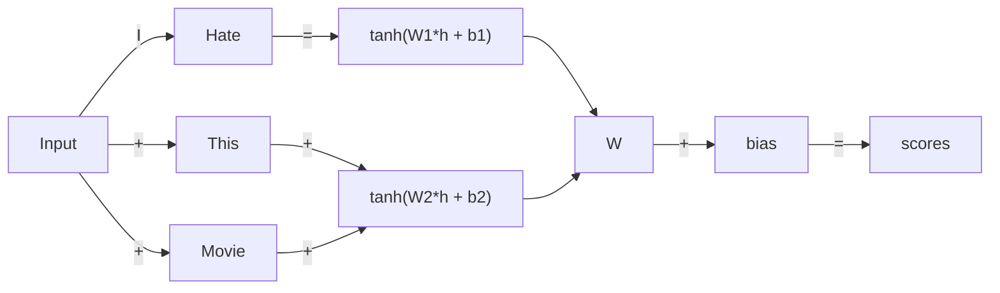
</details>

A figure from Graham Neubig’s CS11-747 Neural Networks for NLP at CMU, 2019

## What do Our Vectors Represent?

We can learn feature combinations (a node in the second layer might be “feature 1 AND feature 5 are active”)
e.g. capture things such as “not” AND “hate”
BUT! Cannot handle “not hate”

## Content


## Convolutional neural networks (CNNs)

Bag of words
Handling Combinations
Convolutional Neural Networks
Non-linear Activation Functions
An example

## Bag of n-grams


<details>
<summary>flowchart</summary>

```mermaid
graph TD
  subgraph InitialState
  I["I"] --> Sum1["sum("]
  Hate["hate"] --> Sum2["sum"]
  This["this"] --> Sum3["sum"]
  Movie["movie"] --> Sum4["sum"]
  end

  subgraph BiasScores
  Sum1 --> BiasScore{"bias scores"}
  BiasScore -->|Yes| Sum5["sum"]
  BiasScore -->|No| Sum6["sum"]
  end

  subgraph Feedback
  Sum5 --> Result{") ="}
  Result -->|Yes| Softmax["softmax"]
  Result -->|No| Prob["probs"]
  Softmax --> Prob
  end
```
</details>

A figure from Graham Neubig’s CS11-747 Neural Networks for NLP at CMU, 2019

## Why Bag of n-grams?

Allow us to capture combination features in a simple way “don’t love”, “not the best”
Works pretty well


François Chollet @fchollet · 2 Nov 2016

We are releasing an open dataset for theorem proving, HolStep: openreview.net/forum?id=ryuxY... - can you beat our 83% accuracy baseline?


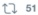


Hal Daumé III @haldaume3 · 2 Nov 2016

.@fchollet sure, I'll play. 85%, took me about an hour. (totally possible I did something wrong in preprocessing though!)

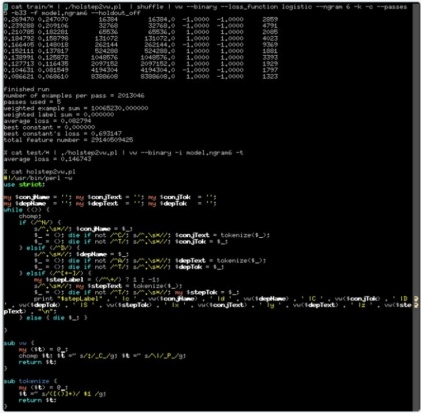

<details>
<summary>text_image</summary>

run class="c-1"box1@v20.p1 | shuffle if "s - binary - loss function logistic regression < 1" < pass
#3334 = C-1 * #1
#3334 = C-1 * #1
#3334 = C-1 * #1
#3334 = C-1 * #1
#3334 = C-1 * #1
#3334 = C-1 * #1
#3334 = C-1 * #1
#3334 = C-1 * #1
#3334 = C-1 * #1
#3334 = C-1 * #1
#3334 = C-1 * #1
#3334 = C-1 * #1
#3334 = C-1 * #1
#3334 = C-1 * #1
#3334 = C-1 * #1
#3334 = C-1 * #1
#3334 = C-1 * #1
#3334 = C-1 * #1
#3334 = C-1 * #1
#3334 = C-1 * #1
#3334 = C-1 * #1
#3334 = C-1 * #1
#3334 = C-1 * #1
#3334 = C-1 * #1
#3334 = C-1 * #1
#3334 = C-1 * #1
#3334 = C-1 * #1
#3334 = C-1 * #1
#3334 = C-1 * #1
#3334 = C-1 * #1
#3334 = C-1 * #1
#3334 = C-1 * #1
#3334 = C-1 * #1
#3334 = C-1 * #1
#3334 = C-1 * #1
#3334 = C-1 * #1
#3334 = C-1 * #1
#3334 = C-1 * #1
#3334 = C-1 * #1
#3334 = C-1 * #1
#3334 = C-1 * #1
#3334 = C-1 * #1
#3334 = C-1 * #1
#3334 = C-1 * #1
#3334 = C-1 * #1
#3334 = C-1 * #1
#3334 = C-1 * #1
#3334 = C-1 * #1
#3334 = C-1 * #1
#3334 = C-1 * #1
#3334 = C-1 * #1
#3334 = C-1 * #1
#3334 = C-1 * #1
#3334 = C-1 * #1
#3334 = C-1 * #1
#3334 = C-1 * #1
#3334 = C-1 * #1
#3334 = C-1 * #1
#3334 = C-1 * #1
#3334 = C-1 * #1
#3334 = C-1 * #1
#3334 = C-1 * #1
#3334 = C-1 * #1
#3334 = C-1 * #1
#3334 = C-1 * #1
#3334 = C-1 * #1
#3334 = C-1 * #1
#3334 = C-1 * #1
#3334 = C-1 * #1
#3334 = C-1 * #1
#3334 = C-1 * #1
#3334 = C-1 * #1
#3334 = C-1 * #1
#3334 = C-1 * #1
#3334 = C-1 * #1
#3334 = C-1 * #1
#3334 = C-1 * #1
#3334 = C-1 * #1
#3334 = C-1 * #1
#3334 = C-1 * #1
#3334 = C-1 * #1
#3334 = C-1 * #1
#3334 = C-1 * #1
#3334 = C-1 * #1
#3334 = C-1 * #1
#3334 = C-1 * #1
#3334 = C-1 * #1
#3334 = C-1 * #1
#3334 = C-1 * #1
#3334 = C-1 * #1
#3334 = C-1 * #1
#3334 = C-1 * #1
#3334 = C-1 * #1
#3334 = C-1 * #1
#3334 = C-1 * #1
#3334 = C-1 * #1
#3334 = C-1 * #1
#3334 = C-1 * #1
#3334 = C-1 * #1
#3334 = C-1 * #1
#3334 = C-1 * #1
#3334 = C-1 * #1
#3334 = C-1 * #1
#3334 = C-1 * #1
#3334 = C-1 * #1
#3334 = C-1 * #1
#3334 = C-1 * #1
#3334 = C-1 * #1
#3334 = C-1 * #1
#3334 = C-1 * #1
#3334 = C-1 * #1
#3334 = C-1 * #1
#3334 = C-1 * #1
#3334 = C-1 * #1
#3334 = C-1 * #1
#3334 = C-1 * #1
#3334 = C-1 * #1
#3334 = C-1 * #1
#3334 = C-1 * #1
#3334 = C-1 * #1
#3334 = C-1 * #1
#3334 = C-1 * #1
#3334 = C-1 * #1
#3334 = C-1 * #1
#3334 = C-1 * #1
#3334 = C-1 * #1
#3334 = C-1 * #1
#3334 = C-1 * #1
#3334 = C-1 * #1
#3334 = C-1 * #1
#3334 = C-1 * #1
#3334 = C-1 * #1
#3334 = C-1 * #1
#3334 = C-1 * #1
#3334 = C-1 * #1
#3334 = C-1 * #1
#3334 = C-1 * #1
#3334 = C-1 * #1
#3334 = C-1 * #1
#3334 = C-1 * #1
#3334 = C-1 * #1
#3334 = C-1 * #1
#3334 = C-1 * #1
#3334 = C-1 * #1
#3334 = C-1 * #1
#3334 = C-1 * #1
#3334 = C-1 * #1
#3334 = C-1 * #1
#3334 = C-1 * #1
#3334 = C-1 * #1
#3334 = C-1 * #1
#3334 = C-1 * #1
#3334 = C-1 * #1
#3334 = C-1 * #1
#3334 = C-1 * #1
#3334 = C-1 * #1
#3334 = C-1 * #1
#3334 = C-1 * #1
#3334 = C-1 * #1
#3334 = C-1 * #1
#3334 = C-1 * #1
#3334 = C-1 * #1
#3334 = C-1 * #1
#3334 = C-1 * #1
#3334 = C-1 * #1
#3334 = C-1 * #1
#3334 = C-1 * #1
#3334 = C-1 * #1
#3334 = C-1 * #1
#3334 = C-1 * #1
#3334 = C-1 * #1
#3334 = C-1 * #1
#3334 = C-1 * #1
#3334 = C-1 * #1
#3334 = C-1 * #1
#3334 = C-1 * #1
#3334 = C-1 * #1
#3334 = C-1 * #1
#3334 = C-1 * #1
#3334 = C-1 * #1
#3334 = C-1 * #1
#3334 = C-1 * #1
#3334 = C-1 * #1
#3334 = C-1 * #1
#3334 = C-1 * #1
#3334 = C-1 * #1
#3334 = C-1 * #1
#3334 = C-1 * #1
#3334 = C-1 * #1
#3334 = C-1 * #1
#3334 = C-1 * #1
#3334 = C-1 * #1
#3334 = C-1 * #1
#3334 = C-1 * #1
#3334 = C-1 * #1
#3334 = C-1 * #1
#3334 = C-1 * #1
#3334 = C-1 * #1
#3334 = C-1 * #1
#3334 = C-1 * #1
#3334 = C-1 * #1
#3334 = C-1 * #1
#3334 = C-1 * #1
#3334 = C-1 * #1
#3334 = C-1 * #1
#3334 = C-1 * #1
#3334 = C-1 * #1
#3334 = C-1 * #1
#3334 = C-1 * #1
#3334 = C-1 * #1
#3334 = C-1 * #1
#3334 = C-1 * #1
#3334 = C-1 * #1
#3334 = C-1 * #1
#3334 = C-1 * #1
#3334 = C-1 * #1
#3334 = C-1 * #1
#3334 = C-1 * #1
#3334 = C-1 * #1
#3334 = C-1 * #1
#3334 = C-1 * #1
#3334 = C-1 * #1
#3334 = C-1 * #1
#3334 = C-1 * #1
#3334 = C-1 * #1
#3334 = C-1 * #1
#3334 = C-1 * #1
#3334 = C-1 * #1
#3334 = C-1 * #1
#3334 = C-1 * #1
#3334 = C-1 * #1
#3334 = C-1 * #1
#3334 = C-1 * #1
#3334 = C-1 * #1
#3334 = C-1 * #1
#3334 = C-1 * #1
#3334 = C-1 * #1
#3334 = C-1 * #1
#3334 = C-1 * #1
#3334 = C-1 * #1
#3334 = C-1 * #1
#3334 = C-1 * #1
#3334 = C-1 * #1
#3334 = C-1 * #1
#3334 = C-1 * #1
#3334 = C-1 * #1
#3334 = C-1 * #1
#3334 = C-1 * #1
#3334 = C-1 * #1
#3334 = C-1 * #1
#3334 = C-1 * #1
#3334 = C-1 * #1
#3334 = C-1 * #1
#3334 = C-1 * #1
#3334 = C-1 * #1
#3334 = C-1 * #1
#3334 = C-1 * #1
#3334 = C-1 * #1
#3334 = C-1 * #1
#3334 = C-1 * #1
#3334 = C-1 * #1
#3334 = C-1 * #1
#3334 = C-1 * #1
#3334 = C-1 * #1
#3334 = C-1 * #1
#3334 = C-1 * #1
#3334 = C-1 * #1
#3334 = C-1 * #1
#3334 = C-1 * #1
#3334 = C-1 * #1
#3334 = C-1 * #1
#3334 = C-1 * #1
#3334 = C-1 * #1
#3334 = C-1 * #1
#3334 = C-1 * #1
#3334 = C-1 * #1
#3334 = C-1 * #1
#3334 = C-1 * #1
#3334 = C-1 * #1
#3334 = C-1 * #1
#3334 = C-1 * #1
#3334 = C-1 * #1
#3334 = C-1 * #1
#3334 = C-1 * #1
#3334 = C-1 * #1
#3334 = C-1 * #1
#3334 = C-1 * #1
#3334 = C-1 * #1
#3334 = C-1 * #1
#3334 = C-1 * #1
#3334 = C-1 * #1
#3334 = C-1 * #1
#3334 = C-1 * #1
#3334 = C-1 * #1
#3334 = C-1 * #1
#3334 = C-1 * #1
#3334 = C-1 * #1
#3334 = C-1 * #1
#3334 = C-1 * #1
#3334 = C-1 * #1
#3334 = C-1 * #1
#3334 = C-1 * #1
#3334 = C-1 * #1
#3334 = C-1 * #1
#3334 = C-1 * #1
#3334 = C-1 * #1
#3334 = C-1 * #1
#3334 = C-1 * #1
#3334 = C-1 * #1
#3334 = C-1 * #1
#3334 = C-1 * #1
#3334 = C-1 * #1
#3334 = C-1 * #1
#3334 = C-1 * #1
#3334 = C-1 * #1
#3334 = C-1 * #1
#3334 = C-1 * #1
#3334 = C-1 * #1
#3334 = C-1 * #1
#3334 = C-1 * #1
#3334 = C-1 * #1
#3334 = C-1 * #1
#3334 = C-1 * #1
#3334 = C-1 * #1
#3334 = C-1 * #1
#3334 = C-1 * #1
#3334 = C-1 * #1
#3334 = C-1 * #1
#3334 = C-1 * #1
#3334 = C-1 * #1
#3334 = C-1 * #1
#3334 = C-1 * #1
#3334 = C-1 * #1
#3334 = C-1 * #1
#3334 = C-1 * #1
#3334 = C-1 * #1
#3334 = C-1 * #1
#3334 = C-1 * #1
#3334 = C-1 * #1
#3334 = C-1 * #1
#3334 = C-1 * #1
#3334 = C-1 * #1
#3334 = C-1 * #1
#3334 = C-1 * #1
#3334 = C-1 * #1
#3334 = C-1 * #1
#3334 = C-1 * #1
#3334 = C-1 * #1
#3334 = C-1 * #1
#3334 = C-1 * #1
#3334 = C-1 * #1
#3334 = C-1 * #1
#3334 = C-1 * #1
#3334 = C-1 * #1
#3334 = C-1 * #1
#3334 = C-1 * #1
#3334 = C-1 * #1
#3334 = C-1 * #1
#3334 = C-1 * #1
#3334 = C-1 * #1
#3334 = C-1 * #1
#3334 = C-1 * #1
#3334 = C-1 * #1
#3334 = C-1 * #1
#3334 = C-1 * #1
#3334 = C-1 * #1
#3334 = C-1 * #1
#3334 = C-1 * #1
#3334 = C-1 * #1
#3334 = C-1 * #1
#3334 = C-1 * #1
#3334 = C-1 * #1
#3334 = C-1 * #1
#3334 = C-1 * #1
#3334 = C-1 * #1
#3334 = C-1 * #1
#3334 = C-1 * #1
#3334 = C-1 * #1
#3334 = C-1 * #1
#3334 = C-1 * #1
#3334 = C-1 * #1
#3334 = C-1 * #1
#3334 = C-1 * #1
#3334 = C-1 * #1
#3334 = C-1 * #1
#3334 = C-1 * #1
#3334 = C-1 * #1
#3334 = C-1 * #1
#3334 = C-1 * #1
#3334 = C-1 * #1
#3334 = C-1 * #1
#3334 = C-1 * #1
#3334 = C-1 * #1
#3334 = C-1 * #1
#3334 = C-1 * #1
#3334 = C-1 * #1
#3334 = C-1 * #1
#3334 = C-1 * #1
#3334 = C-1 * #1
#3334 = C-1 * #1
#3334 = C-1 * #1
#3334 = C-1 * #1
#3334 = C-1 * #1
#3334 = C-1 * #1
#3334 = C-1 * #1
#3334 = C-1 * #1
#3334 = C-1 * #1
#3334 = C-1 * #1
#3334 = C-1 * #1
#3334 = C-1 * #1
#3334 = C-1 * #1
#3334 = C-1 * #1
#3334 = C-1 * #1
#3334 = C-1 * #1
#3334 = C-1 * #1
#3334 = C-1 * #1
#3334 = C-1 * #1
#3334 = C-1 * #1
#3334 = C-1 * #1
#3334 = C-1 * #1
#3334 = C-1 * #1
#3334 = C-1 * #1
#3334 = C-1 * #1
#3334 = C-1 * #1
#3334 = C-1 * #1
#3334 = C-1 * #1
#3334 = C-1 * #1
#3334 = C-1 * #1
#3334 = C-1 * #1
#3334 = C-1 * #1
#3334 = C-1 * #1
#3334 = C-1 * #1
#3334 = C-1 * #1
#3334 = C-1 * #1
#3334 = C-1 * #1
#3334 = C-1 * #1
#3334 = C-1 * #1
#3334 = C-1 * #1
#3334 = C-1 * #1
#3334 = C-1 * #1
#3334 = C-1 * #1
#3334 = C-1 * #1
#3334 = C-1 * #1
#3334 = C-1 * #1
#3334 = C-1 * #1
#3334 = C-1 * #1
#3334 = C-1 * #1
#3334 = C-1 * #1
#3334 = C-1 * #1
#3334 = C-1 * #1
#3334 = C-1 * #1
#3334 = C-1 * #1
#3334 = C-1 * #1
#3334 = C-1 * #1
#3334 = C-1 * #1
#3334 = C-1 * #1
#3334 = C-1 * #1
#3334 = C-1 * #1
#3334 = C-1 * #1
#3334 = C-1 * #1
#3334 = C-1 * #1
#3334 = C-1 * #1
#3334 = C-1 * #1
#3334 = C-1 * #1
#3334 = C-1 * #1
#3334 = C-1 * #1
#3334 = C-1 * #1
#3334 = C-1 * #1
#3334 = C-1 * #1
#3334 = C-1 * #1
#3334 = C-1 * #1
#3334 = C-1 * #1
#3334 = C-1 * #1
#3334 = C-1 * #1
#3334 = C-1 * #1
#3334 = C-1 * #1
#3334 = C-1 * #1
#3334 = C-1 * #1
#3334 = C-1 * #1
#3334 = C-1 * #1
#3334 = C-1 * #1
#3334 = C-1 * #1
#3334 = C-1 * #1
#3334 = C-1 * #1
#3334 = C-1 * #1
#3334 = C-1 * #1
#3334 = C-1 * #1
#3334 = C-1 * #1
#3334 = C-1 * #1
#3334 = C-1 * #1
#3334 = C-1 * #1
#3334 = C-1 * #1
#3334 = C-1 * #1
#3334 = C-1 * #1
#3334 = C-1 * #1
#3334 = C-1 * #1
#3334 = C-1 * #1
#3334 = C-1 * #1
#3334 = C-1 * #1
#3334 = C-1 * #1
#3334 = C-1 * #1
#3334 = C-1 * #1
#3334 = C-1 * #1
#3334 = C-1 * #1
#3334 = C-1 * #1
#3334 = C-1 * #1
#3334 = C-1 * #1
#3334 = C-1 * #1
#3334 = C-1 * #1
#3334 = C-1 * #1
#3334 = C-1 * #1
#3334 = C-1 * #1
#3334 = C-1 * #1
#3334 = C-1 * #1
#3334 = C-1 * #1
#3334 = C-1 * #1
#3334 = C-1 * #1
#3334 = C-1 * #1
#3334 = C-1 * #1
#3334 = C-1 * #1
#3334 = C-1 * #1
#3334 = C-1 * #1
#3334 = C-1 * #1
#3334 = C-1 * #1
#3334 = C-1 * #1
#3334 = C-1 * #1
#3334 = C-1 * #1
#3334 = C-1 * #1
#3334 = C-1 * #1
#3334 = C-1 * #1
#3334 = C-1 * #1
#3334 = C-1 * #1
#3334 = C-1 * #1
#3334 = C-1 * #1
#3334 = C-1 * #1
#3334 = C-1 * #1
#3334 = C-1 * #1
#3334 = C-1 * #1
#3334 = C-1 * #1
#3334 = C-1 * #1
#3334 = C-1 * #1
#3334 = C-1 * #1
#3334 = C-1 * #1
#3334 = C-1 * #1
#3334 = C-1 * #1
#3334 = C-1 * #1
#3334 = C-1 * #1
#3334 = C-1 * #1
#3334 = C-1 * #1
#3334 = C-1 * #1
#3334 = C-1 * #1
#3334 = C-1 * #1
#3334 = C-1 * #1
#3334 = C-1 * #1
#3334 = C-1 * #1
#3334 = C-1 * #1
#3334 = C-1 * #1
#3334 = C-1 * #1
#3334 = C-1 * #1
#3334 = C-1 * #1
#3334 = C-1 * #1
#3334 = C-1 * #1
#3334 = C-1 * #1
#3334 = C-1 * #1
#3334 = C-1 * #1
#3334 = C-1 * #1
#3334 = C-1 * #1
#3334 = C-1 * #1
#3334 = C-1 * #1
#3334 = C-1 * #1
#3334 = C-1 * #1
#3334 = C-1 * #1
#3334 = C-1 * #1
#3334 = C-1 * #1
#3334 = C-1 * #1
#3334 = C-1 * #1
#3334 = C-1 * #1
#3334 = C-1 * #1
#3334 = C-1 * #1
#3334 = C-1 * #1
#3334 = C-1 * #1
#3334 = C-1 * #1
#3334 = C-1 * #1
#3334 = C-1 * #1
#3334 = C-1 * #1
#3334 = C-1 * #1
#3334 = C-1 * #1
#3334 = C-1 * #1
#3334 = C-1 * #1
#3334 = C-1 * #1
#3334 = C-1 * #1
#3334 = C-1 * #1
#3334 = C-1 * #1
#3334 = C-1 * #1
#3334 = C-1 * #1
#3334 = C-1 * #1
#3334 = C-1 * #1
#3334 = C-1 * #1
#3334 = C-1 * #1
#3334 = C-1 * #1
#3334 = C-1 * #1
#3334 = C-1 * #1
#3334 = C-1 * #
</details>

## What Problems w/ Bag of n-grams?

Same as before: parameter explosion
No sharing between similar words/n-grams

## Content


## Convolutional neural networks (CNNs)

Bag of words
Handling Combinations
Convolutional Neural Networks
Non-linear Activation Functions
An example

## 1-dimensional Convolutions / Time-delay Networks

(Waibel et al. 1989)


<details>
<summary>flowchart</summary>

```mermaid
graph TD
  I["I"] --> Tan1["&quot;tanh(W*[x1;x2"]+b)"]
  Hate["hate"] --> Tan1
  This["this"] --> Tan2["&quot;tanh(W*[x2;x3"]+b)"]
  movie["movie"] --> Tan2
  Tan1 --> Combine1["combine"]
  Tan2 --> Combine1
  Combine1 --> SoftText["softm W*h"]
  SoftText --> Combine1
```
</details>

These are soft 2-grams!

probs

A figure from Graham Neubig’s CS11-747 Neural Networks for NLP at CMU, 2019

## 2-dimensional Convolutional Networks

(LeCun et al. 1997)


<details>
<summary>flowchart</summary>

```mermaid
graph LR
  INPUT["INPUT\n32x32"] --> C1["C1: feature maps\n6@28x28"]
  C1 --> C2["S2: f. maps\n6@14x14"]
  C2 --> C3["C3: f. maps 16@10x10"]
  C3 --> S4["S4: f. maps 16@5x5"]
  S4 --> C5["C5: layer\n120"]
  C5 --> F6["F6: layer\n84"]
  F6 --> OUTPUT["OUTPUT\n10"]
  C5 -.->|sub-sampling| C3
  C5 -.->|convolutions| C1
  C5 -.->|convolutions| C2
  C5 -.->|convolutions| C3
  C5 -.->|convolutions| C4
  C5 -.->|convolutions| C5
  C5 -.->|convolutions| C6
  C5 -.->|convolutions| C6
  C5 -.->|convolutions| C7
  C5 -.->|convolutions| C8
  C5 -.->|convolutions| C9
  C5 -.->|convolutions| C10
  C5 -.->|convolutions| C11
  C5 -.->|convolutions| C12
  C5 -.->|convolutions| C13
  C5 -.->|convolutions| C14
  C5 -.->|convolutions| C15
  C5 -.->|convolutions| C16
  C5 -.->|convolutions| C17
  C5 -.->|convolutions| C18
  C5 -.->|convolutions| C19
  C5 -.->|convolutions| C20
  C5 -.->|convolutions| C21
  C5 -.->|convolutions| C22
  C5 -.->|convolutions| C23
  C5 -.->|convolutions| C24
  C5 -.->|convolutions| C25
  C5 -.->|convolutions| C26
  C5 -.->|convolutions| C27
  C5 -.->|convolutions| C28
  C5 -.->|convolutions| C29
  C5 -.->|convolutions| C30
  C5 -.->|convolutions| C31
  C5 -.->|convolutions| C32
  C5 -.->|convolutions| C33
  C5 -.->|convolutions| C34
  C5 -.->|convolutions| C35
  C5 -.->|convolutions| C36
  C5 -.->|convolutions| C37
  C5 -.->|convolutions| C38
  C5 -.->|convolutions| C39
  C5 -.->|convolutions| C40
  C5 -.->|convolutions| C41
  C5 -.->|convolutions| C42
  C5 -.->|convolutions| C43
  C5 -.->|convolutions| C44
  C5 -.->|convolutions| C45
  C5 -.->|convolutions| C46
  C5 -.->|convolutions| C47
  C5 -.->|convolutions| C48
  C5 -.->|convolutions| C49
  C5 -.->|convolutions| C50
  C5 -.->|convolutions| C51
  C5 -.->|convolutions| C52
  C5 -.->|convolutions| C53
  C5 -.->|convolutions| C54
  C5 -.->|convolutions| C55
  C5 -.->|convolutions| C56
  C5 -.->|convolutions| C57
  C5 -.->|convolutions| C58
  C5 -.->|convolutions| C59
  C5 -.->|convolutions| C60
  C5 -.->|convolutions| C61
  C5 -.->|convolutions| C62
  C5 -.->|convolutions| C63
  C5 -.->|convolutions| C64
  C5 -.->|convolutions| C65
  C5 -.->|convolutions| C66
  C5 -.->|convolutions| C67
  C5 -.->|convolutions| C68
  C5 -.->|convolutions| C69
  C5 -.->|convolutions| C70
  C5 -.->|convolutions| C71
  C5 -.->|convolutions| C72
  C5 -.->|convolutions| C73
  C5 -.->|convolutions| C74
  C5 -.->|convolutions| C75
  C5 -.->|convolutions| C76
  C5 -.->|convolutions| C77
  C5 -.->|convolutions| C78
  C5 -.->|convolutions| C79
  C5 -.->|convolutions| C80
  C5 -.->|convolutions| C81
  C5 -.->|convolutions| C82
  C5 -.->|convolutions| C83
  C5 -.->|convolutions| C84
  C5 -.->|convolutions| C85
  C5 -.->|convolutions| C86
  C5 -.->|convolutions| C87
  C5 -.->|convolutions| C88
  C5 -.->|convolutions| C89
  C5 -.->|convolutions| C90
  C5 -.->|convolutions| C91
  C5 -.->|convolutions| C92
  C5 -.->|convolutions| C93
  C5 -.->|convolutions| C94
  C5 -.->|convolutions| C95
  C5 -.->|convolutions| C96
  C5 -.->|convolutions| C97
  C5 -.->|convolutions| C98
  C5 -.->|convolutions| C99
  C5 -.->|convolutions| C100
  C60["Full connection"] --> C61["Gaussian connections"]
  C61 --> C62["Full connection"]
```
</details>

Parameter extraction performs a 2D sweep, not 1 D

## CNNs for Text (Collobert and Weston 2011)

Generally based on 1 D convolutions
But often uses terminology/functions borrowed from image processing for historical reasons
Two main paradigms:

Context window modeling: For tagging, etc. get the surrounding context before tagging
Sentence modeling: Do convolution to extract n-grams, pooling to combine over whole sentence

## CNNs for Sentence Modeling


<details>
<summary>flowchart</summary>

```mermaid
graph TD
  InputSentence["Input Sentence"] --> Feature1["Feature 1"]
  InputSentence --> FeatureK["Feature K"]
  Feature1 --> Padding1["Padding"]
  FeatureK --> Padding2["Padding"]
  
  subgraph LookupTable
    direction TB
  LTW1["LTI_W1"] --> Conv1["Convolution"]
  LTWK["LT_WK"] --> Conv2["Convolution"]
  Conv1 --> M1["M'"]
  Conv2 --> M1
  end
  
  subgraph Convolution
    direction TB
  M1 --> MaxOverTime["Max Over Time"]
  MaxOverTime --> Linear["Linear"]
  Linear --> M2["M² × ⊗"] --> Conv2
  end
  
  subgraph Convolution
    direction TB
  M2 --> Conv3["Conv3"]
  Conv3 --> Output1["Output 1"]
  Conv3 --> Output2["Output 2"]
  Conv3 --> Output3["Output 3"]
  Conv3 --> Output4["Output 4"]
  end
  
  subgraph HardTanh
    direction TB
  HardTanh["HardTanh"] --> Conv5["Conv5"]
  Conv5 --> Output5["Output 5"]
  Conv5 --> Output6["Output 6"]
  Conv5 --> Output7["Output 7"]
  Conv5 --> Output8["Output 8"]
  end
  
  Output1 --> Output9["Output 9"]
  Output2 --> Output10["Output 10"]
  Output3 --> Output11["Output 11"]
  Output4 --> Output12["Output 12"]
  Output5 --> Output13["Output 13"]
  Output6 --> Output14["Output 14"]
  Output7 --> Output15["Output 15"]
  Output8 --> Output16["Output 16"]
  Output9 --> Output17["Output 17"]
  Output10 --> Output18["Output 18"]
  Output11 --> Output19["Output 19"]
  Output12 --> Output20["Output 20"]
  Output13 --> Output21["Output 21"]
  Output14 --> Output22["Output 22"]
  Output15 --> Output23["Output 23"]
  Output16 --> Output24["Output 24"]
  Output17 --> Output25["Output 25"]
  Output18 --> Output26["Output 26"]
  Output19 --> Output27["Output 27"]
  Output20 --> Output28["Output 28"]
  Output21 --> Output29["Output 29"]
  Output22 --> Output30["Output 30"]
  Output23 --> Output31["Output 31"]
  Output24 --> Output32["Output 32"]
  Output25 --> Output33["Output 33"]
  Output26 --> Output34["Output 34"]
  Output27 --> Output35["Output 35"]
  Output28 --> Output36["Output 36"]
  Output29 --> Output37["Output 37"]
  Output30 --> Output38["Output 38"]
  Output31 --> Output39["Output 39"]
  Output32 --> Output40["Output 40"]
  Output33 --> Output41["Output 41"]
  Output34 --> Output42["Output 42"]
  Output35 --> Output43["Output 43"]
  Output36 --> Output44["Output 44"]
  Output37 --> Output45["Output 45"]
  Output38 --> Output46["Output 46"]
  Output39 --> Output47["Output 47"]
  Output40 --> Output48["Output 48"]
  Output41 --> Output49["Output 49"]
  Output42 --> Output50["Output 50"]
  Output43 --> Output51["Output 51"]
  Output44 --> Output52["Output 52"]
  Output45 --> Output53["Output 53"]
  Output46 --> Output54["Output 54"]
  Output47 --> Output55["Output 55"]
  Output48 --> Output56["Output 56"]
  Output49 --> Output57["Output 57"]
  Output50 --> Output58["Output 58"]
  Output51 --> Output59["Output 59"]
  Output52 --> Output60["Output 60"]
  Output53 --> Output61["Output 61"]
  Output54 --> Output62["Output 62"]
  Output55 --> Output63["Output 63"]
  Output56 --> Output64["Output 64"]
  Output57 --> Output65["Output 65"]
  Output58 --> Output66["Output 66"]
  Output59 --> Output67["Output 67"]
  Output60 --> Output68["Output 68"]
  Output61 --> Output69["Output 69"]
  Output62 --> Output70["Output 70"]
  Output63 --> Output71["Output 71"]
  Output64 --> Output72["Output 72"]
  Output65 --> Output73["Output 73"]
  Output66 --> Output74["Output 74"]
  Output67 --> Output75["Output 75"]
  Output68 --> Output76["Output 76"]
  Output69 --> Output77["Output 77"]
  Output70 --> Output78["Output 78"]
  Output71 --> Output79["Output 79"]
  Output72 --> Output80["Output 80"]
  Output73 --> Output81["Output 81"]
  Output74 --> Output82["Output 82"]
  Output75 --> Output83["Output 83"]
  Output76 --> Output84["Output 84"]
  Output77 --> Output85["Output 85"]
  Output78 --> Output86["Output 86"]
  Output79 --> Output87["Output 87"]
  Output80 --> Output88["Output 88"]
  Output81 --> Output89["Output 89"]
  Output82 --> Output90["Output 90"]
  Output83 --> Output91["Output 91"]
  Output84 --> Output92["Output 92"]
  Output85 --> Output93["Output 93"]
  Output86 --> Output94["Output 94"]
  Output87 --> Output95["Output 95"]
  Output88 --> Output96["Output 96"]
  Output89 --> Output97["Output 97"]
  Output90 --> Output98["Output 98"]
  Output91 --> Output99["Output 99"]
  Output92 --> Output100["Output 100"]
```
</details>

(Collobert and Weston 2011)

## Standard conv2d Function

2D convolution function takes input + parameters
Input: 3D tensor
rows (e.g. words), columns, features (“channels”)
Parameters/Filters: 4D tensor
rows, columns, input features, output features

## Padding

After convolution, the rows and columns of the output tensor are either

= to rows/columns of input tensor (“same” convolution)
= to rows/columns of input tensor minus the size of the filter plus one (“valid” or “narrow”)
= to rows/columns of input tensor plus filter minus one (“wide”)


<details>
<summary>flowchart</summary>

```mermaid
graph LR
  subgraph Narrow
  A["s1"] --> B["c5"]
  B --> C["s"]
  C --> D["ss"]
  end

  subgraph Widening
  E["c1"] --> F["s1"]
  F --> G["c5"]
  G --> H["ss"]
  end

  A -.->|Green| B
  B -.->|Red| C
  C -.->|Blue| D
  D -.->|Green| E
  E -.->|Grey| F
  F -.->|Grey| G
  G -.->|Grey| H
  H -.->|Grey| I["Wide"]
```
</details>

Image: Kalchbrenner et al. 2014

## Striding

Skip some of the outputs to reduce length of extracted feature vector

Stride 1


<details>
<summary>flowchart</summary>

```mermaid
graph TD
  I["I"] --> tanh1["&quot;tanh(W*[x1;x2"]+b)"]
  hate["hate"] --> tanh2["&quot;tanh(W*[x2;x3"]+b)"]
  this["this"] --> tanh3["&quot;tanh(W*[x3;x4"]+b)"]
  movie["movie"] --> tanh3
  tanh1 --> tanh2
  tanh2 --> tanh3
  tanh3 --> tanh1
```
</details>

Stride 2

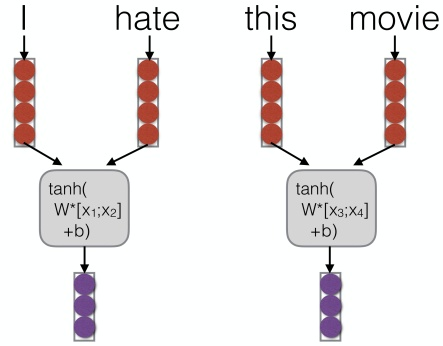

<details>
<summary>flowchart</summary>

```mermaid
graph LR
  I["I"] --> A["&quot;tanh(W*[x1;x2"]+b)"]
  A --> B["hate"]
  B --> C["this"]
  C --> D["movie"]
  D --> E["&quot;tanh(W*[x3;x4"]+b)"]
  E --> F["movie"]
```
</details>

A figure from Graham Neubig’s CS11-747 Neural Networks for NLP at CMU, 2019

## Pooling

Pooling is like convolution, but calculates some reduction function feature-wise
Max pooling: “Did you see this feature anywhere in the range?” (most common)
Average pooling: “How prevalent is this feature over the entire range”
k-Max pooling: “Did you see this feature up to k times?”
Dynamic pooling: “Did you see this feature in the beginning? In the middle? In the end?”

## Stacked Convolution

Feeding in convolution from previous layer results in larger area of focus for each feature


<details>
<summary>flowchart</summary>

```mermaid
graph TD
  A["the actual service"] --> B["the actual"]
  A --> C["actual service was"]
  A --> D["service was not"]
  A --> E["was not very"]
  A --> F["not very good"]
  A --> G["very good"]
  B --> H["the actual service"]
  C --> I["actual service was"]
  D --> J["service was not"]
  E --> K["was not very"]
  F --> L["not very good"]
  G --> M["very good"]
```
</details>

Image Credit: Goldberg Book

## Content


## Convolutional neural networks (CNNs)

Bag of words
Handling Combinations
Convolutional Neural Networks
Non-linear Activation Functions
An example

## Non-linear Functions

Proper choice of a non-linear function is essential in stacked networks
Functions such as RelU or softplus allegedly better at preserving gradients


Image: Wikipedia

## Content


## Convolutional neural networks (CNNs)

Bag of words
Handling Combinations
Convolutional Neural Networks
Non-linear Activation Functions
An example


<details>
<summary>flowchart</summary>

```mermaid
graph TD
  A["Stanford University\nNatural Language Processing"] --> B["NLP"]
  B --> C["S"]
```
</details>

## A 1D convolution for text

| tentative | 0.2 | 0.1 | -0.3 | 0.4 |
| --- | --- | --- | --- | --- |
| deal | 0.5 | 0.2 | -0.3 | -0.1 |
| reached | -0.1 | -0.3 | -0.2 | 0.4 |
| to | 0.3 | -0.3 | 0.1 | 0.1 |
| keep | 0.2 | -0.3 | 0.4 | 0.2 |
| government | 0.1 | 0.2 | -0.1 | -0.1 |
| open | -0.4 | -0.4 | 0.2 | 0.3 |

| t,d,r | -1.0 |
| --- | --- |
| d,r,t | -0.5 |
| r,t,k | -3.6 |
| t,k,g | -0.2 |
| k,g,o | 0.3 |

## Apply a filter (or kernel) of size 3

| 3 | 1 | 2 | -3 |
| --- | --- | --- | --- |
| -1 | 2 | 1 | -3 |
| 1 | 1 | -1 | 1 |

10

Christopher Manning, Natural Language Processing with Deep Learning, Stanford U. CS224n


<details>
<summary>seal</summary>

Stanford University
S
NLP
Natural Language Processing
</details>

1D convolution for text with padding

| ∅ | 0.0 | 0.0 | 0.0 | 0.0 |
| --- | --- | --- | --- | --- |
| tentative | 0.2 | 0.1 | -0.3 | 0.4 |
| deal | 0.5 | 0.2 | -0.3 | -0.1 |
| reached | -0.1 | -0.3 | -0.2 | 0.4 |
| to | 0.3 | -0.3 | 0.1 | 0.1 |
| keep | 0.2 | -0.3 | 0.4 | 0.2 |
| government | 0.1 | 0.2 | -0.1 | -0.1 |
| open | -0.4 | -0.4 | 0.2 | 0.3 |
| ∅ | 0.0 | 0.0 | 0.0 | 0.0 |

| $\emptyset,t,d$ | -0.6 |
| --- | --- |
| t,d,r | -1.0 |
| d,r,t | -0.5 |
| r,t,k | -3.6 |
| t,k,g | -0.2 |
| k,g,o | 0.3 |
| g,o,$\emptyset$ | -0.5 |

Apply a filter (or kernel) of size 3

| 3 | 1 | 2 | -3 |
| --- | --- | --- | --- |
| -1 | 2 | 1 | -3 |
| 1 | 1 | -1 | 1 |

11

Christopher Manning, Natural Language Processing with Deep Learning, Stanford U. CS224n


<details>
<summary>seal</summary>

Stanford University
S
NLP
Natural Language Processing
</details>

3 channel 1D convolution with padding = 1

| ∅ | 0.0 | 0.0 | 0.0 | 0.0 |
| --- | --- | --- | --- | --- |
| tentative | 0.2 | 0.1 | -0.3 | 0.4 |
| deal | 0.5 | 0.2 | -0.3 | -0.1 |
| reached | -0.1 | -0.3 | -0.2 | 0.4 |
| to | 0.3 | -0.3 | 0.1 | 0.1 |
| keep | 0.2 | -0.3 | 0.4 | 0.2 |
| government | 0.1 | 0.2 | -0.1 | -0.1 |
| open | -0.4 | -0.4 | 0.2 | 0.3 |
| ∅ | 0.0 | 0.0 | 0.0 | 0.0 |

Apply 3 filters of size 3

| 3 | 1 | 2 | -3 | 1 | 0 | 0 | 1 | 1 | -1 | 2 | -1 |
| --- | --- | --- | --- | --- | --- | --- | --- | --- | --- | --- | --- |
| -1 | 2 | 1 | -3 | 1 | 0 | -1 | -1 | 1 | 0 | -1 | 3 |
| 1 | 1 | -1 | 1 | 0 | 1 | 0 | 1 | 0 | 2 | 2 | 1 |
| -- |  |  |  |  |  |  |  |  |  |  |  |

| $\emptyset,t,d$ | -0.6 | 0.2 | 1.4 |
| --- | --- | --- | --- |
| t,d,r | -1.0 | 1.6 | -1.0 |
| d,r,t | -0.5 | -0.1 | 0.8 |
| r,t,k | -3.6 | 0.3 | 0.3 |
| t,k,g | -0.2 | 0.1 | 1.2 |
| k,g,o | 0.3 | 0.6 | 0.9 |
| g,o,$\emptyset$ | -0.5 | -0.9 | 0.1 |

Could also use (zero)

padding = 2

Also called “wide convolution”

Christopher Manning, Natural Language Processing with Deep Learning, Stanford U. CS224n


<details>
<summary>seal</summary>

Stanford University
S
NLP
Natural Language Processing
</details>

conv1d, padded with max pooling over time

| ∅ | 0.0 | 0.0 | 0.0 | 0.0 |
| --- | --- | --- | --- | --- |
| tentative | 0.2 | 0.1 | -0.3 | 0.4 |
| deal | 0.5 | 0.2 | -0.3 | -0.1 |
| reached | -0.1 | -0.3 | -0.2 | 0.4 |
| to | 0.3 | -0.3 | 0.1 | 0.1 |
| keep | 0.2 | -0.3 | 0.4 | 0.2 |
| government | 0.1 | 0.2 | -0.1 | -0.1 |
| open | -0.4 | -0.4 | 0.2 | 0.3 |
| ∅ | 0.0 | 0.0 | 0.0 | 0.0 |

| $\emptyset,t,d$ | -0.6 | 0.2 | 1.4 |
| --- | --- | --- | --- |
| t,d,r | -1.0 | 1.6 | -1.0 |
| d,r,t | -0.5 | -0.1 | 0.8 |
| r,t,k | -3.6 | 0.3 | 0.3 |
| t,k,g | -0.2 | 0.1 | 1.2 |
| k,g,o | 0.3 | 0.6 | 0.9 |
| g,o,$\emptyset$ | -0.5 | -0.9 | 0.1 |

| max p | 0.3 | 1.6 | 1.4 |
| --- | --- | --- | --- |

Apply 3 filters of size 3

<table><tr><td rowspan="2"></td><td>3</td><td>1</td><td>2</td><td>-3</td><td rowspan="3"></td><td>1</td><td>0</td><td>0</td><td>1</td><td rowspan="3"></td><td>1</td><td>-1</td><td>2</td><td>-1</td></tr><tr><td>-1</td><td>2</td><td>1</td><td>-3</td><td>1</td><td>0</td><td>-1</td><td>-1</td><td>1</td><td>0</td><td>-1</td><td>3</td></tr><tr><td>13</td><td>1</td><td>1</td><td>-1</td><td>1</td><td>0</td><td>1</td><td>0</td><td>1</td><td>0</td><td>2</td><td>2</td><td>1</td></tr></table>

Christopher Manning, Natural Language Processing with Deep Learning, Stanford U. CS224n


<details>
<summary>flowchart</summary>

```mermaid
graph TD
  A["Stanford University\nNatural Language Processing"] --> B["NLP"]
```
</details>

conv1d, padded with ave pooling over time

| ∅ | 0.0 | 0.0 | 0.0 | 0.0 |
| --- | --- | --- | --- | --- |
| tentative | 0.2 | 0.1 | -0.3 | 0.4 |
| deal | 0.5 | 0.2 | -0.3 | -0.1 |
| reached | -0.1 | -0.3 | -0.2 | 0.4 |
| to | 0.3 | -0.3 | 0.1 | 0.1 |
| keep | 0.2 | -0.3 | 0.4 | 0.2 |
| government | 0.1 | 0.2 | -0.1 | -0.1 |
| open | -0.4 | -0.4 | 0.2 | 0.3 |
| ∅ | 0.0 | 0.0 | 0.0 | 0.0 |

| $\emptyset,t,d$ | -0.6 | 0.2 | 1.4 |
| --- | --- | --- | --- |
| t,d,r | -1.0 | 1.6 | -1.0 |
| d,r,t | -0.5 | -0.1 | 0.8 |
| r,t,k | -3.6 | 0.3 | 0.3 |
| t,k,g | -0.2 | 0.1 | 1.2 |
| k,g,o | 0.3 | 0.6 | 0.9 |
| g,o,$\emptyset$ | -0.5 | -0.9 | 0.1 |

| ave p | -0.87 | 0.26 | 0.53 |
| --- | --- | --- | --- |

Apply 3 filters of size 3

<table><tr><td rowspan="2"></td><td>3</td><td>1</td><td>2</td><td>-3</td><td>1</td><td>0</td><td>0</td><td>1</td><td>1</td><td>-1</td><td>2</td><td>-1</td></tr><tr><td>-1</td><td>2</td><td>1</td><td>-3</td><td>1</td><td>0</td><td>-1</td><td>-1</td><td>1</td><td>0</td><td>-1</td><td>3</td></tr><tr><td>14</td><td>1</td><td>1</td><td>-1</td><td>1</td><td>0</td><td>1</td><td>0</td><td>1</td><td>0</td><td>2</td><td>2</td><td>1</td></tr></table>

Christopher Manning, Natural Language Processing with Deep Learning, Stanford U. CS224n


<details>
<summary>seal</summary>

Stanford University
S
NLP
Natural Language Processing
</details>

Other less useful notions: stride = 2

| ∅ | 0.0 | 0.0 | 0.0 | 0.0 |
| --- | --- | --- | --- | --- |
| tentative | 0.2 | 0.1 | -0.3 | 0.4 |
| deal | 0.5 | 0.2 | -0.3 | -0.1 |
| reached | -0.1 | -0.3 | -0.2 | 0.4 |
| to | 0.3 | -0.3 | 0.1 | 0.1 |
| keep | 0.2 | -0.3 | 0.4 | 0.2 |
| government | 0.1 | 0.2 | -0.1 | -0.1 |
| open | -0.4 | -0.4 | 0.2 | 0.3 |
| ∅ | 0.0 | 0.0 | 0.0 | 0.0 |

| $\emptyset,t,d$ | -0.6 | 0.2 | 1.4 |
| --- | --- | --- | --- |
| $d,r,t$ | -0.5 | -0.1 | 0.8 |
| $t,k,g$ | -0.2 | 0.1 | 1.2 |
| $g,o,\emptyset$ | -0.5 | -0.9 | 0.1 |

Apply 3 filters of size 3

<table><tr><td rowspan="2"></td><td>3</td><td>1</td><td>2</td><td>-3</td><td>1</td><td>0</td><td>0</td><td>1</td><td>1</td><td>-1</td><td>2</td><td>-1</td></tr><tr><td>-1</td><td>2</td><td>1</td><td>-3</td><td>1</td><td>0</td><td>-1</td><td>-1</td><td>1</td><td>0</td><td>-1</td><td>3</td></tr><tr><td>16</td><td>1</td><td>1</td><td>-1</td><td>1</td><td>0</td><td>1</td><td>0</td><td>1</td><td>0</td><td>2</td><td>2</td><td>1</td></tr></table>

Christopher Manning, Natural Language Processing with Deep Learning, Stanford U. CS224n


<details>
<summary>seal</summary>

Stanford University
S
NLP
Natural Language Processing
</details>

Less useful: local max pool, stride = 2

| ∅ | 0.0 | 0.0 | 0.0 | 0.0 |
| --- | --- | --- | --- | --- |
| tentative | 0.2 | 0.1 | -0.3 | 0.4 |
| deal | 0.5 | 0.2 | -0.3 | -0.1 |
| reached | -0.1 | -0.3 | -0.2 | 0.4 |
| to | 0.3 | -0.3 | 0.1 | 0.1 |
| keep | 0.2 | -0.3 | 0.4 | 0.2 |
| government | 0.1 | 0.2 | -0.1 | -0.1 |
| open | -0.4 | -0.4 | 0.2 | 0.3 |
| ∅ | 0.0 | 0.0 | 0.0 | 0.0 |

| $\emptyset,t,d$ | -0.6 | 0.2 | 1.4 |
| --- | --- | --- | --- |
| t,d,r | -1.0 | 1.6 | -1.0 |
| d,r,t | -0.5 | -0.1 | 0.8 |
| r,t,k | -3.6 | 0.3 | 0.3 |
| t,k,g | -0.2 | 0.1 | 1.2 |
| k,g,o | 0.3 | 0.6 | 0.9 |
| g,o,$\emptyset$ | -0.5 | -0.9 | 0.1 |
| $\emptyset$ | -Inf | -Inf | -Inf |

Apply 3 filters of size 3

| 3 | 1 | 2 | -3 | 1 | 0 | 0 | 1 | 1 | -1 | 2 | -1 |
| --- | --- | --- | --- | --- | --- | --- | --- | --- | --- | --- | --- |
| -1 | 2 | 1 | -3 | 1 | 0 | -1 | -1 | 1 | 0 | -1 | 3 |
| 1 | 1 | -1 | 1 | 0 | 1 | 0 | 1 | 0 | 2 | 2 | 1 |

| $\emptyset,t,d,r$ | -0.6 | 1.6 | 1.4 |
| --- | --- | --- | --- |
| d,r,t,k | -0.5 | 0.3 | 0.8 |
| t,k,g,o | 0.3 | 0.6 | 1.2 |
| g,o,$\emptyset$,$\emptyset$ | -0.5 | -0.9 | 0.1 |

Christopher Manning, Natural Language Processing with Deep Learning, Stanford U. CS224n


<details>
<summary>seal</summary>

Stanford University
S
NLP
Natural Language Processing
</details>

conv1d, k-max pooling over time, k = 2

| ∅ | 0.0 | 0.0 | 0.0 | 0.0 |
| --- | --- | --- | --- | --- |
| tentative | 0.2 | 0.1 | -0.3 | 0.4 |
| deal | 0.5 | 0.2 | -0.3 | -0.1 |
| reached | -0.1 | -0.3 | -0.2 | 0.4 |
| to | 0.3 | -0.3 | 0.1 | 0.1 |
| keep | 0.2 | -0.3 | 0.4 | 0.2 |
| government | 0.1 | 0.2 | -0.1 | -0.1 |
| open | -0.4 | -0.4 | 0.2 | 0.3 |
| ∅ | 0.0 | 0.0 | 0.0 | 0.0 |

| $\emptyset,t,d$ | -0.6 | 0.2 | 1.4 |
| --- | --- | --- | --- |
| t,d,r | -1.0 | 1.6 | -1.0 |
| d,r,t | -0.5 | -0.1 | 0.8 |
| r,t,k | -3.6 | 0.3 | 0.3 |
| t,k,g | -0.2 | 0.1 | 1.2 |
| k,g,o | 0.3 | 0.6 | 0.9 |
| g,o,$\emptyset$ | -0.5 | -0.9 | 0.1 |

| 2-max p | -0.2 | 1.6 | 1.4 |
| --- | --- | --- | --- |
|  | 0.3 | 0.6 | 1.2 |

Apply 3 filters of size 3

<table><tr><td rowspan="2"></td><td>3</td><td>1</td><td>2</td><td>-3</td><td>1</td><td>0</td><td>0</td><td>1</td><td>1</td><td>-1</td><td>2</td><td>-1</td></tr><tr><td>-1</td><td>2</td><td>1</td><td>-3</td><td>1</td><td>0</td><td>-1</td><td>-1</td><td>1</td><td>0</td><td>-1</td><td>3</td></tr><tr><td>18</td><td>1</td><td>1</td><td>-1</td><td>1</td><td>0</td><td>1</td><td>0</td><td>1</td><td>0</td><td>2</td><td>2</td><td>1</td></tr></table>

Christopher Manning, Natural Language Processing with Deep Learning, Stanford U. CS224n

## Content

1 Text Classification
2 Artificial neural networks (ANNs)
3 Multilayer perceptron (MLP)
4 Convolutional neural networks (CNNs)
5 Convolutional Networks for Text Classification
6 Neural Networks Tips and Tricks

## Single Layer CNN for Sentence Classification

Yoon Kim (2014): Convolutional Neural Networks for Sentence Classification. EMNLP 2014.

[https://arxiv.org/pdf/1408.5882.pdf](https://arxiv.org/pdf/1408.5882.pdf)

Code: [https://arxiv.org/pdf/1408.5882.pdf](https://arxiv.org/pdf/1408.5882.pdf) [Theano!, etc.]

A variant of convolutional NNs of Collobert, Weston et al. (2011)
Goal: Sentence classification:

Mainly positive or negative sentiment of a sentence
Other tasks like:

Subjective or objective language sentence
Question classification: about person, location, number, . . .

## Single Layer CNN for Sentence Classification

A simple use of one convolutional layer and pooling
Word vectors: $\mathbf { x } _ { j } \in \mathbb { R } ^ { k }$
Sentence: ${ \pmb x } _ { 1 : n } = { \pmb x } _ { 1 } \oplus { \pmb x } _ { 2 } \oplus \cdots \oplus { \pmb x } _ { n }$ (vectors concatenated)
Concatenation of words in range: $\mathbf { x } _ { i : i + j }$ (symmetric more common)
Convolutional filter: $\boldsymbol { \mathsf { w } } \in \mathbb { R } ^ { h k }$ (over window of h words)
Note, filter is a vector!
Filter could be of size 2, 3, or 4:


<details>
<summary>dendrogram</summary>

| Category | Value 1 | Value 2 |
| --- | --- | --- |
| the | 1.1 | 0.4, 0.3 |
| country | 2.1, 3.3 | — |
| of | 7, 7 | — |
| my | 4, 4.5 | — |
| birth | 2.3, 3.6 | — |
</details>

A figure from Christopher Manning, Natural Language Processing with Deep Learning, Stanford U. CS224n

## Single layer CNN

Filter w is applied to all possible windows (concatenated vectors)
To compute feature (one channel) for CNN layer:

$$
c _ {i} = f (\mathbf {w} ^ {T} \mathbf {x} _ {i: i + h - 1} + b)
$$

Sentence: ${ \pmb x } _ { 1 : n } = { \pmb x } _ { 1 } \oplus { \pmb x } _ { 2 } \oplus \cdots \oplus { \pmb x } _ { n }$
All possible windows of length h: $\{ \pmb { x } _ { 1 : h } , \pmb { x } _ { 2 : h + 1 } , \dots , \pmb { x } _ { n - h + 1 : n } \}$
Result is a feature map: $\mathbf { c } = [ { \pmb { c } } _ { 1 } , { \pmb { c } } _ { 2 } , \dots , { \pmb { c } } _ { n - h + 1 } ] \in \mathbb { R } ^ { n - h + 1 }$


A figure from Christopher Manning, Natural Language Processing with Deep Learning, Stanford U. CS224n

## Single layer CNN

Filter w is applied to all possible windows (concatenated vectors)
To compute feature (one channel) for CNN layer:

$$
c _ {i} = f (\mathbf {w} ^ {T} \mathbf {x} _ {i: i + h - 1} + b)
$$

Sentence: ${ \pmb x } _ { 1 : n } = { \pmb x } _ { 1 } \oplus { \pmb x } _ { 2 } \oplus \cdots \oplus { \pmb x } _ { n }$
All possible windows of length h: $\{ \pmb { x } _ { 1 : h } , \pmb { x } _ { 2 : h + 1 } , \dots , \pmb { x } _ { n - h + 1 : n } \}$
Result is a feature map: $\mathbf { c } = [ { \pmb { c } } _ { 1 } , { \pmb { c } } _ { 2 } , \dots , { \pmb { c } } _ { n - h + 1 } ] \in \mathbb { R } ^ { n - h + 1 }$


A figure from Christopher Manning, Natural Language Processing with Deep Learning, Stanford U. CS224n

## Single Layer CNN for Sentence Classification

Pooling: max-over-time pooling (Collobert et al., 2011) is applied to each feature map

Idea: capture the most important feature — one with the highest value — for each feature map
From feature map $\mathbf { c } = [ c _ { 1 } , c _ { 2 } , \ldots , c _ { n - h + 1 } ]$ with $\pmb { \mathsf { c } } \in \mathbb { R } ^ { n - h + 1 }$ , the pooled feature $\hat { \mathbf { c } } = \mathsf { m a x } \{ \mathbf { c } \}$
This pooling scheme naturally deals with variable sentence lengths

Dropout: penultimate layer with a constraint on $1 2 - 1 0 1 7 = 1 2 0 1 7$ of weight vectors (Hinton et al., 2012)

Dropout prevents co-adaptation of hidden units by randomly dropping out — i.e., setting to zero — a proportion $p$ of the hidden units during forward/backpropagation

Use multiple filter weights w (each producing a feature map), instead of a single filter

Useful to have different window sizes h: filters that look at unigrams, bigrams, tri-grams, 4-grams, etc.

## Single Layer CNN for Sentence Classification

First one convolution, followed by one max-pooling
Used 100 maps each of sizes 3, 4, 5
Simple final softmax layer for output unit y
In forward propagation, dropout uses:

$$
y = \mathbf {w} \cdot (\mathbf {z} \circ \mathbf {r}) + b
$$

◦ is the element-wise multiplication operator and $\mathbf { r } \in \mathbb { R } ^ { m }$ is a ‘masking’ vector of Bernoulli random variables with probability p of being 1
Gradients are backpropagated only through the unmasked units
At test time, the learned weight vectors are scaled by $p$ such that $\hat { \mathsf { w } } = p \mathsf { w }$

## From: Zhang and Wallace

## (2015) A Sensitivity

## Analysis of (and

## Practitioners’ Guide to)

## Convolutional Neural

## Networks for Sentence

## Classification

https://arxiv.org/pdf/1510.03820.pdf

## (follow on paper, not

## famous, but a nice picture)


<details>
<summary>flowchart</summary>

```mermaid
graph LR
  A["Sentence matrix\n7 x 5"] --> B["3 region sizes: 2 filters for each region size totally 6 filters"]
  B --> C["2 feature maps for each region size"]
  C --> D["1-max pooling"]
  D --> E["6 univariate vectors concatenated together to form a single feature vector"]
  E --> F["softmax function regularization in this layer"]
  F --> G["2 classes"]
  G --> H["activation function"]
  H --> I["convolution"]
  I --> A
  J["like this movie very much !"] --> K["d=5"]
  K --> L["1-4 filters"]
  L --> M["2 filters"]
  M --> N["3 region sizes: (2,3,4)"]
  N --> O["2 feature maps"]
  O --> P["6 univariate vectors"]
```
</details>

Experiments

| Model | MR | SST-1 | SST-2 | Subj | TREC | CR | MPQA |
| --- | --- | --- | --- | --- | --- | --- | --- |
| CNN-rand | 76.1 | 45.0 | 82.7 | 89.6 | 91.2 | 79.8 | 83.4 |
| CNN-static | 81.0 | 45.5 | 86.8 | 93.0 | 92.8 | 84.7 | 89.6 |
| CNN-non-static | 81.5 | 48.0 | 87.2 | 93.4 | 93.6 | 84.3 | 89.5 |
| CNN-multichannel | 81.1 | 47.4 | 88.1 | 93.2 | 92.2 | 85.0 | 89.4 |
| RAE (Socher et al., 2011) | 77.7 | 43.2 | 82.4 | - | - | - | 86.4 |
| MV-RNN (Socher et al., 2012) | 79.0 | 44.4 | 82.9 | - | - | - | - |
| RNTN (Socher et al., 2013) | - | 45.7 | 85.4 | - | - | - | - |
| DCNN (Kalchbrenner et al., 2014) | - | 48.5 | 86.8 | - | 93.0 | - | - |
| Paragraph-Vec (Le and Mikolov, 2014) | - | 48.7 | 87.8 | - | - | - | - |
| CCAE (Hermann and Blunsom, 2013) | 77.8 | - | - | - | - | - | 87.2 |
| Sent-Parser (Dong et al., 2014) | 79.5 | - | - | - | - | - | 86.3 |
| NBSVM (Wang and Manning, 2012) | 79.4 | - | - | 93.2 | - | 81.8 | 86.3 |
| MNB (Wang and Manning, 2012) | 79.0 | - | - | 93.6 | - | 80.0 | 86.3 |
| G-Dropout (Wang and Manning, 2013) | 79.0 | - | - | 93.4 | - | 82.1 | 86.1 |
| F-Dropout (Wang and Manning, 2013) | 79.1 | - | - | 93.6 | - | 81.9 | 86.3 |
| Tree-CRF (Nakagawa et al., 2010) | 77.3 | - | - | - | - | 81.4 | 86.1 |
| CRF-PR (Yang and Cardie, 2014) | - | - | - | - | - | 82.7 | - |
| SVMS (Silva et al., 2011) | - | - | - | - | 95.0 | - | - |

## Content

1 Text Classification
2 Artificial neural networks (ANNs)
3 Multilayer perceptron (MLP)
4 Convolutional neural networks (CNNs)
5 Convolutional Networks for Text Classification
6 Neural Networks Tips and Tricks

## We have models with many params! Regularization!

Really a full loss function in practice includes regularization over all parameters θ, e.g., L2 regularization:

$$
J (\theta) = \frac {1}{N} \sum_ {i = 1} ^ {N} - \log \left(\frac {e ^ {f _ {y _ {i}}}}{\sum_ {c = 1} ^ {C} e ^ {f _ {c}}}\right) + \lambda \sum_ {k} \theta_ {k} ^ {2}
$$

Regularization produces models that generalize well when we have a lot of features (or later a very powerful/deep model, ++)
We do not care that our models overfit on the training data


<details>
<summary>line</summary>

| Model Power | Training Error | Test Error |
| --- | --- | --- |
| Low | High | High |
| Medium | Low | Low (Lack of generalization) |
| High | Very Low | High |
</details>

A figure from Christopher Manning, Natural Language Processing with Deep Learning, Stanford U. CS224n

## Dropout

**(Srivastava, Hinton, Krizhevsky, Sutskever, & Salakhutdinov 2012/JMLR 2014)**

## Preventing Feature Co-adaptation = Regularization

Training time: at each instance of evaluation (in online SGD-training), randomly set 50% of the inputs to each neuron to 0
Test time: halve the model weights (now twice as many)
This prevents feature co-adaptation: A feature cannot only be useful in the presence of particular other features
In a single layer: A kind of middle-ground between Naïve Bayes (where all feature weights are set independently) and logistic regression models (where weights are set in the context of all others)
Can be thought of as a form of model bagging
Nowadays usually thought of as a strong, feature-dependent regularizer [Wager, Wang, & Liang 2013]

## Vectorization

E.g., looping over word vectors versus concatenating them all into one large matrix and then multiplying the softmax weights with that matrix

Code:

```python
from numpy import random

N = 500  # number of windows to classify
d = 300  # dimensionality of each window
C = 5  # number of classes
W = random.rand(C, d)
wordvectors_list = [random.rand(d, 1) for i in range(N)]
wordvectors_one_matrix = random.rand(d, N)

# timeit [W.dot(wordvectors_list[i]) for i in range(N)]
# timeit W.dot(wordvectors_one_matrix)
```

1000 loops, best of 3: 639 µs per loop 10000 loops, best of 3: 53.8 µs per loop

## Vectorization

## Code:

from numpy import random

```python
N = 500  # number of windows to classify
d = 300  # dimensionality of each window
C = 5  # number of classes
W = random.rand(C, d)
wordvectors_list = [random.rand(d, 1) for i in range(N)]
wordvectors_one_matrix = random.rand(d, N)

# timeit [W.dot(wordvectors_list[i]) for i in range(N)]
# timeit W.dot(wordvectors_one_matrix)
```

The (10x) faster method is using a C x N matrix
Always try to use vectors and matrices rather than for loops!
You should speed-test your code a lot too!!
These differences go from 1 to 2 orders of magnitude with GPUs
tl;dr: Matrices are awesome!!!

## Non-linearities: The starting points

logistic (“sigmoid”)

$$
f (z) = \frac {1}{1 + e ^ {- z}}
$$


<details>
<summary>line</summary>

| X | Y |
| --- | --- |
| -6 | 0 |
| -4 | ~0.05 |
| -2 | ~0.25 |
| 0 | 0.5 |
| 2 | ~0.85 |
| 4 | ~0.98 |
| 6 | 1 |
</details>


<details>
<summary>line</summary>

| X | Y |
| --- | --- |
| -5 | -1 |
| -4 | -1 |
| -3 | ~-0.98 |
| -2 | ~-0.75 |
| -1 | ~-0.25 |
| 0 | 0.25 |
| 1 | ~0.65 |
| 2 | ~0.95 |
| 3 | 1 |
| 4 | 1 |
| 5 | 1 |
</details>


<details>
<summary>line</summary>

| X | Y |
| --- | --- |
| -4 | 1 |
| -3 | 1 |
| -2 | 1 |
| -1 | 1 |
| 0 | ~0.5 |
| 1 | 1 |
| 2 | 1 |
| 3 | 1 |
| 4 | 1 |
</details>

tanh is just a rescaled and shifted sigmoid $( 2 \times$ as steep, [−1, 1]):

$$
\tanh (z) = 2 \text {logistic} (2 z) - 1
$$

Both logistic and tanh are still used in particular uses, but are no longer the defaults for making deep networks

A figure from Christopher Manning, Natural Language Processing with Deep Learning, Stanford U. CS224n

## Non-linearities: The new world order

ReLU (rectified linear unit)

$$
\operatorname{rect} (z) = \max (z, 0)
$$


<details>
<summary>line</summary>

| x | f(x) |
| --- | --- |
| -3 | 0 |
| -2 | 0 |
| -1 | 0 |
| 0 | 0 |
| 1 | 1 |
| 2 | 2 |
| 3 | 3 |
</details>

Leaky ReLU / hard tanh


<details>
<summary>line</summary>

| X | y=x | y=0.01x | Parametric ReLU |
| --- | --- | --- | --- |
| -3 | — | ~0.25 | ~-0.25 |
| 0 | 0 | 0 | 0 |
| 3 | 3 | — | — |
</details>

Swish / Parametric ReLU

[Ramachandran, Zoph & Le 2017]


<details>
<summary>line</summary>

| X | Y |
| --- | --- |
| 0 | ~0.1 |
| ~0.2 | ~-0.3 |
| ~0.4 | ~0.5 |
| ~0.6 | ~3.5 |
| ~0.8 | ~7.5 |
| ~1.0 | ~10.0 |
</details>

For building a deep feed-forward network, the first thing you should try is ReLU — it trains quickly and performs well due to good gradient backflow

## Which Non-linearity Should I Use?

Ultimately an empirical question
Many new functions proposed, but search by Eger et al. (2018) over NLP tasks found that standard functions such as tanh and relu quite robust

| sigmoid | $f(x) = \sigma(x) = 1/(1 + \exp(-x))$ |
| --- | --- |
| swish | $f(x) = x \cdot \sigma(x)$ |
| maxsig | $f(x) = \max\{x, \sigma(x)\}$ |
| cosid | $f(x) = \cos(x) - x$ |
| minsin | $f(x) = \min\{x, \sin(x)\}$ |
| arctid | $f(x) = \arctan(x)^2 - x$ |
| maxtanh | $f(x) = \max\{x, \tanh(x)\}$ |
| lrelu-0.01 | $f(x) = \max\{x, 0.01x\}$ |
| lrelu-0.30 | $f(x) = \max\{x, 0.3x\}$ |
| penalized tanh | $f(x) = \begin{cases} \tanh(x) & x > 0 \\ 0.25 \tanh(x) & x \leq 0 \end{cases}$ |

| best | penalized tanh (6), swish (6), elu (4), relu (4), Irelu-0.01 (4) |
| --- | --- |
| mean | penalized tanh (16), tanh (13) sin (10) |

Top-3 winner statistics. In brackets: number of times within top-3, keeping only functions with four or more top-3 rankings.

## Parameter Initialization

You normally must initialize weights to small random values
To avoid symmetries that prevent learning/specialization
Initialize hidden layer biases to 0 and output (or reconstruction) biases to optimal value if weights were 0 (e.g. mean target or inverse sigmoid of mean target)
Initialize all other weights ∼ Uniform(−r, r), with r chosen so numbers get neither too big or too small
Xavier initialization has variance inversely proportional to fan-in $n _ { i n }$ (previous layer size) and fan-out $n _ { o u t }$ (next layer size):

$$
\text {Var} (W _ {i}) = \frac {2}{n _ {i n} + n _ {o u t}}
$$

## Optimizers

Usually, plain SGD will work just fine
However, getting good results will often require hand-tuning the learning rate (next slide)
For more complex nets and situations, you often do better with more sophisticated “adaptive” optimizers that scale the parameter adjustment by an accumulated gradient
Popular choices today:

AdamW — the long-time industry default for LLM training: stable and robust to hyperparameters
Muon — a recent matrix-preconditioned optimizer, used to train Kimi K2 and Moonlight (∼2× compute efficiency)
SOAP, Shampoo — the matrix-preconditioned family
Adagrad — the classic that started adaptive methods
. . .

The fastest optimizers precondition gradients with matrices rather than scalars — but their speedup shrinks with model scale (1.4× at 0.1 B → 1.1× at 1.2B parameters)

## Learning Rates

You can just use a constant learning rate. Start around $I r = 0 . 0 0 1 ?$
It must be order of magnitude right — try powers of 10

Too big: model may diverge or not converge
Too small: your model may not have trained by the deadline

Better results are generally obtained with warmup + decay:

Warmup: ramp lr up from $\approx 0$ to $I r _ { 0 }$ over the first ∼1% of steps — crucial for stable transformer training
Cosine decay to $h _ { m i n }$ is the modern default:

$$
I r _ {t} = I r _ {\min} + \frac {1}{2} (I r _ {0} - I r _ {\min}) (1 + \cos (\pi t / T))
$$

Classic alternatives: halve the lr every k epochs, exponential decay $I r = I r _ { 0 }   e ^ { - k t }$ ; warmup-stable-decay (WSD) is a recent popular schedule

An epoch = a pass through the data (shuffled or sampled)
Fancier optimizers still use a learning rate but it may be an initial rate that the optimizer shrinks — so may need to start high

## Content

1 Text Classification
2 Artificial neural networks (ANNs)
3 Multilayer perceptron (MLP)
4 Convolutional neural networks (CNNs)
5 Convolutional Networks for Text Classification
6 Neural Networks Tips and Tricks