# Natural Language Processing and LLMs Lecture 04: Language Models; Recurrent Neural Networks; Sequence Tagging<!-- omit in toc -->

Valentin Malykh, MWS AI 

Autumn 2026 

The course is delivered at MIPT, HSE (Moscow), ITMO (Saint Petersburg), and IITU (Almaty)

- [1 Language Models (LMs)](#1-language-models-lms)
  - [How can we define a language? (Recap)](#how-can-we-define-a-language-recap)
  - [How can we define a language? (Recap) The set theory approach](#how-can-we-define-a-language-recap-the-set-theory-approach)
  - [How can we define a language? — The probabilistic approach](#how-can-we-define-a-language--the-probabilistic-approach)
  - [Language Modeling](#language-modeling)
  - [LMs are extremely powerful tools](#lms-are-extremely-powerful-tools)
  - [You use Language Models every day!](#you-use-language-models-every-day)
  - [NLP tasks as Conditional LMs](#nlp-tasks-as-conditional-lms)
- [2 N-gram Language Models](#2-n-gram-language-models)
  - [n-gram Language Models](#n-gram-language-models)
  - [Bigram LM: Parameters](#bigram-lm-parameters)
  - [Bigram LM: Probabilities](#bigram-lm-probabilities)
  - [n-gram Language Models: Example](#n-gram-language-models-example)
  - [Sparsity Problems with n-gram Language Models](#sparsity-problems-with-n-gram-language-models)
  - [Storage Problems with n-gram Language Models](#storage-problems-with-n-gram-language-models)
  - [n-gram Language Models in practice](#n-gram-language-models-in-practice)
- [3 Language Models Based on Recurrent Neural Networks](#3-language-models-based-on-recurrent-neural-networks)
  - [How to build a neural Language Model?](#how-to-build-a-neural-language-model)
  - [A fixed-window neural Language Model](#a-fixed-window-neural-language-model)
  - [Recurrent Neural Networks (RNN)](#recurrent-neural-networks-rnn)
    - [A Simple RNN Language Model](#a-simple-rnn-language-model)
    - [RNN Language Models](#rnn-language-models)
  - [Training an RNN Language Model](#training-an-rnn-language-model)
    - [Backpropagation for RNNs](#backpropagation-for-rnns)
    - [Multivariable Chain Rule](#multivariable-chain-rule)
    - [Backpropagation for RNNs: Proof sketch](#backpropagation-for-rnns-proof-sketch)
    - [Backpropagation for RNNs](#backpropagation-for-rnns-1)
  - [Other applications of neural language models](#other-applications-of-neural-language-models)
    - [Generating text with a RNN Language Model](#generating-text-with-a-rnn-language-model)
  - [Let’s have some fun!](#lets-have-some-fun)
    - [RNNs can be used for sentence classification](#rnns-can-be-used-for-sentence-classification)
    - [RNNs can be used as an encoder module](#rnns-can-be-used-as-an-encoder-module)
    - [A note on terminology](#a-note-on-terminology)
  - [Evaluation of language models](#evaluation-of-language-models)
    - [Evaluating Language Models](#evaluating-language-models)
  - [RNNs have greatly improved perplexity](#rnns-have-greatly-improved-perplexity)
  - [Vanishing gradient](#vanishing-gradient)
    - [Vanishing gradient intuition](#vanishing-gradient-intuition)
    - [Vanishing gradient proof sketch](#vanishing-gradient-proof-sketch)
    - [Why is vanishing gradient a problem?](#why-is-vanishing-gradient-a-problem)
    - [Effect of vanishing gradient on RNN-LM](#effect-of-vanishing-gradient-on-rnn-lm)
    - [How to fix vanishing gradient problem?](#how-to-fix-vanishing-gradient-problem)
  - [Long Short Term Memory (LSTM)](#long-short-term-memory-lstm)
    - [Long Short-Term Memory (LSTM)](#long-short-term-memory-lstm-1)
    - [How does LSTM solve vanishing gradients?](#how-does-lstm-solve-vanishing-gradients)
    - [LSTMs: real-world success](#lstms-real-world-success)
  - [Gated Recurrent Units (GRUs)](#gated-recurrent-units-grus)
    - [LSTM vs GRU](#lstm-vs-gru)
  - [Exploding gradient](#exploding-gradient)
    - [Why is exploding gradient a problem?](#why-is-exploding-gradient-a-problem)
    - [Gradient clipping: solution for exploding gradient](#gradient-clipping-solution-for-exploding-gradient)
  - [Vanishing and exploding gradient for other neural networks](#vanishing-and-exploding-gradient-for-other-neural-networks)
    - [Is vanishing/exploding gradient just a RNN problem?](#is-vanishingexploding-gradient-just-a-rnn-problem)
  - [Bi-directional RNNs and multi-layer RNNs](#bi-directional-rnns-and-multi-layer-rnns)
    - [Bidirectional RNNs: motivation](#bidirectional-rnns-motivation)
    - [Bidirectional RNNs](#bidirectional-rnns)
    - [Bidirectional RNNs: simplified diagram](#bidirectional-rnns-simplified-diagram)
    - [Bidirectional RNNs](#bidirectional-rnns-1)
  - [Multi-layer RNNs](#multi-layer-rnns)
    - [Multi-layer RNNs](#multi-layer-rnns-1)
    - [Multi-layer RNNs in practice](#multi-layer-rnns-in-practice)
- [4 Sequence Tagging](#4-sequence-tagging)
  - [Named Entity Recognition (NER)](#named-entity-recognition-ner)
  - [Three approaches to NER](#three-approaches-to-ner)
  - [Hand-written Patterns for Information Extraction](#hand-written-patterns-for-information-extraction)
  - [The Named Entity Recognition Task](#the-named-entity-recognition-task)
  - [Encoding classes for sequence labeling](#encoding-classes-for-sequence-labeling)
  - [RNNs can be used for tagging](#rnns-can-be-used-for-tagging)
- [Content](#content)

---

## 1 Language Models (LMs) 

### How can we define a language? (Recap)

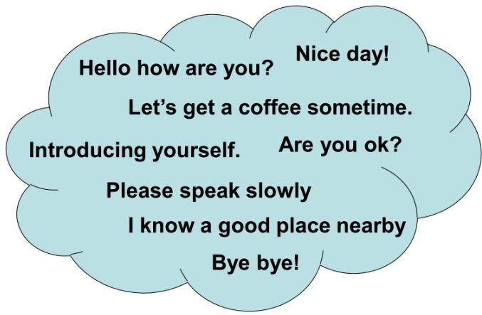


### How can we define a language? (Recap) The set theory approach

- A language can be defined as the set of sentences which can be accepted by the speakers of that language. 

- It is not possible to define a natural language by enumerating al the sentences, because the number of sentences in a natura language is infinite. 

- Two feasible ways to define a language with infinite sentences: 
  - By a Grammar  
  - By an Automaton  

---

### How can we define a language? — The probabilistic approach

- A language can also be defined as a probabilistic distribution over all the possible sentences. 

- A statistical language model is a probability distribution over sequences of words (sentences) in a given language L: 

$$
\sum_ {s \in V ^ {+}} P _ {L M} (s) = 1
$$

- Or: 

$$
\sum_{\substack{s = w_{1}w_{2}\ldots w_{n}\\ w_{i}\in V,n > 0}}P_{LM}(s) = 1
$$

---

### Language Modeling

- **Language Modeling** is the task of predicting what word comes next. 

$$
\text{the students opened their }\begin{cases}
  \text{books}\\
  \text{laptops}\\
  \text{exams}\\
  \text{minds}\\
\end{cases}
$$

- More formally: given a sequence of words $\mathbf { x } ^ { ( 1 ) } , \ldots , \mathbf { x } ^ { ( t ) }$ , compute the probability distribution of the next word $\mathbf { x } ^ { ( t + 1 ) }$ 

$$
P \left(\mathbf {x} ^ {(t + 1)} \mid \mathbf {x} ^ {(t)}, \dots , \mathbf {x} ^ {(1)}\right)
$$

- where $\mathbf { x } ^ { ( t + 1 ) }$ can be any word in the vocabulary 

$$
V = \left\{\mathbf {w} _ {1}, \dots , \mathbf {w} _ {\vert V \vert} \right\}
$$

- A system that does this is called a **Language Model**. 

---

- You can also think of a Language Model as a system that **assigns probability to a piece of text**. 

- For example, if we have some text $\chi ^ { ( 1 ) } , \ldots , \chi ^ { ( T ) }$ , then the probability of this text (according to the Language Model) is: 

$$
P \big (x ^ {(1)}, \ldots , x ^ {(T)} \big) = P \big (x ^ {(1)} \big) \times P \big (x ^ {(2)} \mid x ^ {(1)} \big) \times \ldots \times P \big (x ^ {(T)} \mid x ^ {(T - 1)}, \ldots , x ^ {(1)} \big) \\ 
= \prod_ {t = 1} ^ {T} P \big (x ^ {(t)} \mid x ^ {(t - 1)}, \ldots , x ^ {(1)} \big) 
$$

- **This is what our LM provides** 

---

### LMs are extremely powerful tools

- The definition of LMs is simple but LMs are extremely powerful tools in NLP 

- A number of NLP problems could be viewed as variations of language modelling problems, and can be solved by LMs. 

- Text generation / Data to text / Image captioning / Text summarization  
  - Machine translation  
  - Speech Recognition  
  - Reading Comprehension  
  - POS tagging / Entity recognition / Parsing  

- Any task which could be transformed into a sequential problem is suitable for LMs 

---

### You use Language Models every day!


---


---

### NLP tasks as Conditional LMs

| x "input" | w "text output" |
| --- | --- |
| An author | A document written by that author |
| A topic label | An article about that topic |
| {SPAM, NOT_SPAM} | An email |
| A sentence in French | Its English translation |
| A sentence in English | Its French translation |
| A sentence in English | Its Chinese translation |
| An image | A text description of the image |
| A document | Its summary |
| A document | Its translation |
| Meteorological measurements | A weather report |
| Acoustic signal | Transcription of speech |
| Conversational history + database | Dialogue system response |
| A question + a document | Its answer |
| A question + an image | Its answer |

---

## 2 N-gram Language Models

### n-gram Language Models

- Question: How to learn a Language Model?

- Answer (pre-Deep Learning): learn an n-gram Language Model!

- Definition: A n-gram is a chunk of n consecutive words.  
  - unigrams: “the”, “students”, “opened”, “their”  
  - bigrams: “the students”, “students opened”, “opened their”  
  - trigrams: “the students opened”, “students opened their”  
  - 4-grams: “the students opened their”

- Idea: Collect statistics about how frequent different n-grams are, and use these to predict next word.

---

- First we make a Markov assumption: $\mathbf { X } ^ { ( t + 1 ) }$ depends only on the preceding $n - 1$ words.

$$

\begin{split} 
  P \big (\mathbf {x} ^ {(t + 1)} \mid \mathbf {x} ^ {(t)}, \ldots , \mathbf {x} ^ {(1)} \big) &= P \big (\mathbf {x} ^ {(t + 1)} \mid \overbrace {\mathbf {x} ^ {(t)} , \ldots , \mathbf {x} ^ {(t - n + 2)}} ^ {n - 1 \text {words}}\left. \right)\qquad\text{(assumption)}\\

  \begin{split}
    \text{prob of a n-gram}\longrightarrow\\
    \text{prob of a (n-1)-gram}\longrightarrow
  \end{split}
   &= \frac{\boxed{P \big (\mathbf {x} ^ {(t + 1)}, \mathbf {x} ^ {(t)}, \dots , \mathbf {x} ^ {(t - n + 2)} \big)}}{\boxed{P \big (\mathbf {x} ^ {(t)} , \dots , \mathbf {x} ^ {(t - n + 2)} \big)}}\qquad\text{(definition of conditional prob)}
\end{split}
$$

- <strong><u>Question:</u></strong> How do we get these n-gram and (n-1)-gram probabilities?

- <strong><u>Answer:</u></strong> By counting them in some large corpus of text!

$$
\approx \frac {\operatorname{count} \left(\mathbf {x} ^ {(t + 1)} , \mathbf {x} ^ {(t)} , \dots , \mathbf {x} ^ {(t - n + 2)}\right)}{\operatorname{count} \left(\mathbf {x} ^ {(t)} , \dots , \mathbf {x} ^ {(t - n + 2)}\right)}
\qquad \text{(statistical approximation)}
$$

---

### Bigram LM: Parameters

|  | i | want | to | eat | chinese | food | lunch | spend |
| --- | --- | --- | --- | --- | --- | --- | --- | --- |
| i | 5 | 827 | 0 | 9 | 0 | 0 | 0 | 2 |
| want | 2 | 0 | 608 | 1 | 6 | 6 | 5 | 1 |
| to | 2 | 0 | 4 | 686 | 2 | 0 | 6 | 211 |
| eat | 0 | 0 | 2 | 0 | 16 | 2 | 42 | 0 |
| chinese | 1 | 0 | 0 | 0 | 0 | 82 | 1 | 0 |
| food | 15 | 0 | 15 | 0 | 1 | 4 | 0 | 0 |
| lunch | 2 | 0 | 0 | 0 | 0 | 1 | 0 | 0 |
| spend | 1 | 0 | 1 | 0 | 0 | 0 | 0 | 0 |

---

### Bigram LM: Probabilities

- Normalize by unigrams:

$$
P (w _ {n} \mid w _ {n - 1}) = \frac {C (w _ {n - 1} w _ {n})}{C (w _ {n - 1})}
$$

|  | i | want | to | eat | chinese | food | lunch | spend |
| --- | --- | --- | --- | --- | --- | --- | --- | --- |
| C(w) | 2533 | 927 | 2417 | 746 | 158 | 1093 | 341 | 278 |
| i | .002 | .33 | 0 | .0036 | 0 | 0 | 0 | .00079 |
| want | .0022 | 0 | .66 | .0011 | .0065 | .0065 | .0054 | .0011 |
| to | .00083 | 0 | .0017 | .28 | .00083 | 0 | .0025 | .087 |
| eat | 0 | 0 | .0027 | 0 | .021 | .0027 | .056 | 0 |
| chinese | .0063 | 0 | 0 | 0 | 0 | .52 | .0063 | 0 |
| food | .014 | 0 | .014 | 0 | .00092 | .0037 | 0 | 0 |
| lunch | .0059 | 0 | 0 | 0 | 0 | .0029 | 0 | 0 |
| spend | .0036 | 0 | .0036 | 0 | 0 | 0 | 0 | 0 |

---

### n-gram Language Models: Example

Suppose we are learning a 4-gram Language Model.

$$
\underset{\text{discard}}{\sout{\text{as the proctor started the clock}}}\text{, }\underbrace{\text{the students opened their}}_{\text{condition on this}}\ \underline{\qquad} \\
$$

$$
P (\mathbf {w} \mid \text {students opened their}) = \frac {\text {count(students opened their } \mathbf {w})}{\text {count(students opened their)}}
$$

<u>For example, suppose that in the corpus:</u>

- “students opened their” occurred 1000 times

- “students opened their books” occurred 400 times

  - → $P(\text{books} \vert \text{students opened their}) = 0.4$

- “students opened their exams” occurred 100 times

  - → $P(\text{exams} \vert \text{students opened their}) = 0.1$

> Should we have discarded the “proctor” context?

---

### Sparsity Problems with n-gram Language Models

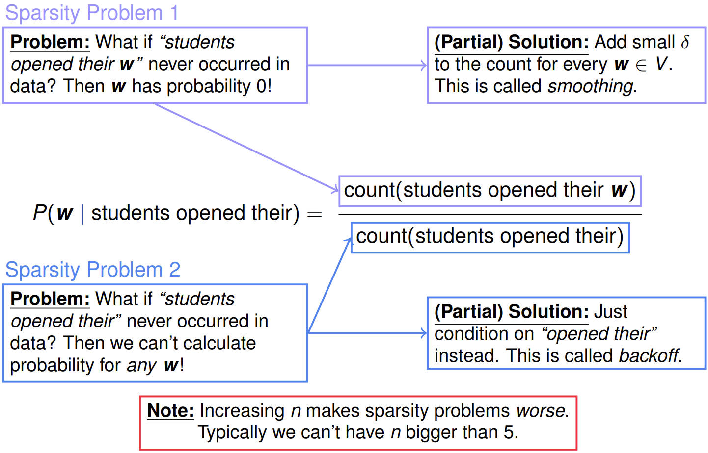

<details>

**Sparsity Problem 1**

<strong><u>Problem:</u></strong> What if “students opened their $\mathbf w$” never occurred in data? Then $\mathbf w$ has probability 0!

<strong><u>(Partial) Solution:</u></strong> Add small $\delta$ to the count for every $\mathbf w \in V$. This is called *smoothing*.

$$
P(\mathbf {w} \vert \text{students opened their})=\dfrac{\text{count}(\text{students opened their }\mathbf{w})}{\text{count}(\text{students opened their})}
$$

**Sparsity Problem 2**

<strong><u>Problem:</u></strong> What if *“students opened their”* never occurred in data? Then we can’t calculate probability for *any* $\mathbf w$!

<strong><u>(Partial) Solution:</u></strong> Just condition on *“opened their”* instead. This is called *backoff*.

<strong><u>Note:</u></strong> Increasing $n$ makes sparsity problems worse. Typically we can’t have $n$ bigger than 5.

</details>

---

### Storage Problems with n-gram Language Models

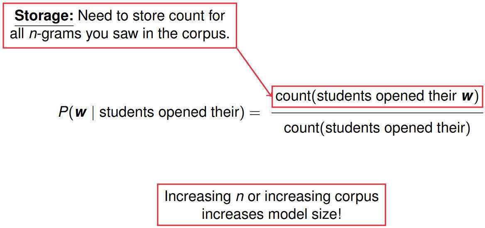

<details>

<strong><u>Storage:</u></strong> Need to store count for all n-grams you saw in the corpus.

$$
P(\mathbf{w} \vert \text{students opened their})=\dfrac{\text{count(students opened their }\mathbf{w})}{\text{count(students opened their)}}
$$

Increasing $n$ or increasing corpus increases model size!

</details>

---

### n-gram Language Models in practice

- You can build a simple trigram Language Model over a 1.7 million word corpus (Reuters) in a few seconds on your laptop

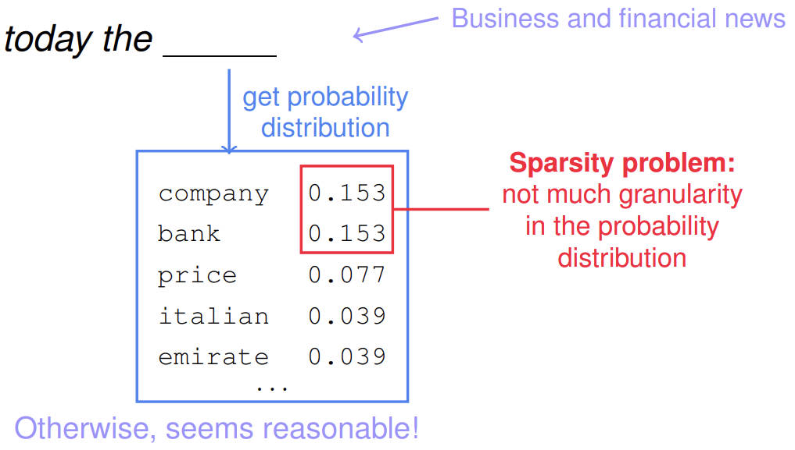

> Try for yourself: [nlpforhackers.io/language-models](https://nlpforhackers.io/language-models/)

---

You can also use a Language Model to **generate text**.

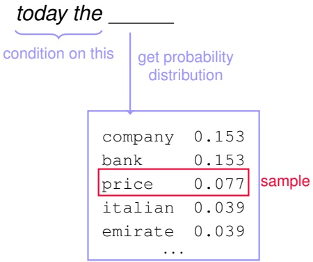

---


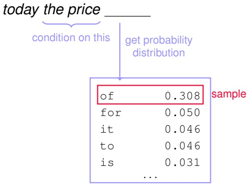

---

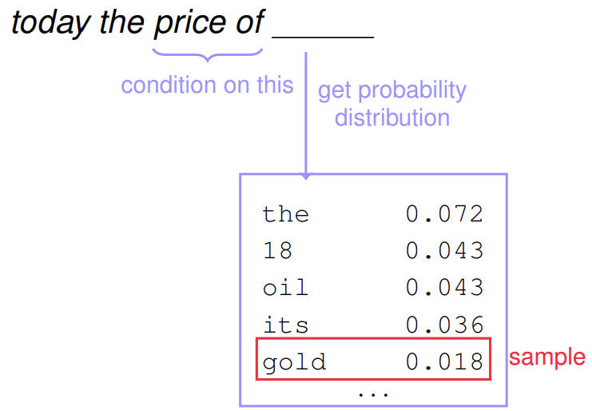

---

> today the price of gold per ton , while production of shoe lasts and shoe industry , the bank intervened just after it considered and rejected an imf demand to rebuild depleted european stocks , sept 30 end primary 76 cts a share .

- Surprisingly grammatical! . . . but incoherent. We need to consider more than three words at a time if we want to model language well.

- But increasing n worsens sparsity problem, and increases model size...

---

## 3 Language Models Based on Recurrent Neural Networks

- Recurrent Neural Networks (RNNs)

- Training a neural language model

- Other applications of neural language models

- Evaluation of language models

- Vanishing gradient

- Long Short Term Memory (LSTM)

- Gated Recurrent Units (GRUs)

- Exploding gradient

- Vanishing and exploding gradient for other neural networks

- Bi-directional RNNs and multi-layer RNNs

### How to build a neural Language Model?

- Recall the Language Modeling task:

  - Input: sequence of words $\mathbf { x } ^ { ( 1 ) } , \mathbf { x } ^ { ( 2 ) } , \ldots , \mathbf { x } ^ { ( t ) }$  
  - Output: prob dist of the next word $P ( { \mathbf x } ^ { ( t + 1 ) } \mid { \mathbf x } ^ { ( t ) } , \ldots , { \mathbf x } ^ { ( 1 ) } )$

- How about a window-based neural model? Predict the next word from a fixed window of the last words:

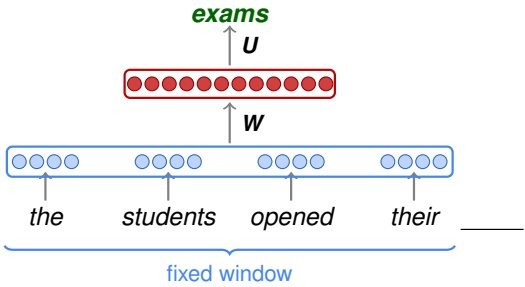

---

### A fixed-window neural Language Model

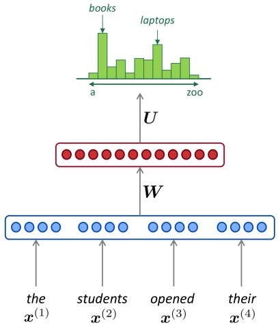

<details>

output distribution $\hat {\mathbf {y}} = \operatorname{softmax} (\mathbf {U h} + \mathbf {b} _ {2}) \in \mathbb {R} ^ {\lvert V \rvert}$

hidden layer $\mathbf {h} = f(\mathbf{W e} + \mathbf{b}_ {1})$

concatenated word embeddings $\mathbf { e } = [ \mathbf { e } ^ { ( 1 ) } ; \mathbf { e } ^ { ( 2 ) } ; \mathbf { e } ^ { ( 3 ) } ; \mathbf { e } ^ { ( 4 ) } ]$

words / one-hot vectors $\mathbf { x } ^ { ( 1 ) } , \mathbf { x } ^ { ( 2 ) } , \mathbf { x } ^ { ( 3 ) } , \mathbf { x } ^ { ( 4 ) }$

</details>

> A figure from Christopher Manning, Natural Language Processing with Deep Learning, Stanford U. CS224n

---

Approximately: Y. Bengio, et al. (2000/2003): A Neural Probabilistic Language Model

**Improvements** over n-gram LM:

- No sparsity problem  
- Don’t need to store all observed n-grams

Remaining **problems**:

- Fixed window is too small  
- Enlarging window enlarges W  
- Window can never be large enough!  
- $\mathbf { X } ^ { ( 1 ) }$ and $\mathbf { X } ^ { ( 2 ) }$ are multiplied by completely different weights in W. No symmetry in how the inputs are processed.

**We need a neural architecture that can process any length input**

> A figure from Christopher Manning, Natural Language Processing with Deep Learning, Stanford U. CS224n

---

### Recurrent Neural Networks (RNN)

A family of neural architectures

Core idea:

Apply the same weights $\mathbf{W}$ repeatedly

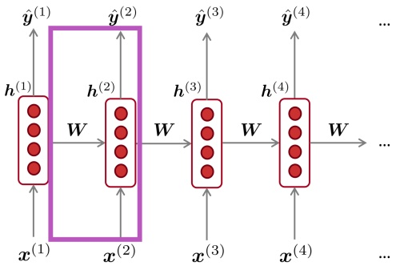

> A figure from Christopher Manning, Natural Language Processing with Deep Learning, Stanford U. CS224n

---

#### A Simple RNN Language Model

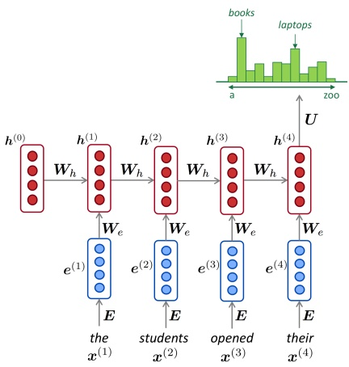

<details>

$\hat { y } ^ { ( 4 ) } = P ( \mathbf { x } ^ { ( 5 ) }\vert \text{the students opened their})$

output distribution $\hat {\mathbf {y}} ^ {(t)} = \operatorname{softmax} \left(\mathbf {U} \mathbf {h} ^ {(t)} + \mathbf {b} _ {2}\right) \in \mathbb {R} ^ {\vert V \vert}$

hidden states  
$\mathbf {h} ^ {(t)} = \sigma \left(\mathbf {W} _ {h} \mathbf {h} ^ {(t - 1)} + \mathbf {W} _ {e} \mathbf {e} ^ {(t)} + \mathbf {b} _ {1}\right)$  
$h ^ { ( 0 ) }$ is the initial hidden state

word embeddings $\mathbf {e} ^ {(t)} = \mathbf {E} \mathbf {x} ^ {(t)}$

words / one-hot vectors $\mathbf {x} ^ {(t)} \in \mathbb {R} ^ {\vert V \vert}$

<u>Note</u>: this input sequence could be much longer, but this slide doesn’t have space!

</details>

> A figure from Christopher Manning, Natural Language Processing with Deep Learning, Stanford U. CS224n

---

#### RNN Language Models

| Advantages | Disadvantages |
| --- | --- |
| ✓ Can process any length input | × Recurrent computation is slow |
| ✓ Computation for step t can (in theory) use information from many steps back |  In practice, difficult to access information from many steps back |
| ✓ Model size doesn’t increase for longer input |  |
| ✓ Same weights applied on every timestep, so there is symmetry in how inputs are processed |  |

(More on these later in the course)

---

### Training an RNN Language Model

- Get a *big corpus of text* which is a sequence of words $\mathbf { x } ^ { ( 1 ) } , \ldots , \mathbf { x } ^ { ( T ) }$

- Feed into RNN-LM; compute output distribution $\hat { y } ^ { ( t ) }$ *for every step* $t$

  - i.e. predict probability dist of every word, given words so far

- *Loss function* on step $t$ is *cross-entropy* between predicted probability distribution $\hat { y } ^ { ( t ) }$ , and the true next word $y ^ { ( t ) }$ (one-hot for $\dot { x } ^ { ( t + 1 ) } )$

$$
J ^ {(t)} (\theta) = C E \big (y ^ {(t)}, \hat {y} ^ {(t)} \big) = - \sum_ {w \in V} y _ {w} ^ {(t)} \log \hat {y} _ {w} ^ {(t)} = - \log \hat {y} _ {x _ {t + 1}} ^ {(t)}
$$

- Average this to get *overall loss* for entire training set:

$$
J (\theta) = \frac {1}{T} \sum_ {t = 1} ^ {T} J ^ {(t)} (\theta) = \frac {1}{T} \sum_ {t = 1} ^ {T} - \log \hat {y} _ {x _ {t + 1}} ^ {(t)}
$$

---

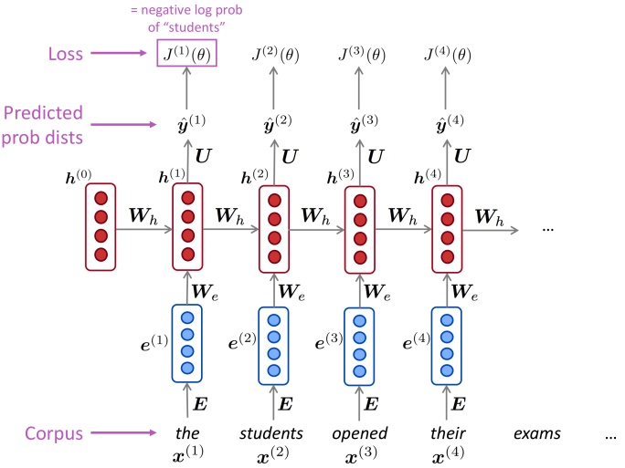

A figure from Christopher Manning, Natural Language Processing with Deep Learning, Stanford U. CS224n

---

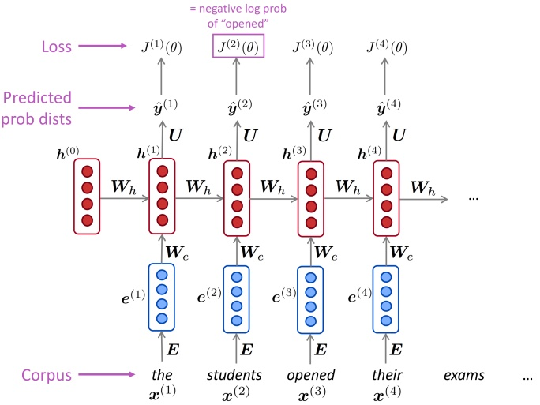

> A figure from Christopher Manning, Natural Language Processing with Deep Learning, Stanford U. CS224n

---

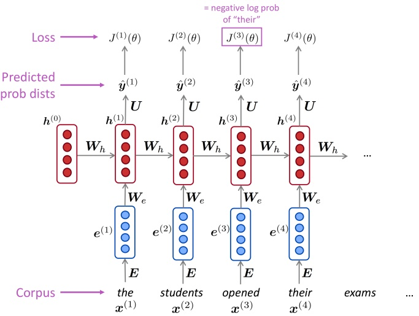

> A figure from Christopher Manning, Natural Language Processing with Deep Learning, Stanford U. CS224n

---

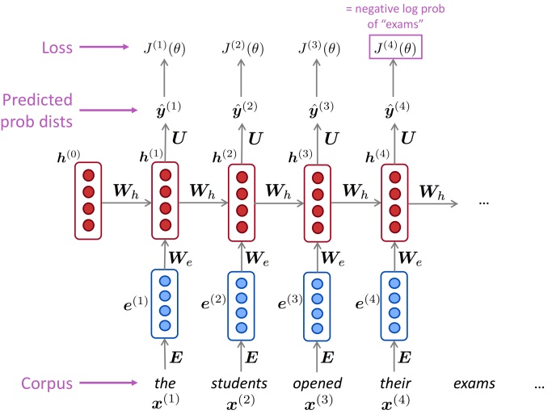

> A figure from Christopher Manning, Natural Language Processing with Deep Learning, Stanford U. CS224n

---

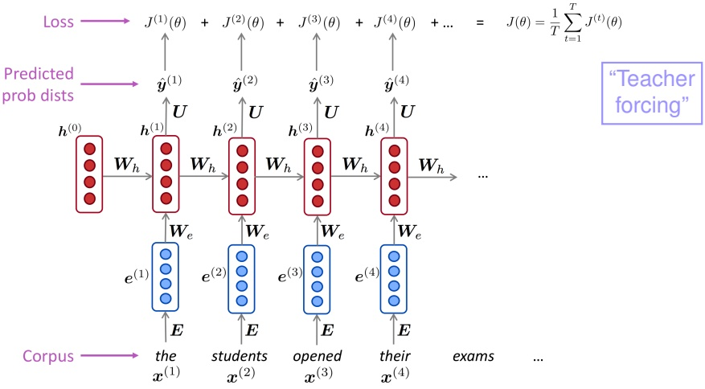

> A figure from Christopher Manning, Natural Language Processing with Deep Learning, Stanford U. CS224n

---

- However: Computing loss and gradients across *entire corpus* is *too expensive*!

- In practice, consider $X ^ { ( t ) }$ as a *sentence* (or a document)

- Recall: *Stochastic Gradient Descent* allows us to compute loss and gradients for small chunk of data, and update

- Compute loss $J ^ { ( t ) }$ for a sentence (actually a batch of sentences), compute gradients and update weights. Repeat.

---

#### Backpropagation for RNNs

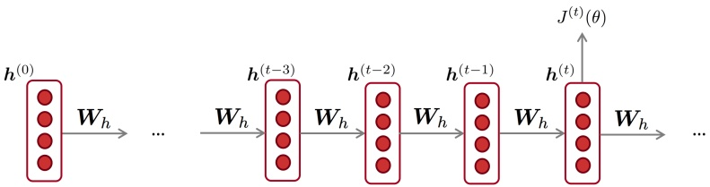

<strong><u>Question:</u></strong> What’s the derivative of $\mathbf { J } ^ { ( t ) } ( \theta )$ w.r.t. the repeated weight matrix $W _ { h } ?$

<strong><u>Answer:</u></strong> $\dfrac { \partial \mathbf { J } ^ { ( t ) } } { \partial \mathbf { W } _ { h } } = \sum _ { i = 1 } ^ { t } \left. \dfrac { \partial \mathbf { J } ^ { ( t ) } } { \partial \mathbf { W } _ { h } } \right\vert _ { ( i ) }$ “The gradient w.r.t. a repeated weight is the sum of the gradient w.r.t. each time it appears”

**Why?**

> A figure from Christopher Manning, Natural Language Processing with Deep Learning, Stanford U. CS224n

---

#### Multivariable Chain Rule

- Given a multivariable function $f ( x , y )$ , and two single variable functions $x ( t )$ and $y ( t )$ , here’s what the multivariable chain rule says:

$$
\underbrace {\frac {d}{d t} f (x (t) , y (t))}_\text {Derivative of composition function}
= \frac {\partial f}{\partial x} \frac {d x}{d t} + \frac {\partial f}{\partial y} \frac {d y}{d t}
$$


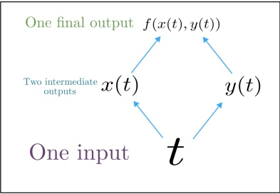

> Source: [Khan Academy: Multivariable chain rule, simple version](https://www.khanacademy.org/math/multivariable-calculus/multivariable-derivatives/differentiating-vector-valued-functions/a/multivariable-chain-rule-simple-version)

---

#### Backpropagation for RNNs: Proof sketch

- Given a multivariable function $f ( x , y )$ , and two single variable functions $x ( t )$ and $y ( t )$ , here’s what the multivariable chain rule says:

$$
\underbrace {\frac {d}{d t} f (x (t) , y (t))}_\text {Derivative of composition function}
= \frac {\partial f}{\partial x} \frac {d x}{d t} + \frac {\partial f}{\partial y} \frac {d y}{d t}
$$

<u>In our example:</u>

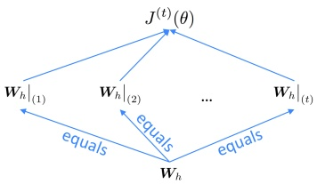

<u>Apply the multivariable chain rule:</u>

$$

\begin{split} 
  \frac {\partial J ^ {(t)}}{\partial \mathbf {W} _ {h}} = \sum_ {i = 1} ^ {t} \left. \frac {\partial J ^ {(t)}}{\partial \mathbf {W} _ {h}} \right\vert _ {(i)} \overset{=1}{\boxed {\frac {\partial \mathbf {W} _ {h} \vert _ {(i)}}{\partial \mathbf {W} _ {h}}}} \\ 
  = \sum_ {i = 1} ^ {t} \left. \frac {\partial J ^ {(t)}}{\partial \mathbf {W} _ {h}} \right\vert _ {(i)} \end{split}
$$

<strong><u>Source:</u></strong> [Khan Academy: Multivariable chain rule, simple version](https://www.khanacademy.org/math/multivariable-calculus/multivariable-derivatives/differentiating-vector-valued-functions/a/multivariable-chain-rule-simple-version)

---

#### Backpropagation for RNNs

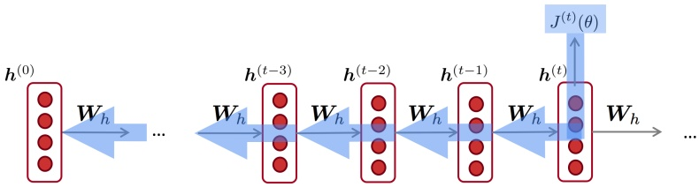

<strong><u>Question:</u></strong> How do we calculate this?

$$
\qquad\qquad\downarrow\\
\frac {\partial J ^ {(t)}}{\partial \mathbf {W} _ {h}} = \boxed{\sum_ {i = 1} ^ {t} \left. \frac {\partial J ^ {(t)}}{\partial \mathbf {W} _ {h}} \right\vert _ {(i)}}\\
$$

<strong><u>Answer:</u></strong> Backpropagate over timesteps $i = t, . . . , 0$, summing gradients as you go. This algorithm is called **“backpropagation through time”** [Werbos, P.G., 1988, Neural Networks 1, and others]

> A figure from Christopher Manning, Natural Language Processing with Deep Learning, Stanford U. CS224n

---

### Other applications of neural language models

#### Generating text with a RNN Language Model

Just like a n-gram Language Model, you can use a RNN Language Model to generate text by repeated sampling. Sampled output is next step’s input.

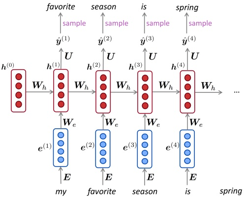

> A figure from Christopher Manning, Natural Language Processing with Deep Learning, Stanford U. CS224n

---

Let’s have some fun!

- You can train a RNN-LM on any kind of text, then generate text in that style.

- RNN-LM trained on *Harry Potter*:


> “Sorry,” Harry shouted, panicking—“I’ll leave those brooms in London, are they?”
> 
> “No idea,” said Nearly Headless Nick, casting low close by Cedric, carrying the last bit of treacle Charms, from Harry’s shoulder, and to answer him the common room perched upon it, four arms held a shining knob from when the spider hadn’t felt it seemed. He reached the teams too.

<strong><u>Source:</u></strong> [medium.com/deep-writing/harry-potter-written-by-artificial-intelligence](https://medium.com/deep-writing/harry-potter-written-by-artificial-intelligence-8a9431803da6)

---

### Let’s have some fun!

- RNN-LM trained on recipes:

```text
Title: CHOCOLATE RANCH BARBECUE
Categories: Game, Casseroles, Cookies, Cookies
Yield: 6 Servings

2 tb Parmesan cheese -- chopped
1 c Coconut milk
3 Eggs, beaten

Place each pasta over layers of lumps. Shape mixture into the moderate oven and simmer until firm. Serve hot in bodied fresh, mustard, orange and cheese.

Combine the cheese and salt together the dough in a large skillet; add the ingredients and stir in the chocolate and pepper.
```


<strong><u>Source:</u></strong> [gist.github.com/nylki/1efbaa36635956d35bcc](https://gist.github.com/nylki/1efbaa36635956d35bcc)

---

#### RNNs can be used for sentence classification

e.g. <u>sentiment classification</u>

How to compute sentence encoding?


> A figure from Christopher Manning, Natural Language Processing with Deep Learning, Stanford U. CS224n

---

How to compute sentence encoding?

<u>Basic way:</u> Use final hidden state

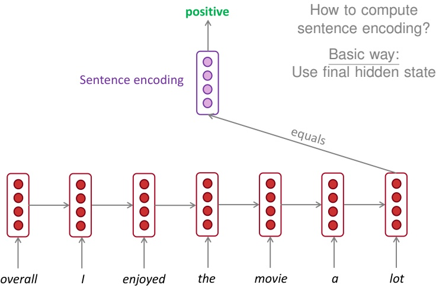

> A figure from Christopher Manning, Natural Language Processing with Deep Learning, Stanford U. CS224n

---

How to compute sentence encoding?

<u>Usually better:</u> Take element-wise max or mean of all hidden states


> A figure from Christopher Manning, Natural Language Processing with Deep Learning, Stanford U. CS224n

---

#### RNNs can be used as an encoder module

e.g. question answering, machine translation, many other tasks!

Here the RNN acts as an **encoder** for the Question (the hidden states represent the Question). The encoder is part of a larger neural system.

<strong><u>Question:</u></strong> what nationality was Beethoven?

<strong><u>Context:</u></strong> Ludwig van Beethoven was a German composer and pianist. A crucial figure ...

<strong><u>Answer:</u></strong> German

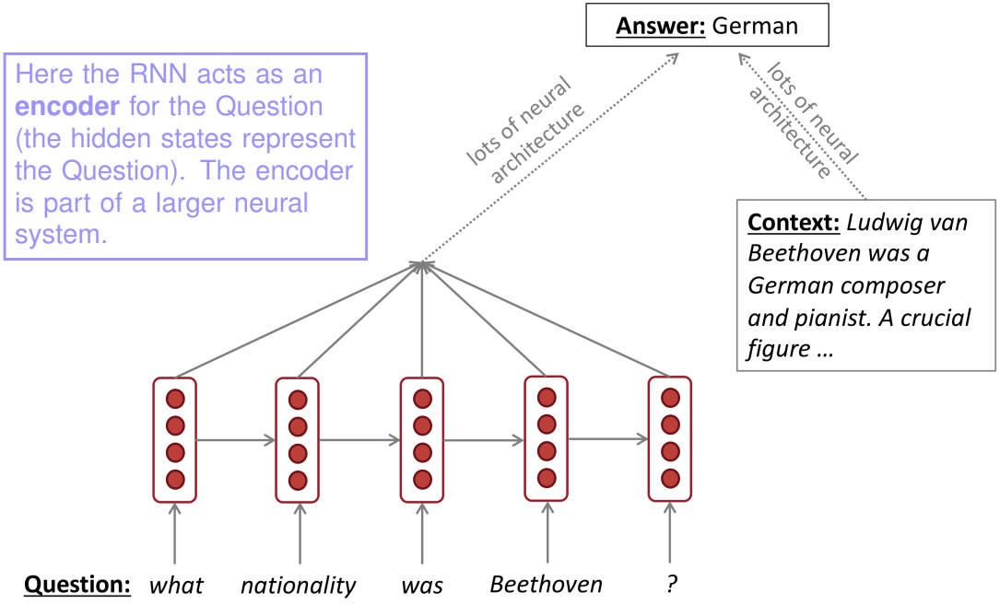

> A figure from Christopher Manning, Natural Language Processing with Deep Learning, Stanford U. CS224n 

---

#### A note on terminology

- The RNN described in this lecture = *simple/vanilla/Elman RNN*

- Next lecture: You will learn about other RNN flavors like **GRU** and **LSTM** and multi-layer RNNs

- By the end of the course: You will understand phrases like *“stacked bidirectional LSTM with residual connections and self-attention”*

---

### Evaluation of language models

#### Evaluating Language Models

- The standard *evaluation metric* for Language Models is *perplexity*.

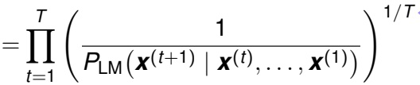

<details>

$$
\text{perplexity} = \underset{\text{Inverse probability of corpus, according to Language Model} }{\underbrace{\prod_ {t = 1} ^ {T} \left(\frac {1}{P _ {\mathrm{LM}} \left(\mathbf {x} ^ {(t + 1)} \mid \mathbf {x} ^ {(t)} , \dots , \mathbf {x} ^ {(1)}\right)}\right)^{1/T}}}^{\leftarrow\text{Normalized by number of words}}
$$

</details>

- This is equal to the exponential of the cross-entropy loss $J ( \theta )$

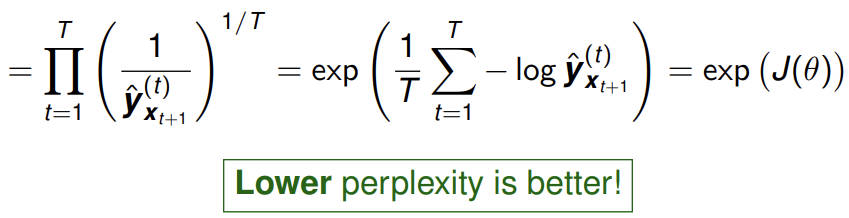

<details>

$$
= \prod_ {t = 1} ^ {T} \left(\frac {1}{\hat {\mathbf {y}} _ {\mathbf {x} _ {t + 1}} ^ {(t)}}\right) ^ {1 / T} = \exp \left(\frac {1}{T} \sum_ {t = 1} ^ {T} - \log \hat {\mathbf {y}} _ {\mathbf {x} _ {t + 1}} ^ {(t)}\right) = \exp (J (\theta))
$$

$$
\boxed{\textbf{Lower} \text{ perplexity is better!}}
$$

</details>

### RNNs have greatly improved perplexity

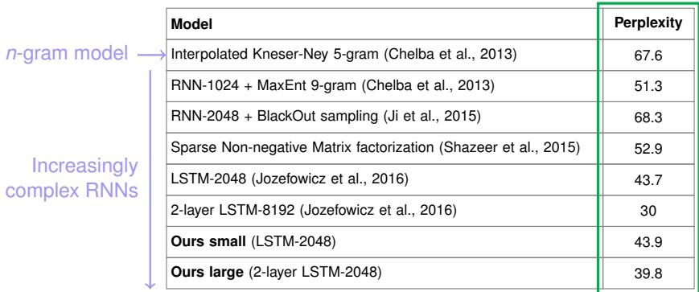

<details>

<table>
  <tr><td></td><td>Model</td><td>Perplexity</td><td rowspan="9">Perplexity improves↓ <br>(lower is better)</td></tr>
  <tr><td>n-gram model →</td><td>Interpolated Kneser-Ney 5-gram (Chelba et al., 2013)</td><td>67.6</td></tr>
  <tr><td rowspan="8">Increasingly complex RNNs↓</td><td>RNN-1024 + MaxEnt 9-gram (Chelba et al., 2013)</td><td>51.3</td></tr>
  <tr><td>RNN-2048 + BlackOut sampling (Ji et al., 2015)</td><td>68.3</td></tr>
  <tr><td>Sparse Non-negative Matrix factorization (Shazeer et al., 2015)</td><td>52.9</td></tr>
  <tr><td>LSTM-2048 (Jozefowicz et al., 2016)</td><td>43.7</td></tr>
  <tr><td>2-layer LSTM-8192 (Jozefowicz et al., 2016)</td><td>30</td></tr>
  <tr><td>Ours small (LSTM-2048)</td><td>43.9</td></tr>
  <tr><td>Ours large (2-layer LSTM-2048)</td><td>39.8</td></tr>
</table>

</details>

**Source:** [research.fb.com/building-an-efficient-neural-language-model-over-a-billion-words](https://research.fb.com/building-an-efficient-neural-language-model-over-a-billion-words/)

---

### Vanishing gradient

#### Vanishing gradient intuition

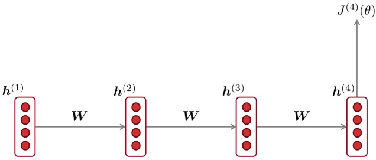

> A figure from Christopher Manning, Natural Language Processing with Deep Learning, Stanford U. CS224n

---

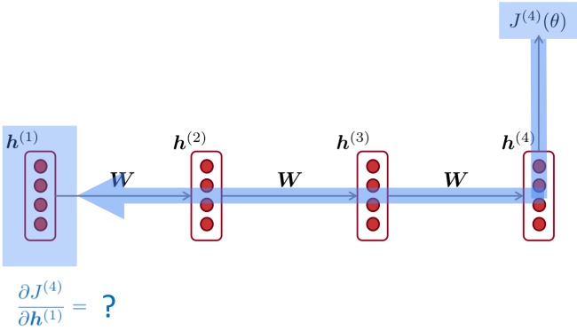

> A figure from Christopher Manning, Natural Language Processing with Deep Learning, Stanford U. CS224n

---

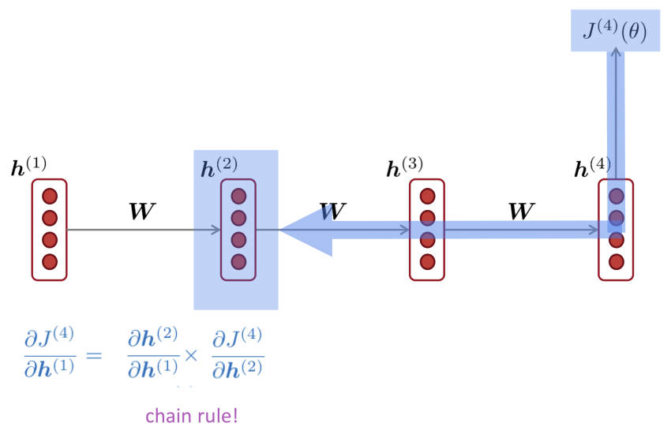

chain rule!

> A figure from Christopher Manning, Natural Language Processing with Deep Learning, Stanford U. CS224n

---

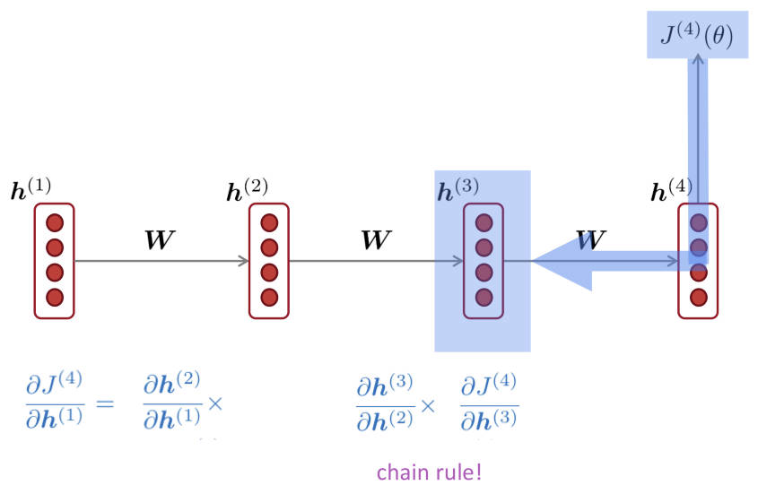

chain rule!

> A figure from Christopher Manning, Natural Language Processing with Deep Learning, Stanford U. CS224n

---

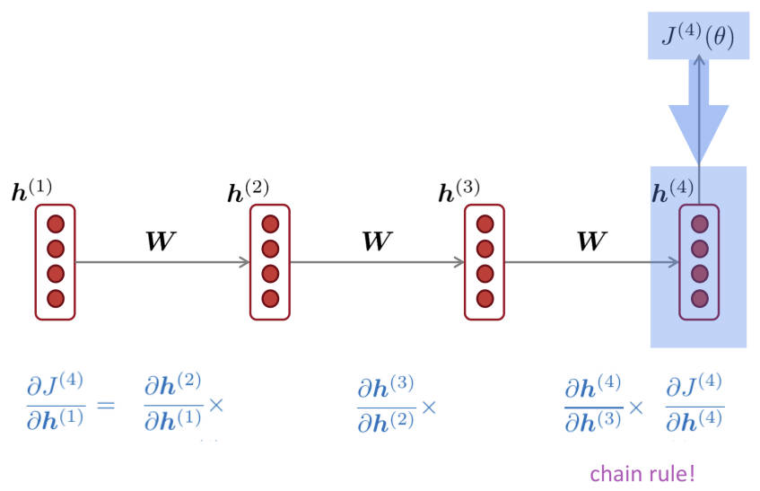

chain rule!

> A figure from Christopher Manning, Natural Language Processing with Deep Learning, Stanford U. CS224n

---

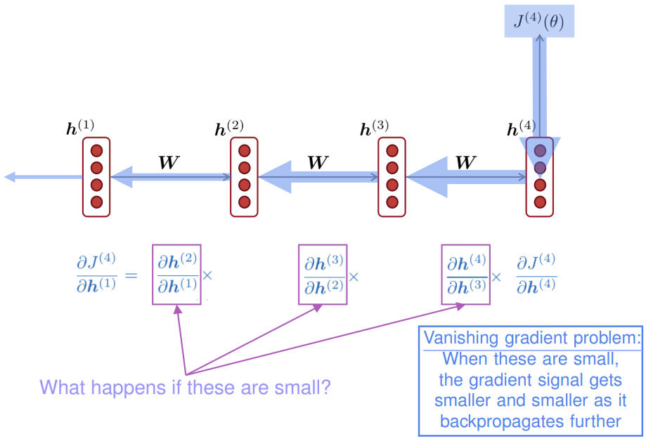

<details>

What happens if these are small?

<u>Vanishing gradient problem:</u> When these are small, the gradient signal gets smaller and smaller as it backpropagates further

</details>

> A figure from Christopher Manning, Natural Language Processing with Deep Learning, Stanford U. CS224n

---

#### Vanishing gradient proof sketch

- Recall: $\mathbf {h} ^ {(t)} = \sigma \left(\mathbf {W} _ {h} \mathbf {h} ^ {(t - 1)} + \mathbf {W} _ {x} \mathbf {x} ^ {(t)} + \mathbf {b} _ {1}\right)$

- Therefore: $\dfrac{\partial \mathbf{h}^{(t)}}{\partial \mathbf{h}^{(t-1)}} = \mathrm{diag} \left( \sigma' \left( \mathbf{W}_h \mathbf{h}^{(t-1)} + \mathbf{W}_x \mathbf{x}^{(t)} + \mathbf{b}_1 \right) \right) \mathbf{W}_h \qquad(\text{chain rule})$

- Consider the gradient of the loss $\mathcal { J } ^ { ( i ) } ( \theta )$ on step i, with respect to the hidden state $\mathbf{h} ^ { ( j ) }$ on some previous step j.

$$
\begin{array}{llr}
  \dfrac {\partial J ^ {(i)} (\theta)}{\partial \mathbf {h} ^ {(j)}} &= \dfrac {\partial J ^ {(i)} (\theta)}{\partial \mathbf {h} ^ {(i)}} \prod_ {j <   t \leq i} \dfrac {\partial \mathbf {h} ^ {(t)}}{\partial \mathbf {h} ^ {(t - 1)}} &(\text {chain rule})\\
  \\
  & = \dfrac {\partial J ^ {(i)} (\theta)}{\partial \mathbf {h} ^ {(i)}} \underset{\uparrow}{\boxed{\mathbf {W} _ {h} ^ {(i - j)}}} \prod_ {j <   t \leq i} \operatorname{diag} \left(\sigma^ {\prime} \left(\mathbf {W} _ {h} \mathbf {h} ^ {(t - 1)} + \mathbf {W} _ {x} \mathbf {x} ^ {(t)} + \mathbf {b} _ {1}\right)\right) &(\text {value of} \frac {\partial \mathbf {h} ^ {(t)}}{\partial \mathbf {h} ^ {(t - 1)}})\\
  & \text{If }\mathbf{W} _ { h }\text{ is small, then this term gets} \\ 
  & \text{vanishingly small as }i\text{ and}j\text{ get further apart} \\
\end{array}\\
$$

<strong><u>Source</u></strong>: “On the difficulty of training recurrent neural networks”, Pascanu et al, 2013. [proceedings.mlr.press/v28/pascanu13.pdf](http://proceedings.mlr.press/v28/pascanu13.pdf)

---

- Consider matrix L2 norms:

$$
\left\Vert \frac {\partial J ^ {(i)} (\theta)}{\partial \mathbf {h} ^ {(j)}} \right\Vert \leq \left\Vert \frac {\partial J ^ {(i)} (\theta)}{\partial \mathbf {h} ^ {(i)}} \right\Vert \Vert \mathbf {W} _ {h} \Vert ^ {(i - j)} \prod_ {j <   t \leq i} \left\Vert \operatorname{diag} \left(\sigma^ {\prime} \left(\mathbf {W} _ {h} \mathbf {h} ^ {(t - 1)} + \mathbf {W} _ {x} \mathbf {x} ^ {(t)} + \mathbf {b} _ {1}\right)\right) \right\Vert
$$

- Pascanu et al showed that if the *largest eigenvalue* of $W _ { h }$ is *less than 1*, then the gradient $\left\Vert \frac { \partial J ^ { ( i ) } ( \theta ) } { \partial \mathbf { h } ^ { ( j ) } } \right\Vert$ will *shrink* exponentially Here the bound is 1 because we have sigmoid nonlinearity

<strong><u>Source</u></strong>: “On the difficulty of training recurrent neural networks”, Pascanu et al, 2013. [proceedings.mlr.press/v28/pascanu13.pdf](http://proceedings.mlr.press/v28/pascanu13.pdf)

---

#### Why is vanishing gradient a problem?

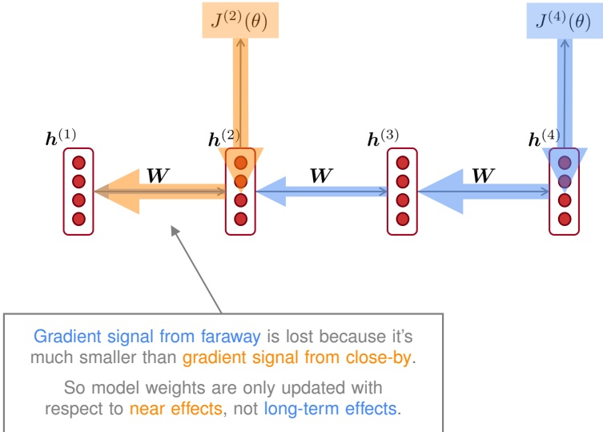

<details>

Gradient signal from faraway is lost because it’s much smaller than gradient signal from close-by.

So model weights are only updated with respect to near effects, not long-term effects.

</details>

> A figure from Christopher Manning, Natural Language Processing with Deep Learning, Stanford U. CS224n

---

- Another explanation: *Gradient* can be viewed as a measure of *the effect of the past on the future*

- If the gradient becomes vanishingly small over longer distances (step $t$ to step $t + n$), then we can’t tell whether:

  1. There’s *no dependency* between step $t$ and $t + n$ in the data

  2. We have *wrong parameters* to capture the true dependency between $t$ and $t + n$

---

#### Effect of vanishing gradient on RNN-LM

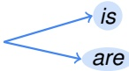

<details>

- **LM task:** 

$$
\text{The writer of the books} \underline{\qquad} \begin{cases} \text{is}\\ \text{are} \end{cases}
$$

- **Correct answer**: 

$$
\text{The writer of the books } \underline{\text{is}} \text{ planning a sequel}
$$

- **Syntactic recency:** 

$$
\text{The }\underline{\text{wri}} \overgroup{ \underline{\text{ter}} \text{ of the books }  \underline{\text{i}} }\underline{\text{s}}\qquad(\text{correct})
$$

- **Sequential recency:** 

$$
\text{The writer of the \underline{bo}} \overgroup{ \underline{\text{oks}}\ \underline{\text{ar}}}\underline{\text{e}}\qquad(\text{incorrect})
$$

- Due to vanishing gradient, RNN-LMs are better at learning from **sequential recency** than **syntactic recency**, so they make this type of error more often than we’d like [Linzen et al 2016]

</details>

> “Assessing the Ability of LSTMs to Learn Syntax-Sensitive Dependencies”, Linzen et al, 2016. [arxiv.org/pdf/1611.01368.pdf](https://arxiv.org/pdf/1611.01368.pdf)

---

#### How to fix vanishing gradient problem?

- The main problem is that it’s too difficult for the RNN to learn to *preserve information over many timesteps*.

- In a vanilla RNN, the hidden state is constantly being *rewritten*:

$$
h ^ {(t)} = f \big (h ^ {(t - 1)}, x ^ {(t)} \big)
$$

- *How about a RNN with separate memory?*

---

### Long Short Term Memory (LSTM)

- A type of RNN proposed by Hochreiter and Schmidhuber in 1997 as a solution to the vanishing gradients problem.

- On step $t$, there is a *hidden state* $h ^ { ( t ) }$ and a *cell state* $c ^ { ( t ) }$  
- Both are vectors length $n$  
- The cell stores* long-term information*  
- The LSTM can *erase*, *write* and *read* information from the cell

- The selection of which information is erased/written/read is controlled by three corresponding gates

  - The gates are also vectors length $n$  
  - On each timestep, each element of the gates can be *open* (1), *closed* (0), or somewhere in-between
  - The gates are *dynamic*: their value is computed based on the current context 

> “Long short-term memory”, Hochreiter and Schmidhuber, 1997,  
> [https://www.bioinf.jku.at/publications/older/2604.pdf](https://www.bioinf.jku.at/publications/older/2604.pdf)

---

#### Long Short-Term Memory (LSTM)

We have a sequence of inputs $\mathbf { X } ^ { ( t ) }$ , and we will compute a sequence of hidden states $h ^ { ( t ) }$ and cell states $\mathbf { c } ^ { ( t ) }$ . On timestep t:

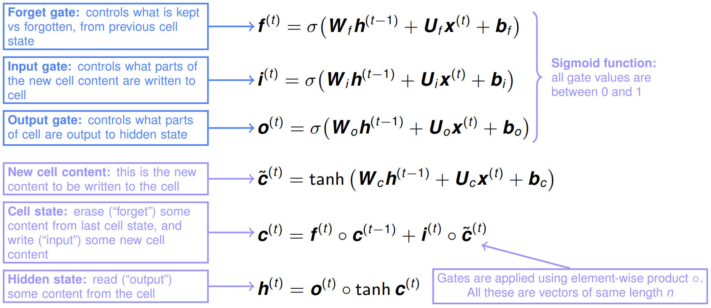

<details>

**Sigmoid function**: all gate values are between 0 and 1

- **Forget gate:** controls what is kept vs forgotten, from previous cell state 

$$
\rightarrow \mathbf {f} ^ {(t)} = \sigma \big (\mathbf {W} _ {f} \mathbf {h} ^ {(t - 1)} + \mathbf {U} _ {f} \mathbf {x} ^ {(t)} + \mathbf {b} _ {f} \big)
$$

- **Input gate:** controls what parts of the new cell content are written to cell

$$
\rightarrow \mathbf {i} ^ {(t)} = \sigma \big (\mathbf {W} _ {i} \mathbf {h} ^ {(t - 1)} + \mathbf {U} _ {i} \mathbf {x} ^ {(t)} + \mathbf {b} _ {i} \big)
$$

- **Output gate:** controls what parts <u>of cell are output to hidden state</u>

$$
\rightarrow \mathbf {o} ^ {(t)} = \sigma \big (\mathbf {W} _ {o} \mathbf {h} ^ {(t - 1)} + \mathbf {U} _ {o} \mathbf {x} ^ {(t)} + \mathbf {b} _ {o} \big)
$$

**New cell content:** this is the new <u>content to be written to the cell</u>

$$
\rightarrow \tilde {\mathbf {c}} ^ {(t)} = \tanh \left(\mathbf {W} _ {c} \mathbf {h} ^ {(t - 1)} + \mathbf {U} _ {c} \mathbf {x} ^ {(t)} + \mathbf {b} _ {c}\right)
$$

**Cell state:** erase (“forget”) some content from last cell state, and write (“input”) some new cell content

$$
\rightarrow \mathbf {c} ^ {(t)} = \mathbf {f} ^ {(t)} \circ \mathbf {c} ^ {(t - 1)} + \mathbf {i} ^ {(t)} \circ \tilde {\mathbf {c}} ^ {(t)}
$$

Gates are applied using element-wise product ◦. All these are vectors of same length $n$

**Hidden state:** read (“output”) <u>some content from the cell</u>

$$
\mathbf {h} ^ {(t)} = \mathbf {o} ^ {(t)} \circ \tanh \mathbf {c} ^ {(t)}
$$

</details>

---

You can think of the LSTM equations visually like this:

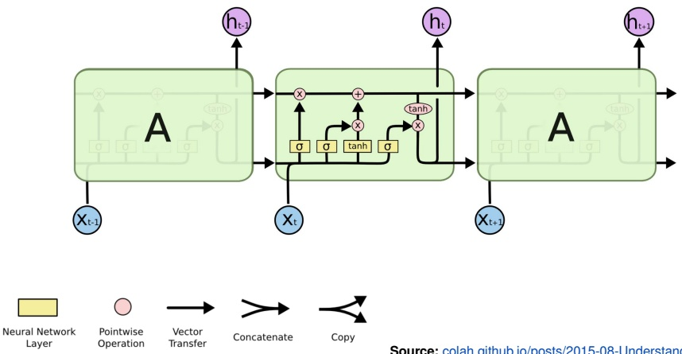

<strong><u>Source:</u></strong> [colah.github.io/posts/2015-08-Understanding-LSTMs](http://colah.github.io/posts/2015-08-Understanding-LSTMs/)

---

You can think of the LSTM equations visually like this:

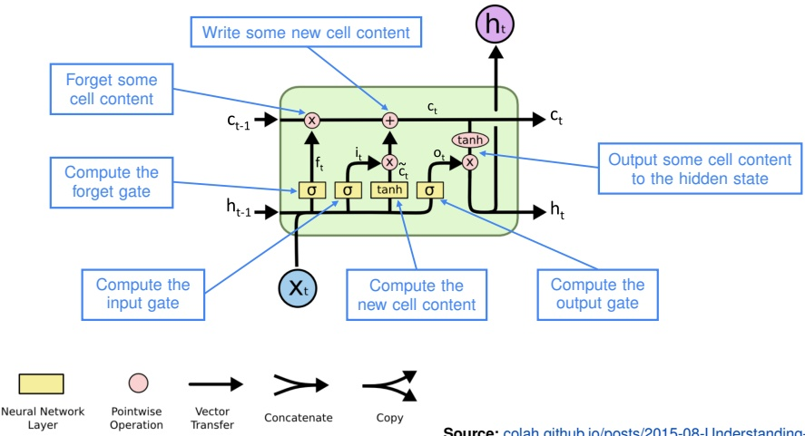

<strong><u>Source:</u></strong> [colah.github.io/posts/2015-08-Understanding-LSTMs](http://colah.github.io/posts/2015-08-Understanding-LSTMs/)

---

#### How does LSTM solve vanishing gradients?

- The LSTM architecture makes it easier for the RNN to preserve information over many timesteps  
  - e.g. if the forget gate is set to remember everything on every timestep, then the info in the cell is preserved indefinitely

- By contrast, it’s harder for vanilla RNN to learn a recurrent weight matrix $W _ { h }$ that preserves info in hidden state

- LSTM doesn’t guarantee that there is no vanishing/exploding gradient, but it does provide an easier way for the model to learn long-distance dependencies

---

#### LSTMs: real-world success

- In *2013-2015*, LSTMs started achieving state-of-the-art results

- Successful tasks include: handwriting recognition, speech recognition, machine translation, parsing, image captioning

- LSTM became the *dominant approach*

- *Now (2019)*, other approaches (e.g. *Transformers*) have become more dominant for certain tasks  
  - For example in WMT (a MT conference + competition):  
    - In the WMT *2016*, the summary report contains “RNN” *44* times  
    - In the WMT *2018*, the report contains “RNN” *9* times and “Transformer” *63* times

> Sources: “Findings of the 2016 Conference on Machine Translation (WMT16)”, Bojar et al. 2016; “Findings of the 2018  
> 
> Conference on Machine Translation (WMT18)”, Bojar et al. 2018

---

### Gated Recurrent Units (GRUs)

- Proposed by Cho et al. in 2014 as a simpler alternative to the LSTM.

- On each timestep t we have input $X ^ { ( t ) }$ and hidden state $h ^ { ( t ) }$ (no cell state).

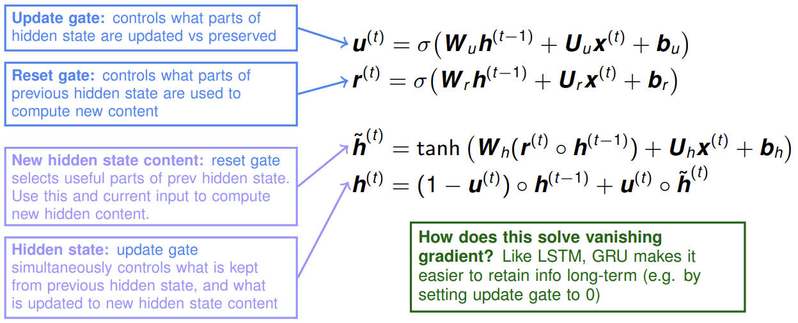

<details>

**Update gate:** controls what parts of hidden state are updated vs preserved

$$
\mathbf {u} ^ {(t)} = \sigma \left(\mathbf {W} _ {u} \mathbf {h} ^ {(t - 1)} + \mathbf {U} _ {u} \mathbf {x} ^ {(t)} + \mathbf {b} _ {u}\right)
$$

**Reset gate:** controls what parts of previous hidden state are used to compute new content

$$
\mathbf {r} ^ {(t)} = \sigma \left(\mathbf {W} _ {r} \mathbf {h} ^ {(t - 1)} + \mathbf {U} _ {r} \mathbf {x} ^ {(t)} + \mathbf {b} _ {r}\right)
$$

**New hidden state content:** reset gate selects useful parts of prev hidden state Use this and current input to compute new hidden content.

$$
\tilde {\mathbf {h}} ^ {(t)} = \tanh \left(\mathbf {W} _ {h} (\mathbf {r} ^ {(t)} \circ \mathbf {h} ^ {(t - 1)}) + \mathbf {U} _ {h} \mathbf {x} ^ {(t)} + \mathbf {b} _ {h}\right)
$$

**Hidden state:** update gate simultaneously controls what is kept from previous hidden state, and what is updated to new hidden state content

$$
\mathbf {\hat {h}} ^ {(t)} = \left(1 - \mathbf {u} ^ {(t)}\right) \circ \mathbf {\hat {h}} ^ {(t - 1)} + \mathbf {u} ^ {(t)} \circ \tilde {\mathbf {h}} ^ {(t)}
$$

**How does this solve vanishing gradient?** Like LSTM, GRU makes it easier to retain info long-term (e.g. by setting update gate to 0)

</details>

> “Learning Phrase Representations using RNN Encoder–Decoder for SMT”, Cho et al. 2014. [arxiv.org/pdf/1406.1078v3.pdf](https://arxiv.org/pdf/1406.1078v3.pdf)

#### LSTM vs GRU

- Researchers have proposed many gated RNN variants, but LSTM and *GRU* are the most widely-used

- The biggest difference is that *GRU is quicker to compute* and has fewer parameters

- There is no conclusive evidence that one consistently performs better than the other

- *LSTM is a good default choice* (especially if your data has particularly long dependencies, or you have lots of training data)

- *Rule of thumb*: start with LSTM, but switch to GRU if you want something more efficient

---

### Exploding gradient

#### Why is exploding gradient a problem?

- The mirror image of vanishing: if the *largest eigenvalue* of $W _ { h }$ is* greater than 1*, the gradient can grow exponentially [Pascanu et al, 2013]

- If the gradient becomes too big, then the SGD update step becomes too big:

$$
\theta_ {\text {new}} = \theta_ {\text {old}} - \underbrace {\alpha} _ {\text {learning rate}} \underbrace {\nabla_ {\theta} J (\theta)} _ {\text {gradient}}
$$

- This can cause *bad updates*: we take too large a step and reach a bad parameter configuration (with large loss)

- In the worst case, this will result in *Inf* or *NaN* in your network (then you have to restart training from an earlier checkpoint)

---

#### Gradient clipping: solution for exploding gradient

*Gradient clipping*: if the norm of the gradient is greater than some threshold, scale it down before applying SGD update

**Algorithm: norm clipping**

$$
\boxed{
\begin{split}
  &\hat {\mathbf {g}} \leftarrow \frac {\partial L}{\partial \theta}\\
  &\textbf{if} \Vert \hat { \mathbf { g } } \Vert \ge \text{threshold} \textbf{ then}\\
  &\qquad\hat {\mathbf {g}} \leftarrow \frac {\text{threshold}}{\Vert \hat {\mathbf {g}} \Vert} \hat {\mathbf {g}}\\
  &\textbf{end if}
\end{split}
}
$$

- *Intuition*: take a step in the same direction, but a smaller step

> <strong><u>Source:</u></strong> On the difficulty of training recurrent neural networks”, Pascanu et al, 2013. [proceedings.mlr.press/v28/pascanu13.pdf](http://proceedings.mlr.press/v28/pascanu13.pdf)

---

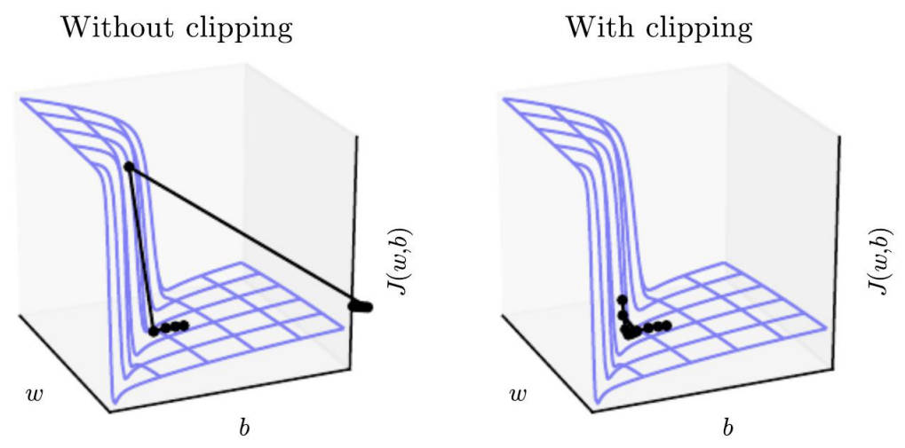

- This shows the loss surface of a simple RNN (hidden state is a scalar not a vector)

- The *“cliff” is dangerous* because it has steep gradient

- On the left, gradient descent takes *two very big steps* due to steep gradient, resulting in climbing the cliff then shooting off to the right (both *bad updates*)

- On the right, gradient clipping reduces the size of those steps, so effect is *less drastic*  

> <strong><u>Source:</u></strong> “Deep Learning”, Goodfellow, Bengio and Courville, 2016. Chapter 10.11.1. [deeplearningbook.org/contents/rnn.html](https://www.deeplearningbook.org/contents/rnn.html)

---

### Vanishing and exploding gradient for other neural networks

#### Is vanishing/exploding gradient just a RNN problem?

- No! It can be a problem for all neural architectures (including *feed-forward* and *convolutional*), especially *deep* ones.  
  - Due to chain rule / choice of nonlinearity function, gradient can become vanishingly small as it backpropagates  
  - Thus lower layers are learnt very slowly (hard to train)  
  - Solution: lots of new deep feedforward/convolutional architectures that *add more direct connections* (thus allowing the gradient to flow)

<u>For example:</u>

- *Residual connections* aka “ResNet”

- Also known as *skip-connections*

- The *identity connection preserves information* by default

- This makes *deep* networks much *easier to train* 

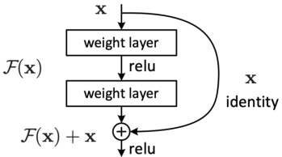

Figure 2. Residual learning: a building block.

> “Deep Residual Learning for Image Recognition”, He et al, 2015. [arxiv.org/pdf/1512.03385.pdf](https://arxiv.org/pdf/1512.03385.pdf)

---

<u>For example:</u>

- *Dense connections* aka “DenseNet”

- Directly connect everything to everything!

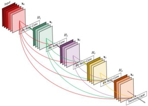

Figure 1: A 5-layer dense block with a growth rate of k = 4. Each layer takes all preceding feature-maps as input.

> “Densely Connected Convolutional Networks”, Huang et al, 2017. [arxiv.org/pdf/1608.06993.pdf](https://arxiv.org/pdf/1608.06993.pdf)

---

**For example: Highway connections aka “HighwayNet”**

- Similar to residual connections, but the identity connection vs the transformation layer is controlled by a dynamic gate

- Inspired by LSTMs, but applied to deep feedforward/convolutional networks

Conclusion: Though vanishing/exploding gradients are a general problem, RNNs are particularly unstable due to the repeated multiplication by the same weight matrix [Bengio et al, 1994]

> “Learning Long-Term Dependencies with Gradient Descent is Difficult”, Bengio et al. 1994,
> [http://ai.dinfo.unifi.it/paolo//ps/tnn-94-gradient.pdf](http://ai.dinfo.unifi.it/paolo//ps/tnn-94-gradient.pdf)

---

### Bi-directional RNNs and multi-layer RNNs

#### Bidirectional RNNs: motivation

<u>Task: Sentiment Classification</u>

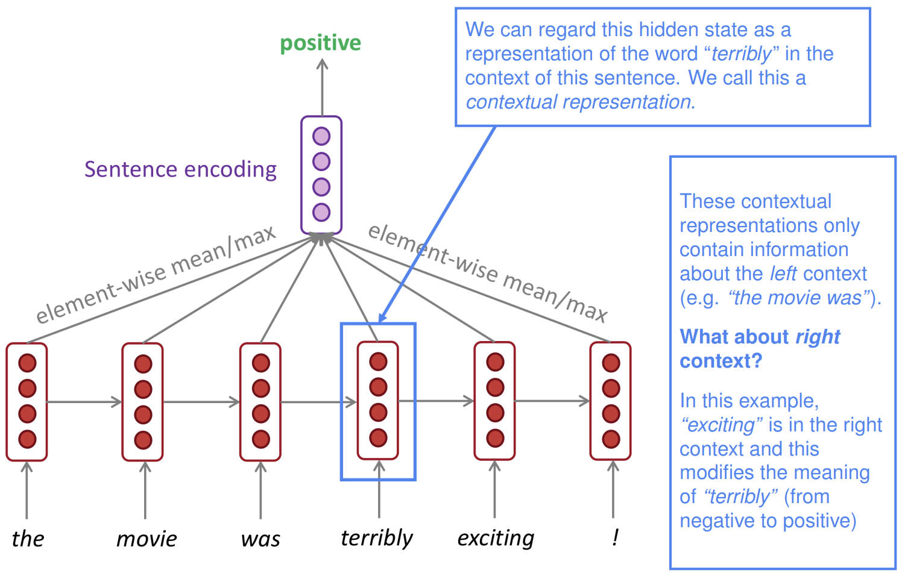

<details>

We can regard this hidden state as a representation of the word *“terribly”* in the context of this sentence. We call this a *contextual representation*.

These contextual representations only contain information about the *left* context (e.g. *“the movie was”*).

**What about *right* context?**

In this example, *“exciting”* is in the right context and this modifies the meaning of *“terribly”* (from negative to positive)

</details>

> A figure from Christopher Manning, Natural Language Processing with Deep Learning, Stanford U. CS224n

---

#### Bidirectional RNNs

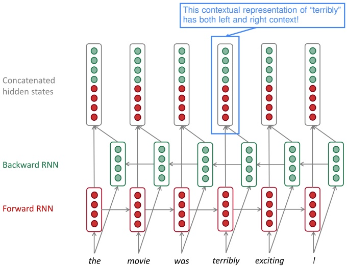

<details>

This contextual representation of “terribly” has both left and right context!

</details>

> A figure from Christopher Manning, Natural Language Processing with Deep Learning, Stanford U. CS224n

---

On timestep $t$:

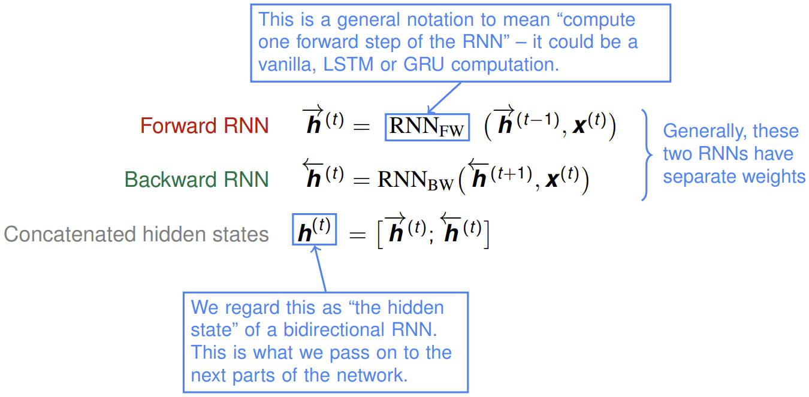

<details>

This is a general notation to mean “compute one forward step of the RNN” – it could be a vanilla, LSTM or GRU computation.

- Forward RNN

$$
\overrightarrow {\mathbf {h}} (t) = \boxed {\mathrm{RNN} _ {\mathrm{FW}}}\left(\overrightarrow {\mathbf {h}} ^ {(t - 1)}, \mathbf {x} ^ {(t)}\right)
$$

- Backward RNN

$$
\overleftarrow {\mathbf {h}} ^ {(t)} = \mathrm{RNN} _ {\mathrm{BW}} \left(\overleftarrow {\mathbf {h}} ^ {(t + 1)}, \mathbf {x} ^ {(t)}\right)
$$

Generally, these two RNNs have separate weights

- Concatenated hidden states

$$
\boxed {\mathbf {h} ^ {(t)}} = \left[ \overrightarrow {\mathbf {h}} ^ {(t)}; \overleftarrow {\mathbf {h}} ^ {(t)} \right]
$$

We regard this as “the hidden state” of a bidirectional RNN. This is what we pass on to the next parts of the network.

</details>

---

#### Bidirectional RNNs: simplified diagram

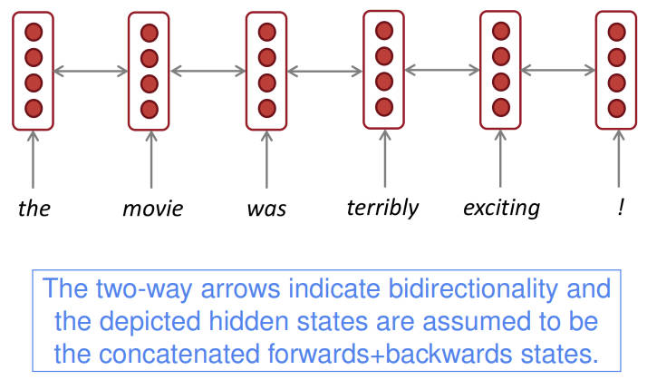

<details>

The two-way arrows indicate bidirectionality and the depicted hidden states are assumed to be the concatenated forwards+backwards states.

</details>

> A figure from Christopher Manning, Natural Language Processing with Deep Learning, Stanford U. CS224n

---

#### Bidirectional RNNs

- Note: bidirectional RNNs are only applicable if you have access to the *entire input sequence*

- They are not applicable to Language Modeling, because in LM you only have left context available

- If you do have entire input sequence (e.g. any kind of encoding), *bidirectionality is powerful* (you should use it by default)  
  - For example, *BERT* (Bidirectional Encoder Representations from Transformers) is a powerful pretrained contextual representation system *built on bidirectionality * 
  - You will learn more about BERT later in the course!

---

### Multi-layer RNNs

- RNNs are already “deep” on one dimension (they unroll over many timesteps)

- We can also make them “deep” in another dimension by applying *multiple RNNs* — this is a *multi-layer RNN*

  - This allows the network to compute *more complex* representations

- The lower RNNs should compute lower-level features and the higher RNNs should compute higher-level features

Multi-layer RNNs are also called *stacked RNNs*

---

#### Multi-layer RNNs

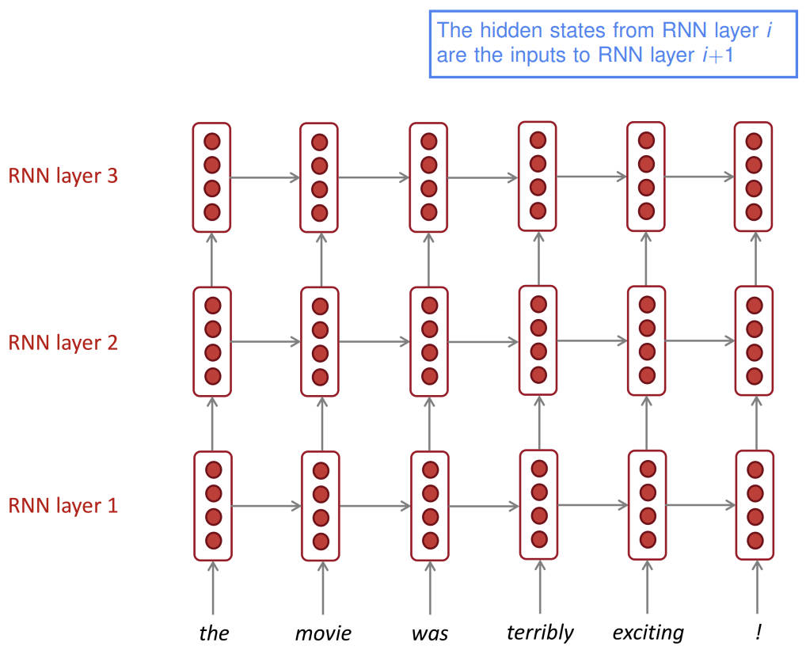

<details>

The hidden states from RNN layer i are the inputs to RNN layer i+1

</details>

> A figure from Christopher Manning, Natural Language Processing with Deep Learning, Stanford U. CS224n

---

#### Multi-layer RNNs in practice

- High-performing RNNs are often multi-layer (but aren’t as deep as convolutional or feed-forward networks)

  - For example: In a 2017 paper, Britz et al find that for Neural Machine Translation, *2 to 4 layers* is best for the encoder RNN, and *4 layers* is best for the decoder RNN

- However, *skip-connections/dense-connections* are needed to train deeper RNNs (e.g. 8 layers)  
  - *Transformer-based* networks (e.g. BERT) can be up to *24 layers*  
  - You will learn about Transformers later; they have a lot of skipping-like connections

> “Massive Exploration of Neural Machine Translation Architectures”, Britz et al, 2017,
> [https://arxiv.org/pdf/1703.03906.pdf](https://arxiv.org/pdf/1703.03906.pdf)

---

## 4 Sequence Tagging

### Named Entity Recognition (NER)

- A very important sub-task: **find** and **classify** names in text, for example:

The decision by the independent MP <font color=red>Andrew Wilkie</font> to withdraw his support for the minority <font color=blue>Labor</font> government sounded dramatic but it should not further threaten its stability. When, after the <font color=orange>2010</font> election, <font color=red>Wilkie</font>, <font color=red>Rob Oakeshott</font>, <font color=red>Tony Windsor</font> and the <font color=blue>Greens</font> agreed to support <font color=blue>Labor</font>, they gave just two guarantees: confidence and supply.

<font color=red>PER</font> person <font color=blue>ORG</font> organization <font color=orange>DATE</font> date

---

- The uses:  
  - Named entities can be indexed, linked off, etc.  
  - Sentiment can be attributed to companies or products  
  - A lot of IE relations are associations between named entities  
  - For question answering, answers are often named entities.

- Concretely:  
  - Many web pages tag various entities, with links to bio or topic pages, etc.  
  - Reuters’ OpenCalais, Evri, AlchemyAPI, Yahoo’s Term Extraction, ...  
  - Apple/Google/Microsoft/... smart recognizers for document content

---

### Three approaches to NER

- Hand-written regular expressions

- Using classifiers

- Sequence models

---

### Hand-written Patterns for Information Extraction

- If extracting from automatically generated web pages, simple regex patterns usually work.
  - Amazon page
    
    ```html
      <div class="buying"><h1 class="parseasinTitle">
      <span id="btAsinTitle" style="">(.*)</span></h1>
    ```

- For certain restricted, common types of entities in unstructured text, simple regex patterns also usually work.  
  - Finding (US) phone numbers
    ```regex
    (?:\(?[0-9]{3}\)?[ -.])?[0-9]{3}[ -.]?[0-9]{4}
    ```

---

### The Named Entity Recognition Task


- Task: Predict entities in a text

<span style="color: blue;">ORG</span> <span style="color: blue;">ORG</span> <span style="color: gray;">O</span> <span style="color: red;">PER</span> <span style="color: red;">PER</span> <span style="color: gray;">O</span> <span style="color: blue;">ORG</span>:

<span style="color: blue;">Foreign</span> <span style="color: blue;">Ministry</span> spokesman <span style="color: red;">Shen Guofang</span> told <span style="color: blue;">Reuters</span>:

<span style="color: red;">PER</span> person <span style="color: blue;">ORG</span> organization <span style="color: gray;">O</span> outside (not an entity)

Standard evaluation is per entity, not per token.

---

### Encoding classes for sequence labeling

<table>
    <tr>
        <td></td>
        <td> <font color=red>Fred</font></td>
        <td>showed</td>
        <td> <font color=red>Sue</font></td>  
        <td> <font color=red>Mengqiu</font></td>  
        <td> <font color=red>Huang</font></td>
        <td>&#39;s</td>
        <td>new</td>
        <td>painting</td>
    </tr>
    <tr>
        <td> <font color=gray>IO</font></td>
        <td> <font color=red>PER</font></td>
        <td> <font color=gray>O</font></td>
        <td> <font color=red>PER</font></td>
        <td> <font color=red>PER</font></td>
        <td> <font color=red>PER</font></td>
        <td> <font color=gray>O</font></td>
        <td> <font color=gray>O</font></td>
        <td> <font color=gray>O</font></td>
    </tr>
    <tr>
        <td> <font color=gray>BIO</font></td>
        <td> <font color=red>B-PER</font></td>
        <td> <font color=gray>O</font></td>
        <td> <font color=red>B-PER</font></td>  
        <td> <font color=red>B-PER</font></td>  
        <td> <font color=red>I-PER</font></td>
        <td> <font color=gray>O</font></td>
        <td> <font color=gray>O</font></td>
        <td> <font color=gray>O</font></td>
    </tr>
</table>

---

### RNNs can be used for tagging

e.g. <u>part-of-speech tagging</u>, named entity recognition

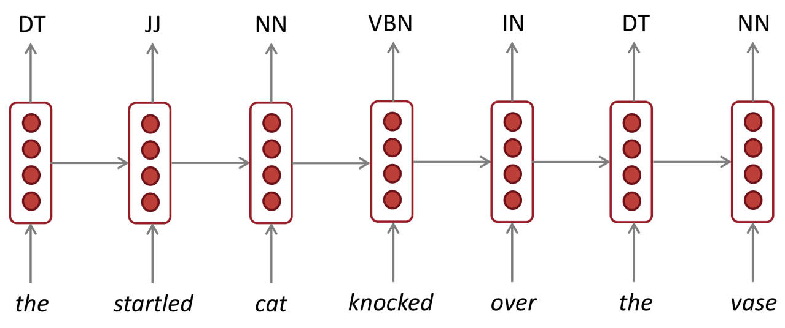

> A figure from Christopher Manning, Natural Language Processing with Deep Learning, Stanford U. CS224n

| Training | Testing |
| --- | --- |
| 1 Collect a set of representative training documents | 1 Receive a set of testing documents |
| 2 Label each token for its entity class or other (O) | 2 Run sequence model inference to label each token |
| 3 Design feature extractors appropriate to the text and classes | 3 Appropriately output the recognized entities |
| 4 Train a sequence classifier to predict the labels from the data |  |

---

## Content

1. **Language Models (LMs)**

2. **N-gram Language Models**

3. **Language Models Based on Recurrent Neural Networks**

4. **Sequence Tagging**