# Natural Language Processing and LLMs Lecture 04: Language Models; Recurrent Neural Networks; Sequence Tagging<!-- omit in toc -->

Valentin Malykh, MWS AI 

Autumn 2026 

The course is delivered at MIPT, HSE (Moscow), ITMO (Saint Petersburg), and IITU (Almaty)

- [1 Language Models (LMs)](#1-language-models-lms)
  - [How can we define a language? (Recap)](#how-can-we-define-a-language-recap)
  - [How can we define a language? (Recap) The set theory approach](#how-can-we-define-a-language-recap-the-set-theory-approach)
  - [How can we define a language? — The probabilistic approach](#how-can-we-define-a-language--the-probabilistic-approach)
  - [Language Modeling](#language-modeling)
  - [Language Modeling](#language-modeling-1)
  - [LMs are extremely powerful tools](#lms-are-extremely-powerful-tools)
  - [You use Language Models every day!](#you-use-language-models-every-day)
  - [You use Language Models every day!](#you-use-language-models-every-day-1)
  - [Google](#google)
  - [NLP tasks as Conditional LMs](#nlp-tasks-as-conditional-lms)
  - [Content](#content)
  - [n-gram Language Models](#n-gram-language-models)
  - [n-gram Language Models](#n-gram-language-models-1)
  - [Bigram LM: Parameters](#bigram-lm-parameters)
  - [Bigram LM: Probabilities](#bigram-lm-probabilities)
  - [n-gram Language Models: Example](#n-gram-language-models-example)
  - [Sparsity Problems with n-gram Language Models](#sparsity-problems-with-n-gram-language-models)
  - [Storage Problems with n-gram Language Models](#storage-problems-with-n-gram-language-models)
  - [n-gram Language Models in practice](#n-gram-language-models-in-practice)
  - [Generating text with a n-gram Language Model](#generating-text-with-a-n-gram-language-model)
  - [Generating text with a n-gram Language Model](#generating-text-with-a-n-gram-language-model-1)
  - [You can also use a Language Model to generate text.](#you-can-also-use-a-language-model-to-generate-text)
  - [Generating text with a n-gram Language Model](#generating-text-with-a-n-gram-language-model-2)
  - [Generating text with a n-gram Language Model](#generating-text-with-a-n-gram-language-model-3)
  - [Generating text with a n-gram Language Model](#generating-text-with-a-n-gram-language-model-4)
  - [Content](#content-1)
  - [How to build a neural Language Model?](#how-to-build-a-neural-language-model)
  - [A fixed-window neural Language Model](#a-fixed-window-neural-language-model)
  - [A fixed-window neural Language Model](#a-fixed-window-neural-language-model-1)
  - [Remaining problems:](#remaining-problems)
  - [We need a neural architecture that can process any length input](#we-need-a-neural-architecture-that-can-process-any-length-input)
  - [Recurrent Neural Networks (RNN)](#recurrent-neural-networks-rnn)
  - [A family of neural architectures](#a-family-of-neural-architectures)
  - [Core idea:](#core-idea)
  - [Apply the same weights W repeatedly](#apply-the-same-weights-w-repeatedly)
  - [A Simple RNN Language Model](#a-simple-rnn-language-model)
  - [RNN Language Models](#rnn-language-models)
  - [Content](#content-2)
  - [3 Language Models Based on Recurrent Neural Networks](#3-language-models-based-on-recurrent-neural-networks)
  - [Content](#content-3)
  - [3 Language Models Based on Recurrent Neural Networks](#3-language-models-based-on-recurrent-neural-networks-1)
  - [Training an RNN Language Model](#training-an-rnn-language-model)
  - [Training an RNN Language Model](#training-an-rnn-language-model-1)
  - [Training an RNN Language Model](#training-an-rnn-language-model-2)
  - [Training an RNN Language Model](#training-an-rnn-language-model-3)
  - [Training an RNN Language Model](#training-an-rnn-language-model-4)
  - [Training an RNN Language Model](#training-an-rnn-language-model-5)
  - [Training a RNN Language Model](#training-a-rnn-language-model)
  - [Backpropagation for RNNs](#backpropagation-for-rnns)
  - [Multivariable Chain Rule](#multivariable-chain-rule)
  - [Backpropagation for RNNs: Proof sketch](#backpropagation-for-rnns-proof-sketch)
  - [Backpropagation for RNNs](#backpropagation-for-rnns-1)
  - [Content](#content-4)
  - [3 Language Models Based on Recurrent Neural Networks](#3-language-models-based-on-recurrent-neural-networks-2)
  - [Generating text with a RNN Language Model](#generating-text-with-a-rnn-language-model)
  - [Generating text with a RNN Language Model](#generating-text-with-a-rnn-language-model-1)
  - [Let’s have some fun!](#lets-have-some-fun)
  - [Generating text with a RNN Language Model](#generating-text-with-a-rnn-language-model-2)
  - [Let’s have some fun!](#lets-have-some-fun-1)
  - [RNNs can be used for sentence classification](#rnns-can-be-used-for-sentence-classification)
  - [e.g. sentiment classification](#eg-sentiment-classification)
  - [RNNs can be used for sentence classification](#rnns-can-be-used-for-sentence-classification-1)
  - [e.g. sentiment classification](#eg-sentiment-classification-1)
  - [RNNs can be used for sentence classification](#rnns-can-be-used-for-sentence-classification-2)
  - [e.g. sentiment classification](#eg-sentiment-classification-2)
  - [RNNs can be used as an encoder module](#rnns-can-be-used-as-an-encoder-module)
  - [e.g. question answering, machine translation, many other tasks!](#eg-question-answering-machine-translation-many-other-tasks)
  - [Answer: German](#answer-german)
  - [A note on terminology](#a-note-on-terminology)
  - [Content](#content-5)
  - [3 Language Models Based on Recurrent Neural Networks](#3-language-models-based-on-recurrent-neural-networks-3)
  - [Evaluating Language Models](#evaluating-language-models)
  - [RNNs have greatly improved perplexity](#rnns-have-greatly-improved-perplexity)
  - [Content](#content-6)
  - [3 Language Models Based on Recurrent Neural Networks](#3-language-models-based-on-recurrent-neural-networks-4)
  - [Vanishing gradient intuition](#vanishing-gradient-intuition)
  - [Vanishing gradient intuition](#vanishing-gradient-intuition-1)
  - [Vanishing gradient intuition](#vanishing-gradient-intuition-2)
  - [Vanishing gradient intuition](#vanishing-gradient-intuition-3)
  - [Vanishing gradient intuition](#vanishing-gradient-intuition-4)
  - [Vanishing gradient intuition](#vanishing-gradient-intuition-5)
  - [Vanishing gradient proof sketch](#vanishing-gradient-proof-sketch)
  - [Vanishing gradient proof sketch](#vanishing-gradient-proof-sketch-1)
  - [Why is vanishing gradient a problem?](#why-is-vanishing-gradient-a-problem)
  - [Why is vanishing gradient a problem?](#why-is-vanishing-gradient-a-problem-1)
  - [Effect of vanishing gradient on RNN-LM](#effect-of-vanishing-gradient-on-rnn-lm)
  - [How to fix vanishing gradient problem?](#how-to-fix-vanishing-gradient-problem)
  - [Content](#content-7)
  - [3 Language Models Based on Recurrent Neural Networks](#3-language-models-based-on-recurrent-neural-networks-5)
  - [Long Short Term Memory (LSTM)](#long-short-term-memory-lstm)
  - [Long Short-Term Memory (LSTM)](#long-short-term-memory-lstm-1)
  - [Long Short-Term Memory (LSTM)](#long-short-term-memory-lstm-2)
  - [Long Short-Term Memory (LSTM)](#long-short-term-memory-lstm-3)
  - [Long Short-Term Memory (LSTM)](#long-short-term-memory-lstm-4)
  - [How does LSTM solve vanishing gradients?](#how-does-lstm-solve-vanishing-gradients)
  - [LSTMs: real-world success](#lstms-real-world-success)
  - [Content](#content-8)
  - [3 Language Models Based on Recurrent Neural Networks](#3-language-models-based-on-recurrent-neural-networks-6)
  - [Gated Recurrent Units (GRUs)](#gated-recurrent-units-grus)
  - [Gated Recurrent Units (GRU)](#gated-recurrent-units-gru)
  - [LSTM vs GRU](#lstm-vs-gru)
  - [Content](#content-9)
  - [3 Language Models Based on Recurrent Neural Networks](#3-language-models-based-on-recurrent-neural-networks-7)
  - [Exploding gradient](#exploding-gradient)
  - [Why is exploding gradient a problem?](#why-is-exploding-gradient-a-problem)
  - [Gradient clipping: solution for exploding gradient](#gradient-clipping-solution-for-exploding-gradient)
  - [Algorithm: norm clipping](#algorithm-norm-clipping)
  - [Gradient clipping: solution for exploding gradient](#gradient-clipping-solution-for-exploding-gradient-1)
  - [Content](#content-10)
  - [3 Language Models Based on Recurrent Neural Networks](#3-language-models-based-on-recurrent-neural-networks-8)
  - [Is vanishing/exploding gradient just a RNN problem?](#is-vanishingexploding-gradient-just-a-rnn-problem)
  - [For example:](#for-example)
  - [Is vanishing/exploding gradient just a RNN problem?](#is-vanishingexploding-gradient-just-a-rnn-problem-1)
  - [For example:](#for-example-1)
  - [Is vanishing/exploding gradient just a RNN problem?](#is-vanishingexploding-gradient-just-a-rnn-problem-2)
  - [For example: Highway connections aka “HighwayNet”](#for-example-highway-connections-aka-highwaynet)
  - [Is vanishing/exploding gradient just a RNN problem?](#is-vanishingexploding-gradient-just-a-rnn-problem-3)
  - [For example: Highway connections aka “HighwayNet”](#for-example-highway-connections-aka-highwaynet-1)
  - [Content](#content-11)
  - [3 Language Models Based on Recurrent Neural Networks](#3-language-models-based-on-recurrent-neural-networks-9)
  - [Bidirectional RNNs: motivation](#bidirectional-rnns-motivation)
  - [Task: Sentiment Classification](#task-sentiment-classification)
  - [What about right context?](#what-about-right-context)
  - [Bidirectional RNNs](#bidirectional-rnns)
  - [Bidirectional RNNs](#bidirectional-rnns-1)
  - [Bidirectional RNNs: simplified diagram](#bidirectional-rnns-simplified-diagram)
  - [Bidirectional RNNs](#bidirectional-rnns-2)
  - [Multi-layer RNNs](#multi-layer-rnns)
  - [Multi-layer RNNs](#multi-layer-rnns-1)
  - [Multi-layer RNNs in practice](#multi-layer-rnns-in-practice)
  - [Content](#content-12)
  - [Named Entity Recognition (NER)](#named-entity-recognition-ner)
  - [Named Entity Recognition (NER)](#named-entity-recognition-ner-1)
  - [Named Entity Recognition (NER)](#named-entity-recognition-ner-2)
  - [The uses:](#the-uses)
  - [Concretely:](#concretely)
  - [Three approaches to NER](#three-approaches-to-ner)
  - [Hand-written Patterns for Information Extraction](#hand-written-patterns-for-information-extraction)
  - [The Named Entity Recognition Task](#the-named-entity-recognition-task)
  - [Encoding classes for sequence labeling](#encoding-classes-for-sequence-labeling)
  - [RNNs can be used for tagging](#rnns-can-be-used-for-tagging)
  - [The ML sequence model approach to NER](#the-ml-sequence-model-approach-to-ner)
  - [Content](#content-13)

---

## 1 Language Models (LMs) 

### How can we define a language? (Recap)


### How can we define a language? (Recap) The set theory approach

- A language can be defined as the set of sentences which can be accepted by the speakers of that language. 

- It is not possible to define a natural language by enumerating al the sentences, because the number of sentences in a natura language is infinite. 

- Two feasible ways to define a language with infinite sentences: 

  - By a Grammar 
  - By an Automaton 

---

### How can we define a language? — The probabilistic approach

- A language can also be defined as a probabilistic distribution over all the possible sentences. 

- A statistical language model is a probability distribution over sequences of words (sentences) in a given language L: 

$$
\sum_ {s \in V ^ {+}} P _ {L M} (s) = 1
$$

- Or: 

$$
\sum_{\substack{s = w_{1}w_{2}\ldots w_{n}\\ w_{i}\in V,n > 0}}P_{LM}(s) = 1
$$

---

### Language Modeling

- **Language Modeling** is the task of predicting what word comes next. 

$$
\text{the students opened their }\begin{cases}
  \text{books}\\
  \text{laptops}\\
  \text{exams}\\
  \text{minds}\\
\end{cases}
$$

- More formally: given a sequence of words $\pmb { x } ^ { ( 1 ) } , \ldots , \pmb { x } ^ { ( t ) }$ , compute the probability distribution of the next word $\pmb { x } ^ { ( t + 1 ) }$ 

$$
P \left(\mathbf {x} ^ {(t + 1)} \mid \mathbf {x} ^ {(t)}, \dots , \mathbf {x} ^ {(1)}\right)
$$

- where $\pmb { x } ^ { ( t + 1 ) }$ can be any word in the vocabulary 

$$
V = \left\{\mathbf {w} _ {1}, \dots , \mathbf {w} _ {| V |} \right\}
$$

- A system that does this is called a Language Model. 

### Language Modeling

You can also think of a Language Model as a system that assigns probability to a piece of text. 

For example, if we have some text $\chi ^ { ( 1 ) } , \ldots , \chi ^ { ( T ) }$ , then the probability of this text (according to the Language Model) is: 

$$
\begin{array}{c} P \big (x ^ {(1)}, \ldots , x ^ {(T)} \big) = P \big (x ^ {(1)} \big) \times P \big (x ^ {(2)} \mid x ^ {(1)} \big) \times \ldots \times P \big (x ^ {(T)} \mid x ^ {(T - 1)}, \ldots , x ^ {(1)} \big) \\ = \prod_ {t = 1} ^ {T} P \big (x ^ {(t)} \mid x ^ {(t - 1)}, \ldots , x ^ {(1)} \big) \end{array}
$$

This is what our LM provides 

### LMs are extremely powerful tools

The definition of LMs is simple but LMs are extremely powerful tools in NLP 

A number of NLP problems could be viewed as variations of language modelling problems, and can be solved by LMs. 

Text generation / Data to text / Image captioning / Text summarization 

Machine translation 

Speech Recognition 

Reading Comprehension 

POS tagging / Entity recognition / Parsing 

Any task which could be transformed into a sequential problem is suitable for LMs 

### You use Language Models every day!


I'll meet you at the 


<table><tr><td>3</td><td colspan="2">cafe</td><td colspan="4">airport</td><td colspan="4">office</td></tr><tr><td>1</td><td>2</td><td>3</td><td>4</td><td>5</td><td>6</td><td>7</td><td>8</td><td>9</td><td>0</td><td></td></tr><tr><td>q</td><td>w</td><td>e</td><td>r</td><td>t</td><td>y</td><td>u</td><td>i</td><td>o</td><td>p</td><td></td></tr><tr><td>@</td><td>#</td><td>&amp;</td><td>*</td><td>-</td><td>+</td><td>=</td><td>(</td><td>)</td><td></td><td></td></tr><tr><td>a</td><td>s</td><td>d</td><td>f</td><td>g</td><td>h</td><td>j</td><td>k</td><td>l</td><td></td><td></td></tr><tr><td></td><td>-</td><td>£</td><td>&quot;</td><td>&#x27;</td><td>:</td><td>;</td><td>/</td><td></td><td></td><td></td></tr><tr><td></td><td>z</td><td>x</td><td>c</td><td>v</td><td>b</td><td>n</td><td>m</td><td></td><td></td><td></td></tr><tr><td>123</td><td></td><td></td><td></td><td></td><td></td><td></td><td>,!?</td><td></td><td></td><td></td></tr><tr><td></td><td>,</td><td></td><td></td><td></td><td></td><td></td><td>.</td><td></td><td></td><td></td></tr></table>

### You use Language Models every day!

### Google

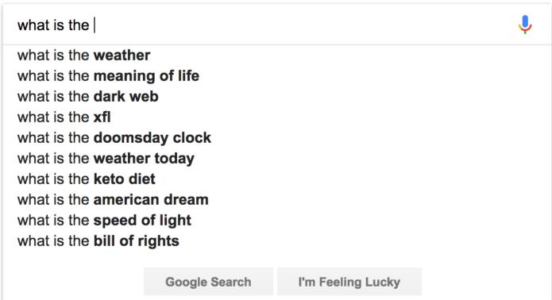


Google Search


I'm Feeling Lucky


### NLP tasks as Conditional LMs

<table><tr><td>x “input”</td><td>w “text output”</td></tr><tr><td>An author</td><td>A document written by that author</td></tr><tr><td>A topic label</td><td>An article about that topic</td></tr><tr><td>{SPAM, NOT_SPAM}</td><td>An email</td></tr><tr><td>A sentence in French</td><td>Its English translation</td></tr><tr><td>A sentence in English</td><td>Its French translation</td></tr><tr><td>A sentence in English</td><td>Its Chinese translation</td></tr><tr><td>An image</td><td>A text description of the image</td></tr><tr><td>A document</td><td>Its summary</td></tr><tr><td>A document</td><td>Its translation</td></tr><tr><td>Meteorological measurements</td><td>A weather report</td></tr><tr><td>Acoustic signal</td><td>Transcription of speech</td></tr><tr><td>Conversational history + database</td><td>Dialogue system response</td></tr><tr><td>A question + a document</td><td>Its answer</td></tr><tr><td>A question + an image</td><td>Its answer</td></tr></table>

### Content


Language Models (LMs) 


N-gram Language Models 


Language Models Based on Recurrent Neural Networks 


Sequence Tagging 

### n-gram Language Models

Question: How to learn a Language Model? 

Answer (pre-Deep Learning): learn an n-gram Language Model! 

Definition: A n-gram is a chunk of n consecutive words. 

unigrams: “the”, “students”, “opened”, “their” 

bigrams: “the students”, “students opened”, “opened their” 

trigrams: “the students opened”, “students opened their” 

4-grams: “the students opened their” 

Idea: Collect statistics about how frequent different n-grams are, and use these to predict next word. 

### n-gram Language Models

First we make a Markov assumption: $\pmb { x } ^ { ( t + 1 ) }$ depends only on the preceding $n - 1$ words. 

$$
P \big (\mathbf {x} ^ {(t + 1)} \mid \mathbf {x} ^ {(t)}, \ldots , \mathbf {x} ^ {(1)} \big) = P \big (\mathbf {x} ^ {(t + 1)} \mid \overbrace {\mathbf {x} ^ {(t)} , \ldots , \mathbf {x} ^ {(t - n + 2)}} ^ {n - 1 \text { words }} \big)
$$

(assumption) 

prob of a n-gram 

prob of a (n-1)-gram 

$$
\begin{array}{l} \longrightarrow \boxed {P (\mathbf {x} ^ {(t + 1)}, \mathbf {x} ^ {(t)}, \ldots , \mathbf {x} ^ {(t - n + 2)})} \\ = \frac {}{\longrightarrow \boxed {P (\mathbf {x} ^ {(t)} , \ldots , \mathbf {x} ^ {(t - n + 2)})}} \end{array}
$$

(definition of conditional prob) 

Question: How do we get these n-gram and (n-1)-gram probabilities? 

Answer: By counting them in some large corpus of text! 

$$
\approx \frac {\operatorname{count} \left(\mathbf {x} ^ {(t + 1)} , \mathbf {x} ^ {(t)} , \dots , \mathbf {x} ^ {(t - n + 2)}\right)}{\operatorname{count} \left(\mathbf {x} ^ {(t)} , \dots , \mathbf {x} ^ {(t - n + 2)}\right)}
$$

(statistica approximation) 

### Bigram LM: Parameters

<table><tr><td></td><td>i</td><td>want</td><td>to</td><td>eat</td><td>chinese</td><td>food</td><td>lunch</td><td>spend</td></tr><tr><td>i</td><td>5</td><td>827</td><td>0</td><td>9</td><td>0</td><td>0</td><td>0</td><td>2</td></tr><tr><td>want</td><td>2</td><td>0</td><td>608</td><td>1</td><td>6</td><td>6</td><td>5</td><td>1</td></tr><tr><td>to</td><td>2</td><td>0</td><td>4</td><td>686</td><td>2</td><td>0</td><td>6</td><td>211</td></tr><tr><td>eat</td><td>0</td><td>0</td><td>2</td><td>0</td><td>16</td><td>2</td><td>42</td><td>0</td></tr><tr><td>chinese</td><td>1</td><td>0</td><td>0</td><td>0</td><td>0</td><td>82</td><td>1</td><td>0</td></tr><tr><td>food</td><td>15</td><td>0</td><td>15</td><td>0</td><td>1</td><td>4</td><td>0</td><td>0</td></tr><tr><td>lunch</td><td>2</td><td>0</td><td>0</td><td>0</td><td>0</td><td>1</td><td>0</td><td>0</td></tr><tr><td>spend</td><td>1</td><td>0</td><td>1</td><td>0</td><td>0</td><td>0</td><td>0</td><td>0</td></tr></table>

### Bigram LM: Probabilities

Normalize by unigrams: 

$$
P (w _ {n} \mid w _ {n - 1}) = \frac {C (w _ {n - 1} w _ {n})}{C (w _ {n - 1})}
$$

<table><tr><td></td><td>i</td><td>want</td><td>to</td><td>eat</td><td>chinese</td><td>food</td><td>lunch</td><td>spend</td></tr><tr><td>C(w)</td><td>2533</td><td>927</td><td>2417</td><td>746</td><td>158</td><td>1093</td><td>341</td><td>278</td></tr><tr><td>i</td><td>.002</td><td>.33</td><td>0</td><td>.0036</td><td>0</td><td>0</td><td>0</td><td>.00079</td></tr><tr><td>want</td><td>.0022</td><td>0</td><td>.66</td><td>.0011</td><td>.0065</td><td>.0065</td><td>.0054</td><td>.0011</td></tr><tr><td>to</td><td>.00083</td><td>0</td><td>.0017</td><td>.28</td><td>.00083</td><td>0</td><td>.0025</td><td>.087</td></tr><tr><td>eat</td><td>0</td><td>0</td><td>.0027</td><td>0</td><td>.021</td><td>.0027</td><td>.056</td><td>0</td></tr><tr><td>chinese</td><td>.0063</td><td>0</td><td>0</td><td>0</td><td>0</td><td>.52</td><td>.0063</td><td>0</td></tr><tr><td>food</td><td>.014</td><td>0</td><td>.014</td><td>0</td><td>.00092</td><td>.0037</td><td>0</td><td>0</td></tr><tr><td>lunch</td><td>.0059</td><td>0</td><td>0</td><td>0</td><td>0</td><td>.0029</td><td>0</td><td>0</td></tr><tr><td>spend</td><td>.0036</td><td>0</td><td>.0036</td><td>0</td><td>0</td><td>0</td><td>0</td><td>0</td></tr></table>

### n-gram Language Models: Example

Suppose we are learning a 4-gram Language Model. 

as the proctor started the clock, the students opened their 

discard 

di i hi 

$$
P (\mathbf {w} \mid \text {   students   opened   their   }) = \frac {\text { count(students   opened   their   } \mathbf {w})}{\text { count(students   opened   their) }}
$$

For example, suppose that in the corpus: 

“students opened their” occurred 1000 times 

“students opened their books” occurred 400 times 

→ P(books | students opened their) = 0.4 

Should we have discarded the “proctor” context? 

“students opened their exams” occurred 100 times 

→ P(exams | students opened their) = 0.1 

### Sparsity Problems with n-gram Language Models

Sparsity Problem 1 

Problem: What if “students opened their w” never occurred in data? Then w has probability 0! 

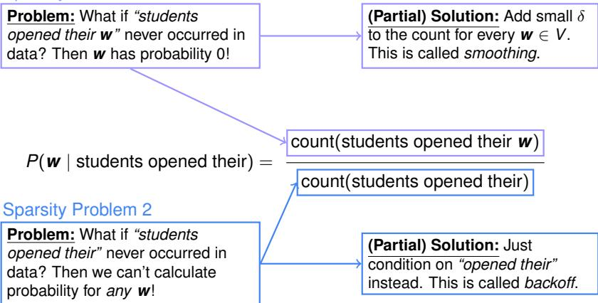


P(w | students opened their) 

count(students opened their w) 

count(students opened their) 

Sparsity Problem 2 

Problem: What if “students opened their” never occurred in data? Then we can’t calculate probability for any w! 

(Partial) Solution: Just condition on “opened their” instead. This is called backoff. 

Note: Increasing n makes sparsity problems worse. Typically we can’t have n bigger than 5. 

### Storage Problems with n-gram Language Models

Storage: Need to store count for all n-grams you saw in the corpus. 

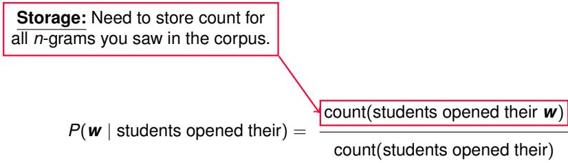


P(w | students opened their) 

count(students opened their w) 

count(students opened their) 

Increasing n or increasing corpus i d l i ! 

### n-gram Language Models in practice

You can build a simple trigram Language Model over a 1.7 million word corpus (Reuters) in a few seconds on your laptop 

today the 

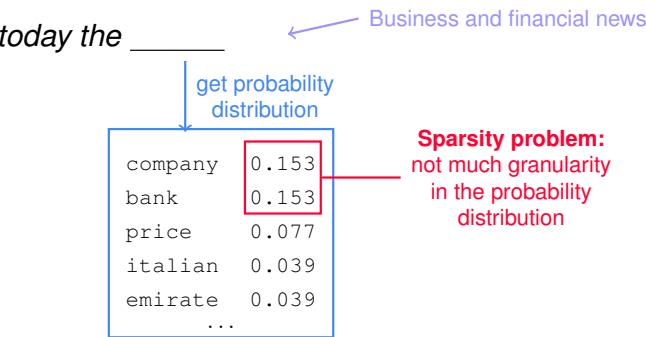


Otherwise, seems reasonable!


*Try for yourself: nlpforhackers.io/lanquage-models


### Generating text with a n-gram Language Model

You can also use a Language Model to generate text. 

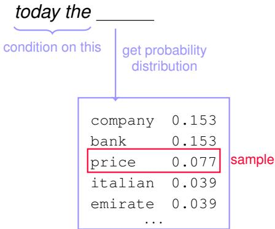


### Generating text with a n-gram Language Model

### You can also use a Language Model to generate text.

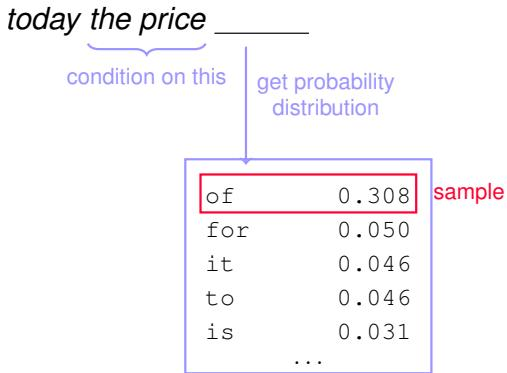


### Generating text with a n-gram Language Model

You can also use a Language Model to generate text. 

today the price of 

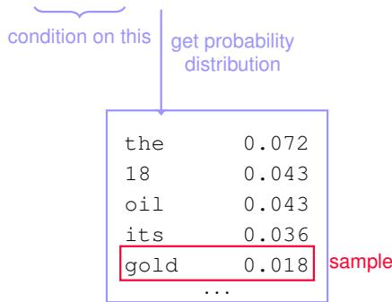


### Generating text with a n-gram Language Model

You can also use a Language Model to generate text. 

today the price ofgold 

### Generating text with a n-gram Language Model

You can also use a Language Model to generate text. 

today the price of gold per ton , while production of shoe lasts and shoe industry , the bank intervened just after it considered and rejected an imf demand to rebuild depleted european stocks , sept 30 end primary 76 cts a share . 

Surprisingly grammatical! . . . but incoherent. We need to consider more than three words at a time if we want to model language well. 

But increasing n worsens sparsity problem, and increases model size. . . 

### Content


Language Models (LMs) 


N-gram Language Models 


Language Models Based on Recurrent Neural Networks 


Sequence Tagging 

### How to build a neural Language Model?

Recall the Language Modeling task: 

Input: sequence of words $\pmb { x } ^ { ( 1 ) } , \pmb { x } ^ { ( 2 ) } , \ldots , \pmb { x } ^ { ( t ) }$ 

Output: prob dist of the next word $P ( \pmb { x } ^ { ( t + 1 ) } \mid \pmb { x } ^ { ( t ) } , \ldots , \pmb { x } ^ { ( 1 ) } )$ 

How about a window-based neural model? Predict the next word from a fixed window of the last words: 

as the proctor started the clock discard 

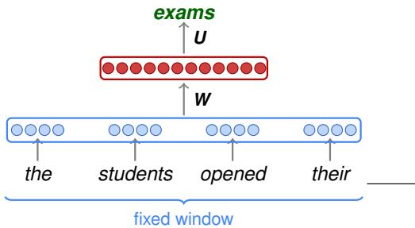


### A fixed-window neural Language Model

$$
\begin{array}{l} \text {output distribution} \\ \hat {\mathbf {y}} = \operatorname{softmax} (\mathbf {U h} + \mathbf {b} _ {2}) \in \mathbb {R} ^ {| V |} \end{array}
$$

hidden layer h = f(We + b ) 

concatenated word embeddings $\pmb { \mathscr { e } } = [ \pmb { \mathscr { e } } ^ { ( 1 ) } ; \pmb { \mathscr { e } } ^ { ( 2 ) } ; \pmb { \mathscr { e } } ^ { ( 3 ) } ; \pmb { \mathscr { e } } ^ { ( 4 ) } ]$ 

words / one-hot vectors $\pmb { x } ^ { ( 1 ) } , \pmb { x } ^ { ( 2 ) } , \pmb { x } ^ { ( 3 ) } , \pmb { x } ^ { ( 4 ) }$ 

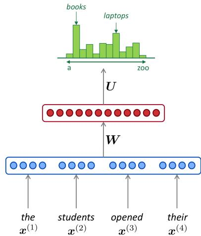


A figure from Christopher Manning, Natural Language Processing with Deep Learning, Stanford U. CS224n 

### A fixed-window neural Language Model

Approximately: Y. Bengio, et al. (2000/2003): A Neural Probabilistic Language Mode 

Improvements over n-gram LM: 

No sparsity problem 

Don’t need to store all observed n-grams 

### Remaining problems:

Fixed window is too small 

Enlarging window enlarges W 

Window can never be large enough! 

0 $\pmb { x } ^ { ( 1 ) }$ and $\pmb { x } ^ { ( 2 ) }$ are multiplied by completely different weights in W. No symmetry in how the inputs are processed. 

### We need a neural architecture that can process any length input

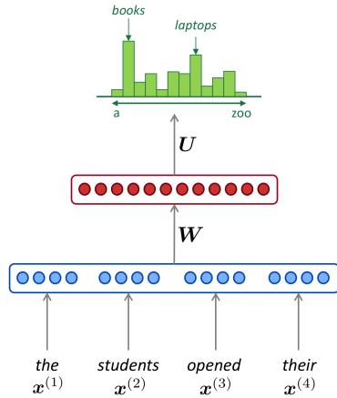


A figure from Christopher Manning, Natural Language Processing with Deep Learning, Stanford U. CS224n 

### Recurrent Neural Networks (RNN)

### A family of neural architectures

outputs (optional) 

hidden states 

input sequence (any length) 

### Core idea:

### Apply the same weights W repeatedly

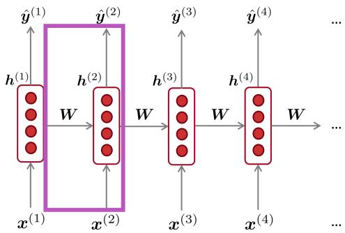


A figure from Christopher Manning, Natural Language Processing with Deep Learning, Stanford U. CS224n 

$\hat { y } ^ { ( 4 ) } = P ( \pmb { x } ^ { ( 5 ) }$ |the students opened their 

### A Simple RNN Language Model

output distribution 

$$
\hat {\mathbf {y}} ^ {(t)} = \operatorname{softmax} \left(\mathbf {U h} ^ {(t)} + \mathbf {b} _ {2}\right) \in \mathbb {R} ^ {| V |}
$$

hidden states 

$$
\mathbf {h} ^ {(t)} = \sigma \left(\mathbf {W} _ {h} \mathbf {h} ^ {(t - 1)} + \mathbf {W} _ {e} \mathbf {e} ^ {(t)} + \mathbf {b} _ {1}\right)
$$

$\pmb { h } ^ { ( 0 ) }$ is the initial hidden state 

word embeddings 

$$
\mathbf {e} ^ {(t)} = \mathbf {E x} ^ {(t)}
$$

words / one-hot vectors 

$$
\mathbf {x} ^ {(t)} \in \mathbb {R} ^ {| V |}
$$

l b hi lid d h ! 

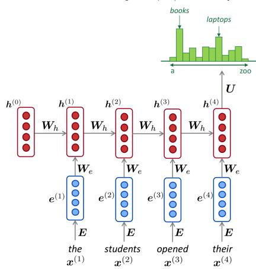


A figure from Christopher Manning, Natural Language Processing with Deep Learning, Stanford U. CS224n 

### RNN Language Models

<table><tr><td>Advantages</td><td>Disadvantages</td></tr><tr><td>√ Can process any length input</td><td>× Recurrent computation is slow</td></tr><tr><td>√ Computation for step t can (in theory) use information from many steps back</td><td>× In practice, difficult to access information from many steps back</td></tr><tr><td>√ Model size doesn’t increase for longer input</td><td></td></tr><tr><td>√ Same weights applied on every timestep, so there is symmetry in how inputs are processed</td><td></td></tr></table>

(More on these later in the course) 

### Content


### 3 Language Models Based on Recurrent Neural Networks

Recurrent Neural Networks (RNNs) 

Training a neural language model 

Other applications of neural language models 

Evaluation of language models 

Vanishing gradient 

Long Short Term Memory (LSTM) 

Gated Recurrent Units (GRUs) 

Exploding gradient 

Vanishing and exploding gradient for other neural networks 

Bi-directional RNNs and multi-layer RNNs 

### Content


### 3 Language Models Based on Recurrent Neural Networks

Recurrent Neural Networks (RNNs) 

Training a neural language model 

Other applications of neural language models 

Evaluation of language models 

Vanishing gradient 

Long Short Term Memory (LSTM) 

Gated Recurrent Units (GRUs) 

Exploding gradient 

Vanishing and exploding gradient for other neural networks 

Bi-directional RNNs and multi-layer RNNs 

### Training an RNN Language Model

Get a big corpus of text which is a sequence of words $\mathbf { \Psi } _ { X } ^ { ( 1 ) } , \dots , X ^ { ( T ) }$ 

Feed into RNN-LM; compute output distribution $\hat { y } ^ { ( t ) }$ for every step t 

i.e. predict probability dist of every word, given words so far 

Loss function on step t is cross-entropy between predicted probability distribution $\hat { y } ^ { ( t ) }$ , and the true next word $y ^ { ( t ) }$ (one-hot for $\dot { \mathbf { x } } ^ { ( t + 1 ) } )$ 

$$
\mathbf {J} ^ {(t)} (\theta) = \mathbf {C E} \left(\mathbf {y} ^ {(t)}, \hat {\mathbf {y}} ^ {(t)}\right) = - \sum_ {w \in V} y _ {w} ^ {(t)} \log \hat {y} _ {w} ^ {(t)} = - \log \hat {y} _ {x _ {t + 1}} ^ {(t)}
$$

Average this to get overall loss for entire training set: 

$$
J (\theta) = \frac {1}{T} \sum_ {t = 1} ^ {T} J ^ {(t)} (\theta) = \frac {1}{T} \sum_ {t = 1} ^ {T} - \log \hat {y} _ {x _ {t + 1}} ^ {(t)}
$$

### Training an RNN Language Model

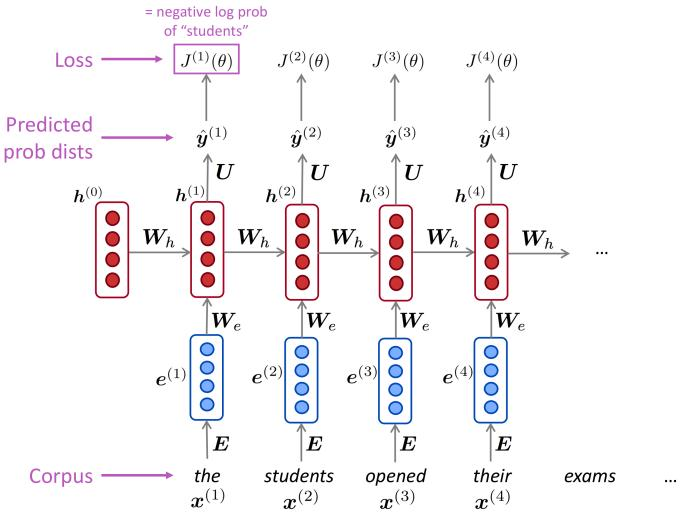


A figure from Christopher Manning, Natural Language Processing with Deep Learning, Stanford U. CS224n


### Training an RNN Language Model

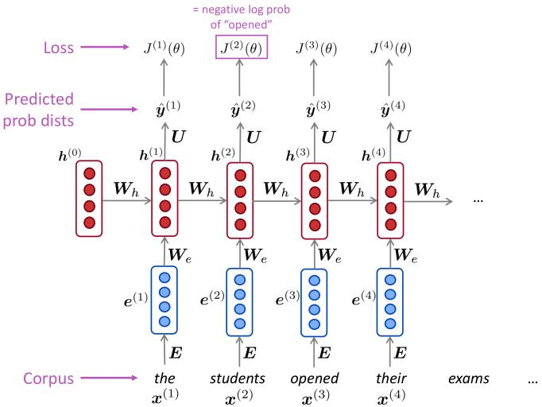


A figure from Christopher Manning, Natural Language Processing with Deep Learning, Stanford U. CS224n 

### Training an RNN Language Model

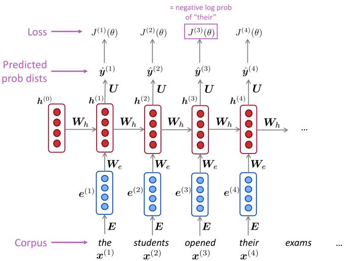


A figure from Christopher Manning, Natural Language Processing with Deep Learning, Stanford U. CS224n 

### Training an RNN Language Model

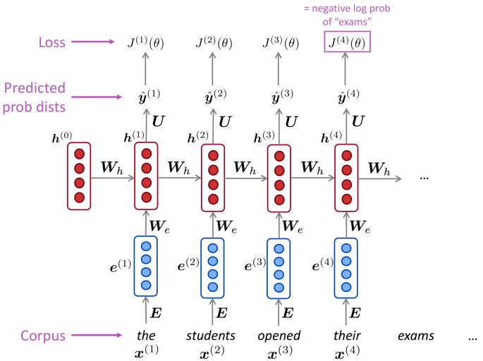


A figure from Christopher Manning, Natural Language Processing with Deep Learning, Stanford U. CS224n 

### Training an RNN Language Model

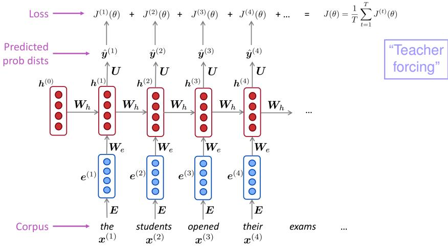


A figure from Christopher Manning, Natural Language Processing with Deep Learning, Stanford U. CS224n 

### Training a RNN Language Model

However: Computing loss and gradients across entire corpus is too expensive! 

In practice, consider $x ^ { ( t ) }$ as a sentence (or a document) 

Recall: Stochastic Gradient Descent allows us to compute loss and gradients for small chunk of data, and update 

Compute loss $\mathbf { J } ^ { ( t ) }$ for a sentence (actually a batch of sentences), compute gradients and update weights. Repeat. 

### Backpropagation for RNNs

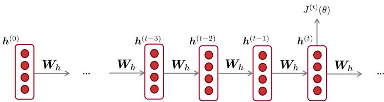


Question: What’s the derivative of $J ^ { ( t ) } ( \theta )$ w.r.t. the repeated weight matrix $W _ { h } ?$ 

Answer: $\frac { \partial J ^ { ( t ) } } { \partial \mathbf { W } _ { h } } = \sum _ { i = 1 } ^ { t } \frac { \partial J ^ { ( t ) } } { \partial \mathbf { W } _ { h } } \bigg \vert _ { ( i ) }$ “The gradient w.r.t. a repeated weight is the sum of the gradient w.r.t. each time it appears” 

Why? 

A figure from Christopher Manning, Natural Language Processing with Deep Learning, Stanford U. CS224n 

### Multivariable Chain Rule

Given a multivariable function $f ( x , y )$ , and two single variable functions $x ( t )$ and $y ( t )$ , here’s what the multivariable chain rule says: 

$$
\underbrace {\frac {d}{d t} f (x (t) , y (t))} _ {}
$$

$$
= \frac {\partial f}{\partial x} \frac {d x}{d t} + \frac {\partial f}{\partial y} \frac {d y}{d t}
$$

Derivative of composition function 

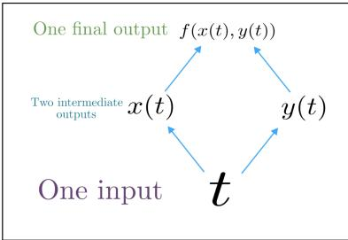


Source: Khan Academy: Multivariable chain rule, simple versio 

### Backpropagation for RNNs: Proof sketch

Given a multivariable function $f ( x , y )$ , and two single variable functions $x ( t )$ and $y ( t )$ , here’s what the multivariable chain rule says: 

$$
\underbrace {\frac {d}{d t} f (x (t) , y (t))} _ {}
$$

$$
= \frac {\partial f}{\partial x} \frac {d x}{d t} + \frac {\partial f}{\partial y} \frac {d y}{d t}
$$

Derivative of composition function 

In our example: 

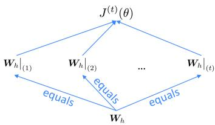


Apply the multivariable chain rule: 

$$
\begin{array}{c} \frac {\partial \mathbf {J} ^ {(t)}}{\partial \mathbf {W} _ {h}} = \sum_ {i = 1} ^ {t} \left. \frac {\partial \mathbf {J} ^ {(t)}}{\partial \mathbf {W} _ {h}} \right| _ {(i)} \boxed {\frac {\partial \mathbf {W} _ {h} | _ {(i)}}{\partial \mathbf {W} _ {h}}} \\ = \sum_ {i = 1} ^ {t} \left. \frac {\partial \mathbf {J} ^ {(t)}}{\partial \mathbf {W} _ {h}} \right| _ {(i)} \end{array}
$$

Source: Khan Academy: Multivariable chain rule, simple versior 

### Backpropagation for RNNs


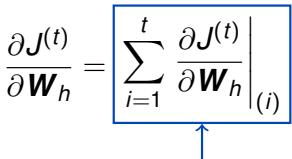


Question: How do we calculate this? 

Answer: Backpropagate over timesteps i = t, . . . , 0, summing gradients as you go. This algorithm is called “backpropagation through time” [Werbos, P.G., 1988, Neural Networks 1, and others] 

A figure from Christopher Manning, Natural Language Processing with Deep Learning, Stanford U. CS224n 

### Content


### 3 Language Models Based on Recurrent Neural Networks

Recurrent Neural Networks (RNNs) 

Training a neural language model 

Other applications of neural language models 

Evaluation of language models 

Vanishing gradient 

Long Short Term Memory (LSTM) 

Gated Recurrent Units (GRUs) 

Exploding gradient 

Vanishing and exploding gradient for other neural networks 

Bi-directional RNNs and multi-layer RNNs 

### Generating text with a RNN Language Model

Just like a n-gram Language Model, you can use a RNN Language Model to generate text by repeated sampling. Sampled output is next step’s input. 

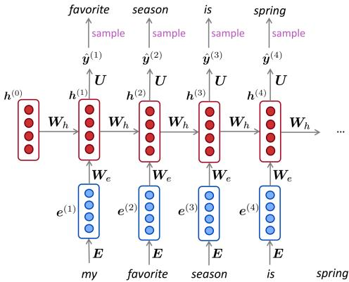


A figure from Christopher Manning, Natural Language Processing with Deep Learning, Stanford U. CS224n


### Generating text with a RNN Language Model

### Let’s have some fun!

You can train a RNN-LM on any kind of text, then generate text in that style. 

RNN-LM trained on Harry Potter: 

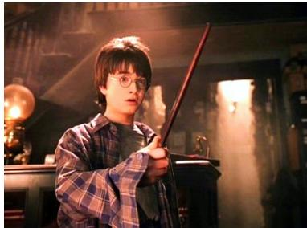


“Sorry,” Harry shouted, panicking—“I’ll leave those brooms in London, are they?” 

“No idea,” said Nearly Headless Nick, casting low close by Cedric, carrying the last bit of treacle Charms, from Harry’s shoulder, and to answer him the common room perched upon it, four arms held a shining knob from when the spider hadn’t felt it seemed. He reached the teams too. 

Source: medium.com/deep-writing/harry-potter-written-by-artificial-intelligenc 

### Generating text with a RNN Language Model

### Let’s have some fun!

You can train a RNN-LM on any kind of text, then generate text in that style. 

RNN-LM trained on recipes: 

```txt
Title: CHOCOLATE RANCH BARBECUE  
Categories: Game, Casseroles, Cookies, Cookies  
Yield: 6 Servings  
2 tb Parmesan cheese -- chopped  
1 c Coconut milk  
3 Eggs, beaten 
```


Place each pasta over layers of lumps. Shape mixture into the moderate oven and simmer until firm. Serve hot in bodied fresh, mustard, orange and cheese. 

Combine the cheese and salt together the dough in a large skillet; add the ingredients and stir in the chocolate and pepper. 

Source: gist.qithub.com/nylki/1efbaa36635956d35bcc 

### RNNs can be used for sentence classification

### e.g. sentiment classification

positive 

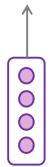


How to compute sentence encoding?


Sentence encoding 


overall


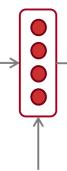


enjoyed


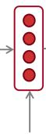


the


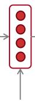


movie


0 


lot


A figure from Christopher Manning, Natural Language Processing with Deep Learning, Stanford U. CS224n 

0 

A figure from Christopher Manning, Natural Language Processing with Deep Learning, Stanford U. CS224n 

### RNNs can be used for sentence classification

### e.g. sentiment classification

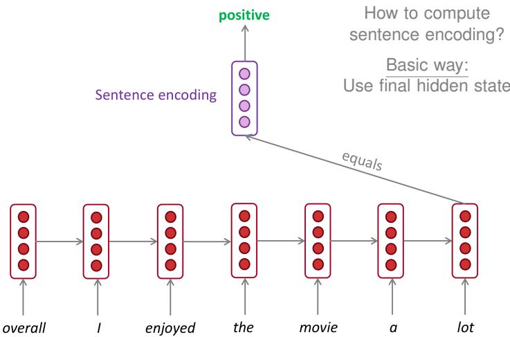


How to compute sentence encoding?


Basic way: Use final hidden state 

overall 

1 

enjoyed 

the 

movie 

lot 

### RNNs can be used for sentence classification

### e.g. sentiment classification

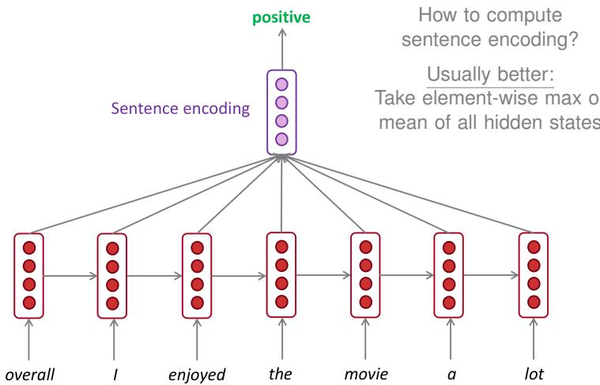


overall


enjoyed


the


movie


A figure from Christopher Manning, Natural Language Processing with Deep Learning, Stanford U. CS224n 

### RNNs can be used as an encoder module

### e.g. question answering, machine translation, many other tasks!

Here the RNN acts as an encoder for the Question (the hidden states represent the Question). The encoder is part of a larger neural system. 

### Answer: German

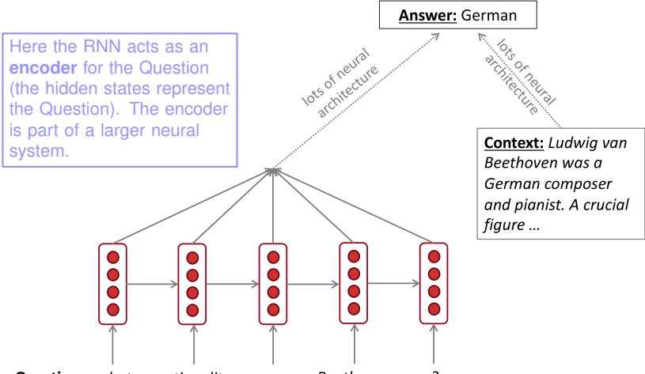


Context: Ludwig van Beethoven was a German composer and pianist. A crucial figure ... 

Question: what 

nationality 

was 

Beethoven 

A figure from Christopher Manning, Natural Language Processing with Deep Learning, Stanford U. CS224n 

### A note on terminology

The RNN described in this lecture = simple/vanilla/Elman RNN 

Next lecture: You will learn about other RNN flavors like GRU and LSTM and multi-layer RNNs 

By the end of the course: You will understand phrases like “stacked bidirectional LSTM with residual connections and self-attention” 

### Content


### 3 Language Models Based on Recurrent Neural Networks

Recurrent Neural Networks (RNNs) 

Training a neural language model 

Other applications of neural language models 

Evaluation of language models 

Vanishing gradient 

Long Short Term Memory (LSTM) 

Gated Recurrent Units (GRUs) 

Exploding gradient 

Vanishing and exploding gradient for other neural networks 

Bi-directional RNNs and multi-layer RNNs 

### Evaluating Language Models

The standard evaluation metric for Language Models is perplexity. 

perplexity 

$$
= \prod_ {t = 1} ^ {T} \left(\frac {1}{P _ {\mathrm{LM}} \left(\mathbf {x} ^ {(t + 1)} \mid \mathbf {x} ^ {(t)} , \dots , \mathbf {x} ^ {(1)}\right)}\right) ^ {1 / T}
$$

Normalized by number of words 

Inverse probability of corpus, according to Language Mode 

This is equal to the exponential of the cross-entropy loss $J ( \theta )$ : 

$$
= \prod_ {t = 1} ^ {T} \left(\frac {1}{\hat {\mathbf {y}} _ {\mathbf {x} _ {t + 1}} ^ {(t)}}\right) ^ {1 / T} = \exp \left(\frac {1}{T} \sum_ {t = 1} ^ {T} - \log \hat {\mathbf {y}} _ {\mathbf {x} _ {t + 1}} ^ {(t)}\right) = \exp (J (\theta))
$$

Lower perplexity is better! 

### RNNs have greatly improved perplexity

<table><tr><td rowspan="9">n-gram model → Increasingly complex RNNs</td><td>Model</td><td>Perplexity</td></tr><tr><td>Interpolated Kneser-Ney 5-gram (Chelba et al., 2013)</td><td>67.6</td></tr><tr><td>RNN-1024 + MaxEnt 9-gram (Chelba et al., 2013)</td><td>51.3</td></tr><tr><td>RNN-2048 + BlackOut sampling (Ji et al., 2015)</td><td>68.3</td></tr><tr><td>Sparse Non-negative Matrix factorization (Shazeer et al., 2015)</td><td>52.9</td></tr><tr><td>LSTM-2048 (Jozefowicz et al., 2016)</td><td>43.7</td></tr><tr><td>2-layer LSTM-8192 (Jozefowicz et al., 2016)</td><td>30</td></tr><tr><td>Ours small (LSTM-2048)</td><td>43.9</td></tr><tr><td>Ours large (2-layer LSTM-2048)</td><td>39.8</td></tr></table>


Perplexity improves (lower is better) 


Source: research.fb.com/building-an-efficient-neural-language-model-over-a-billion-words 

### Content


### 3 Language Models Based on Recurrent Neural Networks

Recurrent Neural Networks (RNNs) 

Training a neural language model 

Other applications of neural language models 

Evaluation of language models 

Vanishing gradient 

Long Short Term Memory (LSTM) 

Gated Recurrent Units (GRUs) 

Exploding gradient 

Vanishing and exploding gradient for other neural networks 

Bi-directional RNNs and multi-layer RNNs 

### Vanishing gradient intuition

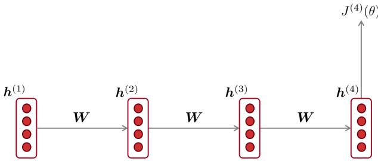


A figure from Christopher Manning, Natural Language Processing with Deep Learning, Stanford U. CS224r 

### Vanishing gradient intuition

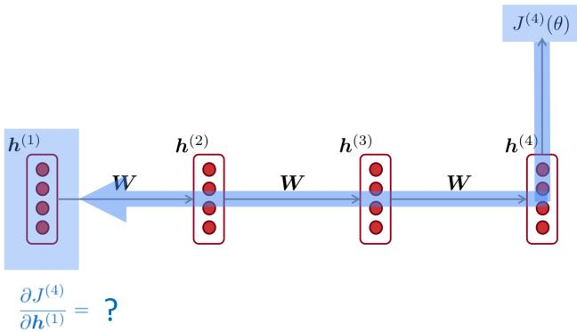


A figure from Christopher Manning, Natural Language Processing with Deep Learning, Stanford U. CS224r 

### Vanishing gradient intuition

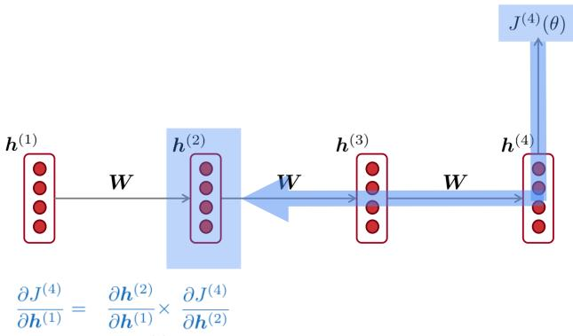


chain rule!


A figure from Christopher Manning, Natural Language Processing with Deep Learning, Stanford U. CS224r 

### Vanishing gradient intuition

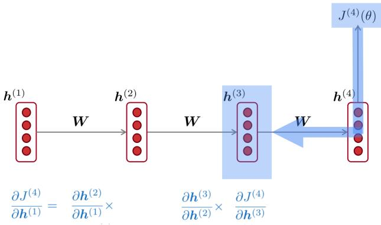


chain rule!


A figure from Christopher Manning, Natural Language Processing with Deep Learning, Stanford U. CS224n 

### Vanishing gradient intuition

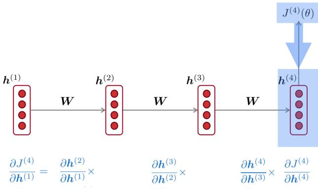


chain rule!


A figure from Christopher Manning, Natural Language Processing with Deep Learning, Stanford U. CS224n 

### Vanishing gradient intuition

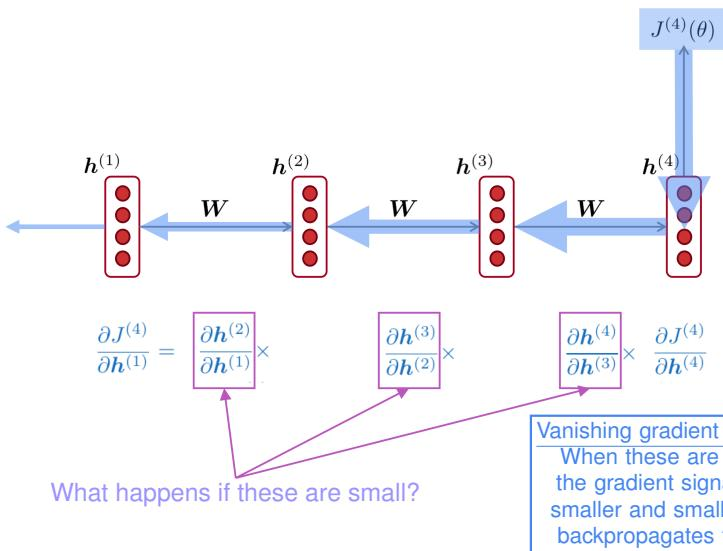


What happens if these are small? 

Vanishing gradient problem: When these are small. the gradient signal gets smaller and smaller as it backpropagates further 

A figure from Christopher Manning, Natural Language Processing with Deep Learning, Stanford U. CS224n 

### Vanishing gradient proof sketch

Recall: 

$$
\mathbf {h} ^ {(t)} = \sigma \left(\mathbf {W} _ {h} \mathbf {h} ^ {(t - 1)} + \mathbf {W} _ {x} \mathbf {x} ^ {(t)} + \mathbf {b} _ {1}\right)
$$

Therefore: $\frac { \partial \pmb { h } ^ { ( t ) } } { \partial \pmb { h } ^ { ( t - 1 ) } } = \mathrm { d i a g } \Big ( \sigma ^ { \prime } \big ( \pmb { W } _ { h } \pmb { h } ^ { ( t - 1 ) } + \pmb { W } _ { x } \pmb { x } ^ { ( t ) } + \pmb { b } _ { 1 } \big ) \Big ) \pmb { W } _ { h }$ (chain rule) 

Consider the gradient of the loss $J ^ { ( i ) } ( \theta )$ on step i, with respect to the hidden state $\pmb { h } ^ { ( j ) }$ on some previous step j. 

$$
\begin{array}{l} \frac {\partial \mathbf {J} ^ {(i)} (\theta)}{\partial \mathbf {h} ^ {(j)}} = \frac {\partial \mathbf {J} ^ {(i)} (\theta)}{\partial \mathbf {h} ^ {(i)}} \prod_ {j <   t \leq i} \frac {\partial \mathbf {h} ^ {(t)}}{\partial \mathbf {h} ^ {(t - 1)}} \\ = \frac {\partial \mathbf {J} ^ {(i)} (\theta)}{\partial \mathbf {h} ^ {(i)}} \boxed {\mathbf {W} _ {h} ^ {(i - j)}} \prod_ {j <   t \leq i} \operatorname{diag} \left(\sigma^ {\prime} \left(\mathbf {W} _ {h} \mathbf {h} ^ {(t - 1)} + \mathbf {W} _ {x} \mathbf {x} ^ {(t)} + \mathbf {b} _ {1}\right)\right) \quad (\text { value   of } \frac {\partial \mathbf {h} ^ {(t)}}{\partial \mathbf {h} ^ {(t - 1)}}) \end{array} \tag {chainrule}
$$

If $W _ { h }$ is small, then this term gets 

vanishingly small as i and j get further apart 

Source: $^ { \mathfrak { a } } _ { \mathsf { O n } }$ the difficulty of training recurrent neural networks”, Pascanu et al, 2013. proceedings.mlr.press/v28/pascanu13.pd 

### Vanishing gradient proof sketch

Consider matrix $\textsf { L } 2$ norms: 

$$
\left\| \frac {\partial \mathbf {J} ^ {(i)} (\theta)}{\partial \mathbf {h} ^ {(j)}} \right\| \leq \left\| \frac {\partial \mathbf {J} ^ {(i)} (\theta)}{\partial \mathbf {h} ^ {(i)}} \right\| \| \mathbf {W} _ {h} \| ^ {(i - j)} \prod_ {j <   t \leq i} \left\| \operatorname{diag} \left(\sigma^ {\prime} \left(\mathbf {W} _ {h} \mathbf {h} ^ {(t - 1)} + \mathbf {W} _ {x} \mathbf {x} ^ {(t)} + \mathbf {b} _ {1}\right)\right) \right\|
$$

Pascanu et al showed that if the largest eigenvalue of $W _ { h }$ is less than 1, then the gradient $\left\| \frac { \partial J ^ { ( i ) } ( \theta ) } { \partial \pmb { h } ^ { ( j ) } } \right\|$ will shrink exponentially Here the bound is 1 because we have sigmoid nonlinearity 

Source: “On the difficulty of training recurrent neural networks”, Pascanu et al, 2013. proceedings.mlr.press/v28/pascanu13.pd 

### Why is vanishing gradient a problem?

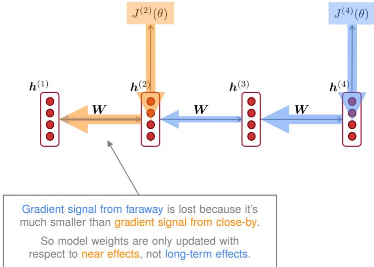


Gradient signal from faraway is lost because it’s much smaller than gradient signal from close-by. 

So model weights are only updated with respect to near effects, not long-term effects. 

A figure from Christopher Manning, Natural Language Processing with Deep Learning, Stanford U. CS224n 

### Why is vanishing gradient a problem?

Another explanation: Gradient can be viewed as a measure of the effect of the past on the future 

If the gradient becomes vanishingly small over longer distances (step t to step t + n), then we can’t tell whether: 

1 There’s no dependency between step t and t + n in the data 

2 We have wrong parameters to capture the true dependency between t and t + n 

### Effect of vanishing gradient on RNN-LM

LM task: The writer ofthe books 

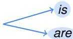


Correct answer: The writer of the books is planning a sequel 

Syntactic recency: The writer of the books is 

(correct) 

Sequential recency: The writer of the books are 

(incorrect) 

Due to vanishing gradient, RNN-LMs are better at learning from sequential recency than syntactic recency, so they make this type of error more often than we’d like [Linzen et al 2016] 

“Assessing the Ability of LSTMs to Learn Syntax-Sensitive Dependencies”, Linzen et al, 2016. arxiv.org/pdf/1611.01368.pd 

### How to fix vanishing gradient problem?

The main problem is that it’s too difficult for the RNN to learn to preserve information over many timesteps. 

In a vanilla RNN, the hidden state is constantly being rewritten: 

$$
h ^ {(t)} = f \left(h ^ {(t - 1)}, x ^ {(t)}\right)
$$

How about a RNN with separate memory? 

### Content


### 3 Language Models Based on Recurrent Neural Networks

Recurrent Neural Networks (RNNs) 

Training a neural language model 

Other applications of neural language models 

Evaluation of language models 

Vanishing gradient 

### Long Short Term Memory (LSTM)

Gated Recurrent Units (GRUs) 

Exploding gradient 

Vanishing and exploding gradient for other neural networks 

Bi-directional RNNs and multi-layer RNNs 

### Long Short-Term Memory (LSTM)

A type of RNN proposed by Hochreiter and Schmidhuber in 1997 as a solution to the vanishing gradients problem. 

On step t, there is a hidden state $h ^ { ( t ) }$ and a cell state $c ^ { ( t ) }$ 

Both are vectors length n 

The cell stores long-term information 

The LSTM can erase, write and read information from the cel 

The selection of which information is erased/written/read is controlled by three corresponding gates 

The gates are also vectors length n 

On each timestep, each element of the gates can be open (1), closed (0), or somewhere in-between 

The gates are dynamic: their value is computed based on the current context 

“Long short-term memory”, Hochreiter and Schmidhuber, 1997, 

https://www.bioinf.jku.at/publications/older/2604.pd 

### Long Short-Term Memory (LSTM)

We have a sequence of inputs $\pmb { x } ^ { ( t ) }$ , and we will compute a sequence of hidden states $\pmb { h } ^ { ( t ) }$ and cell states $\pmb { c } ^ { ( t ) }$ . On timestep t: 

Forget gate: controls what is kept vs forgotten, from previous cell state 

Input gate: controls what parts o the new cell content are written to cell 

Output gate: controls what parts of cell are output to hidden state 

C ll ( f ) write (“input”) some new cell content 

Hidden state: d ( ) 

$$
\begin{array}{l}\rightarrow \mathbf {f} ^ {(t)} = \sigma \big (\mathbf {W} _ {f} \mathbf {h} ^ {(t - 1)} + \mathbf {U} _ {f} \mathbf {x} ^ {(t)} + \mathbf {b} _ {f} \big)\\\rightarrow \mathbf {i} ^ {(t)} = \sigma \big (\mathbf {W} _ {i} \mathbf {h} ^ {(t - 1)} + \mathbf {U} _ {i} \mathbf {x} ^ {(t)} + \mathbf {b} _ {i} \big)\\\rightarrow \mathbf {o} ^ {(t)} = \sigma \big (\mathbf {W} _ {o} \mathbf {h} ^ {(t - 1)} + \mathbf {U} _ {o} \mathbf {x} ^ {(t)} + \mathbf {b} _ {o} \big)\end{array}
$$

Sigmoid function: all gate values are 

$$
\tilde {\mathbf {c}} ^ {(t)} = \tanh \left(\mathbf {W} _ {c} \mathbf {h} ^ {(t - 1)} + \mathbf {U} _ {c} \mathbf {x} ^ {(t)} + \mathbf {b} _ {c}\right)
$$

$$
\mathbf {c} ^ {(t)} = \mathbf {f} ^ {(t)} \circ \mathbf {c} ^ {(t - 1)} + \mathbf {i} ^ {(t)} \circ \tilde {\mathbf {c}} ^ {(t)}
$$

$$
\mathbf {h} ^ {(t)} = \mathbf {o} ^ {(t)} \circ \tanh \mathbf {c} ^ {(t)}
$$

Gates are applied using element-wise product ◦. All these are vectors of same length n 

Neural Network Layer 

Concatenate 

Pointwise Operation 

Vector Transfer 

### Long Short-Term Memory (LSTM)

You can think of the LSTM equations visually like this: 

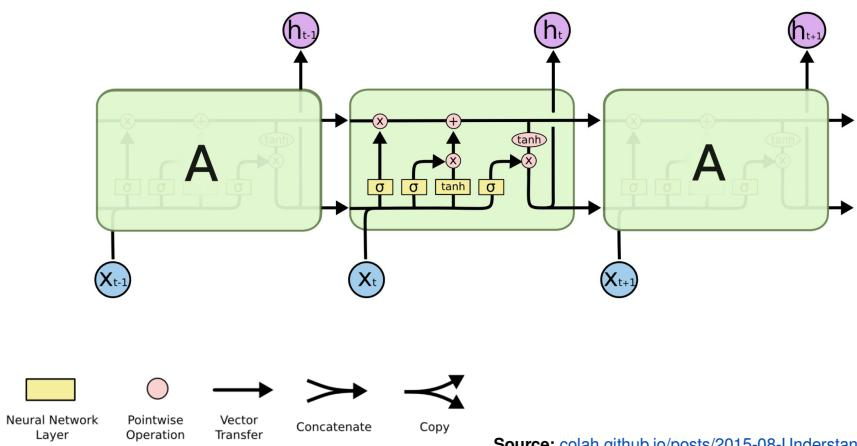


Source: l h i h b i / / U d di LSTM 

### Long Short-Term Memory (LSTM)

You can think of the LSTM equations visually like this: 

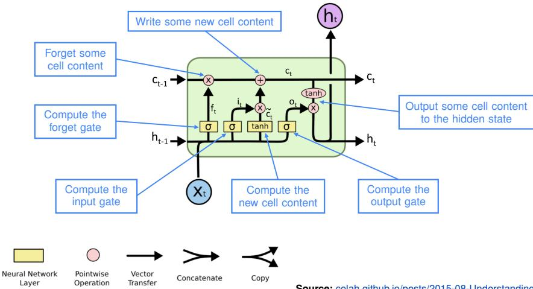


Source: colah.github.jo/posts/2015-08-Understanding-LSTMs 

### How does LSTM solve vanishing gradients?

The LSTM architecture makes it easier for the RNN to preserve information over many timesteps 

e.g. if the forget gate is set to remember everything on every timestep, then the info in the cell is preserved indefinitely 

By contrast, it’s harder for vanilla RNN to learn a recurrent weight matrix $W _ { h }$ that preserves info in hidden state 

LSTM doesn’t guarantee that there is no vanishing/exploding gradient, but it does provide an easier way for the model to learn long-distance dependencies 

### LSTMs: real-world success

In 2013-2015, LSTMs started achieving state-of-the-art results 

Successful tasks include: handwriting recognition, speech recognition, machine translation, parsing, image captioning 

LSTM became the dominant approach 

Now (2019), other approaches (e.g. Transformers) have become more dominant for certain tasks 

For example in WMT (a MT conference + competition): 

In WMT 2016, the summary report contains “RNN” 44 times 

In WMT 2018, the report contains “RNN” 9 times and “Transformer” 63 times 

Sources: “Findings of the 2016 Conference on Machine Translation (WMT16)”, Bojar et al. 2016; “Findings of the 2018 

Conference on Machine Translation (WMT18)”, Bojar et al. 2018 

### Content


### 3 Language Models Based on Recurrent Neural Networks

Recurrent Neural Networks (RNNs) 

Training a neural language model 

Other applications of neural language models 

Evaluation of language models 

Vanishing gradient 

Long Short Term Memory (LSTM) 

### Gated Recurrent Units (GRUs)

Exploding gradient 

Vanishing and exploding gradient for other neural networks 

Bi-directional RNNs and multi-layer RNNs 

### Gated Recurrent Units (GRU)

Proposed by Cho et al. in 2014 as a simpler alternative to the LSTM. 

On each timestep t we have input ${ \pmb x } ^ { ( t ) }$ and hidden state $\pmb { h } ^ { ( t ) }$ (no cell state). 

Update gate: controls what parts of hidden state are updated vs preserved 

Reset gate: controls what parts of previous hidden state are used to compute new content 

New hidden state content: reset gate Use this and current input to compute new hidden content. 

Hidden state: update gate simultaneously controls what is kept from previous hidden state, and wha is updated to new hidden state conten 

$$
\mathbf {u} ^ {(t)} = \sigma \left(\mathbf {W} _ {u} \mathbf {h} ^ {(t - 1)} + \mathbf {U} _ {u} \mathbf {x} ^ {(t)} + \mathbf {b} _ {u}\right)
$$

$$
\mathbf {r} ^ {(t)} = \sigma \left(\mathbf {W} _ {r} \mathbf {h} ^ {(t - 1)} + \mathbf {U} _ {r} \mathbf {x} ^ {(t)} + \mathbf {b} _ {r}\right)
$$

$$
\tilde {\mathbf {h}} ^ {(t)} = \tanh \left(\mathbf {W} _ {h} (\mathbf {r} ^ {(t)} \circ \mathbf {h} ^ {(t - 1)}) + \mathbf {U} _ {h} \mathbf {x} ^ {(t)} + \mathbf {b} _ {h}\right)
$$

$$
\mathbf {h} ^ {(t)} = \left(1 - \mathbf {u} ^ {(t)}\right) \circ \mathbf {h} ^ {(t - 1)} + \mathbf {u} ^ {(t)} \circ \tilde {\mathbf {h}} ^ {(t)}
$$

How does this solve vanishing gradient? Like LSTM, GRU makes it easier to retain info long-term (e.g. by setting update gate to 0) 

“Learning Phrase Representations using RNN Encoder–Decoder for SMT”, Cho et al. 2014. arxiv.org/pdf/1406.1078v3.pd 

### LSTM vs GRU

Researchers have proposed many gated RNN variants, but LSTM and GRU are the most widely-used 

The biggest difference is that GRU is quicker to compute and has fewer parameters 

There is no conclusive evidence that one consistently performs better than the other 

LSTM is a good default choice (especially if your data has particularly long dependencies, or you have lots of training data) 

Rule of thumb: start with LSTM, but switch to GRU if you want something more efficient 

### Content


### 3 Language Models Based on Recurrent Neural Networks

Recurrent Neural Networks (RNNs) 

Training a neural language model 

Other applications of neural language models 

Evaluation of language models 

Vanishing gradient 

Long Short Term Memory (LSTM) 

Gated Recurrent Units (GRUs) 

### Exploding gradient

Vanishing and exploding gradient for other neural networks 

Bi-directional RNNs and multi-layer RNNs 

### Why is exploding gradient a problem?

The mirror image of vanishing: if the largest eigenvalue of $W _ { h }$ is greater than 1, the gradient can grow exponentially [Pascanu et al, 2013] 

If the gradient becomes too big, then the SGD update step becomes too big: 

$$
\theta_ {\text { new }} = \theta_ {\text { old }} - \underbrace {\alpha} _ {\text { learning   rate }} \underbrace {\nabla_ {\theta} J (\theta)} _ {\text { gradient }}
$$

● This can cause bad updates: we take too large a step and reach a bad parameter configuration (with large loss) 

In the worst case, this will result in Inf or NaN in your network (then you have to restart training from an earlier checkpoint) 

### Gradient clipping: solution for exploding gradient

Gradient clipping: if the norm of the gradient is greater than some threshold, scale it down before applying SGD update 

### Algorithm: norm clipping

$$
\hat {\pmb {g}} \leftarrow \frac {\partial L}{\partial \theta}
$$

if $\| \hat { \pmb g } \| \ge$ threshold then 

$$
\hat {\mathbf {g}} \leftarrow \frac {\text { threshold }}{\| \hat {\mathbf {g}} \|} \hat {\mathbf {g}}
$$

end if 

Intuition: take a step in the same direction, but a smaller step 

Source: $\mathfrak { a } _ { \mathsf { O } \mathsf { n } }$ the difficulty of training recurrent neural networks”. Pascanu et al. 2013. proceedings,mlr.press/y28/pascanu13.pd 

### Gradient clipping: solution for exploding gradient

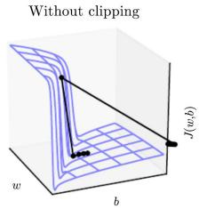


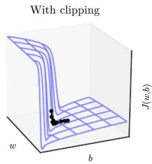


This shows the loss surface of a simple RNN (hidden state is a scalar not a vector) 

The “cliff” is dangerous because it has steep gradient 

On the left, gradient descent takes two very big steps due to steep gradient, resulting in climbing the cliff then shooting off to the right (both bad updates) 

On the right, gradient clipping reduces the size of those steps, so effect is less drastic 

Source: “Deep Learning”, Goodfellow, Bengio and Courville, 2016. Chapter 10.11.1. deeplearningbook.org/contents/rnn.htm 

### Content


### 3 Language Models Based on Recurrent Neural Networks

Recurrent Neural Networks (RNNs) 

Training a neural language model 

Other applications of neural language models 

Evaluation of language models 

Vanishing gradient 

Long Short Term Memory (LSTM) 

Gated Recurrent Units (GRUs) 

Exploding gradient 

Vanishing and exploding gradient for other neural networks 

Bi-directional RNNs and multi-layer RNNs 

### Is vanishing/exploding gradient just a RNN problem?

No! It can be a problem for all neural architectures (including feed-forward and convolutional), especially deep ones. 

Due to chain rule / choice of nonlinearity function, gradient can become vanishingly small as it backpropagates 

Thus lower layers are learnt very slowly (hard to train) 

Solution: lots of new deep feedforward/convolutional architectures that add more direct connections (thus allowing the gradient to flow) 

### For example:

Residual connections aka “ResNet” 

Also known as skip-connections 

The identity connection preserves information by default 

This makes deep networks much easier to train 

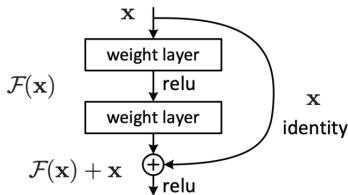


Figure 2. Residual learning: a building block


“Deep Residual Learning for Image Recognition”, He et al, 2015. arxiv.org/pdf/1512.03385.pd 

### Is vanishing/exploding gradient just a RNN problem?

No! It can be a problem for all neural architectures (including feed-forward and convolutional), especially deep ones. 

● Due to chain rule / choice of nonlinearity function, gradient can become vanishingly small as it backpropagates 

Thus lower layers are learnt very slowly (hard to train) 

Solution: lots of new deep feedforward/convolutional architectures that add more direct connections (thus allowing the gradient to flow) 

### For example:

Dense connections aka “DenseNet” 

Directly connect everything to everything! 

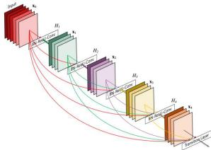


Figure 1: A 5-laver dense block with a growth rate of k = 4 Each layer takes all preceding feature-maps as input


“Densely Connected Convolutional Networks”, Huang et al, 2017. arxiv.org/pdf/1608.06993.pd 

### Is vanishing/exploding gradient just a RNN problem?

### For example: Highway connections aka “HighwayNet”

Similar to residual connections, but the identity connection vs the transformation layer is controlled by a dynamic gate 

Inspired by LSTMs, but applied to deep feedforward/convolutiona networks 

Conclusion: Though vanishing/exploding gradients are a genera problem, RNNs are particularly unstable due to the repeated multiplication by the same weight matrix [Bengio et al, 1994] 

### Is vanishing/exploding gradient just a RNN problem?

### For example: Highway connections aka “HighwayNet”

Similar to residual connections, but the identity connection vs the transformation layer is controlled by a dynamic gate 

Inspired by LSTMs, but applied to deep feedforward/convolutiona networks 

Conclusion: Though vanishing/exploding gradients are a general problem, RNNs are particularly unstable due to the repeated multiplication by the same weight matrix [Bengio et al, 1994] 

“Learning Long-Term Dependencies with Gradient Descent is Difficult", Bengio et al. 1994 

http://ai.dinfo.unifi.it/paolo//ps/tnn-94-gradient.pdf 

### Content


### 3 Language Models Based on Recurrent Neural Networks

Recurrent Neural Networks (RNNs) 

Training a neural language model 

Other applications of neural language models 

Evaluation of language models 

Vanishing gradient 

Long Short Term Memory (LSTM) 

Gated Recurrent Units (GRUs) 

Exploding gradient 

Vanishing and exploding gradient for other neural networks 

Bi-directional RNNs and multi-layer RNNs 

### Bidirectional RNNs: motivation

### Task: Sentiment Classification

W d hi hidd representation of the word “terribly” in the context of this sentence. We call this a contextual representation. 

Sentence encoding 

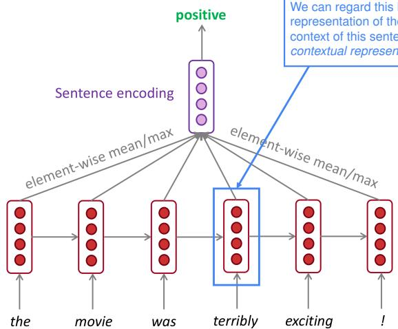


the


movie


was


terribly


exciting


These contextua representations only contain information about the left context (e.g. “the movie was”) 

### What about right context?

In this example, “exciting” is in the right context and this modifies the meaning of “terribly” (from negative to positive) 

A figure from Christopher Manning, Natural Language Processing with Deep Learning, Stanford U. CS224n 

### Bidirectional RNNs

This contextual representation of “terribly” has both left and right context 

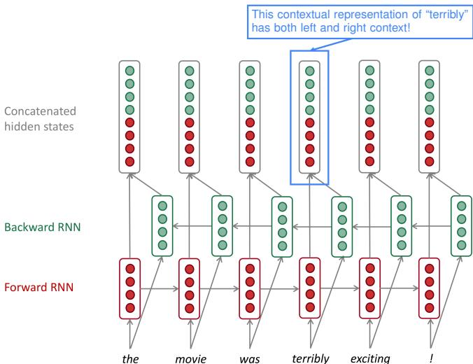


the


movie


was


terribly


exciting


A figure from Christopher Manning, Natural Language Processing with Deep Learning, Stanford U. CS224


### Bidirectional RNNs

On timestep t: 

This is a general notation to mean “compute one forward step of the RNN” – it could be a vanilla, LSTM or GRU computation. 

Forward RNN 

$$
\overrightarrow {\mathbf {h}} ^ {(t)} = \boxed {\mathrm{RNN} _ {\mathrm{FW}}}
$$

$$
\big (\overrightarrow {\pmb {h}} ^ {(t - 1)}, \pmb {x} ^ {(t)} \big)
$$

Backward RNN 

$$
\overleftarrow {\mathbf {h}} ^ {(t)} = \mathrm{RNN} _ {\mathrm{BW}} \left(\overleftarrow {\mathbf {h}} ^ {(t + 1)}, \mathbf {x} ^ {(t)}\right)
$$

Generally, these two RNNs have separate weights 

Concatenated hidden states 

$$
\boxed {\mathbf {h} ^ {(t)}} = \left[ \overrightarrow {\mathbf {h}} ^ {(t)}; \overleftarrow {\mathbf {h}} ^ {(t)} \right]
$$

We regard this as “the hidden state” of a bidirectional RNN. This is what we pass on to the next parts of the network. 

### Bidirectional RNNs: simplified diagram

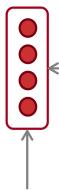


the


movie


was


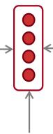


terribly


exciting


The two-way arrows indicate bidirectionality and the depicted hidden states are assumed to be the concatenated forwards+backwards states. 

A figure from Christopher Manning, Natural Language Processing with Deep Learning, Stanford U. CS224n 

### Bidirectional RNNs

Note: bidirectional RNNs are only applicable if you have access to the entire input sequence 

They are not applicable to Language Modeling, because in LM you only have left context available 

If you do have entire input sequence (e.g. any kind of encoding), bidirectionality is powerful (you should use it by default) 

For example, BERT (Bidirectional Encoder Representations from Transformers) is a powerful pretrained contextual representation system built on bidirectionality 

You will learn more about BERT later in the course! 

### Multi-layer RNNs

RNNs are already “deep” on one dimension (they unroll over many timesteps) 

We can also make them “deep” in another dimension by applying multiple RNNs — this is a multi-layer RNN 

This allows the network to compute more complex representations 

The lower RNNs should compute lower-level features and the higher RNNs should compute higher-level features 

Multi-layer RNNs are also called stacked RNNs 

### Multi-layer RNNs

RNN layer 3 

RNN layer 2 

RNN layer 1 

The hidden states from RNN layer are the inputs to RNN layer i+ 

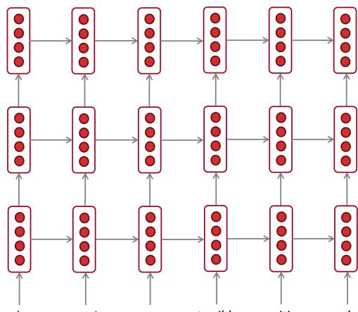


the


movie


was


terribly


exciting


A figure from Christopher Manning, Natural Language Processing with Deep Learning, Stanford U. CS224r


### Multi-layer RNNs in practice

High-performing RNNs are often multi-layer (but aren’t as deep as convolutional or feed-forward networks) 

0 For example: In a 2017 paper, Britz et al find that for Neura Machine Translation, 2 to 4 layers is best for the encoder RNN, and 4 layers is best for the decoder RNN 

However, skip-connections/dense-connections are needed to train deeper RNNs (e.g. 8 layers) 

Transformer-based networks (e.g. BERT) can be up to 24 layers 

You will learn about Transformers later; they have a lot of skipping-like connections 

“Massive Exploration of Neural Machine Translation Architectures”, Britz et al, 2017, 

https://arxiv.org/pdf/1703.03906.pdf 

### Content


Language Models (LMs) 


N-gram Language Models 


Language Models Based on Recurrent Neural Networks 


Sequence Tagging 

### Named Entity Recognition (NER)

A very important sub-task: find and classify names in text, for example: 

The decision by the independent MP Andrew Wilkie to withdraw his support for the minority Labor government sounded dramatic but it should not further threaten its stability. When, after the 2010 election, Wilkie, Rob Oakeshott, Tony Windsor and the Greens agreed to support Labor, they gave just two guarantees: confidence and supply. 

### Named Entity Recognition (NER)

A very important sub-task: find and classify names in text, for example: 

The decision by the independent MP Andrew Wilkie to withdraw his support for the minority Labor government sounded dramatic but it should not further threaten its stability. When, after the 2010 election, Wilkie, Rob Oakeshott, Tony Windsor and the Greens agreed to support Labor, they gave just two guarantees: confidence and supply. 

PER person ORG organization DATE date 

### Named Entity Recognition (NER)

### The uses:

Named entities can be indexed, linked off, etc. 

Sentiment can be attributed to companies or products 

A lot of IE relations are associations between named entities 

For question answering, answers are often named entities. 

### Concretely:

Many web pages tag various entities, with links to bio or topic pages, etc. 

Reuters’ OpenCalais, Evri, AlchemyAPI, Yahoo’s Term Extraction, 

Apple/Google/Microsoft/. . . smart recognizers for document conten 

### Three approaches to NER

Hand-written regular expressions 

Using classifiers 

Sequence models 

### Hand-written Patterns for Information Extraction

If extracting from automatically generated web pages, simple regex patterns usually work. 

```html
- Amazon page
  <div class="buying"><h1 class="parseasinTitle">
    <span id="btAsinTitle" style="">(.*)</span></h1> 
```

For certain restricted, common types of entities in unstructured text, simple regex patterns also usually work. 

Finding (US) phone numbers 

(?: $?[0-9]{3}$ ?[-.])?[0-9]{3}[-.]?[0-9]{4} 


### The Named Entity Recognition Task

Task: Predict entities in a text 

ORG 

ORG 


PER 

PER 

O 

ORG 

Foreign Ministry spokesman Shen Guofang told Reuters : 

PER person 

ORG organization 


O outside (not an entity) 

Standard evaluation is per entity, not per token 

<table><tr><td></td><td>Fred</td><td>showed</td><td>Sue</td><td>Mengqiu</td><td>Huang</td><td>&#x27;s</td><td>new</td><td>painting</td></tr><tr><td>IO</td><td>PER</td><td>O</td><td>PER</td><td>PER</td><td>PER</td><td>O</td><td>O</td><td>O</td></tr><tr><td>BIO</td><td>B-PER</td><td>O</td><td>B-PER</td><td>B-PER</td><td>I-PER</td><td>O</td><td>O</td><td>O</td></tr></table>

### Encoding classes for sequence labeling

### RNNs can be used for tagging

e.g. part-of-speech tagging, named entity recognition 

the 

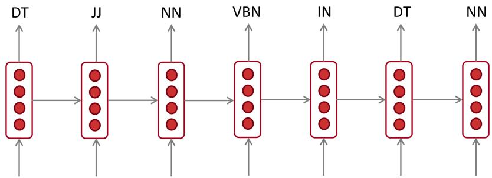


startled


NN 

cat 

VBN 

knocked 

IN 

over 

DT 

the 

NN 

vase 

A figure from Christopher Manning, Natural Language Processing with Deep Learning, Stanford U. CS224n 

<table><tr><td>Training</td><td>Testing</td></tr><tr><td>Collect a set of representative training documentsLabel each token for its entity class or other (O)Design feature extractors appropriate to the text and classesTrain a sequence classifier to predict the labels from the data</td><td>Receive a set of testing documentsRun sequence model inference to label each tokenAppropriately output the recognized entities</td></tr></table>

### The ML sequence model approach to NER

### Content


Language Models (LMs) 


2 N-gram Language Models 


3 Language Models Based on Recurrent Neural Networks 


Sequence Tagging 