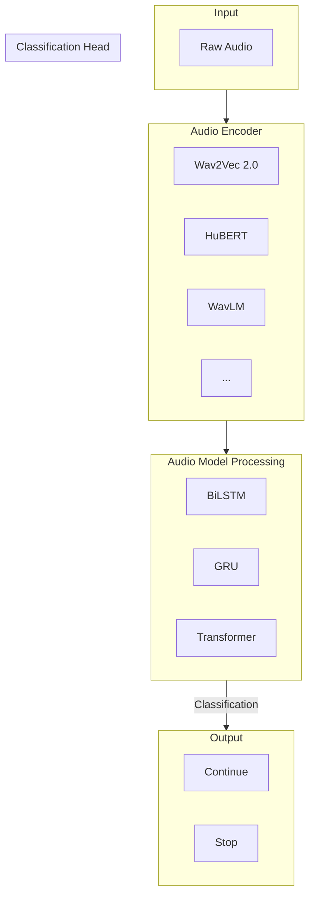
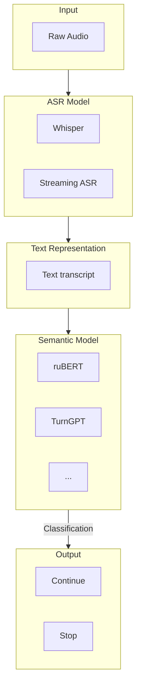
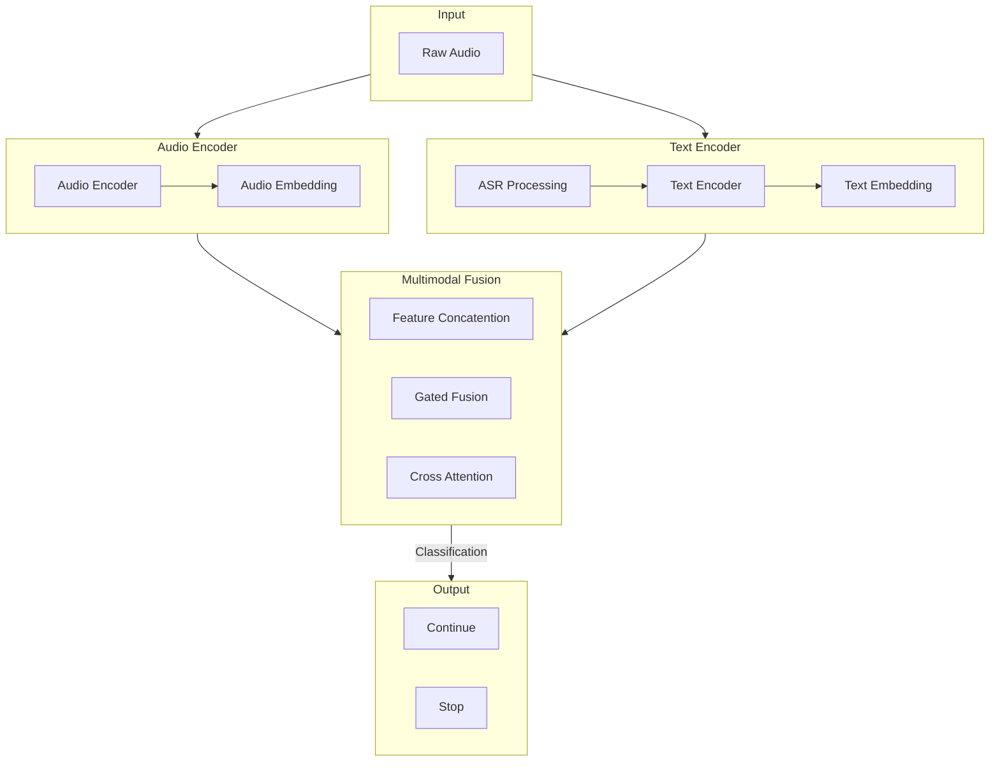

# NLP Course Research Project: Semantic VAD

## 1. Model Architecture: Available Options

### 1.1 End to End (Audio-Only)

Directly Use audio features without ASR processing to predict voice activity.

Pretrained Models:
- Wav2Vec 2.0
- HuBERT
- WavLM

Advantages:
- Without ASR processing.
- Can utilize pitch, silence, pitch, rhythm, etc.
- Directly process audio input.
- Suitable for real-time inference.

Disadvantages:
- Model training and parameter tuning are relatively complex.
- Difficult to understand complex semantics solely based on audio features.
- Requires good quality voice data and boundary annotations.

Reference: 
- [FD-VAD: Semantic Endpoint Detection for Streaming Full-Duplex Speech](https://fd-vad.github.io/)
  - WavLM-base-plus: Extract audio features.
  - Modality Adapter: Map audio representations.
  - Qwen2.5-0.5B: Contextual prediction.
  - LoRA: Reduce fine-tuning cost.

### 1.2 ASR + NLP Layered(Text-Only)

First, use ASR to convert audio to text. Then, use NLP model to judge if the text is complete.

Advantages:
- Can utilize complex semantics.
- Can handle long audio input.
- Most relevant to our NLP course.

Disadvantages:
- ASR processing latency.
- ASR mistake can affect the accuracy of the semantic VAD.
- Without acoustic features.
- Lower inference speed.

Reference: 
- [TurnGPT: A Transformer-based Language Model for Predicting Turn-taking in Spoken Dialog](https://aclanthology.org/2020.findings-emnlp.268/)
  - Use Transformer based language model to predict turn-taking in spoken dialog.
  - Study the relationship between language expression completeness and dialog turn.
  > It is a text-only prediction research, not a full ASR + NLP system.
- [SmartTurn](https://github.com/pipecat-ai/smart-turn)
  - based on whisper-tiny encoder
  - shallow linear classifier
  - only for audio pieces

### 1.3 Audio + Text Multimodal Fusion

Combination of acoustic features and text features to predict voice activity.

Advantages:
- Combine acoustic features and text features.
- Higher research value.
- May leads to a high-quality publication?

Disadvantages:
- More complex architechture. 
- Difficult to realize.
- Lowest inference speed?

#### My Advice
- Personally I recommend the ASR + NLP Layered(Text-Only) Option since it is most relevant to our NLP course. But if we want something more(like a good publication), we may try the Audio + Text Multimodal Fusion Option.

## 2. Dataset

### Requirements: 
- Original natural audio data.
- Complete or incomplete endpoint labels.
- Russian language(Optional).
- Pulse time stamps(Optional).
- Transcripted text(Recommended for ASR).
- Contextual information(Recommended).

### Available Datasets

1. [pipecat-ai/smart-turn-data-v3.2-trai](https://huggingface.co/datasets/pipecat-ai/smart-turn-data-v3.2-train): 271k rows, 4.7% rus, short audio pieces
2. [otoearth/otoSpeech-full-duplex-turn-104h](https://huggingface.co/datasets/otoearth/otoSpeech-full-duplex-turn-104h): 104h, 100%eu, Full duplex audio

## 3. Benchmark and metrics

### Metrics

- Precision: 

$$
\frac{TP}{TP+FP}
$$

- Recall

$$
\frac{TP}{TP+FN}
$$

- FPR

$$
\frac{FP}{TN+FP}
$$

- Latency: Time to process one audio sample. Unit: milliseconds.

### Available Benchmarks

- [TurnBench](https://turnbench.sesame.com/)
- [SmartTurn](https://github.com/pipecat-ai/smart-turn)
