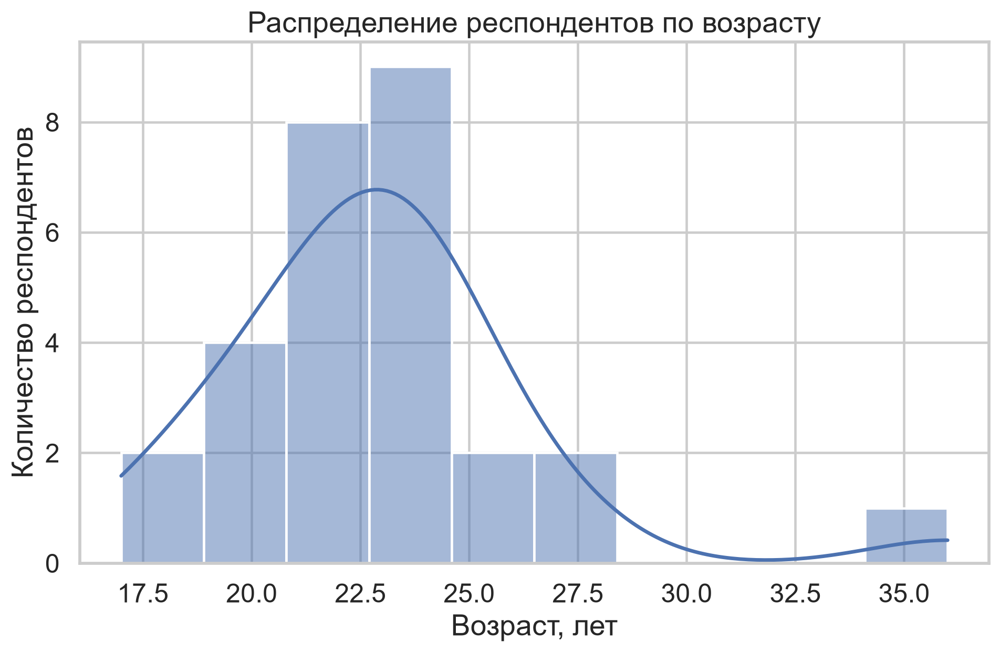
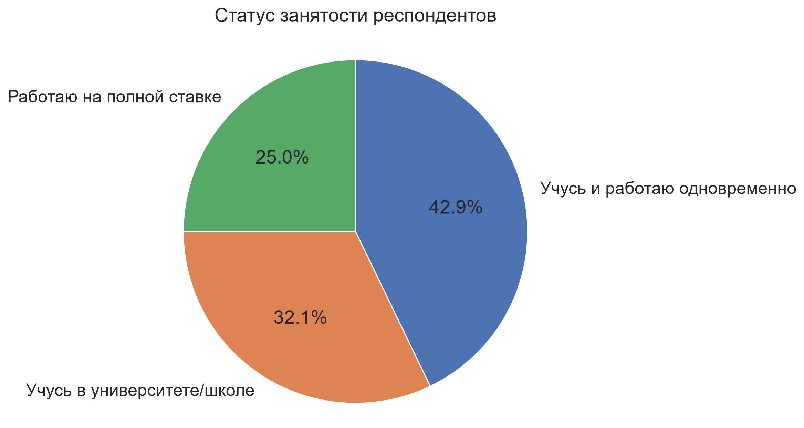
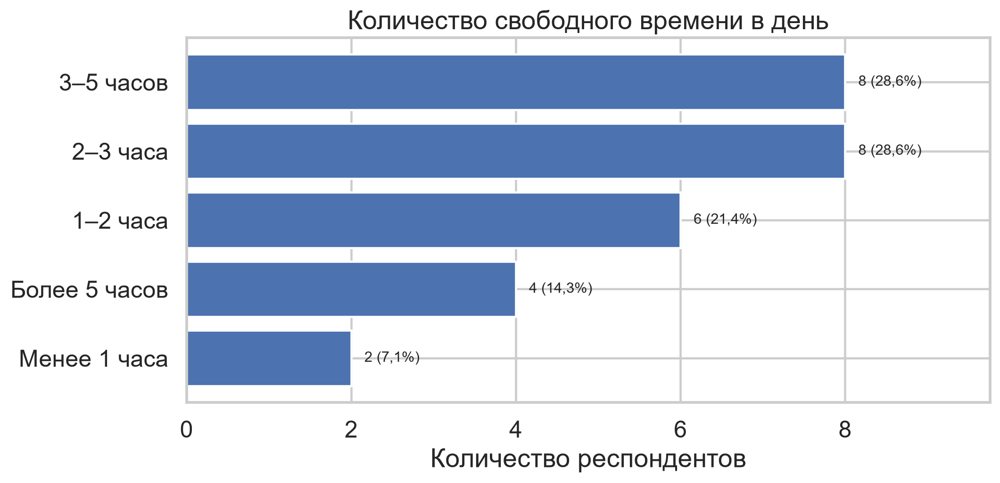
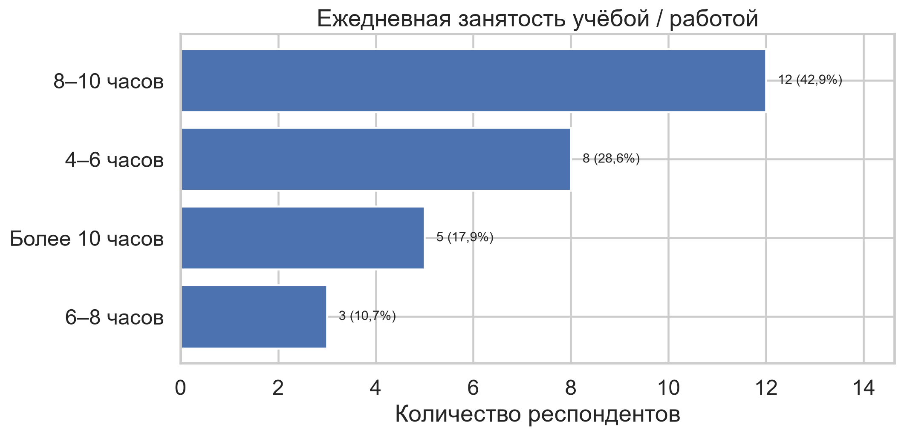
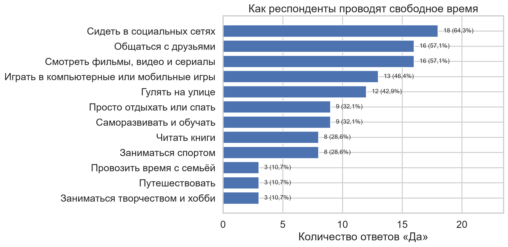
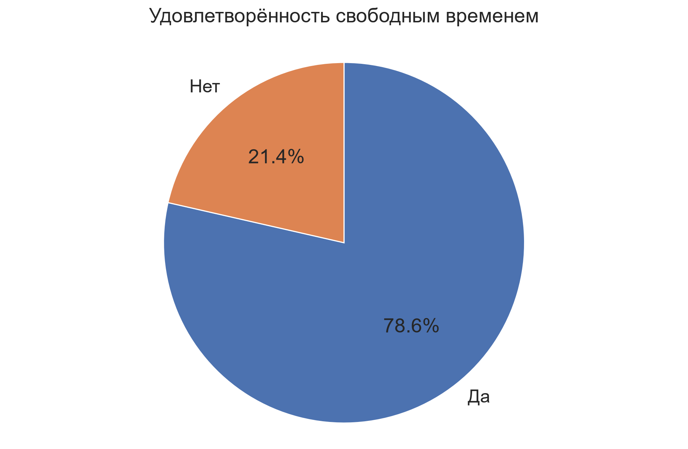
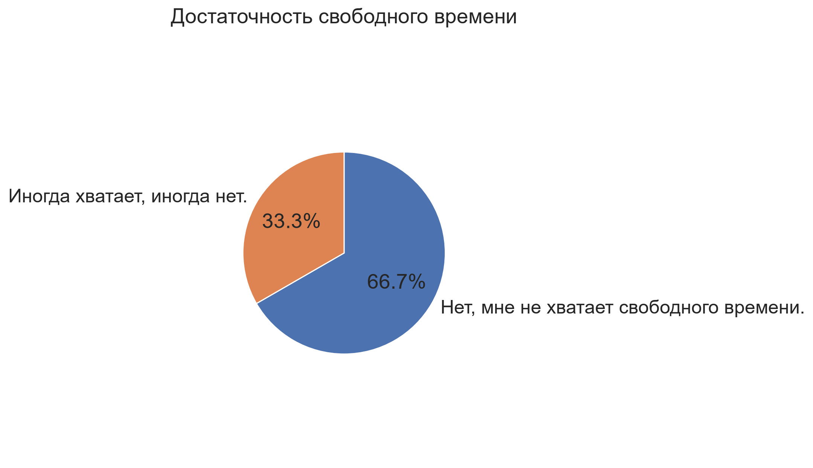
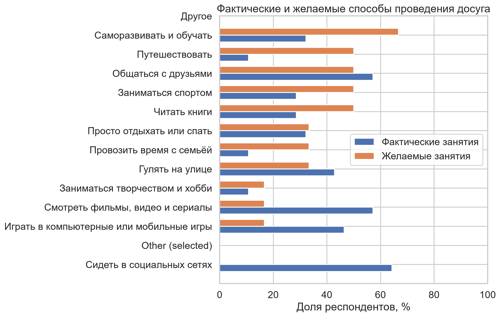
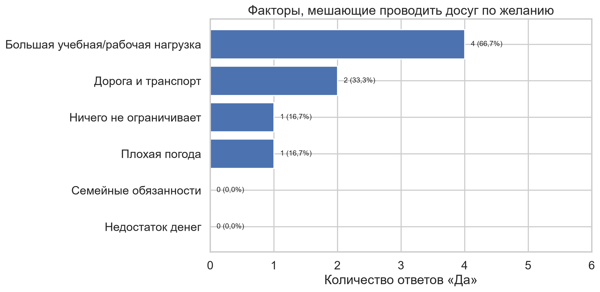

# Тема презентации: Как молодые люди проводят свободное время?

## 1. Введение

Здравствуйте! Сегодня я хочу представить вам результаты нашего социологического опроса на тему «Как молодые люди проводят свободное время?».

Цель исследования — узнать, как люди проводят свободное время, чем они заниматься и насколько они удовлетворены своим свободным временем.

Опрос проводился в формате онлайн-анкеты. В анкете было три блока и девять вопросов. В первом блоке мы собрали основную информацию об участниках. Во втором блоке были вопросы о свободном времени. В третьем блоке мы изучили удовлетворённость свободным временем, а также разницу между желаемым и реальным свободным временем.

В опросе приняли участие 28 человек в возрасте от 17 до 36 лет. Среди них были студенты, работающие люди, а также те, кто одновременно учится и работает.

---

## 2. Результаты опроса

Сначала посмотрим, сколько свободного времени обычно есть у участников.

По результатам опроса, у 57% участников свободного времени не больше трёх часов в день. У 29% есть от трёх до пяти часов, а только у 14% больше пяти часов. 

Кроме того, 43% участников обычно заняты учёбой или работой по 8-10 часов в день. Это показывает, что свободное время у многих людей довольно ограничено.

Теперь перейдём к тому, чем участники обычно занимаются в свободное время.

Самый популярный ответ — социальные сети: этот вариант выбрали 64% участников. Просмотр фильмов, видео и сериалов, а также общение с друзьями выбрали по 57% участников. Ещё 46% участников играют в компьютерные или мобильные игры, а 43% предпочитают гулять.

Теперь посмотрим, насколько участники довольны своим свободным временем.  

Большинство участников — 79% — ответили, что довольны, а 21% ответили, что не довольны. Для тех, кто недоволен, мы задали несколько дополнительных вопросов, чтобы узнать, почему они не довольны своим свободным временем.

Сначала мы спросили, хватает ли им свободного времени. Среди этих участников четыре человека ответили, что им его не хватает, а двое сказали, что иногда его хватает, а иногда нет.

Кроме того, мы задали вопрос о желаемых занятиях и сравнили их с тем, чем участники фактичесно занимаются.

Чаще всего эти участники хотели бы заниматься саморазвитием и учёбой: этот вариант выбрали четыре из шести человека, или 67%. Общение с друзьями, спорт, чтение и путешествия выбрали по три человека, или по 50%.

В действительности в этой группе чаще всего гуляли: этот вариант выбрали четыре человека, или 67%. Социальные сети, фильмы и общение с друзьями выбрали по три человека, или по 50%.

Обратите внимание на разницу между желаемыми и фактическими занятиями. Спортом и путешествиями хотели бы заниматься 50% участников, но в действительности эти занятия не выбрал никто. Также заметна разницы в желании проводить время с семьёй, заниматься саморазвитием и учёбой — они составляют 33 процентных пункта.

Что касается причин, мешающих проводить свободное время по своему желанию, то главный барьер — большая учебная или рабочая нагрузка: об этом заявили четыре из шести участников (67%). Ещё один важный фактор — дорога и транспорт: его отметили двое из шести участников (33%).

---

## 3. Заключение

Подведём итоги. В целом большинство участников опроса довольны своим досугом. Однако большая учебная или рабочая нагрузка в определённой степени ограничивает количество свободного времени молодых людей, а также их возможности выбирать занятия по своему желанию.

В результате молодые люди чаще предпочитают простые и доступные виды отдыха, а не те занятия, которыми им действительно хотелось бы заниматься.

Возможно, если удастся каким-то образом снизить учебную или рабочую нагрузку, это поможет улучшить ситуацию, повысить удовлетворённость людей своей жизнью и, в конечном итоге, повысить общий уровень благополучия общества.

Мне кажется, это вопрос, который заслуживает дальнейшего обсуждения.

Спасибо за внимание!
