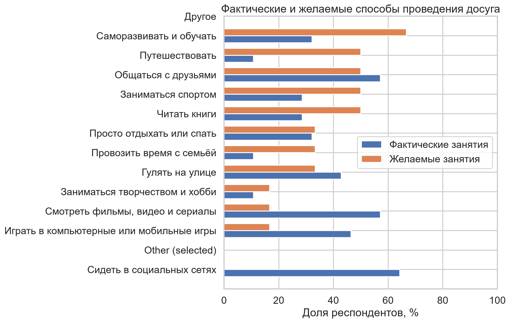

# Социологического опроса "Как молодые люди проводят свободное время?"

**Цель исследования:** Изучить, как молодые люди проводят свободное время и насколько они удовлетворены его количеством.

**Формат опроса:** Онлайн-анкета.

**Количество полученных анкет:** 28.

---

## Общая информация

### Сколько вам лет?*

На вопрос ответили **28 человек**.

Диапазон: **17–36** лет
Средний возраст: **22,9** года
Медиана: **22,5**

| Возраст, лет | Количество, чел. | Доля, % |
| --- | --- | --- |
| 17 | 1 | 3,6% |
| 18 | 1 | 3,6% |
| 19 | 2 | 7,1% |
| 20 | 2 | 7,1% |
| 21 | 2 | 7,1% |
| 22 | 6 | 21,4% |
| 23 | 2 | 7,1% |
| 24 | 7 | 25,0% |
| 25 | 2 | 7,1% |
| 27 | 2 | 7,1% |
| 36 | 1 | 3,6% |

---

### Вы сейчас работаете или учитесь?*

На вопрос ответили **28 человек**. 

Наиболее распространённый ответ — «Учусь и работаю одновременно» (12 человек, 42,9%).

| Вариант ответа | Количество, чел. | Доля, % |
| --- | --- | --- |
| Учусь и работаю одновременно | 12 | 42,9% |
| Учусь в университете/школе | 9 | 32,1% |
| Работаю на полной ставке | 7 | 25,0% |

---

## Свободное время и повседневная жизнь

### Сколько часов в день вы обычно заняты учёбой или работой?*

На вопрос ответили **28 человек**. 

Наиболее распространённый ответ — «8–10 часов» (12 человек, 42,9%).

| Вариант ответа | Количество, чел. | Доля, % |
| --- | --- | --- |
| 8–10 часов | 12 | 42,9% |
| 4–6 часов | 8 | 28,6% |
| 6–8 часов | 3 | 10,7% |
| Более 10 часов | 5 | 17,9% |

---

### Сколько свободного времени у вас обычно есть в день?*

На вопрос ответили **28 человек**. 

Наиболее распространённый ответ — «3–5 часов» (8 человек, 28,6%).

| Вариант ответа | Количество, чел. | Доля, % |
| --- | --- | --- |
| Более 5 часов | 4 | 14,3% |
| 3–5 часов | 8 | 28,6% |
| 2–3 часа | 8 | 28,6% |
| 1–2 часа | 6 | 21,4% |
| Менее 1 часа | 2 | 7,1% |

---

### Как вы обычно проводите свободное время? (Не больше 5 выборов.)*

На вопрос ответили **28 человек**.

Наиболее популярные варианты: 

- «Сидеть в социальных сетях» — 18 человек (64,3%);
- «Смотреть фильмы, видео и сериалы» — 16 человек (57,1%);
- «Общаться с друзьями» — 16 человек (57,1%).

| Вариант ответа | Выбрали, чел. | Доля, % | Ответивших, чел. |
| --- | --- | --- | --- |
| Заниматься творчеством и хобби | 3 | 10,7% | 28 |
| Путешествовать | 3 | 10,7% | 28 |
| Провозить время с семьёй | 3 | 10,7% | 28 |
| Заниматься спортом | 8 | 28,6% | 28 |
| Читать книги | 8 | 28,6% | 28 |
| Саморазвивать и обучать | 9 | 32,1% | 28 |
| Просто отдыхать или спать | 9 | 32,1% | 28 |
| Гулять на улице | 12 | 42,9% | 28 |
| Играть в компьютерные или мобильные игры | 13 | 46,4% | 28 |
| Смотреть фильмы, видео и сериалы | 16 | 57,1% | 28 |
| Общаться с друзьями | 16 | 57,1% | 28 |
| Сидеть в социальных сетях | 18 | 64,3% | 28 |

---

## Ограничения и пожелания

### Довольны ли вы своим свободным временем?*

На вопрос ответили **28 человек**. 

Наиболее распространённый ответ — «Да» (22 человека, 78,6%).

| Вариант ответа | Количество, чел. | Доля, % |
| --- | --- | --- |
| Да | 22 | 78,6% |
| Нет | 6 | 21,4% |

---

### Хватает ли вам свободного времени?

*Вопрос открыт только для тех, кто ответил «Не доволен(а) своим свободным временем».*

На вопрос ответили **6 человек**. 

Наиболее распространённый ответ — «Нет, мне не хватает свободного времени» (4 человека, 66,7%).

| Вариант ответа | Количество, чел. | Доля, % |
| --- | --- | --- |
| Нет, мне не хватает свободного времени. | 4 | 66,7% |
| Иногда хватает, иногда нет. | 2 | 33,3% |

---

### Как вы бы хотели проводить своё свободное время? (Не больше 5 выборов.)

*Вопрос открыт только для тех, кто ответил «Не доволен(а) своим свободным временем».*

На вопрос ответили **6 человек**.

Наиболее популярные варианты: 
- «Саморазвивать и обучать» — 4 человека (66,7%);
- «Общаться с друзьями» — 3 человека (50,0%);
- «Заниматься спортом» — 3 человека (50,0%).

Наиболее выраженный разрыв между желаемым и фактическим участием наблюдается в следующих занятиях: 
- «Заниматься спортом» (+50,0 п.п.);
- «Путешествовать» (+50,0 п.п.);
- «Провозить время с семьёй» (+33,3 п.п.).

| Занятие | Фактически, чел. | Фактически, % | Хотели бы, чел. | Хотели бы, % |
| --- | --- | --- | --- | --- |
| Сидеть в социальных сетях | 3 | 50,0% | 0 | 0,0% |
| Смотреть фильмы, видео и сериалы | 3 | 50,0% | 1 | 16,7% |
| Играть в компьютерные или мобильные игры | 2 | 33,3% | 1 | 16,7% |
| Заниматься творчеством и хобби | 0 | 0,0% | 1 | 16,7% |
| Гулять на улице | 4 | 66,7% | 2 | 33,3% |
| Провозить время с семьёй | 0 | 0,0% | 2 | 33,3% |
| Просто отдыхать или спать | 3 | 50,0% | 2 | 33,3% |
| Общаться с друзьями | 3 | 50,0% | 3 | 50,0% |
| Заниматься спортом | 0 | 0,0% | 3 | 50,0% |
| Читать книги | 2 | 33,3% | 3 | 50,0% |
| Путешествовать | 0 | 0,0% | 3 | 50,0% |
| Саморазвивать и обучать | 2 | 33,3% | 4 | 66,7% |

---

### Какой фактор чаще всего мешает вам проводить свободное время по желанию? (Не больше 2 выборов.)

*Вопрос открыт только для тех, кто ответил «Не доволен(а) своим свободным временем».*

На вопрос ответили **6 человек**.

Наиболее популярные варианты: 
- «Большая учебная/рабочая нагрузка» — 4 человека (66,7%);
- «Дорога и транспорт» — 2 человека (33,3%);
- «Плохая погода» — 1 человек (16,7%).

| Вариант ответа | Выбрали, чел. | Доля, % | Ответивших, чел. |
| --- | --- | --- | --- |
| Недостаток денег | 0 | 0,0% | 6 |
| Семейные обязанности | 0 | 0,0% | 6 |
| Плохая погода | 1 | 16,7% | 6 |
| Ничего не ограничивает | 1 | 16,7% | 6 |
| Дорога и транспорт | 2 | 33,3% | 6 |
| Большая учебная/рабочая нагрузка | 4 | 66,7% | 6 |
