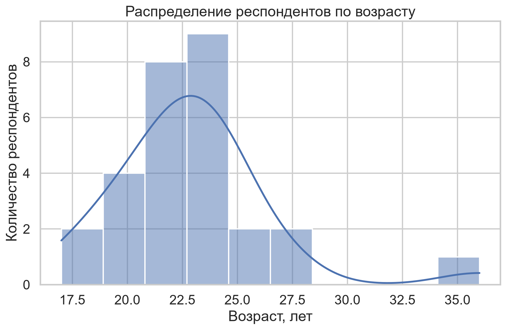
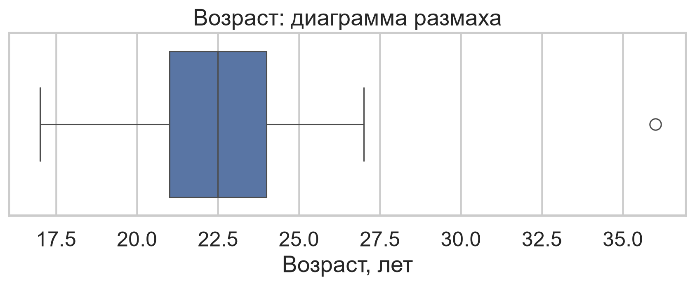
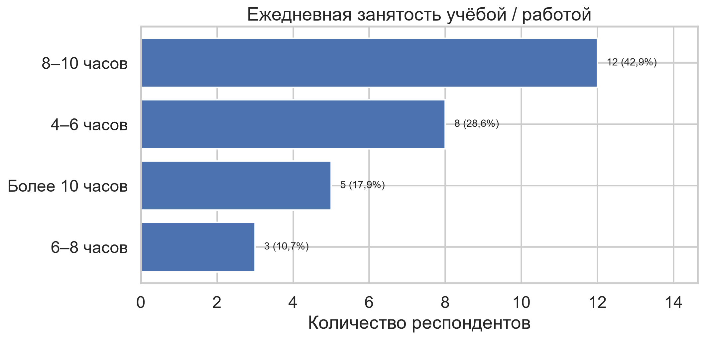
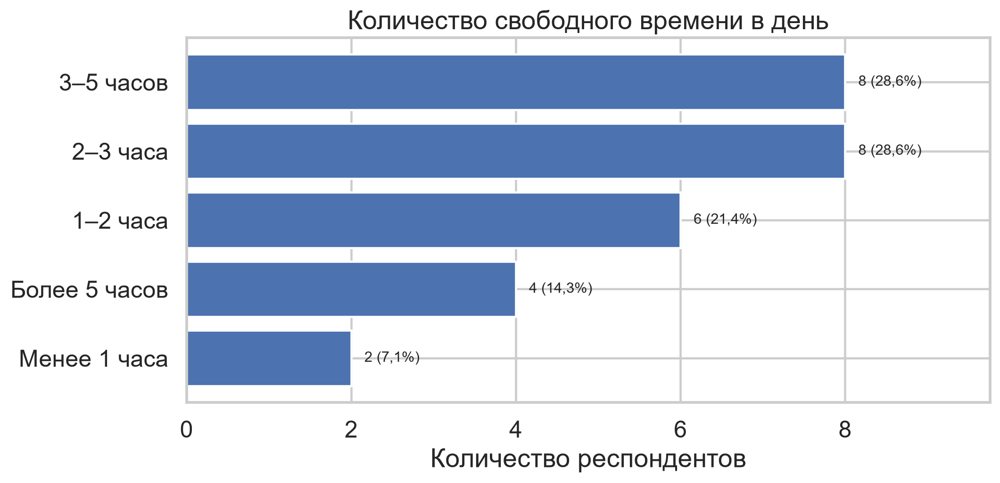
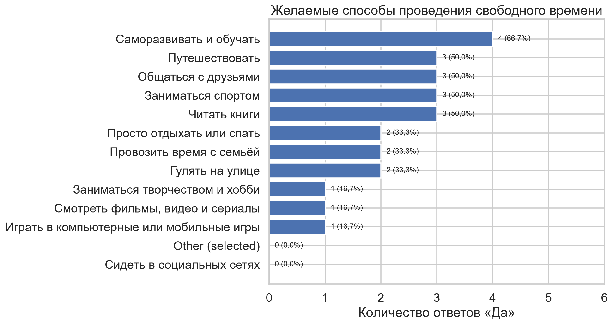
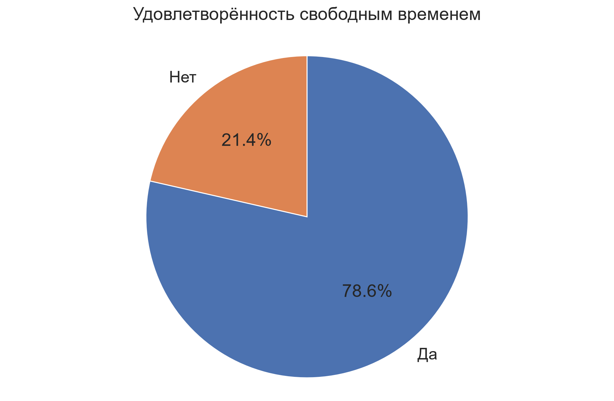
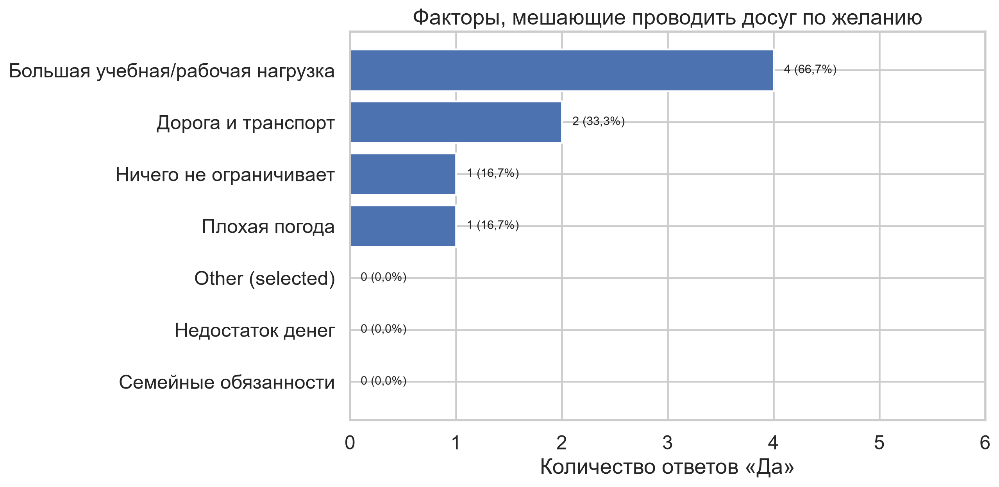
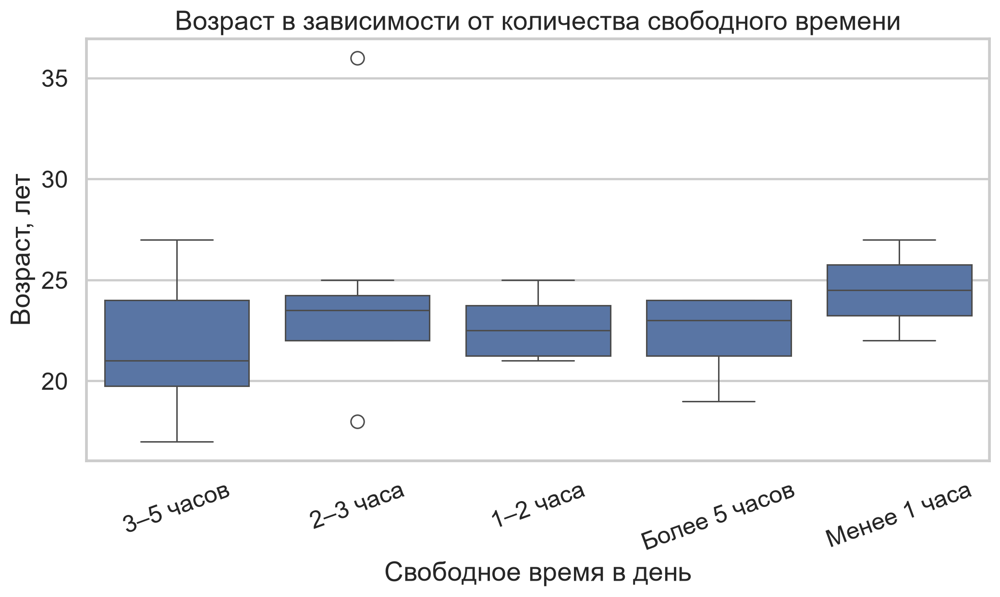
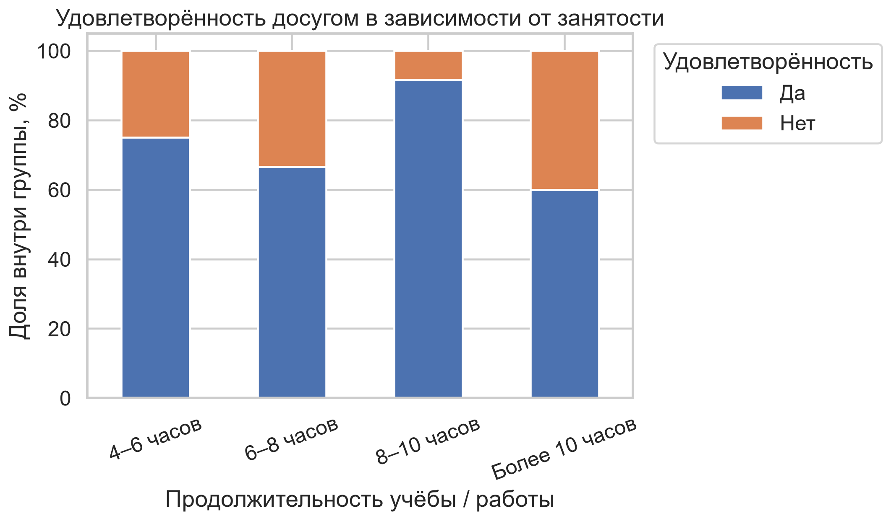

# Отчёт по результатам социологического опроса

**Количество полученных анкет:** 28.

## Цель исследования

Изучить, как респонденты проводят свободное время, насколько они удовлетворены его количеством, какие занятия хотели бы выбрать и какие обстоятельства мешают им реализовать свои предпочтения.

## Краткая характеристика выборки

В анализ включено **28** анкет. При расчёте долей для каждого вопроса использовались только валидные ответы на соответствующий вопрос. В вопросах с множественным выбором процент рассчитан от числа ответивших на данный пункт; сумма процентов может превышать 100%.

### Возраст участников

В опросе приняли участие **28** человек с указанным возрастом. Средний возраст — **22,9** года, медиана — **22,5**, диапазон — **17–36** лет.

### Работа и учёба

На вопрос «Статус занятости» ответили 28 человек. Наиболее распространённый ответ — «Учусь и работаю одновременно» (12 человек, 42,9%).

### Продолжительность учёбы / работы

На вопрос «Продолжительность учёбы / работы» ответили 28 человек. Наиболее распространённый ответ — «8–10 часов» (12 человек, 42,9%).

### Количество свободного времени

На вопрос «Количество свободного времени» ответили 28 человек. Наиболее распространённый ответ — «3–5 часов» (8 человек, 28,6%).

### Фактическое проведение свободного времени

Респонденты могли выбрать несколько вариантов. Наиболее популярные варианты: «Сидеть в социальных сетях» — 18 (64,3%); «Смотреть фильмы, видео и сериалы» — 16 (57,1%); «Общаться с друзьями» — 16 (57,1%).

### Желаемые занятия

Респонденты могли выбрать несколько вариантов. Наиболее популярные варианты: «Саморазвивать и обучать» — 4 (66,7%); «Общаться с друзьями» — 3 (50,0%); «Заниматься спортом» — 3 (50,0%).

### Сравнение фактических и желаемых занятий

Наиболее выраженный разрыв между желаемым и фактическим участием наблюдается в следующих занятиях: «Путешествовать» (+39,3 п.п.); «Саморазвивать и обучать» (+34,5 п.п.); «Провозить время с семьёй» (+22,6 п.п.).

### Удовлетворённость

На вопрос «Удовлетворённость» ответили 28 человек. Наиболее распространённый ответ — «Да» (22 человек, 78,6%).

### Достаточность свободного времени

На вопрос «Достаточность свободного времени» ответили 6 человек. Наиболее распространённый ответ — «Нет, мне не хватает свободного времени.» (4 человек, 66,7%).

### Факторы, ограничивающие свободное время

Можно было выбрать несколько факторов. Наиболее популярные варианты: «Большая учебная/рабочая нагрузка» — 4 (66,7%); «Дорога и транспорт» — 2 (33,3%); «Ничего не ограничивает» — 1 (16,7%).

### Возраст и количество свободного времени

Диаграмма позволяет визуально сравнить распределение возраста в группах с разным объёмом свободного времени. Она носит описательный характер и сама по себе не доказывает причинно-следственную связь.

### Занятость и удовлетворённость

На диаграмме показана доля ответов об удовлетворённости внутри каждой категории ежедневной занятости. При небольшом числе участников сравнения следует интерпретировать осторожно.

## Общие выводы

Результаты позволяют сопоставить повседневные занятия респондентов с их предпочтениями, а также оценить роль учебной/рабочей нагрузки, времени на дорогу, финансовых и других ограничений. Выводы следует рассматривать как описание данной выборки, а не как оценку всей популяции.

## Методологические примечания

- Ответы `Н/Д`, пустые ячейки и технические значения исключались из расчёта соответствующего вопроса.
- В вопросах с множественным выбором подсчитывались ответы «Да» по каждому варианту независимо.
- Для категориальных вопросов использовались частоты и проценты; возраст анализировался как числовая переменная.
- При небольшом объёме выборки не следует трактовать наблюдаемые различия как статистически значимые без отдельной проверки.

## Файлы

- `survey_charts.pdf` — все графики в одном PDF-файле.
- `charts/` — отдельные изображения графиков.
- `summary_tables.xlsx` — сводные таблицы (если доступен пакет `openpyxl`).
- `cleaned_data.csv` — очищенная версия исходных данных.