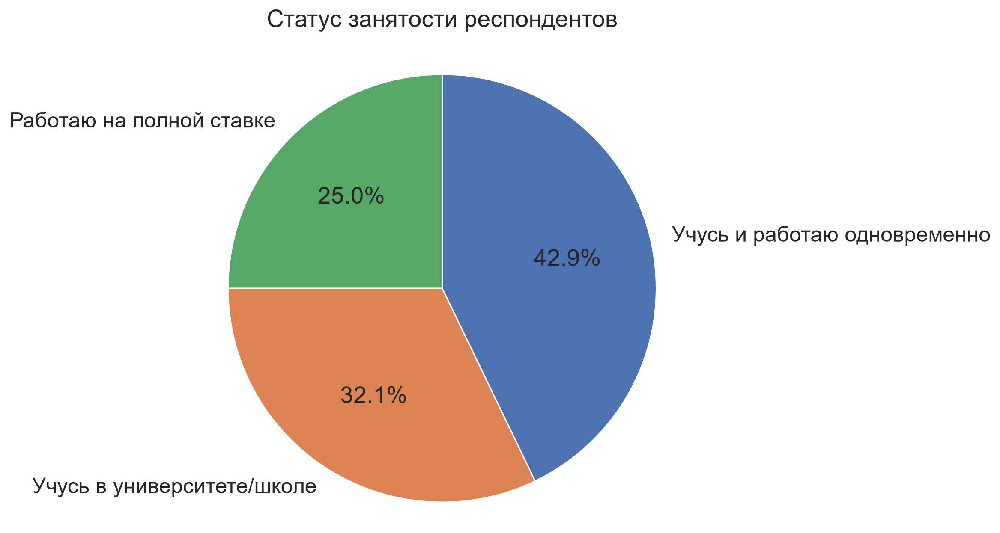
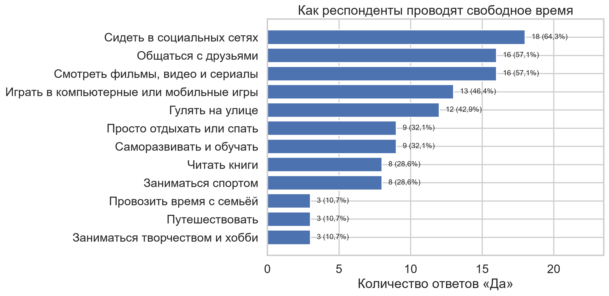
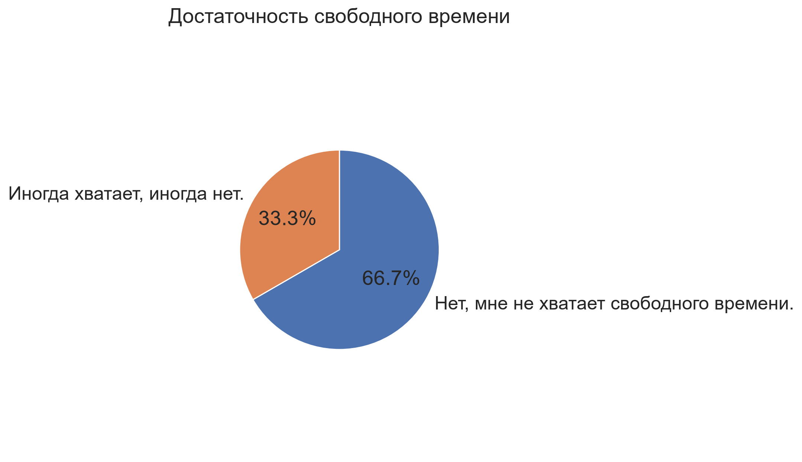

# Социологического опроса "Как молодые люди проводят свободное время?"

**Цель исследования:** Изучить, как молодые люди проводят свободное время и насколько они удовлетворены свое свободное время.

**Формат опроса:** Онлайн анкета. 

**Количество полученных анкет:** 28.

---

## Общая информация

---

### Сколько вам лет?*

На вопрос ответили 28 человек.  

Диапазон: **17–36** лет  
Средний возраст: **22,9** года   
Медиана: **22,5**  

---

### Вы сейчас работаете или учитесь?*

На вопрос ответили 28 человек.  

Наиболее распространённый ответ — «Учусь и работаю одновременно» (12 человек, 42,9%).

---

## Свободное время и повседневная жизнь

---

### Сколько часов в день вы обычно заняты учёбой или работой?*

На вопрос ответили 28 человек.  

Наиболее распространённый ответ — «8–10 часов» (12 человек, 42,9%).

---

### Сколько свободного времени у вас обычно есть в день?*

На вопрос ответили 28 человек.  

Наиболее распространённый ответ — «3–5 часов» (8 человек, 28,6%).

---
### Как вы обычно проводите свободное время? (Не больше 5 выборов.)*

На вопрос ответили 28 человек.  

Наиболее популярные варианты: «Сидеть в социальных сетях» — 18 (64,3%); «Смотреть фильмы, видео и сериалы» — 16 (57,1%); «Общаться с друзьями» — 16 (57,1%).

---

## Ограничения и пожелания

---

### Довольны ли вы своим свободным временем?*

На вопрос ответили 28 человек.  

Наиболее распространённый ответ — «Да» (22 человек, 78,6%).

---

### Хватает ли вам свободного времени?

*Вопрос открыта только для тех, кто ответил "Не доволен(а) своим свободным временем"*

На вопрос ответили 6 человек.  

Наиболее распространённый ответ — «Нет, мне не хватает свободного времени.» (4 человек, 66,7%).

---

### Как вы бы хотели проводить своё свободное время? (Не больше 5 выборов.)

*Вопрос открыта только для тех, кто ответил "Не доволен(а) своим свободным временем"*

На вопрос ответили 6 человек.  

Наиболее популярные варианты: «Саморазвивать и обучать» — 4 (66,7%); «Общаться с друзьями» — 3 (50,0%); «Заниматься спортом» — 3 (50,0%).

Наиболее выраженный разрыв между желаемым и фактическим участием наблюдается в следующих занятиях: «Путешествовать» (+39,3 п.п.); «Саморазвивать и обучать» (+34,5 п.п.); «Провозить время с семьёй» (+22,6 п.п.).

### Какой фактор чаще всего мешает вам проводить свободное время по желанию? (Не больше 2 выборов.)

*Вопрос открыта только для тех, кто ответил "Не доволен(а) своим свободным временем"*

Наиболее популярные варианты: «Большая учебная/рабочая нагрузка» — 4 (66,7%); «Дорога и транспорт» — 2 (33,3%); «Ничего не ограничивает» — 1 (16,7%).

---

## Общие выводы

