## Управление научными исследованиями

Занятие 1

Юлия Разливина

м.н.с. ПИШ ИТМО

Центр ИИ в Химии ПИШ ИТМО

## Преподаватель

## Юлия Разливина

Научный сотрудник центра ИИ в Химии ИТМО

м.н.с. ПИШ ИТМО

Руководитель группы AI-трансформации

AlmetTech

Преподаватель ИТМО

6 статей в Q1 и 1 на NeurIPS 2025

## Два семестра — две цели

|  | I семестр | II семестр |
| --- | --- | --- |
| Цель | Стать экспертомв своей теме | Сделатьсобственный вклад |
| Результат | Литературныйобзор | Черновик научнойстатьи |

## 1 семестр

Поиск литературы: Scholar, Scopus, arXiv
Критическая оценка: импакт-фактор, h-индекс
Критическое чтение: аннотации, таблицы, методы
Менеджмент литературы: Mendeley, Zotero, LaTeX
ИИ-инструменты для исследований: SciSpace, Elicit, Scholarcy
Написание обзора: структура, логика, цитирование

## 2 семестр

Формат конференций/журналов
Методология: описание экспериментов, воспроизводимость, статистика
Структура статьи, Представление результатов
Дискуссия и выводы: интерпретация, ограничения, перспективы
Работа с дополнительными файлами
Работа с рецензиями и доработками

## Формат

Еженедельные занятия, позволяющие планомерно идти к результату:

5 предзаписанных лекций далее практика и консультации

Зачет путем написания работ и рецензирования

## Принципы нашей работы

1 2 3

Проектный подход

Практика > Теория

Взаимное рецензирова ние

## Курсовое задание

Литературный обзор:

- Название
- Автор
- Ключевые слова
- Introduction
- Related work
- References

2 этапа доработки и рецензирования

Идея

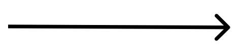

Научный вклад

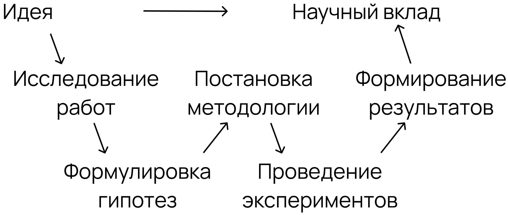

flowchart

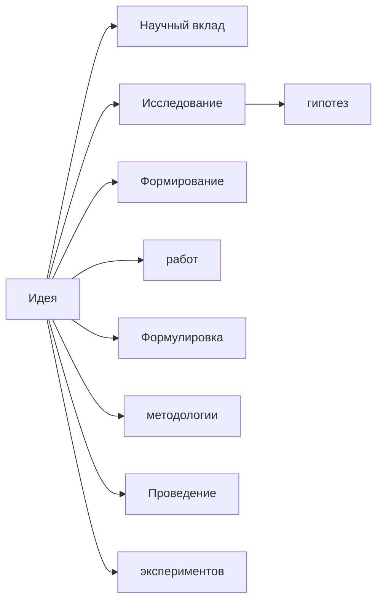

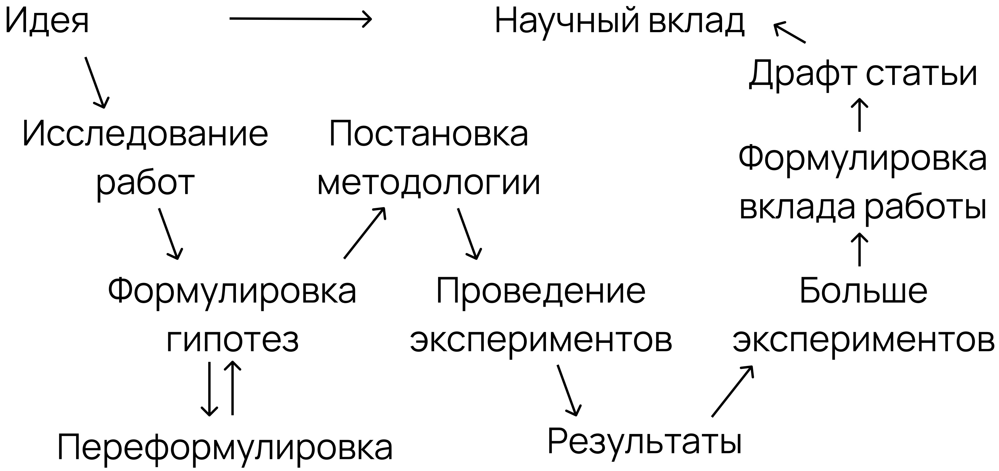

flowchart

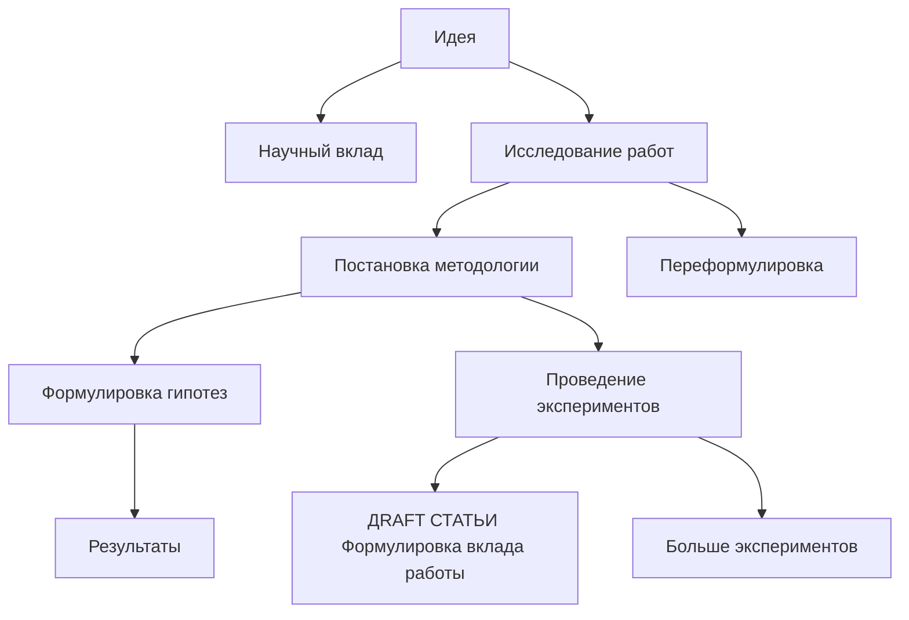

## Как устроена наука как система

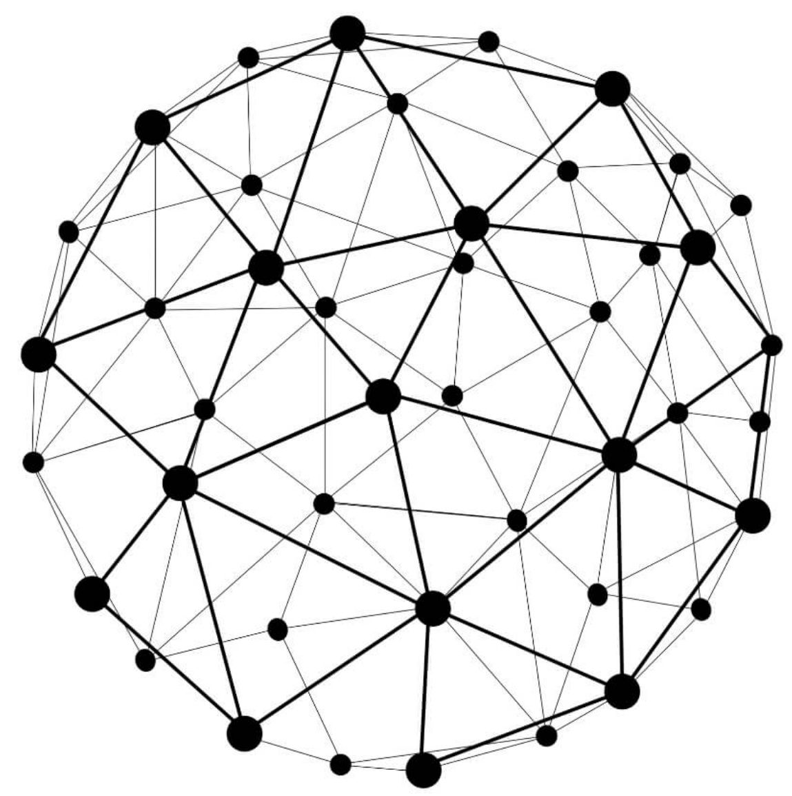

natural_image

Geometric network diagram of interconnected nodes forming a spherical structure (no text or labels)

## Жизненный цикл научной идеи

Идея → ... → Новая идея

Все начинается с гипотезы, затем проводится исследование, результаты которого оформляются в виде рукописи. Эта рукопись проходит через 'фильтр' рецензирования, и в случае успеха публикуется. Затем другие ученые читают вашу работу, цитируют, критикуют, и на ее основе у них рождаются новые идеи. И цикл запускается снова.

## Основа вашей интеллектуальной работы

Организованный скептицизм

Принцип воспроизводимости

Принцип фальсифицируемости

## Анализируем утверждение

“Классическая музыка положительно влияет на интеллектуальные способности”

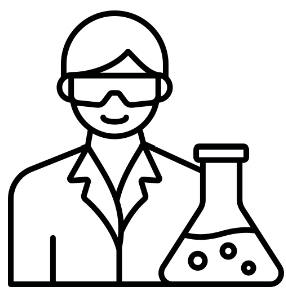

natural_image

Line drawing of a scientist in lab coat and safety goggles next to a flask (no text or symbols)

natural_image

Simple line icon of a person wearing a microphone (no text or symbols)

natural_image

Simple illustration of a person's head and shoulders wearing a blue shirt (no text or symbols)

## Разбор утверждения: что здесь проверяемо?

• Что значит «положительно» и как это измерить
• Что значит «интеллектуальные способности»
• На ком проверяли и какой размер эффекта
• Причина или корреляция

## Наука в 2026 году

## Наука в 2026: как изменилась

истема знаний + социальный институт + технологии
Открытая и междисциплинарная
Автоматизация, ИИ, большие данные
Этика, воспроизводимость, FAIR-принципы

## Новые тренды

Open Science: данные, коды, протоколы в открытом доступе
Препринты как быстрый канал
Коллаборации и консорциумы
Ответственная наука (responsible research)

## Классические публикации

Статьи в рецензируемых журналах
Краткие сообщения (letters)
Обзоры (review articles)

До 2010-х это была почти вся “научная публикация”

## Рецензирование — "фильтр качества"

Peer Review - анонимная оценка вашей работы независимыми экспертами. Научиться работать с критикой рецензентов — один из ключевых навыков ученого.

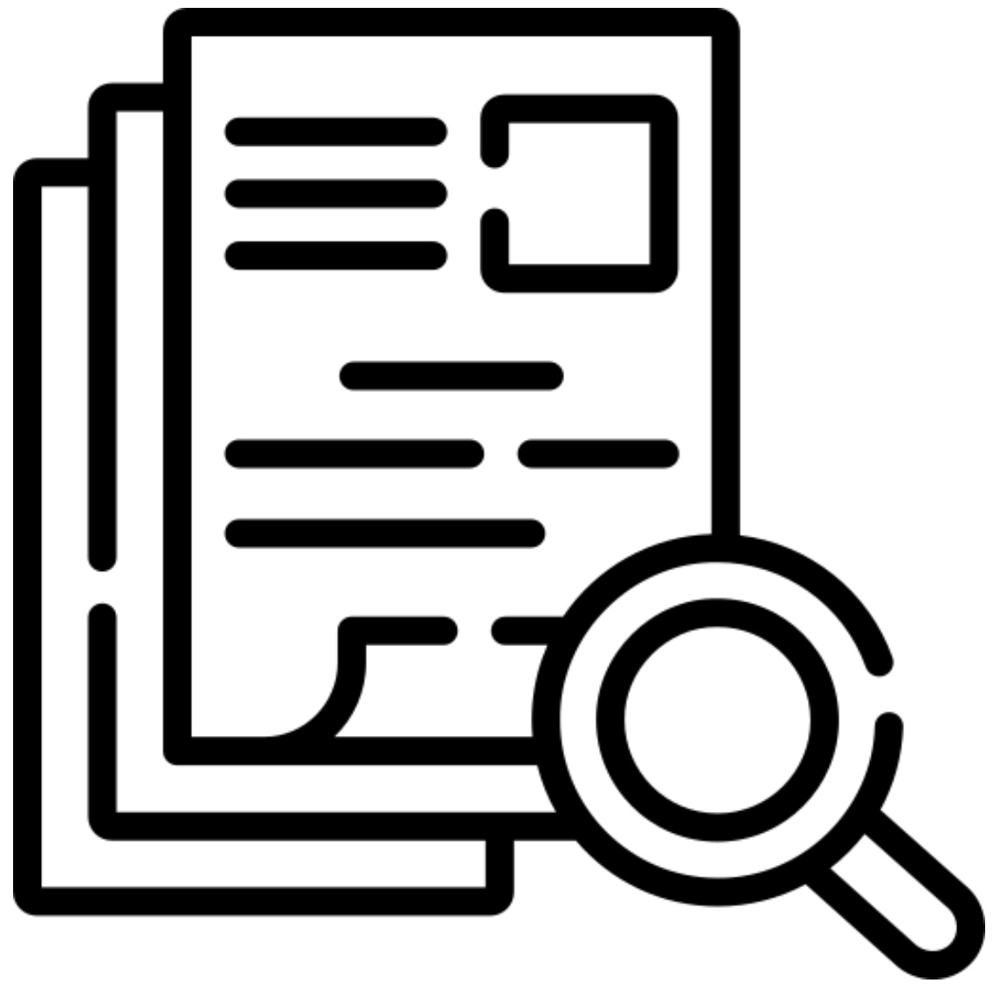

natural_image

Icon depicting documents with a magnifying glass, symbolizing document review or search (no text present)

## Современные форматы

Препринты (arXiv, bioRxiv, ChemRxiv)
Data papers (публикация наборов данных)
Software papers (публикация программного обеспечения)
Registered reports (публикация дизайна исследования)

As a peer-reviewed journal article

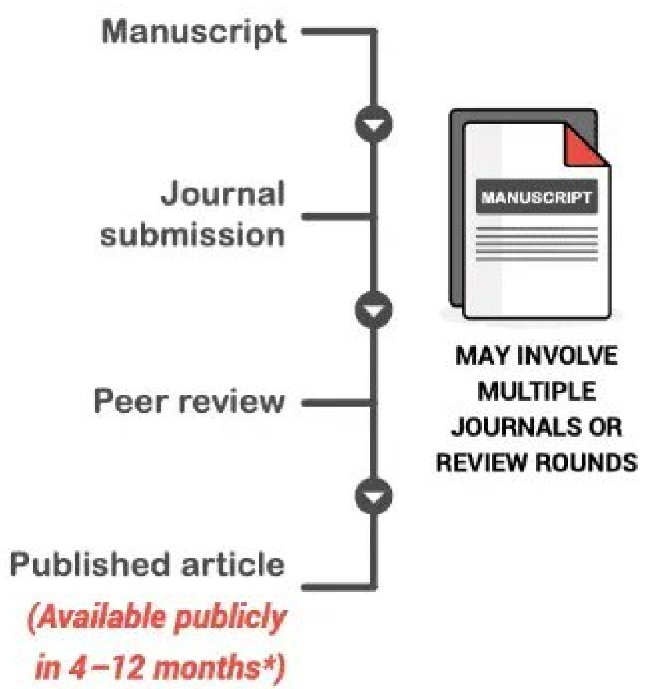

flowchart

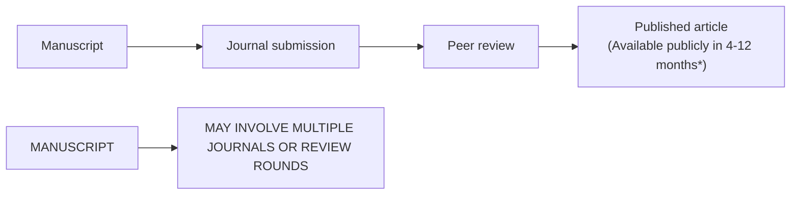

As a preprint

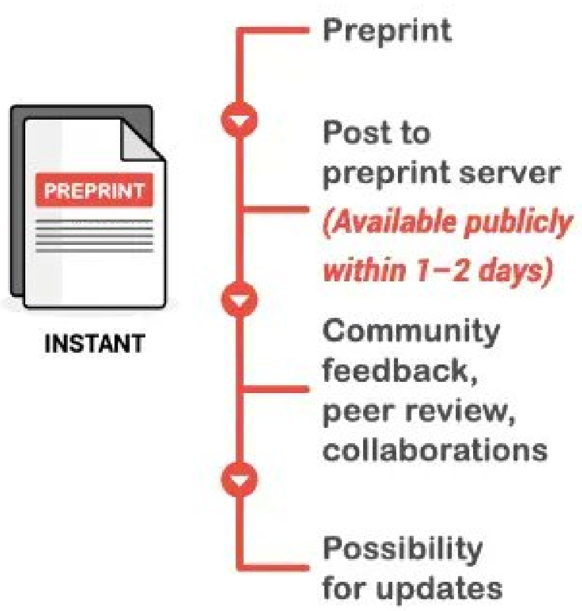

flowchart

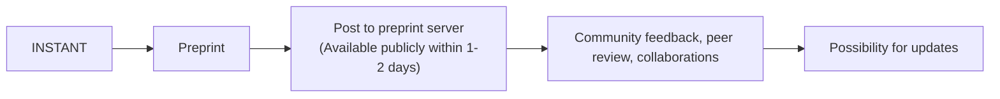

| Paper Submissions Open | Apr 03 '25 (Anywhere on Earth) |
| --- | --- |
| Paper Abstract Submission Deadline | May 11 '25 (Anywhere on Earth) |
| Full Paper Submission Deadline | May 15 '25 (Anywhere on Earth) |
| Paper Supplemental Material Submission Deadline | May 22 '25 (Anywhere on Earth) |
| Reviewing Begins | May 29 '25 (Anywhere on Earth) |
| Reviewing Ends | Jul 02 '25 (Anywhere on Earth) |
| Author Rebuttal Begins | Jul 24 '25 (Anywhere on Earth) |
| Author Rebuttal Ends | Jul 30 '25 (Anywhere on Earth) |
| Reviewer Author Discussions Begins | Jul 31 '25 (Anywhere on Earth) |
| Reviewer Author Discussions Ends | Aug 06 '25 (Anywhere on Earth) |
| Paper Author Notifications | Sep 18 '25 (Anywhere on Earth) |
| Choose San Diego or Mexico City. | Oct 01 '25 (Anywhere on Earth) |
| Paper Camera Ready Deadline | Oct 23 '25 (Anywhere on Earth) |

## Альтернативные каналы

Патенты как результат НИОКР
Базы данных, протоколы, стандарты
Open-source коды и GitHub (с DOI)
Посты и обсуждения (ResearchGate, OSF)

## Что считать научным вкладом?

– Только статья
– Патент
– Данные / код
– Протокол
– Всё перечисленное

Исследователь выкладывает open-source библиотеку анализа данных, которой пользуются десятки лабораторий. Это научный вклад?

## Да, это может быть существенным научным вкладом

Научный результат не обязательно должен быть оформлен в виде статьи. Если исследователь разработал новый метод анализа данных, алгоритм или программный инструмент, который решает научную задачу и воспроизводимо применяется другими исследователями, это может быть самостоятельным результатом.

Команда публикует только препринты, но их цитируют 500 раз до статьи.

Это научный результат?

## Да, это может быть существенным научным вкладом

Препринт может содержать полноценный научный результат ещё до публикации в журнале. Он позволяет оперативно представить результаты, сделать их доступными научному сообществу и получить обратную связь.

## Сотрудник оформляет патент вместо статьи.

## Это публикация?

## Нет, патент и научная публикация — это разные формы.

Патент подтверждает исключительное право на изобретение при соблюдении установленных требований, а научная статья предназначена прежде всего для представления результатов исследования и их обсуждения научным сообществом.

## Как оценивается вклад

Новизна
Воспроизводимость
Влияние / использование
Открытость / цитируемость

## Вызовы перед наукой в 2026 году

## Технологический вызов

ИИ и его роль
Большие данные: хранение, обработка, анализ
Быстрое появление новых инструментов и методов

## Воспроизводимость и прозрачность

Проверка экспериментов и данных другими лабораториями
Публикация протоколов и raw data
Registered reports: публикация дизайна до эксперимента

## Этика и социальная

## ответственность

Конфиденциальность и защита данных
Авторство и использование ИИ
Социальное влияние научных открытий

## Авторство и ИИ

Использование ИИ
Кто автор?
Новые стандарты

Наука — это процесс: от вопроса и анализа литературы до проверки результатов и их публикации.
Обзор — не пересказ статей, а синтез знаний: подходы, противоречия, ограничения и нерешённые вопросы.
Научный вклад нужно обосновать: что нового получено, чем это подтверждается и чем отличается от предыдущих работ?
Критическая оценка важнее авторитета и метрик: проверяйте источники, методы, доказательства и ограничения.
ИИ — инструмент, а не источник гарантированной истины: результаты его работы необходимо проверять, а ответственность остаётся за исследователем.
Научная добросовестность обязательна: прозрачность, воспроизводимость и этика — часть качественного исследования.