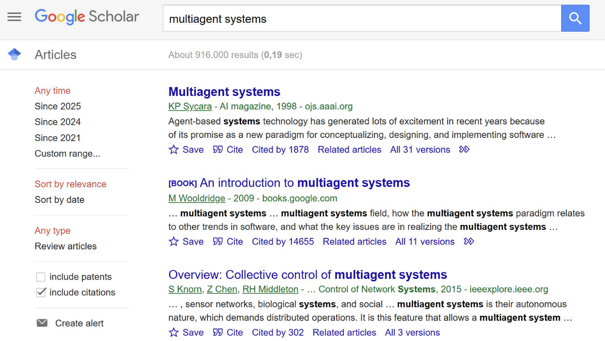
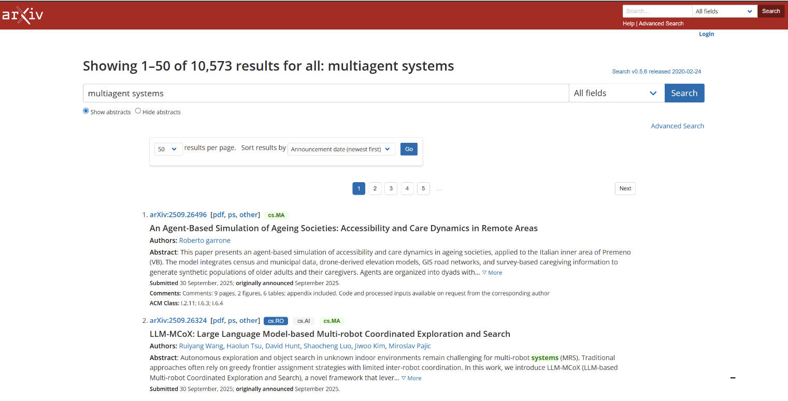
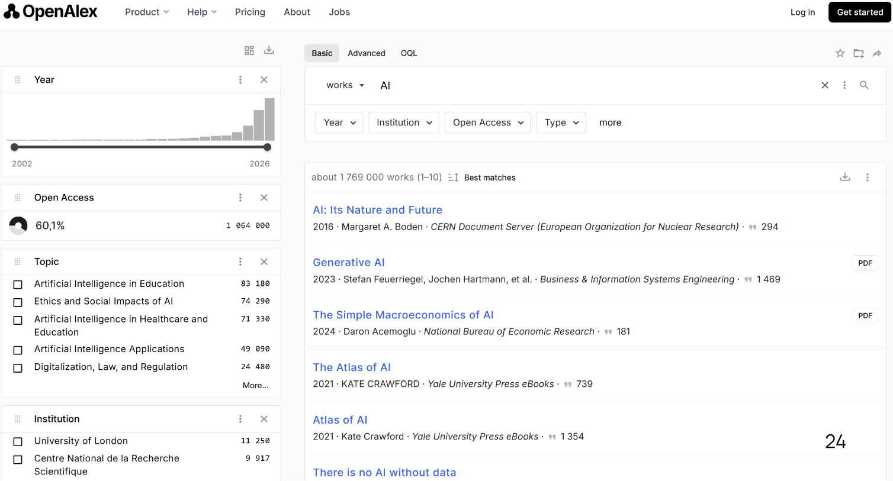
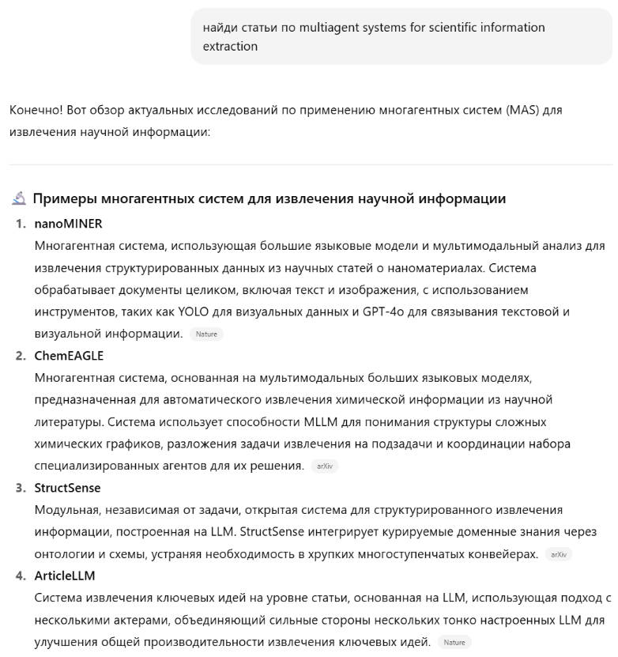
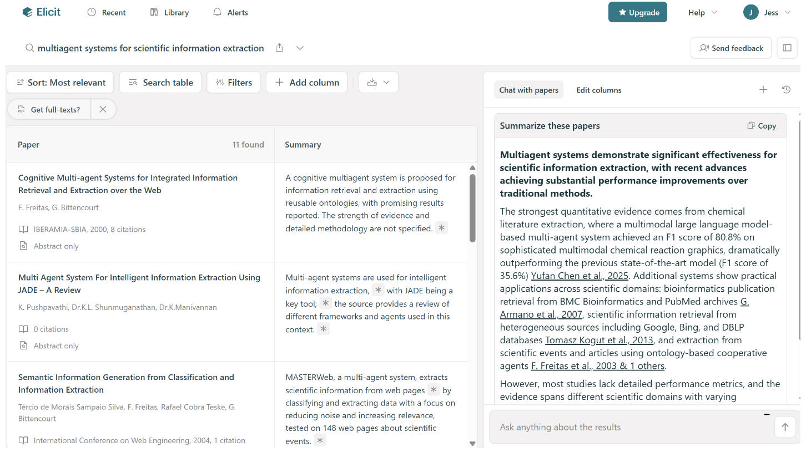
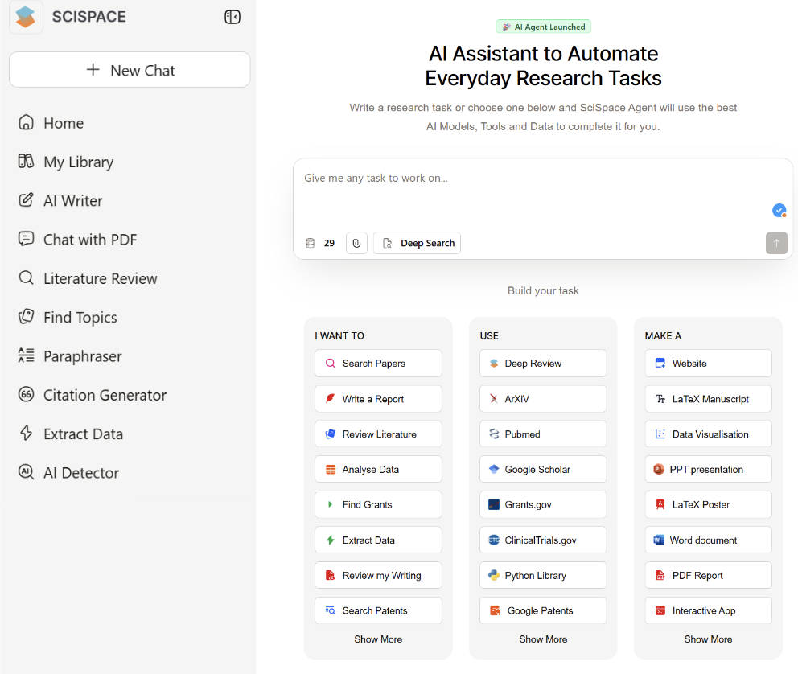
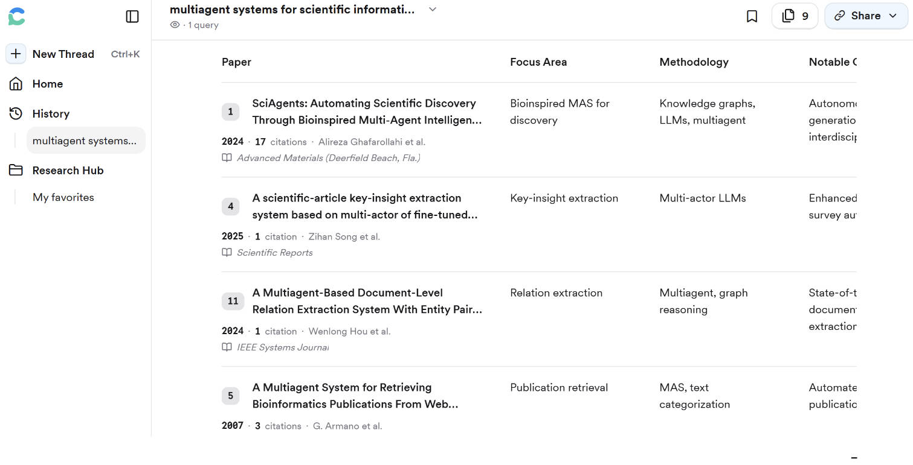
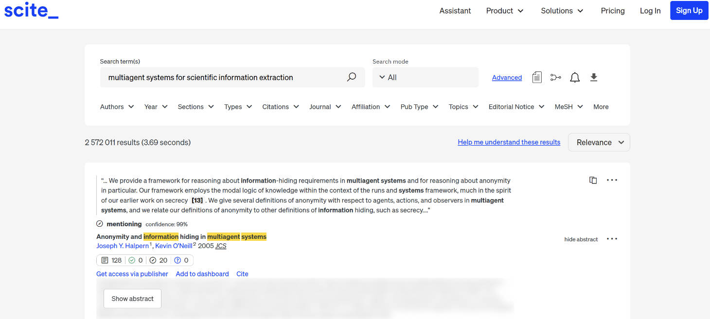
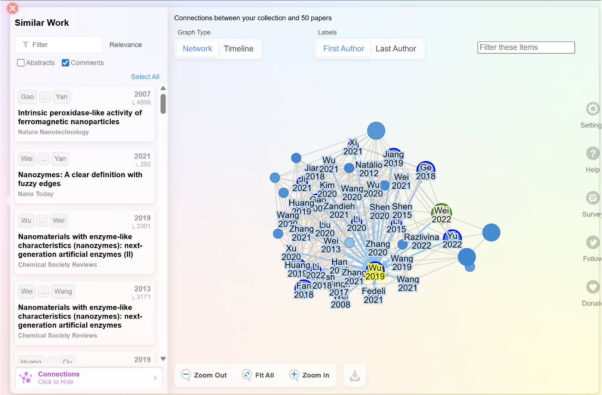

# Управление научными исследованиями

**Занятие 2**  

Юлия Разливина  
м.н.с. ПИШ ИТМО  
Центр ИИ в Химии ПИШ ИТМО  

---

## DOI (Digital Object Identifier)

уникальный цифровой идентификатор научной публикации или другого электронного материала  

10.1038/s41524-025-01674-7  

DOI обычно состоит из двух частей:  

Префикс — например, 10.1038, идентифицирующий регистрирующую организацию издателя.  
Суффикс — s41524-025-01674-7, идентифицирующий конкретный материал.  

---

## Поиск научной литературы в цифровую эпоху

---

## Логика литературного поиска

Схема:  

тема → запрос → отбор → «снежный ком» → полный текст  

---

## Как строить запрос

Ключевые слова и синонимы на английском языке  
AND / OR / NOT, кавычки  
Фильтры по годам и типам  

---

## «Снежный ком»

Назад: изучите список литературы найденной статьи.  
Вперёд: найдите новые работы через Cited by («Цитирования»).  、

От фундаментальных исследований до самых свежих публикаций.  
Одна хорошая статья может стать отправной точкой для изучения целой темы.  

---

## Плюсы

- Бесплатный, доступен всем.  
- Очень широкий охват (от статей до диссертаций).  
- Иннтеграция с Google Books и Google Patents.  
- Показывает цитирование  
- Можно создать профиль исследователя.  
- Есть  «Alerts»  

---

## Минусы

- Слабая фильтрация (много нерецензированных материалов).  
- Иногда встречаются «мусорные» публикации.  
- Нет глубокого анализа журналов.   

---

## Лайфхаки

- Использовать кавычки " " для точных фраз.  
- Использовать фильтры «Since Year» для свежих статей.  
- Нажимать “Cited by” → найти похожие исследования.  
- Иннтеграция с Zotero/Mendeley через кнопки экспорта.    

---

---

## Плюсы

- Авторитетная база по медицине и биологии.  
- Хорошие фильтры (тип исследования, возраст пациентов и т.д.).  
- PubMed Central даёт полный текст, если он открыт.  
- Иннтеграция с MeSH-терминами (медицинский словарь).  

---

## Минусы

- Не все статьи бесплатны (часть за paywall).  
- Интерфейс сложный для новичков.  
- Ограничено медико- биологическими темами.  

---

## Лайфхаки

- Использовать MeSH для точного поиска (например, «Gene Editing» [MeSH]).  
- Фильтровать по «Free full text».  
- Сохранять поиски в личный кабинет NCBI.  
- Подключить PubMed в Zotero для автоимпорта статей.    

---

---

## Плюсы

- Бесплатный доступ ко всем материалам.  
- Самые свежие исследования (часто ещё до публикации в журналах).  
- Возможность подписки на категории и получать уведомления.  
- Полные версии статей в PDF.  

---

## Минусы

- Нет рецензирования (качество сильно варьируется).  
- Иногда тяжело понять, принята статья в журнал или нет.  
- Нет встроенной системы цитирования (в отличие от Scholar).  

---

## Лайфхаки

- Использовать RSS-подписку по разделам (например, cs.AI).  
- Проверять последние версии статей — часто авторы выкладывают обновления.  
- Вводить авторов через au: (например, au:"Yoshua Bengio").   
- Сравнивать препринт с финальной версией в журнале, чтобы видеть изменения.    

---

---

---

## Плюсы

- Автоматические резюме статей (TL;DR).  
- Удобная сеть цитирования (related papers).  
- Хорошо работает с ИИ и биомедициной.    

---

## Минусы

- Иногда не отображается полный текст.  
- Меньший охват, чем у Google Scholar.  
- Аннотации ИИ бывают неточными.    

---

## Лайфхаки

- Использовать фильтр «Highly Influential Citations».  
- Сохранять статьи в свои коллекции.  
- Искать по DOI — даёт точный результат.  
- Проверять вкладку «Cited by» → это помогает расширить список литературы.    

---

---

## Плюсы

- Полностью бесплатный доступ.  
- Проверка качества журналов (борьба с хищническими издателями).  
- Интернациональный охват (журналы из более чем 120 стран).  
- Легко интегрируется в библиотеки и системы (поддержка API, OAI-PMH).    

---

## Минусы

- Не все ведущие журналы индексируются  
- Качество журналов разнится: есть сильные, но есть и региональные, менее известные.  
- Интерфейс поиска проще, чем у Scopus или Web of Science     

---

---

## Плюсы

- Проверенные журналы: отбор строже, чем в открытых базах  
- Расширенный поиск с фильтрами и экспортом  
- Анализ цитирования, профили авторов и организаций, h-индекс   
- Scopus шире по охвату, Web of Science строже по отбору и сильнее в естественных и технических науках  

---

## Минусы

- Платный доступ по подписке организации  
- Охват неполный: не все качественные издания включены, у Web of Science он уже, чем у Scopus  
- Слабее для гуманитарных, региональных и неанглоязычных работ  
- В профилях авторов бывает путаница с однофамильцами   

---

---

## Плюсы

- Полный набор данных бесплатен для скачивания  
- Огромный охват, включая препринты и работы в открытом доступе  
- Связи между работами, авторами и организациями, ссылки на открытые версии  
- Программный интерфейс (API) для анализа и автоматизации   

---

## Минусы

- Метаданные неидеальны: дубли, ошибки в авторах и организациях  
- Нет отбора по качеству, попадают и слабые издания  
- Интерфейс проще, чем у Scopus и Web of Science, меньше аналитических фильтров  
- С февраля 2026 для API нужен ключ: бесплатно примерно на 1 доллар использования в день, дальше платно  

| Задача | Где искать |
| --- | --- |
| Общий быстрый поиск | Google Scholar |
| Серьёзный охват с фильтрами | Scopus, Web of Science(если есть доступ) |
| Открытые данные и автоматизация | OpenAlex |
| Свежие результаты: информатика и физика | arXiv |
| Свежие результаты: химия | ChemRxiv |
| Свежие результаты: биология и медицина | bioRxiv, medRxiv |
| Биомедицина | PubMed |
| Проверка журналов открытого доступа | DOAJ |
| Рекомендации с помощью ИИ | Semantic Scholar |

---

## ИИ-сервисы для поиска и анализа литературы

---

---

---

---

Filters  

---

---

---

---

---

| Сервис | Ключевые функции | Сильные стороны | Слабые стороны |
| --- | --- | --- | --- |
| GPT | Генеративный поиск, резюме, списки литературы | Гибкость, синтез и помощь в формулировке идей | Hallucinations, требует проверки источников |
| Elicit | Систематические обзоры, извлечение данных | Структурирование, табличный вывод, удобно для PICO | Ограниченный доступ к полным текстам |
| SciSpace | Чтение PDF, Q&amp;A, Deep Review | Удобство работы с PDF, всё в одном | Зависимость от качества источников |
| Consensus | Краткие ответы, синтез по статьям | Консолидированные выводы с цитированием | Упрощение сложных тем, ограниченный охват |
| Scite | Анализ цитирований, Smart Citations | Показывает контекст цитат (поддержка/опровержение) | Не заменяет полный поиск по теме |
| Research Rabbit | Визуализация связей, эволюция тем | Наглядные карты, динамическое отслеживание | Зависит от качества метаданных |
| Connected Papers | Граф похожих работ, обзор области | Быстрый визуальный обзор, соседние статьи | Ограничение числа узлов, поверхностность |

---

## Как проверять выдачу ИИ

- Несуществующие ссылки  
- Сверка по DOI  
- Открыть оригинал и прочитать    

---

## Задание на самостоятельную практику

- Поисковая стратегия по своей теме (ключевые слова, запрос)
- Найти от 15 публикаций минимум в двух источниках (один — ИИ-инструмент), список с DOI
- Проверить, что найденные ИИ публикации существуют
