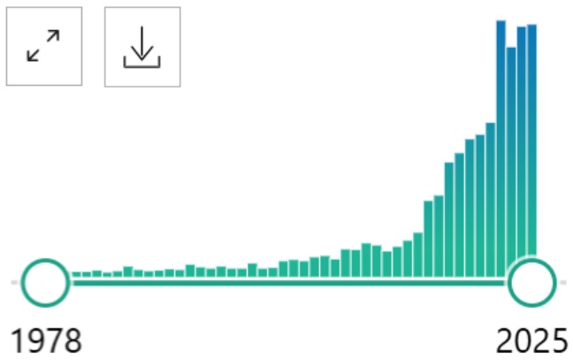
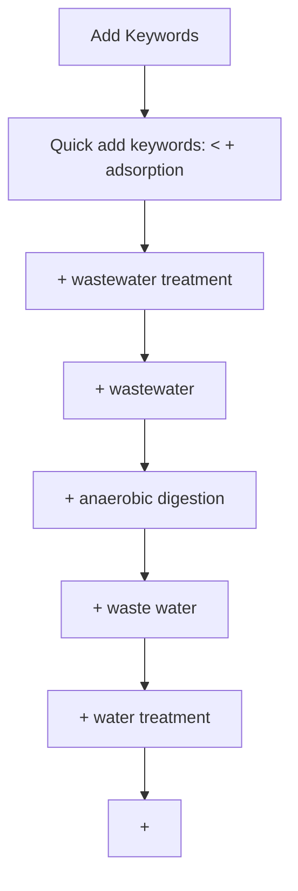
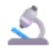
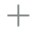
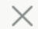
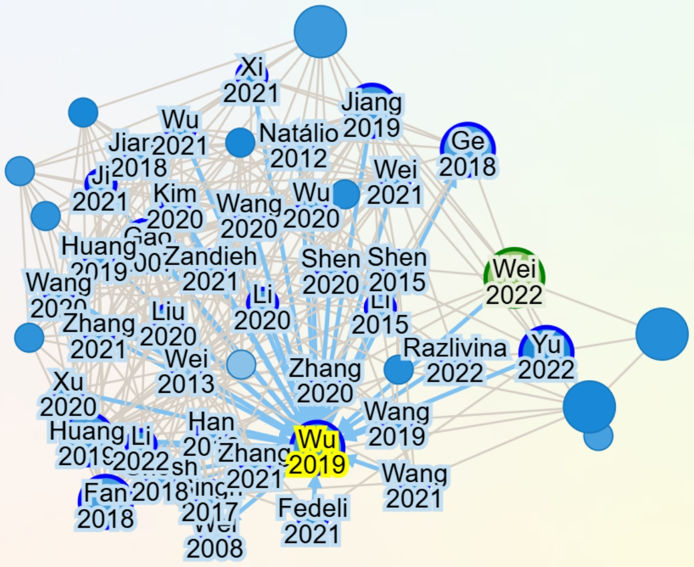
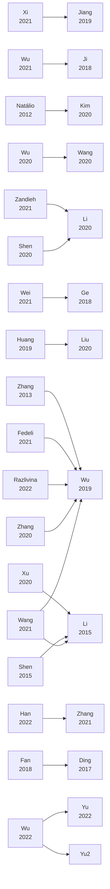
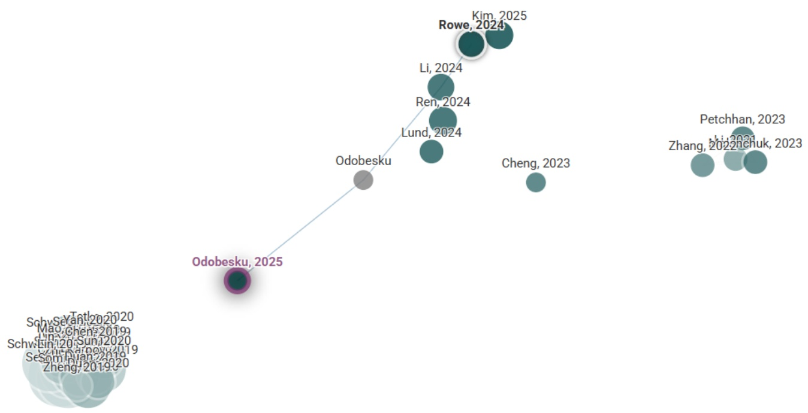

## Управление научными исследованиями

Занятие 2

Юлия Разливина

м.н.с. ПИШ ИТМО

Центр ИИ в Химии ПИШ ИТМО

## DOI (Digital Object Identifier)

уникальный цифровой идентификатор научной публикации или другого электронного материала

10.1038/s41524-025-01674-7

DOI обычно состоит из двух частей:

Префикс — например, 10.1038, идентифицирующий регистрирующую организацию издателя.
Суффикс — s41524-025-01674-7, идентифицирующий конкретный материал.

## Поиск научной литературы в цифровую эпоху

## Логика литературного поиска

Схема:

тема → запрос → отбор → «снежный ком» → полный текст

## Как строить запрос

Ключевые слова и синонимы на английском языке
AND / OR / NOT, кавычки
Фильтры по годам и типам

## «Снежный ком»

Назад: изучите список литературы найденной статьи.
Вперёд: найдите новые работы через Cited by («Цитирования»).
От фундаментальных исследований до самых свежих публикаций.
Одна хорошая статья может стать отправной точкой для изучения целой темы.

## Articles

## Any time

Since 2025

Since 2024

Since 2021

Custom range...

## Sort by relevance

Sort by date

## Any type

Review articles

include patents
include citations

Create alert

## Multiagent systems

KP Sycara - Al magazine, 1998 - ojs.aaai.org

Agent-based systems technology has generated lots of excitement in recent years because of its promise as a new paradigm for conceptualizing, designing, and implementing software

Save  Cite Cited by 1878 Related articles All 31 versions

## [Book] An introduction to multiagent systems

M Wooldridge - 2009 - books.google.com

... multiagent systems ... multiagent systems field, how the multiagent systems paradigm relates to other trends in software, and what the key issues are in realizing the multiagent systems ...

Save  Cite Cited by 14655 Related articles All 11 versions

## Overview: Collective control of multiagent systems

S Knorn, Z Chen, RH Middleton - ... Control of Network Systems, 2015 - ieeexplore.ieee.org, sensor networks, biological systems, and social ... multiagent systems is their autonomous nature, which demands distributed operations. It is this feature that allows a multiagent system

Save Cite Cited by 302 Related articles All 3 versions

## Плюсы

Бесплатный, доступен всем.
Очень широкий охват (от статей до диссертаций).
Интеграция с Google Books и Google Patents.
Показывает цитирование
Можно создать профиль исследователя.
Есть «Alerts»

## Минусы

лабая фильтрация (много нерецензированных материалов).
Иногда встречаются «мусорные» публикации.
Нет глубокого анализа журналов.

## Лайфхаки

Использовать кавычки " " для точных фраз.
Использовать фильтры «Since Year» для свежих статей.
Нажимать “Cited by” → найти похожие исследования.
Интеграция с Zotero/Mendeley через кнопки экспорта.

Save

Email

Send to

Sort by:

Best match

Display options

2,774 results

Page

of 278

bar

| Year | Value |
| --- | --- |
| 1978 | ~Low |
| 2025 | ~High |

1 year
5 years
10 years
Custom Range

Formulating and Representing Multiagent Systems With Hypergraphs.

Yu S, Huang H, Shen Y, Wang P, Zhang Q, Sun K, Chen H.

Cite IEEE Trans Neural Netw Learn Syst. 2024 Feb 27;PP. doi: 10.1109/TNNLS.2024.3368111. Online ahead of print.

PMID: 38412083

Additionally, the pairwise interactions used in existing methods also lack the expressiveness for the higher-order complex relations among multiple agents, thus limiting the performance in various tasks. In this work, we propose a Multiagent Hypergraph Force-learning metho ...

□ Multiagent Al Systems in Health Care: Envisioning Next-Generation Intelligence.

2 Borkowski AA, Ben-Ari A.

Cite Fed Pract. 2025 May;42(5):188-194. doi: 10.12788/fp.0589. Epub 2025 May 14.

PMID: 40831649 Free PMC article.

This article explores the emerging paradigm of multiagent artificial intelligence (Al) systems in health care, which represent a significant leap beyond traditional large language models. OBSERVATIONS: This analysis reviews the potential of multiagent Al s .

## Плюсы

Авторитетная база по медицине и биологии.
Хорошие фильтры (тип исследования, возраст пациентов и т.д.).
PubMed Central даёт полный текст, если он открыт.
Интеграция с MeSH-терминами (медицинский словарь).

## Минусы

Не все статьи бесплатны (часть за paywall).
Интерфейс сложный для новичков.
Ограничено медико- биологическими темами.

## Лайфхаки

Использовать MeSH для точного поиска (например, «Gene Editing» [MeSH]).
Фильтровать по «Free full text».
Сохранять поиски в личный кабинет NCBI.
Подключить PubMed в Zotero для автоимпорта статей.

## Showing 1-50 of 10,573 results for all: multiagent systems

Search v0.5.6 released 2020-02-24

multiagent systems

All fields

Search

Show abstracts Hide abstracts

Advanced Search

50 V

results per page. Sort results by

Announcement date (newest first)

Go

Next

1. arXiv:2509.26496[pdf, ps, other] cs.MA

## An Agent-Based Simulation of Ageing Societies: Accessibility and Care Dynamics in Remote Areas

Authors: Roberto garrone

Abstract: This paper presents an agent-based simulation of accessibility and care dynamics in ageing societies, applied to the Italian inner area of Premeno (VB). The model integrates census and municipal data, drone-derived elevation models, GIS road networks, and survey-based caregiving information to generate synthetic populations of older adults and their caregivers. Agents are organized into dyads with... ∇ More

Submitted 30 September, 2025; originally announced September 2025.

Comments: Comments: 9 pages, 2 figures, 6 tables; appendix included. Code and processed inputs available on request from the corresponding author

ACM Class: 1.2.11; 1.6.3; 1.6.4

2. arXiv:2509.26324[pdf, ps, other] cs.RO cs.Al cs.MA

## LLM-MCoX: Large Language Model-based Multi-robot Coordinated Exploration and Search

Authors: Ruiyang Wang, Haolun Tsu, David Hunt, Shaocheng Luo, Jiwoo Kim, Miroslav Pajic

Abstract: Autonomous exploration and object search in unknown indoor environments remain challenging for multi-robot systems (MRS). Traditional approaches often rely on greedy frontier assignment strategies with limited inter-robot coordination. In this work, we introduce LLM-MCoX (LLM-based Multi-robot Coordinated Exploration and Search), a novel framework that lever... ∇ More

Submitted 30 September, 2025; originally announced September 2025.

## Плюсы

Бесплатный доступ ко всем материалам.
Самые свежие исследования (часто ещё до публикации в журналах).
Возможность подписки на категории и получать уведомления.
Полные версии статей в PDF.

## Минусы

Нет рецензирования (качество сильно варьируется).
Иногда тяжело понять, принята статья в журнал или нет.
Нет встроенной системы цитирования (в отличие от Scholar).

## Лайфхаки

Использовать RSS-подписку по разделам (например, cs.AI).
Проверять последние версии статей — часто авторы выкладывают обновления.
Вводить авторов через au: (например, au:"Yoshua Bengio").
Сравнивать препринт с финальной версией в журнале, чтобы видеть изменения.

## bioRxiv

## THE PREPRINT SERVER FOR BIOLOGY

Search

Advanced Search

## COVID-19 SARS-CoV-2 preprints from medRxiv and bioR

## Subject Areas

All Articles

HOME | SUBMIT | FAQ | BLOG | ALERTS / RSS | RESOURCES

## medRxiv

## THE PREPRINT SERVER FOR HEALTH SCIENCES

Search

Advanced Search

Caution: Preprints are preliminary reports of work that have not been certified by peer review.They should not be relied on to guide clinical practice or health-related behavior and should not be reported in news media as established information.

COVID-19 SARS-CoV-2 preprints from medRxiv and bioRxiv

## Subject Areas

All Articles

About 22,100,000 results for “multiagent systems

Fields of Study

Date Range

Has PDF

Author

Journals & Conferences

Sort by Relevance

## An Improved Predefined-Time Adaptive Neural Control Approach for Nonlinear Multiagent Systems

Yingnan Pan

Weiyu Ji

H. Lam

Liang Cao

Engineering, Computer Science

IEEE Transactions on Automation Science and... · 1 October 2024

TLDR A predefined-time adaptive neural control method for MASs is developed, which can guarantee that all signals within MASs are predefined-time stable while enabling the followers to accurately track the desired trajectory with predefined time.Expand

66120

PDF

IEEE

Save

Cite

## Event-Based Finite-Time Control for Nonlinear Multiagent Systems With Asymptotic Tracking

Yongming Li

Yuanxin Li

Shaocheng Tong

Engineering, Computer Science

IEEE Transactions on Automatic Control· 1 June 2023

TLDR By using a novel finite-time stability criterion, it can be proved that the closed-loop system is finitetime stable and the consensus tracking errors can reach zero as time approaches to infinity.Expand

6 324

IEEE

Save

Cite

## Плюсы

Автоматические резюме статей (TL;DR).
Удобная сеть цитирования (related papers).
Хорошо работает с ИИ и биомедициной.

## Минусы

Иногда не отображается полный текст.
Меньший охват, чем у Google Scholar.
Аннотации ИИ бывают неточными.

## Лайфхаки

Использовать фильтр «Highly Influential Citations».
Сохранять статьи в свои коллекции.
Искать по DOI — даёт точный результат.
Проверять вкладку «Cited by» → это помогает расширить список литературы.

## 1,371 indexed articles

Refine search results

SUBJECTS

Q

Agriculture
Auxiliary sciences of history
Bibliography. Library science Information resources
Education
Fine Arts
General Works
Geography. Anthropology.

JOURNALS

YEAR OF PUBLICATION

## Sort by

Added to DOAJ (newest first)

## Results per page

10

« First

< Prev

Page 1 of 138

Next >

## ENTROPY (DEC 2009)

Comment on “Equiprobability, Entropy, Gamma Distributions and Other Geometrical Questions in Multi-Agent Systems”, Entropy 2009, 11, 959-971

Raúl Toral

Article keywords

Lamé curves

Abstract+

Read online
Export citation (RIS)\_
About the journal
Published by MDPI AG

## IEEE ACCESS (JAN 2019)

Consensus of Multi-Agent Systems With Piecewise Continuous Time-Varying Topology

Wangui Yuan, Guangjie Han

Article keywords

Consensus, time-varying topology, limit topology, multi-agent systems

Abstract+

Read online
Export citation (RIS)\_
About the journal
Published by IEEE

## Плюсы

Полностью бесплатный доступ.
Проверка качества журналов (борьба с хищническими издателями).
Интернациональный охват (журналы из более чем 120 стран).
Легко интегрируется в библиотеки и системы (поддержка API, OAI-PMH).

## Минусы

Не все ведущие журналы индексируются
Качество журналов разнится: есть сильные, но есть и региональные, менее известные.
Интерфейс поиска проще, чем у Scopus или Web of Science

Search > Results for waste water (All Fields) AND 2000-2024 (Year Published)

flowchart

294,443 Documents

You may also like...

Analyze Results

Create Alert

## Refine results

## Export Refine

Search within results...

## Quick Filters

Highly Cited Papers
Hot Papers
□ 日Review Article
□Early Access
Open Access
三Associated Data
Enriched Cited References
☐日Open publisher-invited reviews

Publication Years

Show Final Publication Year

□2024
□ 2023
□2022 26.834

0/294,443

Add To Marked List

Export

Citations: highest first

<

## 1 Removal of heavy metal ions from wastewaters: A review

Fu, FL and Wang, Q

Mar 2011 | JOURNAL OF ENVIRONMENTAL MANAGEMENT 92 (3) , pp.407-418

Heavy metal pollution has become one of the most serious environmental problems today. The treatment of heavy metals is of special concern due to their recalcitrance and persistence in the environment. In recent years, various methods for heavy metal removal from wastewater have been extensively studied. This paper reviews the current methods that ... Show more

Full Text at Publisher

## 2 Solutions for a cultivated planet

Foley, JA; Ramankutty, N; (...); Zaks, DPM

Oct 20 2011 |NATURE478 (7369), pp.337-342

Increasing population and consumption are placing unprecedented demands on agriculture and natural resources. Today, approximately a billion people are chronically malnourished while our agricultural systems are concurrently degrading land,

water, biodiversity and climate on a global scale. To meet the world's future food security and sustaina ... Show more

Full Text at Publisher View Full Text on ProQuest

6,452

Citations

184

References

Related records?

5,229

Citations

72

References

<table><tr><td colspan="2">СОК ИСТОЧНИКОВ</td><td colspan="3">Посмотреть параметры за год:</td></tr><tr><td colspan="2"></td><td colspan="2"></td><td>2025</td></tr><tr><td>↓</td><td>Наивысшийпроцентиль ↓</td><td>Цитирования2022-25 ↓</td><td>Документы2022-25 ↓</td><td>% цитирования ↓</td></tr><tr><td></td><td>99%1/428Oncology</td><td>66 928</td><td>103</td><td>91</td></tr><tr><td></td><td>99%1/414Molecular Biology</td><td>37 826</td><td>229</td><td>90</td></tr></table>

## Плюсы

Проверенные журналы: отбор строже, чем в открытых базах
Расширенный поиск с фильтрами и экспортом
Анализ цитирования, профили авторов и организаций, h-индекс
Scopus шире по охвату, Web of Science строже по отбору и сильнее в естественных и технических науках

## Минусы

Платный доступ по подписке организации
Охват неполный: не все качественные издания включены, у Web of Science он уже, чем у Scopus
Слабее для гуманитарных, региональных и неанглоязычных работ
В профилях авторов бывает путаница с однофамильцами

bar

| Year | Value |
| --- | --- |
| 2002 | ~0 |
| 2026 | ~100 |

| Open Access | × |
| --- | --- |
| 60,1% | 1 064 000 |

<table><tr><td colspan="2">Topic</td><td>×</td></tr><tr><td>□</td><td>Artificial Intelligence in Education</td><td>83 180</td></tr><tr><td>□</td><td>Ethics and Social Impacts of AI</td><td>74 290</td></tr><tr><td>□</td><td>Artificial Intelligence in Healthcare and Education</td><td>71 330</td></tr><tr><td>□</td><td>Artificial Intelligence Applications</td><td>49 090</td></tr><tr><td>□</td><td>Digitalization, Law, and Regulation</td><td>24 480</td></tr><tr><td colspan="2"></td><td>More...</td></tr></table>

<table><tr><td colspan="2">Institution</td><td>×</td></tr><tr><td>□</td><td>University of London</td><td>11 250</td></tr><tr><td>□</td><td>Centre National de la Recherche Scientifique</td><td>9 917</td></tr></table>

Basic

Advanced

OQL

worksAl

Year

Institution

Open Access

Typemore

about 1 769 000 works (1–10) 三 Best matches

## Al: Its Nature and Future

2016 · Margaret A. Boden · CERN Document Server (European Organization for Nuclear Research) ·294

## Generative Al

2023 · Stefan Feuerriegel, Jochen Hartmann, et al. · Business & Information Systems Engineering ·1 469

PDF

## The Simple Macroeconomics of Al

2024· Daron Acemoglu· National Bureau of Economic Research ·"9181

PDF

## The Atlas of AI

2021·KATE CRAWFORD·Yale University Press eBooks·739

## Atlas of Al

2021·Kate Crawford · Yale University Press eBooks·"91 354

There is no Al without data

## Плюсы

Полный набор данных бесплатен для скачивания
Огромный охват, включая препринты и работы в открытом доступе
Связи между работами, авторами и организациями, ссылки на открытые версии
Программный интерфейс (API) для анализа и автоматизации

## Минусы

Метаданные неидеальны: дубли, ошибки в авторах и организациях
Нет отбора по качеству, попадают и слабые издания
Интерфейс проще, чем у Scopus и Web of Science, меньше аналитических фильтров
С февраля 2026 для API нужен ключ: бесплатно примерно на 1 доллар использования в день, дальше платно

| Задача | Где искать |
| --- | --- |
| Общий быстрый поиск | Google Scholar |
| Серьёзный охват с фильтрами | Scopus, Web of Science(если есть доступ) |
| Открытые данные и автоматизация | OpenAlex |
| Свежие результаты: информатика и физика | arXiv |
| Свежие результаты: химия | ChemRxiv |
| Свежие результаты: биология и медицина | bioRxiv, medRxiv |
| Биомедицина | PubMed |
| Проверка журналов открытого доступа | DOAJ |
| Рекомендации с помощью ИИ | Semantic Scholar |

## ИИ-сервисы для поиска и анализа литературы

!         ()

## 1. nanoMINER

,.,    ,,        -.

## 2. ChemEAGLE

,      ,.,.

## 3. StructSense

,   ,,   .,      .

## 4. ArticleLLM

,   ,,.

## Qmultiagent systems for scientific information extraction

## 三 Sort: Most relevant

Search table

Filters

Add column

## Get full-texts?

<table><tr><td>Paper</td><td>11 found</td><td>Summary</td></tr><tr><td colspan="2">Cognitive Multi-agent Systems for Integrated Information Retrieval and Extraction over the WebF. Freitas, G. BittencourtIBERAMIA-SBIA, 2000, 8 citationsAbstract only</td><td>A cognitive multiagent system is proposed for information retrieval and extraction using reusable ontologies, with promising results reported. The strength of evidence and detailed methodology are not specified. *</td></tr><tr><td colspan="2">Multi Agent System For Intelligent Information Extraction Using JADE – A ReviewK. Pushpavathi, Dr.K.L. Shunmuganathan, Dr.K.Manivannan0 citationsAbstract only</td><td>Multi-agent systems are used for intelligent information extraction, * with JADE being a key tool; * the source provides a review of different frameworks and agents used in this context. *</td></tr><tr><td colspan="2">Semantic Information Generation from Classification and Information ExtractionTércio de Morais Sampaio Silva, F. Freitas, Rafael Cobra Teske, G. BittencourtInternational Conference on Web Engineering, 2004, 1 citation</td><td>MASTERWeb, a multi-agent system, extracts scientific information from web pages * by classifying and extracting data with a focus on reducing noise and increasing relevance, tested on 148 web pages about scientific events. *</td></tr></table>

Send feedback

Chat with papers

Edit columns

## Summarize these papers

Copy

## Multiagent systems demonstrate significant effectiveness for scientific information extraction, with recent advances achieving substantial performance improvements over traditional methods.

The strongest quantitative evidence comes from chemical literature extraction, where a multimodal large language modelbased multi-agent system achieved an F1 score of 80.8% on sophisticated multimodal chemical reaction graphics, dramatically outperforming the previous state-of-the-art model (F1 score of 35.6%) Yufan Chen et al., 2025. Additional systems show practical applications across scientific domains: bioinformatics publication retrieval from BMC Bioinformatics and PubMed archives G. Armano et al., 2007, scientific information retrieval from heterogeneous sources including Google, Bing, and DBLP databases Tomasz Kogut et al., 2013, and extraction from scientific events and articles using ontology-based cooperative agents F. Freitas et al., 2003 & 1 others.

However, most studies lack detailed performance metrics, and the evidence spans different scientific domains with varying

## + New Chat

Home

My Library

Al Writer

Chat with PDF

Literature Review

Find Topics

Paraphraser

Citation Generator

Extract Data

Al Detector

## Al Assistant to Automate Everyday Research Tasks

Write a research task or choose one below and SciSpace Agent will use the best

Al Models, Tools and Data to complete it for you.

29

Deep Search

Build your task

## I WANT TO

Q Search Papers

3 Write a Report

Review Literature

Analyse Data

Find Grants

4 Extract Data

Review my Writing

Q Search Patents

Show More

## USE

Deep Review

ArXiV

0Pubmed

Google Scholar

Grants.gov

CTG ClinicalTrials.gov

Python Library

Google Patents

Show More

## MAKE A

Website

Tτ LaTeX Manuscript

Data Visualisation

PPT presentation

LaTeX Poster

W Word document

PDF PDF Report

Interactive App

Show More

## Search research papers on multiagent systems for scientific information extraction

Initiating comprehensive research on multiagent systems for scientific information extraction

I'll conduct a thorough search across multiple academic databases to find relevant research papers on multiagent systems for scientific information extraction. This is a specialized area that combines artificial intelligence, distributed systems, and information science.

Q Searched SciSpace multiagent systems for scientific information extraction and knowledge discovery >
Q Searched Scispace Full Text multiagent systems for scientific information extraction and knowledge dis… >
Q Searched Google Scholar multiagent systems scientific information extraction distributed knowledge dis… >
Q Searched arXiv all:multiagent+systems+AND+all:scientific+information+extraction >

## Search Results Summary

I've successfully completed comprehensive searches across multiple academic databases for research papers on multiagent systems for scientific information extraction:

## Search Results by Database:

SciSpace Database: 100 papers found
SciSpace Full-Text Search: 100 papers found
Google Scholar: 20 papers found
arXiv: 20 papers found

Total: 240 research papers collected across four major academic databases, providing comprehensive coverage of the field.

## Architectural approaches and frameworks

Multi-agent architectures for scientific IE group specialized agents (retrieval, parsing, extraction, reasoners, orchestrators) into coordinated workflows; designs range from ontology-centric federations to LLM-powered agent swarms. These architectures balance modularity, data heterogeneity handling and deployment targets (cloud/HPC/edge) to support large corpora and experimental integration.

| Framework | Core components | Deployment and scalability notes |
| --- | --- | --- |
| SciAgents | ontological knowledge graphs, LLMs, multi-agent graph reasoners | modular, targets materials discovery and cross-domain graph reasoning [1] |
| Academy | middleware for federated agents, stateful agent abstractions, async execution | built for federated research infrastructure and HPC scalability [2] |
| Alpha Berkeley | plan-first orchestration, capability selection, execution checkpointing | production-oriented orchestration for high-stakes scientific facilities [3] |
| ALFA | hyper-graph object model, interactive extraction tools (BioFerret, ALFA Text Viewer) | integrates extracted info with experimental data via ontologies [4] |
| KDMAS | process-oriented MAS combining agent engineering, ontologies, data mining | emphasizes integration across semantic web, databases, social media [5] |

New Thread

Ctrl+K

Home

History

multiagent systems...

Research Hub

My favorites

<table><tr><td colspan="2">Paper</td><td>Focus Area</td><td>Methodology</td><td>Notable C</td></tr><tr><td>1</td><td>SciAgents: Automating Scientific Discovery Through Bioinspired Multi-Agent Intelligen...</td><td>Bioinspired MAS for discovery</td><td>Knowledge graphs, LLMs, multiagent</td><td>Autonomy generation interdiscip</td></tr><tr><td colspan="2">2024 · 17 citations · Alireza Ghafarollahi et al.</td><td></td><td></td><td></td></tr><tr><td colspan="2">□ Advanced Materials (Deerfield Beach, Fla.)</td><td></td><td></td><td></td></tr><tr><td>4</td><td>A scientific-article key-insight extraction system based on multi-actor of fine-tuned...</td><td>Key-insight extraction</td><td>Multi-actor LLMs</td><td>Enhanced survey au</td></tr><tr><td colspan="2">2025 · 1 citation · Zihan Song et al.</td><td></td><td></td><td></td></tr><tr><td colspan="2">□ Scientific Reports</td><td></td><td></td><td></td></tr><tr><td>11</td><td>A Multiagent-Based Document-Level Relation Extraction System With Entity Pair...</td><td>Relation extraction</td><td>Multiagent, graph reasoning</td><td>State-of-t document extraction</td></tr><tr><td colspan="2">2024 · 1 citation · Wenlong Hou et al.</td><td></td><td></td><td></td></tr><tr><td colspan="2">□ IEEE Systems Journal</td><td></td><td></td><td></td></tr><tr><td>5</td><td>A Multiagent System for Retrieving Bioinformatics Publications From Web...</td><td>Publication retrieval</td><td>MAS, text categorization</td><td>Automate publication</td></tr><tr><td colspan="2">2007 · 3 citations · G. Armano et al.</td><td></td><td></td><td></td></tr></table>

Search term(s)

multiagent systems for scientific information extraction

Search mode

✓ All

Advanced

Authors

Year V

Sections

Types

Citations

Journal

Affiliation

Pub Type

Topics

Editorial Notice

MeSH

More

2 572 011 results (3.69 seconds)

Help me understand these results

Relevance

“... We provide a framework for reasoning about information-hiding requirements in multiagent systems and for reasoning about anonymity in particular. Our framework employs the modal logic of knowledge within the context of the runs and systems framework, much in the spirit of our earlier work on secrecy[13]. We give several definitions of anonymity with respect to agents, actions, and observers in multiagent systems, and we relate our definitions of anonymity to other definitions of information hiding, such as secrecy...."

mentioning confidence: 99%

Anonymity andinformationhiding inmultiagentsystems

Joseph Y. Halpern1, Kevin O'Neill² 2005 JCS

hide abstract

目 128

Get access via publisher Add to dashboard Cite

Show abstract

# Reimagine Research

We're rethinking everything: literature search, alerts, and more

Sign up

text_image

multiagent systems, scientific information extraction
Search
Biomedical & Life Sciences	All Subject Areas
Choose Papers to Power ResearchRabbit's Recommendations
Results powered by SemanticScholar
Li ... Lin 2023
Unlocking Science: Novel Dataset and Benchmark for Cross-Modality Scientific Information Extraction
arXiv.org
Add to Collection
Li ... Lin 2023
All Data on the Table: Novel Dataset and Benchmark for Cross-Modality Scientific Information Extraction
Extracting key information from scientific papers has the potential to help researchers work more efficiently and accelerate the pace of scientific progress. Over the last few years, research on Scientific Information Extraction (SciIE) witnessed the release of several new systems and benchmarks. However, existing paper-focused datasets mostly focus only on specific parts of a manuscript (e.g., abstracts) and are single-modality (i.e., text- or table-only), due to complex processing

## Similar Work

Filter

Relevance

Abstracts

Comments

Select All

2007

Intrinsic peroxidase-like activity of ferromagnetic nanoparticles

2021

Nanozymes: A clear definition with fuzzy edges

2019

Nanomaterials with enzyme-like characteristics (nanozymes): nextgeneration artificial enzymes (II)

Chemical Society Reviews

Nanomaterials with enzyme-like characteristics (nanozymes): nextgeneration artificial enzymes

Chemical Society Reviews

Connections

## Connections between your collection and 50 papers

Graph Type

Network

Timeline

Labels

First Author

Last Author

Filter these items

flowchart

Setting

Help

Survey

Follow

Donaté

Zoom Out

Fit All

Zoom In

## Agent-based multimodal information extraction for nanomaterials

Prior works

Derivative works

List view

Filters

More

NANO MINER: M ULTIMODAL I NFORMATION E XTRACTION FOR N...

R. Odobesku, K. Romanova, O. Zagorulko,...

An air-to-air unmanned aerial vehicle interceptor using machine-learning...

David Cheng, Grant Nicol 2023

Laterality: A Potential Pitfall in Applying Multimodal Large Languag...

David Li, Jaron J R Chong 2024

Research on Athlete Performance Prediction Model Based on Recurren...

Ying Zhang 2022

A Transformer Model for Retrosynthesis

Pavel Karpov, G. Godin, I. Tetko 2019

Artificial intelligence in radiation therapy: An emerging revolution that.

Steven P. Rowe, N. Wijetunga 2024

Study in Intelligent Exam Based on RNN and LSTM

bubble

| Entity | Year |
| --- | --- |
| Zheng, 2019 | 2020 |
| SchvSetan, 2020 | 2020 |
| May, Chen, 2019 | 2019 |
| Jin, Sun, 2020 | 2020 |
| Schwin, Sun, 2020 | 2019 |
| Sen, Sun, 2019 | 2019 |
| Zheng, 2019 | 2020 |
| Odobesku, 2025 | 2025 |
| Odobesku | N/A |
| Lin, 2024 | 2024 |
| Ren, 2024 | 2024 |
| Lund, 2024 | 2024 |
| Cheng, 2023 | N/A |
| Li, 2024 | 2024 |
| Kim, 2025 | 2025 |
| Petchhan, 2023 | 2023 |
| Zhang, 2022 | 2023 |
| Chuk, 2023 | 2023 |

## New version ready

Artificial intelligence in radiation therapy: An emerging revolution that will be driven by generative methodologies.

Steven P. Rowe, N. Wijetunga

2024, Diagnostic and Interventional Imaging

3 Citations

Save

Open in:

Open graph

Add origin

| Сервис | Ключевые функции | Сильные стороны | Слабые стороны |
| --- | --- | --- | --- |
| GPT | Генеративный поиск, резюме, списки литературы | Гибкость, синтез и помощь в формулировке идей | Hallucinations, требует проверки источников |
| Elicit | Систематические обзоры, извлечение данных | Структурирование, табличный вывод, удобно для PICO | Ограниченный доступ к полным текстам |
| SciSpace | Чтение PDF, Q&amp;A, Deep Review | Удобство работы с PDF, всё в одном | Зависимость от качества источников |
| Consensus | Краткие ответы, синтез по статьям | Консолидированные выводы с цитированием | Упрощение сложных тем, ограниченный охват |
| Scite | Анализ цитирований, Smart Citations | Показывает контекст цитат (поддержка/опровержение) | Не заменяет полный поиск по теме |
| Research Rabbit | Визуализация связей, эволюция тем | Наглядные карты, динамическое отслеживание | Зависит от качества метаданных |
| Connected Papers | Граф похожих работ, обзор области | Быстрый визуальный обзор, соседние статьи | Ограничение числа узлов, поверхностность |

## Как проверять выдачу ИИ

Несуществующие ссылки
Сверка по DOI
Открыть оригинал и прочитать

## Задание на самостоятельную практику

•  Поисковая стратегия по своей теме (ключевые слова, запрос)
•  Найти от 15 публикаций минимум в двух источниках (один — ИИ-инструмент), список с DOI
•  Проверить, что найденные ИИ публикации существуют