## Управление научными исследованиями

Занятие 3

Юлия Разливина

м.н.с. ПИШ ИТМО

Центр ИИ в Химии ПИШ ИТМО

## Почему важно различать и проверять надежность источника?

## Надежный источник дает

беспечение качества и надежности исследований
Избежание дезинформации и фейковых данных
Увеличение убедительности аргументов
Защита от предвзятости и манипуляций
Соответствие академическим стандартам
Экономия времени и ресурсов

## Рассмотрим

Издательства
Базы данных
Индексация
Метрики
Хищниые журналы

## Устройство системы публикаций

## Издательства

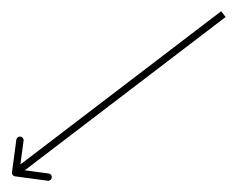

Коммерческие, фокусируются на прибыли через подписки/APC

Некоммерческие, фокусируются на доступности и сообществе

## Коммерческие издательства

Независимые компании с бизнес-моделью на основе подписок, APC (article processing charges) и продаж. Прибыль превышает затраты; часто владеют престижными журналами.
Преимущества: Высокая видимость, маркетинг;
Недостатки: Высокие цены (до 30–50% рынка академических публикаций).

Бизнес-модель

| Компонент | Описание | Примеры монетизации | Доля в доходах |
| --- | --- | --- | --- |
| Подписки (Subscriptions) | Библиотеки и университеты платят за доступ к архивам и новым выпускам журналов. | Ежегодные контракты с вузами (e.g., £1,000+ за журнал в гуманитариях). | 50–70% (традиционный основной поток). |
| APC (Article Processing Charges) | Авторы (или их учреждения) платят за OA-публикацию (gold OA или hybrid). Цены: $1,500–12,000 за статью. | Springer Nature: до $5,000; Elsevier: $2,000–10,000. | 20–30% (рост из-за OA-трендов; $1+ млрд глобально для big five). |
| Transformative Agreements (Read &amp; Publish) | Комбинированные сделки: фиксированная сумма за чтение + публикации OA. Переход от подписок к "pay to publish". | Норвегия/UK: £112 млн на APC в 2022 (рост к 2025). | 15–25% (ключ к OA-переходу). |
| Дополнительные услуги | Продажа книг, данных, аналитики, AI-инструментов (peer review, plagiarism detection). | Elsevier: ScienceDirect; Wiley: платформы для тренд-анализа. | 5–10% |

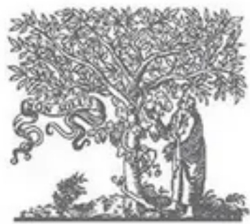

natural_image

Illustration of a person standing under a leafy tree with decorative vines, no text or symbols present

## WILEY

natural_image

Blue circular icon with a white stylized icon of a teacup and steam rising, no text or symbols present.

Taylor & Francis

seal

W

## WILEY

## SPRINGER

## NATURE

## Некоммерческие издательства

Аффилированы с университетами, обществами или сообществами; фокус на открытом доступе (OA) и вкладе в науку, без прибыли
Преимущества: Низкие цены, этичность;
Недостатки: Меньше маркетинга.

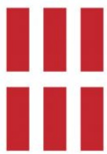

## Harvard University Press

natural_image

Red and white shield emblem with four golden lion designs and a central emblem (no text or symbols)

## CAMBRIDGE

## UNIVERSITY PRESS

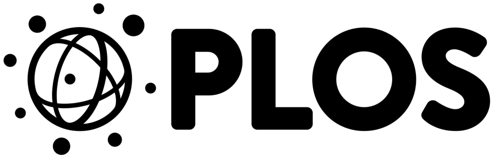

text_image

PLOS

## Конференции с proceedings и их воркшопы

Бесплатная публикация + обязательная регистрация для презентации

Подача и публикация бесплатны, но принятая статья требует регистрации хотя бы одного автора для презентации (in-person или virtual). Fee покрывает доступ к мероприятию, не публикацию.

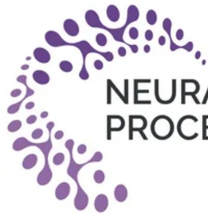

text_image

NEURAPROCE

NEURAL INFORMATION PROCESSING SYSTEMS

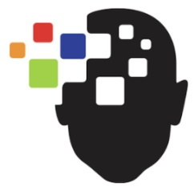

ICML

International Conference

On Machine Learning

IROS

## Springer Nature

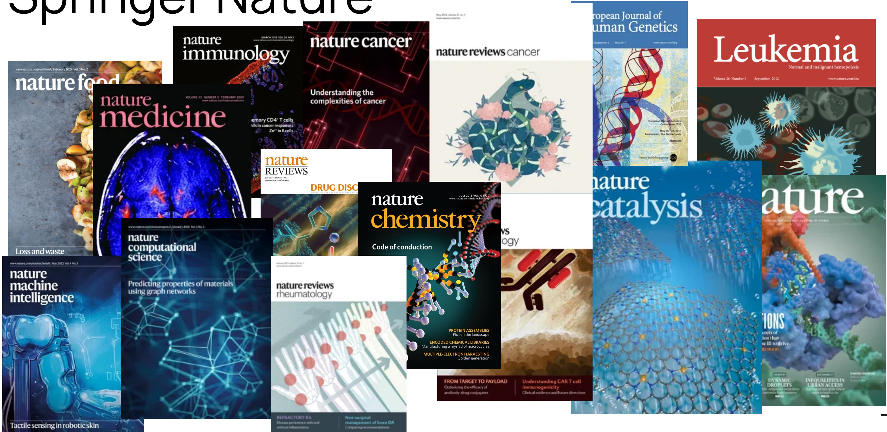

## Открытый доступ

Читатель может получить полный текст без подписки или оплаты.

Модели доступа различаются:

Gold OA — статья в открытом журнале
Green OA — версия в репозитории
Hybrid OA — OA-статья в подписном журнале

## APC

Плата за публикацию, которую взимают с автора или организации.

Перед отправкой проверьте:

обязательна ли APC и каков размер
есть ли waiver / скидка
что именно покрывает платёж
нет ли иных обязательных сборов

nature  npj computational materials  open access

For Authors and Referees

For authors

Guide to Authors

Submission guidelines

Editorial process

Matters Arising

Collections and special issues

Guide for Reviewers

Reviewer of the Year

## Open Access

## Open Access Fees and Funding

All articles published in npj Computational Materials are made freely and permanently available online immediately upon publication, without subscription charges or registration barriers. Further information about open access can be found here

As authors of articles published in npj Computational Materials, you are the copyright holders of your article and grant to any third party, in advance and in perpetuity, the right to use, reproduce or disseminate your article.

## Benefits of open access

Publishing OA offers a number of benefits, including greater reach and readership for your

Find out more about benefits of OA.

## Article processing charges (APC)

Authors who publish in npj Computational Materials are required to pay an article processing charge (APC). The APC price will be determined from the date on which the article is accepted for publication.

The current APC, subject to VAT or local taxes where applicable, is:

Original Research: £2790.00/\$3590.00/€3090.00

Brief Communication / Perspective / Review / Comment: £1355.00/ \$1870.00/ € 1545.00

Visit our open access support portal and our Journal Pricing FAQs for further information.

## Рецензируемость

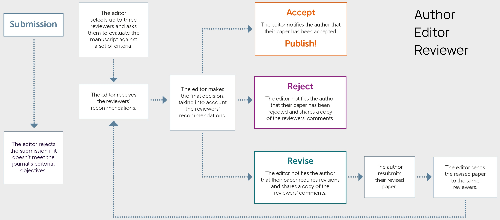

flowchart

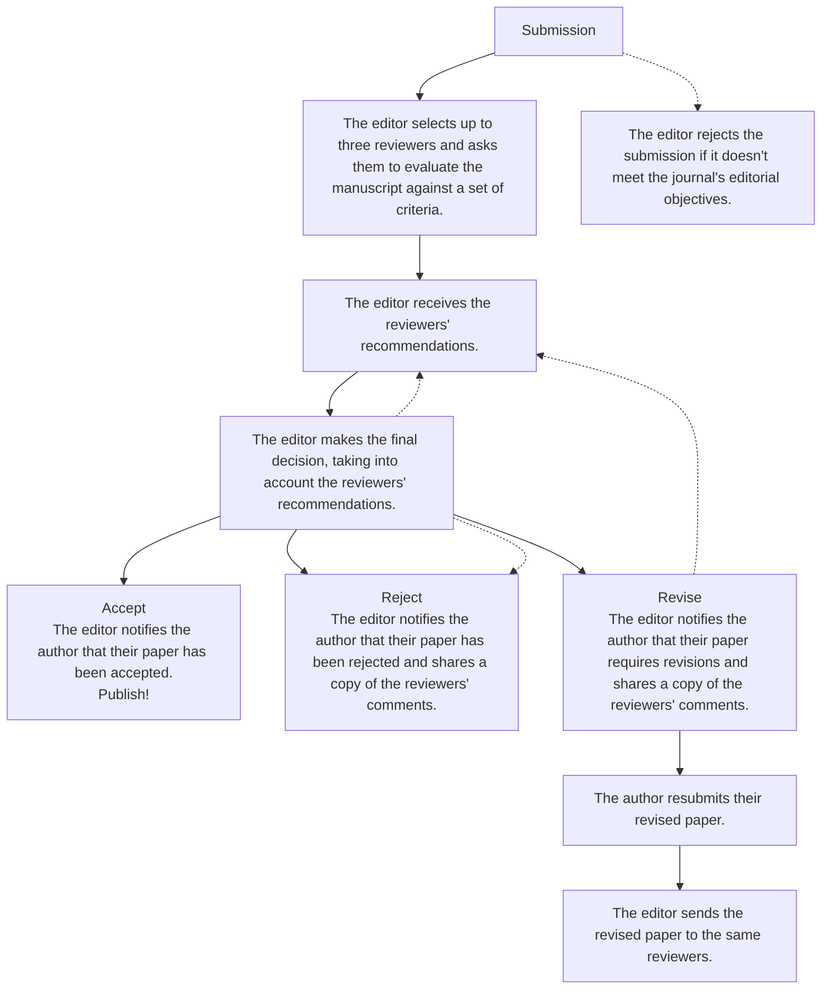

## Ретракции и коррекции

## CORRECTION / ИСПРАВЛЕНИЕ

Исправляет существенную ошибку в опубликованной работе.

Статья остаётся в научном обороте, а исправление связано с ней ссылкой.

Читателю важно понять, что именно изменено и влияет ли это на выводы.

## RETRACTION / ОТЗЫВ

Публикация отзывается, если выводам или целостности работы нельзя доверять либо выявлены серьёзные нарушения.

Отзыв не всегда означает доказанный умысел автора. Изучите причину и запись издателя, а не только пометку «Retracted».

## Рецензируемость

Цель: оценить новизну, достоверность, значимость.

Среднее время: от 3 до 9 месяцев (зависит от издателя).

Возможны reject / revise / accept решения

| Тип | Кто знает кого | Особенности |
| --- | --- | --- |
| Single-blind | Рецензент знает автора | Стандарт в журналах |
| Double-blind | Никто никого не знает | Снижает предвзятость, стандарт конференций |
| Open review | Все открыты | Прозрачность, но риск давления |

## Индексация

Системы индексации — это и есть каталоги для мира научных публикаций. Они не хранят полные тексты всех статей, но содержат ключевую информацию о них: название, автор, аннотация, место публикации и, что самое важное, списки цитируемой литературы.

Поиск и доступ
Оценка влияния
Наукометрия

## Базы данных для индексации

## Scopus (от Elsevier)

Крупнейшая в мире база данных аннотаций и цитирований. Для чего: Поиск литературы, отслеживание цитируемости, оценка авторов и журналов. Очень строгий отбор контента.

## Web of Science (WoS, от Clarivate)

Старейшая и одна из самых авторитетных баз данных. Считается "золотым стандартом" Для чего: Аналогично Scopus, но исторически с большим фокусом на естественные науки. Еще более жесткий отбор.

## Рейтинги

Рейтинги используют данные из систем индексации, чтобы сравнивать и ранжировать участников научной гонки: университеты, научные организации и даже страны.

## Шанхайский рейтинг

<table><tr><td>Top Journals</td><td>Top Awards</td><td>Top Conferences</td><td>Key International Organization</td><td>Participants</td><td>Methodology</td><td></td></tr><tr><td colspan="2">Academic Subject</td><td colspan="3">Conference Name</td><td>Conference Abbreviation</td><td>Number of Votes</td></tr><tr><td colspan="2">Computer Science &amp; Engineering</td><td colspan="3">ACM Symposium on Theory of Computing</td><td>STOC</td><td>24</td></tr><tr><td colspan="2">Computer Science &amp; Engineering</td><td colspan="3">USENIX Symposium on Operating Systems Design and Implementation</td><td>OSDI</td><td>18</td></tr><tr><td colspan="2">Computer Science &amp; Engineering</td><td colspan="3">ACM SIGGRAPH</td><td>SIGGRAPH</td><td>18</td></tr><tr><td colspan="2">Computer Science &amp; Engineering</td><td colspan="3">IEEE Symposium on Foundations of Computer Science</td><td>FOCS</td><td>17</td></tr><tr><td colspan="2">Computer Science &amp; Engineering</td><td colspan="3">Symposium on Principles of Programming Languages</td><td>POPL</td><td>17</td></tr><tr><td colspan="2">Computer Science &amp; Engineering</td><td colspan="3">ACM SIGMOD Conference</td><td>SIGMOD</td><td>17</td></tr><tr><td colspan="2">Computer Science &amp; Engineering</td><td colspan="3">Programming Language Design and Implementation</td><td>PLDI</td><td>16</td></tr><tr><td colspan="2">Computer Science &amp; Engineering</td><td colspan="3">ACM SIGCOMM Conference</td><td>SIGCOMM</td><td>13</td></tr></table>

## Рейтинги

Рейтинги используют данные из систем индексации, чтобы сравнивать и ранжировать участников научной гонки: университеты, научные организации и даже страны.

Шанхайский рейтинг

<table><tr><td> SHANGHAI RANKING</td><td>Home</td><td>Rankings</td><td>Universities</td><td>News</td><td>Activities</td><td>中文版</td></tr><tr><td>Top Journals</td><td>Top Awards</td><td>Top Conferences</td><td>Key International Organization</td><td>Participants</td><td>Methodology</td><td></td></tr><tr><td colspan="2">All</td><td colspan="3">Journal Name</td><td>ISSN</td><td>Percentage Voted</td></tr><tr><td colspan="2">Mathematics</td><td colspan="3">ANNALS OF MATHEMATICS</td><td>0003-486X</td><td>74%</td></tr><tr><td colspan="2">Mathematics</td><td colspan="3">INVENTIONES MATHEMATICAE</td><td>0020-9910</td><td>60%</td></tr><tr><td colspan="2">Mathematics</td><td colspan="3">JOURNAL OF THE AMERICAN MATHEMATICAL SOCIETY</td><td>0894-0347</td><td>53%</td></tr><tr><td colspan="2">Mathematics</td><td colspan="3">ACTA MATHEMATICA</td><td>0001-5962</td><td>36%</td></tr><tr><td colspan="2">Physics</td><td colspan="3">PHYSICAL REVIEW LETTERS</td><td>0031-9007</td><td>71%</td></tr><tr><td colspan="2">Physics</td><td colspan="3">NATURE PHYSICS</td><td>1745-2473</td><td>42%</td></tr></table>

# Рейтинги элитных публикаций

Nature Index - не база данных, а скорее рейтинг научной элиты

Отслеживает публикации только в 82 самых престижных естественно- научных журналах. Показывает, какие университеты и страны вносят наибольший вклад в передовую науку.

Фокус только на качестве, а не на количестве.

## 11. What journals are in the Nature Index?

The current 12-month window on nature.com/nature-index/ includes data from primary research articles from the following science journals:

• ACS Nano (2718 articles)
• Advanced Functional Materials (5063 articles)
• Advanced Materials (2994 articles)
• American Journal of Clinical Nutrition (256 articles)
• American Journal of Epidemiology (57 articles)
• American Journal of Human Genetics (183 articles)
• American Journal of Obstetrics and Gynecology (88 articles)
• American Journal of Pathology (123 articles)
• American Journal of Respiratory and Critical Care Medicine (41 articles)
• Analytical Chemistry (2451 articles)
• Anesthesiology (61 articles)
• Angewandte Chemie International Edition (4538 articles)
• Annals of Emergency Medicine (60 articles)

• Journal of Geophysical Research: Solid Earth (518 articles)
• Journal of Hepatology (99 articles)
• Journal of High Energy Physics (2666 articles)
• Journal of Infectious Diseases (336 articles)
• Journal of Neuroscience (573 articles)
• Journal of Physiology (327 articles)
• Journal of Thoracic and Cardiovascular Surgery (66 articles)
• Journal of the American Academy of Child and Adolescent Psychiatry (6 articles)
• Journal of the American Academy of Dermatology (109 articles)
• Journal of the American Chemical Society (3807 articles)
• Journal of the American College of Cardiology (190 articles)
• Journal of the American Geriatrics Society (260 articles)
• Journal of the American Society of Nephrology (92 articles)

## Рейтинги конференций

## CORE Ranking

Самый авторитетный рейтинг конференций в области IT.

Присваивает конференциям уровни: A\* (топ), A, B, C. Публикация на конференции A\* ценится чрезвычайно высоко.

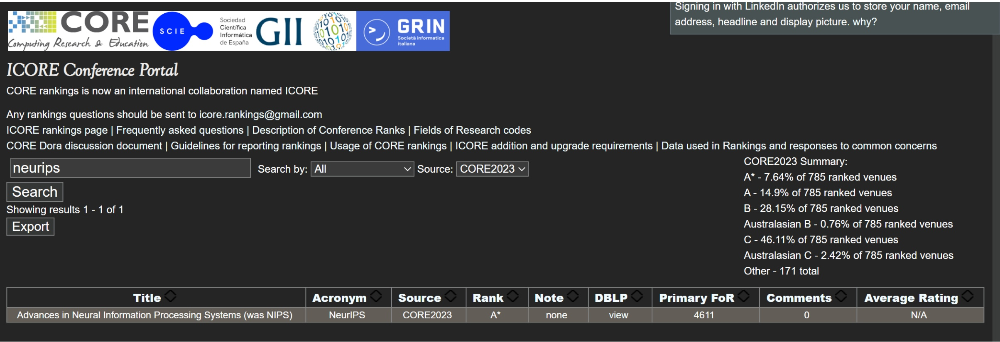

text_image

Core
Computing Research & Education
SCIE
Sociedad Científica Informática de España
GII
10 10 10
10 10
GRIN
Società informatica italiana
Signing in with LinkedIn authorizes us to store your name, email address, headline and display picture. why?
ICORE Conference Portal
CORE rankings is now an international collaboration named ICORE
Any rankings questions should be sent to icore.rankings@gmail.com
ICORE rankings page | Frequently asked questions | Description of Conference Ranks | Fields of Research codes
CORE Dora discussion document | Guidelines for reporting rankings | Usage of CORE rankings | ICORE addition and upgrade requirements | Data used in Rankings and responses to common concerns
neurips
Search by: All
Source: CORE2023
Search
Showing results 1 - 1 of 1
Export
CORE2023 Summary:
A* - 7.64% of 785 ranked venues
A - 14.9% of 785 ranked venues
B - 28.15% of 785 ranked venues
Australasian B - 0.76% of 785 ranked venues
C - 46.11% of 785 ranked venues
Australasian C - 2.42% of 785 ranked venues
Other - 171 total
Title
Acronym
Source
Rank
Note
DBLP
Primary FoR
Comments
Average Rating
Advances in Neural Information Processing Systems (was NIPS)
NeurIPS
CORE2023
A*
none
view
4611
0
N/A

## Наукометрия

## Impact Factor

IF (год N) = (Количество цитирований статей из N-1 и N-2) / (Количество статей в N-1 и N-2).

Обновление: июнь ежегодно.

## Достоинства:

Стандартизированный показатель;
Прост для интерпретации;
Привязан к конкретной области знаний.

## Недостатки:

Зависит от области (в биологии IF > чем в математике);
Цитируемость ≠ качество исследования;
Уязвим к манипуляциям (самоцитирование, «review papers»)

## CiteScore (Scopus)

Среднее число цитирований в течение 4 лет (в отличие от IF — 2 года). Источник — Scopus.

## Достоинства:

Более широкий временной диапазон;
Учитывает больше типов документов (включая обзоры, конференции);
Доступен бесплатно через Scopus / Scimago.

## Недостатки:

Не все статьи равнозначны (новости, письма и обзоры считаются вместе);
Сложнее сопоставлять по областям.

## Квартили(Q1–Q4)

Квартиль — позиция журнала в своей предметной области Квартиль — показатель престижа журнала в его области.

Квартиль (Q1–Q4) — относительная позиция журнала в ранжировании по метрике (SJR, IF или CiteScore) внутри конкретной категории (например, Biotechnology, Computer Science, Education).

Q1 — верхние 25% журналов;

Q2 — 25–50%;

Q3 — 50–75%;

Q4 — нижние 25%.

## SJR (Scimago Journal Rank)

Показатель престижа журнала, учитывающий не только количество цитирований, но и вес цитирующих источников:

Цитата из Nature «весит» больше, чем из малоизвестного журнала;
Делит журналы на квартильные группы Q1–Q4 (по областям).

Достоинства:

Корректирует «массовые» цитирования;
Более устойчива к самоцитированию;
Доступна бесплатно (scimagojr.com).

Недостатки:

Менее прозрачная формула;
В разных областях шкала различается;
Не все журналы включены.

## Scimago

## Nature Communications ∂

## COUNTRY

United Kingdom

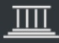

Universities and research institutions in United Kingdom

Media Ranking in United Kingdom

## SUBJECT AREA AND CATEGORY

Biochemistry, Genetics and Molecular Biology

Biochemistry, Genetics and Molecular Biology (miscellaneous)

Chemistry

Chemistry (miscellaneous)

Physics and Astronomy

Physics and Astronomy (miscellaneous)

## PUBLISHER

Nature Research

## SJR 2024

4.761

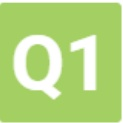

## H-INDEX

577

## Scimago

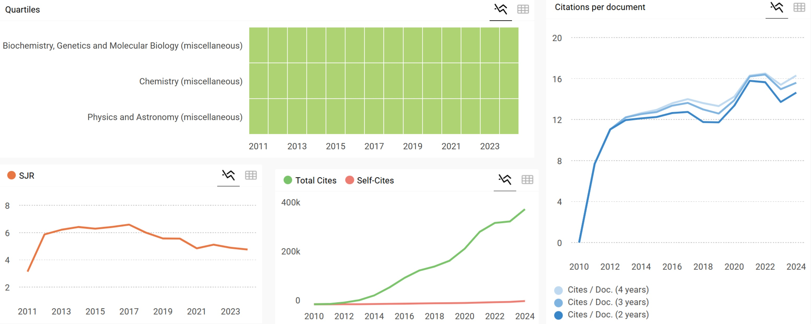

Scimago

Chemistry Chemistry (miscellaneous)

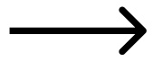

<table><tr><td colspan="2">Title</td><td>Type</td><td>↓ SJR</td><td>H index</td><td>Total Docs. (2024)</td><td>Total Docs. (3years)</td><td>Total Refs. (2024)</td></tr><tr><td>1</td><td>Chemical Reviews</td><td>journal</td><td>16.455 Q1</td><td>873</td><td>227</td><td>849</td><td>106923</td></tr><tr><td>2</td><td>Nature Materials</td><td>journal</td><td>14.204 Q1</td><td>583</td><td>322</td><td>875</td><td>10721</td></tr><tr><td>3</td><td>Nature Reviews Chemistry</td><td>journal</td><td>13.441 Q1</td><td>131</td><td>106</td><td>306</td><td>8489</td></tr><tr><td>4</td><td>Chemical Society Reviews</td><td>journal</td><td>11.467 Q1</td><td>673</td><td>310</td><td>944</td><td>87507</td></tr><tr><td>5</td><td>ACS Energy Letters</td><td>journal</td><td>6.799 Q1</td><td>223</td><td>661</td><td>1596</td><td>35619</td></tr><tr><td>6</td><td>Nature Chemistry</td><td>journal</td><td>6.710 Q1</td><td>308</td><td>309</td><td>740</td><td>13413</td></tr></table>

## H-index (индекс Хирша)

Индивидуальная метрика исследователя:

исследователь имеет h, если у него есть h статей, каждая из которых процитирована не менее h раз.

## Достоинства:

Простая интерпретация (объединяет качество и количество);
Устойчив к единичным «всплескам» цитируемости;
Легко сравнивать в рамках одной дисциплины.

## Недостатки:

Зависит от возраста карьеры и количества статей;
Не учитывает авторство (1-й, последний, совместный автор);
Можно «накрутить» самоцитированием.

## Дополнительные метрики

| Метрика | Описание | Источник | Особенности |
| --- | --- | --- | --- |
| g-index | Усиливает значение высокоцитируемых статей | Scopus | чувствителен к «звёздным» публикациям |
| i10-index | Кол-во статей с ≥10 цитированиями | Google Scholar | простая альтернатива h-index |
| h5-index | h-index за последние 5 лет | Google Metrics | чаще применяется для конференций |

## CORE Ranking: система A–C\*

| Уровень | Характеристика | Пример |
| --- | --- | --- |
| A* | Всемирно признанные, ведущие конференции | NeurIPS, CVPR, ACL, ICML |
| A | Очень хорошие, с сильным рецензированием | ICPR, AAAI, ISMAR |
| B | Качественные, но менее престижные | ACIVS, ICPRAM |
| C | Региональные или узкоспециализированные | ICISSP, ICBR |

Рейтинг формируется экспертными панелями.
Учитываются: цитируемость, качество рецензирования, история, узнаваемость.
CORE обновляется каждые 3–4 года.
Используется для аттестации исследователей (в т.ч. в Европе и Австралии).

## Altmetrics — альтернатива цитированиям

Метрики, основанные на вовлечённости в сети (просмотры, скачивания, упоминания в СМИ, соцсетях, блогах).

Количество загрузок / просмотров PDF;
Упоминания в Twitter, Mendeley, Wikipedia;
Altmetric Attention Score (радужная «значка»).

## Достоинства:

Быстро реагирует на интерес к работе;
Показывает общественную значимость;
Открытые данные.

## Недостатки:

Не коррелирует с научным качеством;
Можно искусственно завысить;
Зависит от активности сообщества.

## Ограничения метрик

## Цитирования распределены неравномерно

Небольшое число статей может давать большую часть цитирований журнала.

## Есть задержка во времени

Новые работы ещё не успели накопить цитирования; окна расчёта различаются.

## Области несопоставимы

Частота цитирования зависит от дисциплины,типа публикации и размера сообщества.

## Покрытие баз неполное

Результат зависит от базы, языка, типа документа и корректности записей.

## Российский контекст: РИНЦ и ВАК

## РИНЦ / eLIBRARY.RU

Российская библиографическая и цитатная инфраструктура.

Проверяйте карточку журнала, индексацию и сведения о публикациях.

Наличие в РИНЦ не означает автоматически,что журнал входит в перечень ВАК.

## ПЕРЕЧЕНЬ ВАК

Учитывайте актуальный перечень и требования к конкретной специальности.

Категории К1–К3 — учитывай категорию журнала и актуальность его включения в перечень

## Predatory Journals

обманные или поддельные издания, которые имитируют легитимные рецензируемые журналы, но взимают плату с авторов за публикацию, пропуская реальный процесс рецензирования (peer review).

Фальшивый peer review; А
грессивные рассылки по email с приглашениями;
Скрытые или неясные APC (article processing charges), которые появляются только после принятия;
Отсутствие индексации в базах вроде Web of Science, Scopus или DOAJ
Неаккуратный сайт с грамматическими ошибками или стоковыми фото;
Обещания быстрой публикации ("submit today, publish next week")

## Predatory Journals

Cabells Blacklist превышает 15 000 названий подобных журналов

Влияние журналов:

Для исследователей: Повреждение репутации (публикации игнорируются при найме/продвижении); потеря времени, денег и усилий; эксплуатация молодых ученых (студентов, постдоков); проблемы с цитированием и индексацией.

Для науки: Распространение ложной информации ; эрозия доверия к исследованиям; искажение цитирований; снижение эффективности финансирования; подрыв OA-модели.

## Что проверять?

## Проверьте индексирование

Найдите журнал в официальных каталогах DOAJ, Scopus, ВАК, Web of science и др.

## Изучите опубликованные выпуски

Статьи выпущенные в последних изданиях , архивных

## Изучите редколлегию

Проверьте имена, аффилиации и научную экспертизу редакторов

## Оцените прозрачность условий

APC , этапы и сроки рецензирования должны быть ясны

## Greetings from ACCS!!

Hope you are doing well and very good in health.

I am Crystal Waston manager of " Archives of Clinical Case Studies (ACCS)".I was in shortfall of articles for releasing of Upcoming Issue. Is it possible for you to support us with your mini review/research article for this issue?

I believe in you thatyour one article brings out the best achievement to our Journal.

Please do not hesitate to contact us, if there are any further queries.

Await your positive response.

Crystal Waston|Managing Editor

Archives of Clinical Case Studies ISSN: 2687-8410

Iris Publishers LLC,315 Montgomery Street, San Francisco, CA 94104, USA.

Greetings from ACCS!!

Hope you are doing well and very good in health.

I am Crystal Waston manager of " Archives of Clinical Case Studies (ACCS)".I was in shortfall of articles for releasing of Upcoming Issue. Is it possible for you to support us with your mini review/research article for this issue?

I believe in you thatyour one article brings out the best achievement to our Journal.

Please do not hesitate to contact us, if there are any further queries.

Await your positive response.

Crystal Waston|Managing Editor

Archives of Clinical Case Studies ISSN: 2687-8410

Iris Publishers LLC,315 Montgomery Street, San Francisco, CA 94104, USA.

• Неестественный английский и ошибки в формулировках
• Давление срочностью: не хватает статей к выпуску
• Лесть и обещание лучшего достижения журналу
• Нет персонализации по вашей тематике
• Просьба прислать статью без ясных условий
• Подпись и адрес сами по себе ничего не доказывают

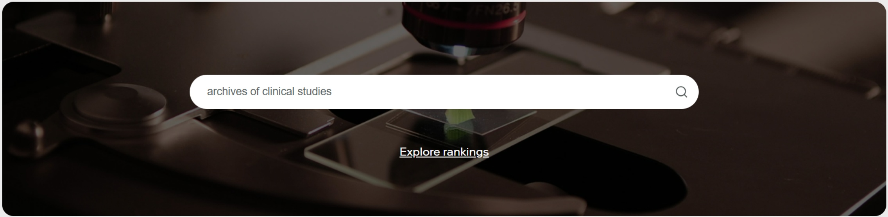

text_image

archives of clinical studies
Explore rankings

Sorry, no results were found.

## Suggestions

• Check your spelling
• Try more general search query
• Try different keywords
Browse Journal Rankings

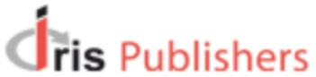

Home About UsJournalsFor Authors & EditorsSubmit ManuscriptContact Us

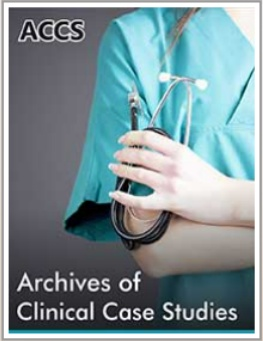

text_image

ACCS
Archives of
Clinical Case Studies

## Archives of Clinical Case Studies – ACCS

ISSN: 2687-8410

Managing Editor: Crystal Waston

Contact us at:

clinicalcasestudies@irispublishe

clinicalcasestudies@irispublishe

clinicalcasestudies@iris-

research.net

clinicalcasestudies@irispublishe

About ACCS

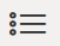

Classification

Editorial Panel

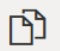

Article in press

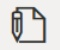

Current Issue

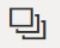

Archive

## About ACCS

Archives of Clinical Case Studies (ACCS) is an interdisciplinary journal which is combination of all types of case reports includes all types of sciences. However, case study is an intensive topic that every researcher shows interest. It is an intensive analysis of an individual unit stressing organic process factors in relevance context. Clinical Case Studies presents innovative psychotherapy cases involving individual, couples, and family therapy. We aim to encourage authors to publish their recent data by providing a platform to report distinctive, unusual and rare cases that enhance our understanding of illness method, its identification, management and clinico-pathologic correlations and creates awareness in readers. Clinical Case Studies concentrates on the on the topics like behavioral, cognitive-behavioral, gestalt, humanistic, psychodynamic, rational-emotive therapy, existential, systems, and others. As the medical technology developing day by day, clinical researchers and medical doctors are interested in clinical case presentations and their each case present provides new insights in diagnosis and treatment methods.

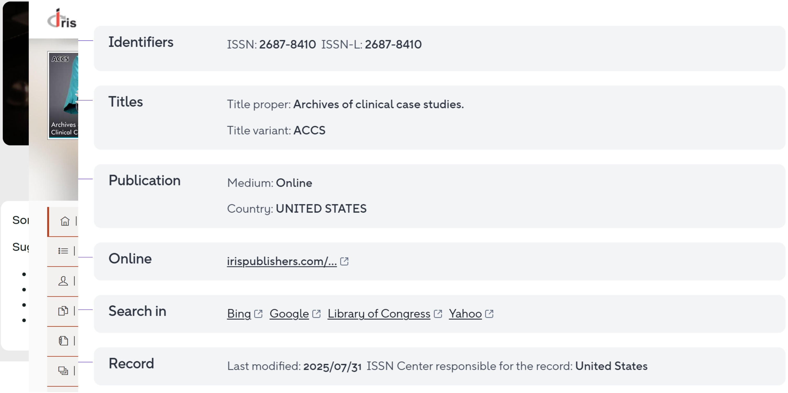

other

| Section | Item | Details |
| :--- | :--- | :--- |
| Top Section | Identifiers | ISSN: 2687-8410 ISSN-L: 2687-8410 |
| Top Section | Titles | Title proper: Archives of clinical case studies. 
Title variant: ACCS |
| Middle Section | Publication | Medium: Online 
Country: UNITED STATES |
| Bottom Section | Online | irispublishers.com/... |
| Bottom Section | Search in | Bing Google Library of Congress Yahoo |
| Bottom Section | Record | Last modified: 2025/07/31 ISSN Center responsible for the record: United States |

## Задание на самостоятельную практику

Таблица оценки 5 источников из списка 15 статей полученных после прошлого занятия: издатель, индексация, квартиль или CORE, год и цитируемость, рецензируемая публикация или препринт, вывод берём / не берём