# Управление научными исследованиями

**Занятие 4**  

Юлия Разливина  
м.н.с. ПИШ ИТМО  
Центр ИИ в Химии ПИШ ИТМО  

---

## Форматирование статьи

---

<center>
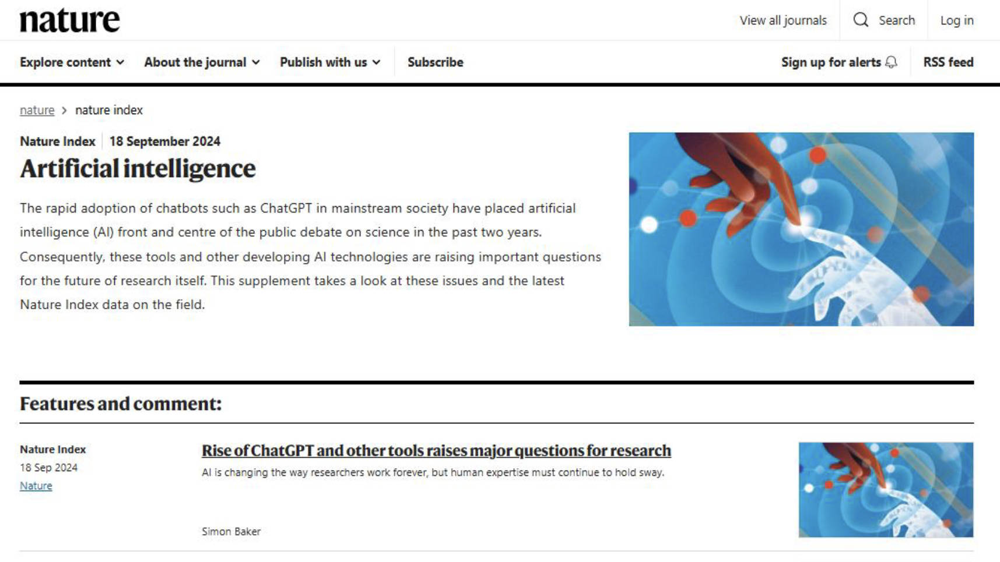
</center>

---

<center>
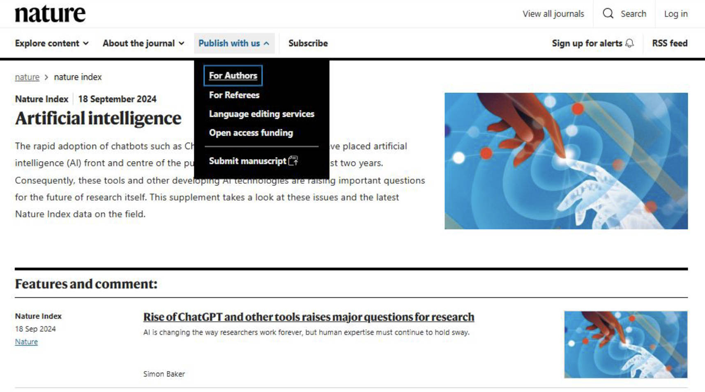
</center>

<details>
<summary>Image Text</summary>

<h3>Artificial intelligence</h3>

The rapid adoption of chatbots such as ChatGPT in mainstream society have placed artificial intelligence (Al) front and centre of the public debate on science in the past two years. Consequently, these tools and other developing Al technologies are raising important questions for the future of research itself. This supplement takes a look at these issues and the latest Nature Index data on the field.  

<h4>Features and comment:</h4>

<h5>Rise of ChatGPT and other tools raises major questions for research</h5>

Al is changing the way researchers work forever, but human expertise must continue to hold sway. 

</details>

---

<center>

</center><center>

</center>

<details>
<summary>Image Text</summary>

<h3>Initial submission</h3>

Submissions for Articles, Reviews and Perspectives, and Matters Arising must be submitted via our online submission system. Please follow these guidelines to ensure that your submission proceeds smoothly  

If your manuscript and figures are ready to submit according to the manuscript formatting guidelines and requirements below, please proceed directly to the online submission system.  

<h4>Brief guide for submission to Nature</h4>

This guide outlines key points for preparing primary research manuscripts for submission to Nature.  

The corresponding author should be familiar with the Nature journals' editorial policies and is solely responsible for communicating with the journal and managing communication between coauthors. Before submission, the corresponding author ensures that all authors are included in the author list and agree with its order, and that they are aware the manuscript is to be submitted. For more information on editorial and authorship policies, please review our Guide to Authors.  

<h4>Main manuscript</h4>

The Nature journals are flexible with regard to the format of initial submissions. Within reason, style and length will not influence consideration of a manuscript. If revisions are requested, the editor will provide detailed formatting instructions at that time.  

To facilitate the review process however, we strongly encourage you to incorporate the manuscript text and figures into a single PDF or Microsoft Word file. Suitably high resolution figures may be inserted within the text at appropriate positions or grouped at the end. Each figure legend should be presented on the same page as its figure. The reference list should include article titles. If providing a PDF, please number all lines. The submission system will number all lines in a Word document for you. We accept LaTeX files at the acceptance stage, but before that time please supply PDFs.  

<b>Title</b>.Titles must fit on two lines in print (75 characters including spaces) and should avoid technical terms, abbreviations and active verbs.  

<b>Authors</b>. Corresponding author(s) should be identified with an asterisk. Large Language Models (LLMs), such as ChatGPT, do not currently satisfy our authorship criteria. Notably an attribution of authorship carries with it accountability for the work, which cannot be effectively applied to LLMs. Use of an LLM should be properly documented in the Methods section (and if a Methods section is not available, in a suitable alternative part) of the manuscript.  

</details>

---

## Журнал

- Подготовка в гугл доках или ms office  
- Учет необходимых заголовков журнала  
- Сабмит в формате .docx, .doc  
- Картинки и доп информация отдельными файлами  

---

**Abstract**. Provide a general introduction to the topic and a brief non-technical summary of your main results and their implication.  

**Text length and formatting**. Attention to the following details can help expedite publication if we invite a revision after external review.  

A fully referenced \~200 word summary paragraph; main text of 2,500 words and 4 modest display items (figures, tables) for a typical 6 page article and 4300 words and 5-6 modest display items for a typical 8 page article; as a guideline up to 50 references if needed and within the allocated page budget. Sections can be separated with subheadings to aid navigation.  

Please consult Nature's content types for final length and formatting requirements of other article types.  

**Methods**. The Methods section appears in most online original research articles and should contain all elements necessary for interpretation and replication of the results. Methods should be written as concisely as possible and typically do not exceed 3,000 words but may be longer if necessary. Methods-only references do not count against your reference limit. We encourage you to deposit any step-by-step protocols used in your study in the open resource protocols.io. Protocols that are deposited should be mentioned in the Methods section and added to the reference list.  

**References**. These may only contain citations and should list only one publication with each number. Include the title of the cited article or dataset.  

**Acknowledgements** (optional). Keep acknowledgements brief and do not include thanks to anonymous referees or editors, or effusive comments. Grant or contribution numbers may be acknowledged.  

**Author contributions**. You must include a statement that specifies the individual contributions of each co-author. For example: "A.P.M. 'contributed' Y and Z; B.T.R. 'contributed' Y," etc. See our authorship policies for more details.  

---

<center>
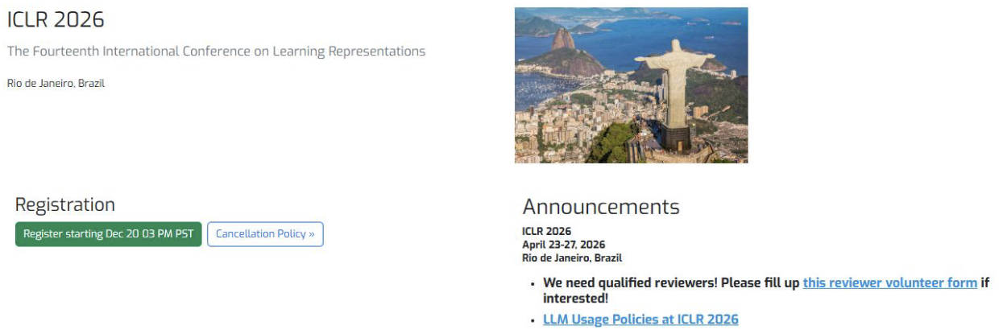
</center>

<details>
<summary>Image Text</summary>

<h4>ICLR 2026</h4>

The Fourteenth International Conference on Learning Representations

Rio de Janeiro, Brazil  

<h4>Registration</h4>

Register starting Dec 20 03 PM PST | Cancellation Policy

<h4>Announcements</h4>

ICLR 2026  

April 23-27, 2026  

Rio de Janeiro, Brazil  

We need qualified reviewers! Please fill up this reviewer volunteer form if interested!  
- LLM Usage Policies at ICLR 2026

</details>

---

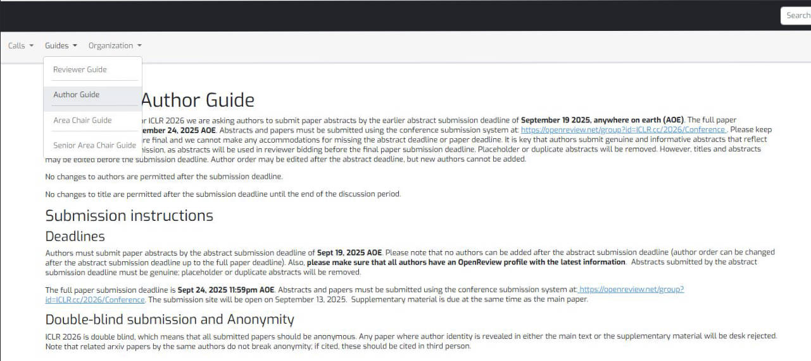
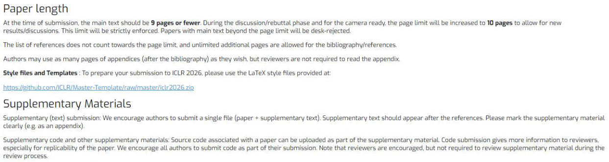

https://iclr.cc/Conferences/2026/AuthorGuide

---

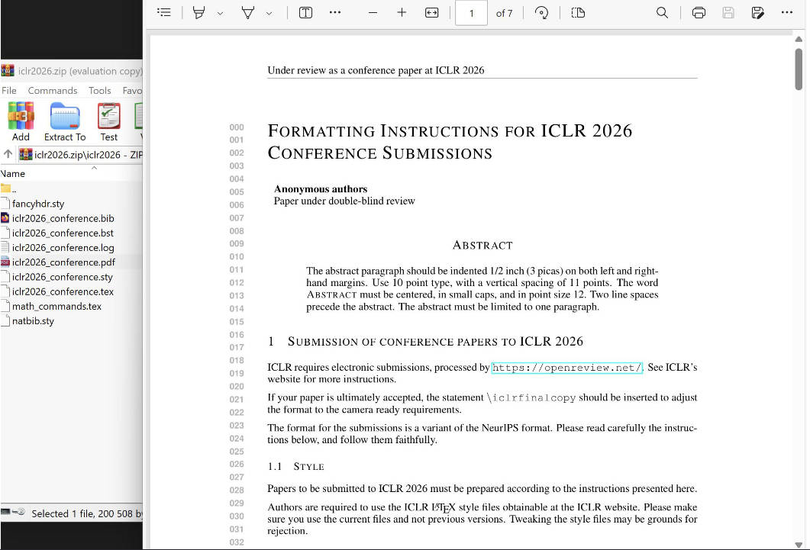

---

## Конференция

- Подготовка в LaTeX формате, который у каждой конференции свой  
- Нормативы по объему  
- Подача в виде PDF из LaTeX файла  
- Обычно доп информация в апендиксе в основном файле  

---

<center>

</center>

---

## Overleaf

\+ Не требует установки  
\+ Коллаборация в реальном времени  
\+ Шаблоны для журналов  
\+ BibTeX/CSL интеграция  

\- Ограниченный бесплатный тариф  
\- Зависимость от интернета

---

<center>
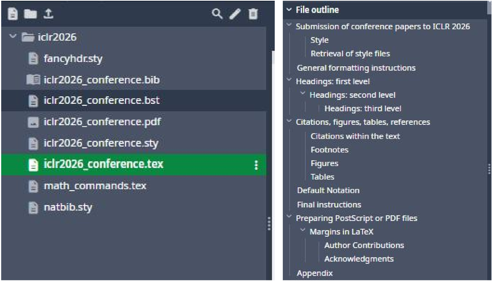
</center>

Демонстрация работы в Overleaf

---

<center>
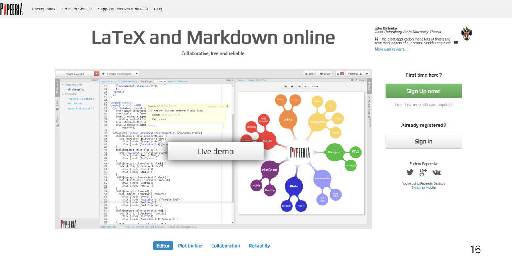
</center>

---

## PAPEERIA

\+ Простота,  
\+ Совместная работа  

\- Ограниченные шаблоны  
\- Меньше инструментов  
\- Медленная компиляция  

**Authorea похожий инструмент**

---

<center>
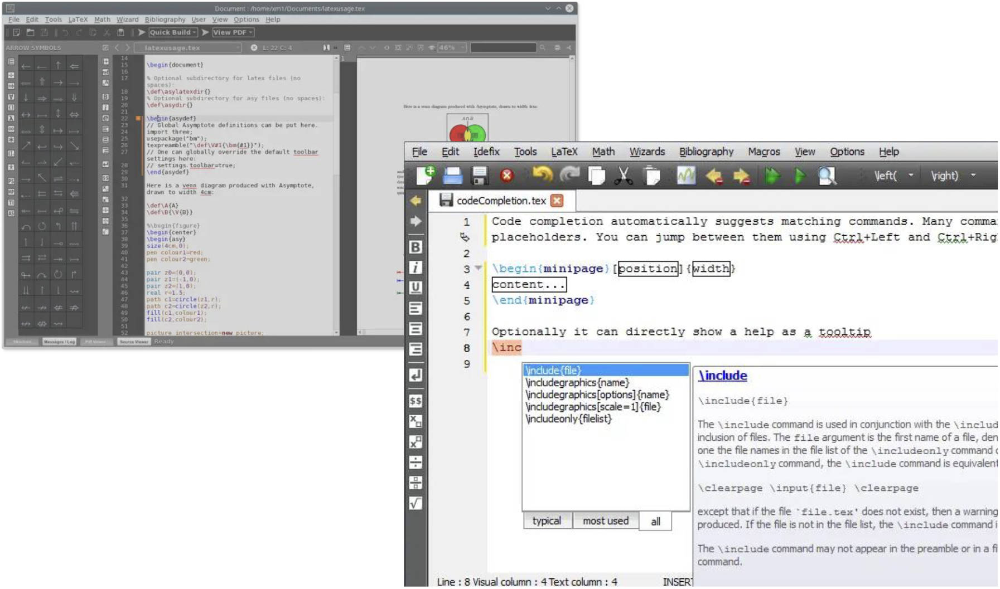
</center>

---

## TeXstudio / TeXmaker / TeXworks

\+ Полный контроль над сборкой
\+ Подсветка синтаксиса, автодополнение
\+ Встроенный PDF-viewer
\+ Не требуют интернета

\- Нужно установить TeX Live / MiKTeX
\- Нет онлайн-совместной работы
\- Интерфейс консервативный

---

## Менеджмент научной литературы

---

## Менеджмент литературы — ключевой навык

- Оформление библиографии — обязательный критерий при приёме статьи.  
- У 60 % статей в первые рецензии замечания касаются именно ссылок.  
- Менеджеры литературы — “система координат” научного текста.  
- Хорошее цитирование = доверие редакции и читателей.  

<center>
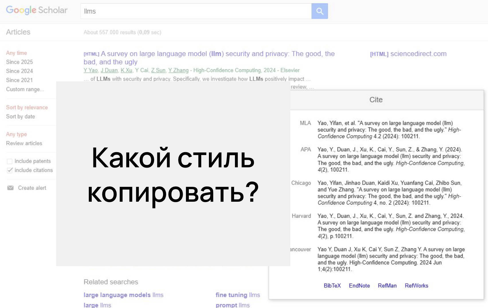
</center>

---

## Стили цитирования из Google Scholar

<table>
<thead>
<tr><th>Стиль</th><th>Особенности</th><th>Где применяется</th></tr>
</thead>
<tbody>
<tr><td align="center">MLA <br>(Modern Language Association) <br>9th edition</td><td><ul><li>"et al." после первого автора</li><li>Название в кавычках</li><li>Формат: (Автор Страница)</li><li>Том.Номер (Год): страницы</li></ul></td><td>Гуманитарные науки <br>Литература <br>Йскусство</td></tr>

<tr><td align="center">APA <br>(American Psychological Association) <br>7th edition</td><td><ul><li>Амперсанд (&amp;) перед последним автором</li><li>Год в скобках после авторов</li><li>Формат: (Автор, Год)</li><li>Название без кавычек, курсив журнала</li></ul></td><td>Психология <br>Социальные науки <br>Образование</td></tr>

<tr><td align="center">Chicago <br>(Chicago Manual of Style) <br>17th edition</td><td><ul><li>Все авторы полностью</li><li>"and" перед последним автором</li><li>"по." для номера выпуска</li><li>Два варианта: сноски или автор-дата</li></ul></td><td>История <br>Искусство <br>Гуманитарные науки</td></tr>

<tr><td align="center">Harvard <br>(Harvard Referencing Style)</td><td><ul><li>Строчное "and" между авторами</li><li>Год после авторов через запятую</li><li>Формат: (Автор Год: Страница)</li><li>"р." перед номером страницы</li></ul></td><td>Естественные науки <br>Социальные науки <br>Бизнес</td></tr>

<tr><td align="center">Vancouver <br>(Vancouver Referencing Style)</td><td><ul><li>Только инициалы без точек</li><li>Нет запятых между авторами</li><li>Полная дата публикации</li><li>Нумерация в тексте [1], [2], [3]...</li></ul></td><td>Медицина <br>Биология <br>Здравоохранение</td></tr>

</tbody></table>

Google Scholar предоставляет все эти форматы автоматически через кнопку "Cite"  
Так же дост упны форматы для импорта: BibTeX, EndNote, RefMan, RefWorks 

---

## Ручное форматирование

- Трудно исправлять и обновлять.  
- Ошибки в фамилиях, журналах, DOI.  
- Несогласованность с цитатами в тексте.  
- Проблемы при импорте в издательские системы (Editorial Manager, ScholarOne).  

---

## Путь ссылки

От находки до списка литературы  

<center>
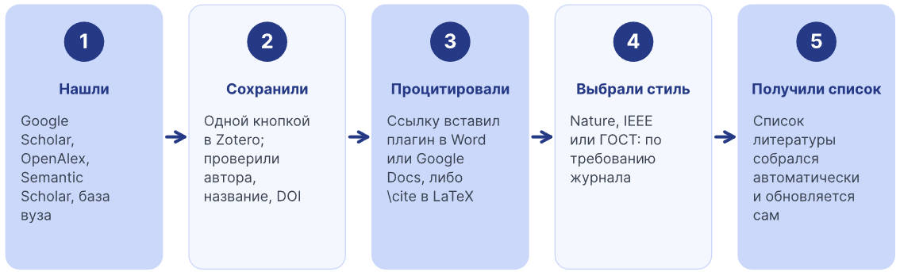
</center>

<details>

<summary>Image Text</summary>

<h5>Нашли</h5>
Google Scholar, OpenAlex, Semantic Scholar, база вуза  

<h5>Сохранили</h5>
Zotero, EndNote, RefMan, RefWorks  

<h5>Процитировали</h5>
Ссылку вставил плагин в Word или Google Docs, либо \cite в LaTeX  

<h5>Выбрали стиль</h5>
Nature, IEEE или ГОСТ: по требованию журнала  

<h5>Получили список</h5>
Список литературы собрался автоматически и обновляется сам  
</details>

**Если шаг делать руками, появляются ошибки**  

Задача менеджера литературы: чтобы руками вы не делали ничего  

---

## Файл .bib

```bib
@article{ivanov2024review,
author = {Ivanov, Ivan and Smith, Anna},
title = {Title of the article},
journal = {Journal Name},
year = {2024},
doi = {10.xxxx/xxxxx}
}
```

**Что это**

Текстовый файл со списком источников в формате BibTeX. Одна запись — один источник  

**Ключ записи**

По нему цитируем в тексте: \cite{ivanov2024review}. Поля записи: автор, название, журнал, год, DOI  

**Как связан с менеджером литературы**

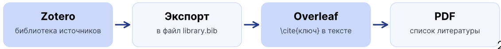

<details>
<summary>Image Text</summary>

<h5>Zotero</h5>
библиотека источников  

<h5>Экспорт</h5>
в файл library.bib  

<h5>Overleaf</h5>
\cite{ключ} в тексте  

<h5>PDF</h5>
список литературы  

</details>

---

<center>
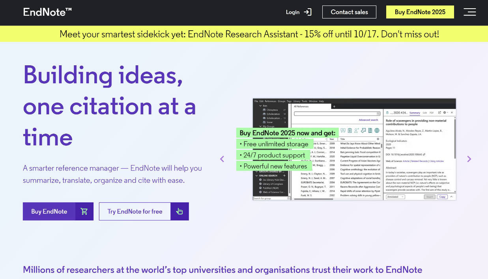
</center>

---

## EndNote

Преимущества

- Интеграция с Microsoft Word  
- Поддержка более 7000 стилей цитирования  
- Расширенные возможности поиска и организации  
- Прямой поиск в онлайн-базах данных из программы  
- Неограниченное хранилище в облачной версии  
- Синхронизация EndNote Desktop и EndNote Online  
- Групповая работа над проектами    

Недостатки

- Дорого (от \$250 за лицензию или \$100/год подписка)  
- Сложный интерфейс для новичков  
- Требует времени на изучение   
- Только Windows и Mac (нет Linux)  
- Избыточен для простых задач  
- Бесплатная базовая версия (EndNote Basic) сильно урезана      

---

<center>
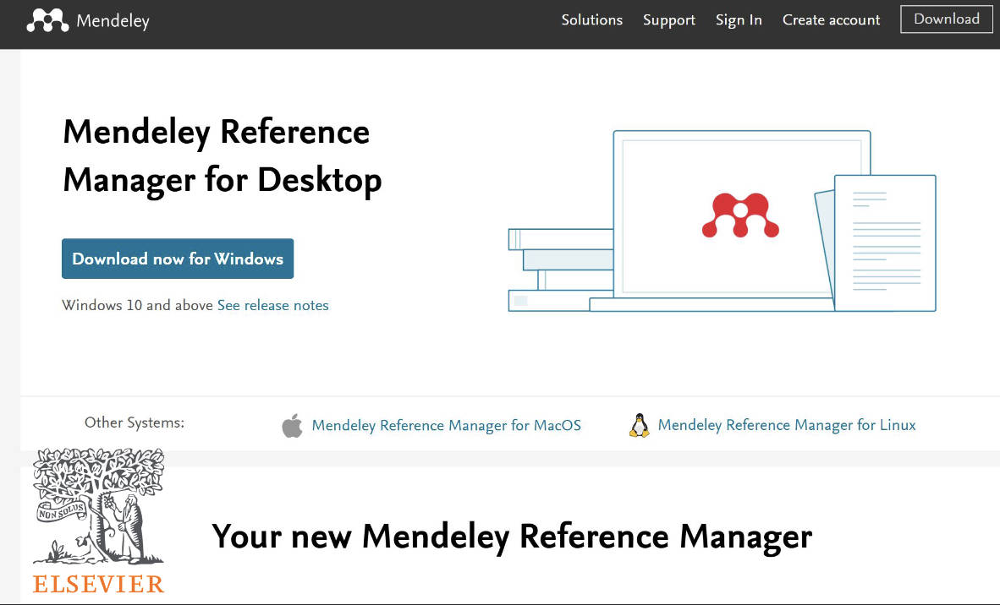
</center>

---

## Mendeley

Преимущества

- Бесплатный базовый план (2 ГБ)
- Встроенный PDF-ридер с аннотациями и заметками  
- Рекомендации статей на основе вашей библиотеки  
- Интеграция с Word и LibreOffice  
- Автоматическое извлечение метаданных из PDF  
- Мобильные приложения для iOS и Android  
- Интеграция с Elsevier и ScienceDirect  
- Статистика чтения  
- Работает на Windows, Mac, Linux  

Недостатки

- Принадлежит издательству Elsevier  
- Ограничения в бесплатной версии  
- Медленная синхронизация больших библиотек  
- Меньее гибкая настройка стилей цитирования  
- Проблемы с поддержкой кириллицы в некоторых случаях  
- Закрытый исходный код     

---

## Your personal research assistant

Zotero is a free, easy-to-use tool to help you collect, organize, annotate, cite, and share research.  

<center>
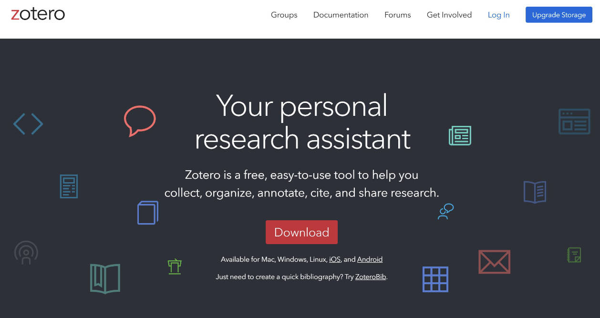
</center>

---

## Zotero

Преимущества

- Полностью бесплатный и open-source  
- Браузерное расширение для быстрого сохранения источников  
- Автоматическое извлечение метаданных из веб- страниц, PDF  
- Интеграция с Word, LibreOffice, Google Docs  
- Синхронизация между устройствами (300 МБ)  
- Групповые библиотеки для совместной работы  
- Поддержка всех основных стилей цитирования  
- Работает на Windows, Mac, Linux  
- Возможность добавлять заметки и теги  

Недостатки

- Ограниченное бесплатное облачное хранилище (300 МБ)  
- Нет встроенного PDF-ридера с продвинутыми функциями аннотирования  

---

## Демонстрация работы Zotero
