# Управление научными исследованиями

Занятие 4

Юлия Разливина

м.н.с. ПИШ ИТМО

Центр ИИ в Химии ПИШ ИТМО

## Форматирование статьи

nature > nature index

Nature Index 18 September 2024

## Artificial intelligence

The rapid adoption of chatbots such as ChatGPT in mainstream society have placed artificial intelligence (Al) front and centre of the public debate on science in the past two years. Consequently, these tools and other developing Al technologies are raising important questions for the future of research itself. This supplement takes a look at these issues and the latest Nature Index data on the field.

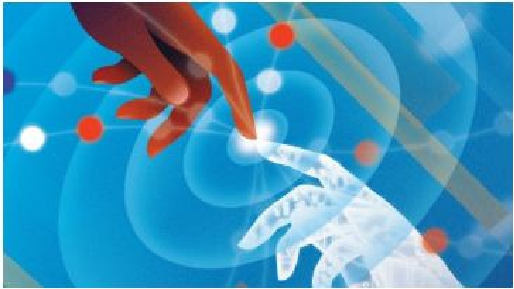

<details>
<summary>natural_image</summary>

Abstract digital illustration of two hands interacting with glowing spheres and lines, symbolizing technology or data interaction (no text or symbols)
</details>

## Features and comment:

Nature Index

18 Sep 2024

Nature

## Rise of ChatGPT and other tools raises major questions for research

Al is changing the way researchers work forever, but human expertise must continue to hold sway.

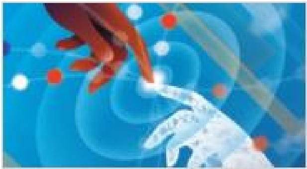

<details>
<summary>natural_image</summary>

Abstract digital illustration of two hands interacting with a glowing object, set against a blue background with circular patterns (no text or symbols)
</details>

Simon Baker

Explore content

About the journal

Publish with us

Subscribe

Sign up for alerts


RSS feed

nature > nature index

Nature Index 18 September 2024

## Artificial intelligence

The rapid adoption of chatbots such as Ch intelligence (Al) front and centre of the pu

Consequently, these tools and other developing Ar tecnnorogres are raising important questions for the future of research itself. This supplement takes a look at these issues and the latest Nature Index data on the field.

## For Authors

For Referees

Language editing services

)pen access funding

Submit manuscript ve placed artificial st two years.

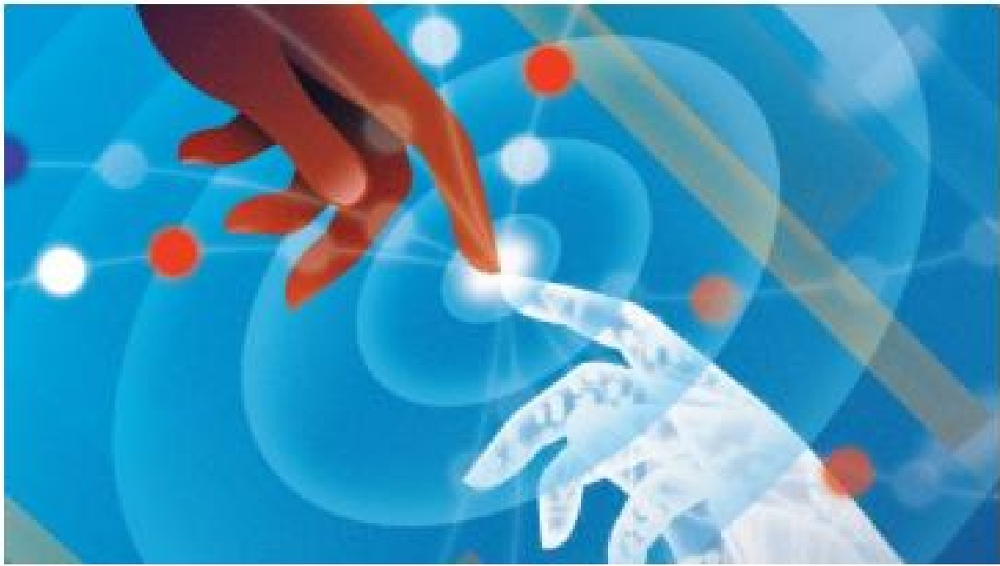

<details>
<summary>natural_image</summary>

Abstract digital illustration of two hands interacting with a glowing central node, set against a blue abstract background (no text or symbols)
</details>

## Features and comment:

Nature Index

18 Sep 2024

Nature

## Rise of ChatGPT and other tools raises major questions for research

Al is changing the way researchers work forever, but human expertise must continue to hold sway.

Simon Baker

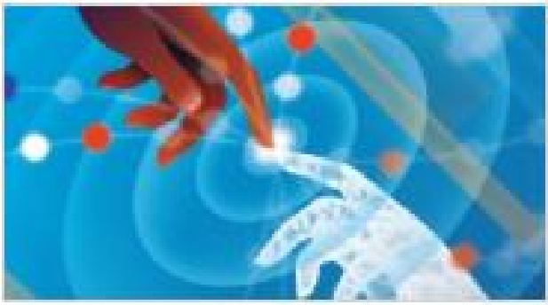

<details>
<summary>natural_image</summary>

Abstract digital illustration of two hands reaching toward a glowing object, with abstract circular patterns and no visible text or symbols.
</details>

nature > for authors > initial submission

## For Authors

Editorial criteria and processes

Formatting\_guide

Presubmission enquiries

Initial submission

Final submission

Supplementary information

Forms and declarations

Matters Arising

Other types of submissions

Publishing\_options

Registered Reports

## Initial submission

Submissions for Articles, Reviews and Perspectives, and Matters Arising must be submitted via our online submission system. Please follow these guidelines to ensure that your submission proceeds smoothly

If your manuscript and figures are ready to submit according to the manuscript formatting guidelines and requirements below, please proceed directly to the online submission system.

## Brief guide for submission to Nature

This guide outlines key points for preparing primary research manuscripts for submission to Nature.

The corresponding author should be familiar with the Nature journals' editorial policies and is solely responsible for communicating with the journal and managing communication between coauthors. Before submission, the corresponding author ensures that all authors are included in the author list and agree with its order, and that they are aware the manuscript is to be submitted. For more information on editorial and authorship policies, please review our Guide to Authors.

## Main manuscript

The Nature journals are flexible with regard to the format of initial submissions. Within reason, style and length will not influence consideration of a manuscript. If revisions are requested, the editor will provide detailed formatting instructions at that time.

To facilitate the review process however, we strongly encourage you to incorporate the manuscript text and figures into a single PDF or Microsoft Word file. Suitably high resolution figures may be inserted within the text at appropriate positions or grouped at the end. Each figure legend should be presented on the same page as its figure. The reference list should include article titles. If providing a PDF, please number all lines. The submission system will number all lines in a Word document for you. We accept LaTeX files at the acceptance stage, but before that time please supply PDFs.

Title.Titles must fit on two lines in print (75 characters including spaces) and should avoid technical terms, abbreviations and active verbs.

Authors. Corresponding author(s) should be identified with an asterisk. Large Language Models (LLMs), such as ChatGPT, do not currently satisfy our authorship criteria. Notably an attribution of authorship carries with it accountability for the work, which cannot be effectively applied to LLMs. Use of an LLM should be properly documented in the Methods section (and if a Methods section is not available, in a suitable alternative part) of the manuscript.

## Журнал

Подготовка в гугл доках или ms office
Учет необходимых заголовков журнала
Сабмит в формате .docx, .doc
Картинки и доп информация отдельными файлами

Abstract. Provide a general introduction to the topic and a brief non-technical summary of your main results and their implication.

Text length and formatting. Attention to the following details can help expedite publication if we invite a revision after external review.

A fully referenced \~200 word summary paragraph; main text of 2,500 words and 4 modest display items (figures, tables) for a typical 6 page article and 4300 words and 5-6 modest display items for a typical 8 page article; as a guideline up to 50 references if needed and within the allocated page budget. Sections can be separated with subheadings to aid navigation.

Please consult Nature's content types for final length and formatting requirements of other article types.

Methods. The Methods section appears in most online original research articles and should contain all elements necessary for interpretation and replication of the results. Methods should be written as concisely as possible and typically do not exceed 3,000 words but may be longer if necessary. Methods-only references do not count against your reference limit. We encourage you to deposit any step-by-step protocols used in your study in the open resource protocols.io. Protocols that are deposited should be mentioned in the Methods section and added to the reference list.

References. These may only contain citations and should list only one publication with each number. Include the title of the cited article or dataset.

Acknowledgements (optional). Keep acknowledgements brief and do not include thanks to anonymous referees or editors, or effusive comments. Grant or contribution numbers may be acknowledged.

Author contributions. You must include a statement that specifies the individual contributions of each co-author. For example: "A.P.M. 'contributed' Y and Z; B.T.R. 'contributed' Y," etc. See our authorship policies for more details.

## ICLR 2026

Rio de Janeiro, Brazil

## Registration

Register starting Dec 20 03 PM PST

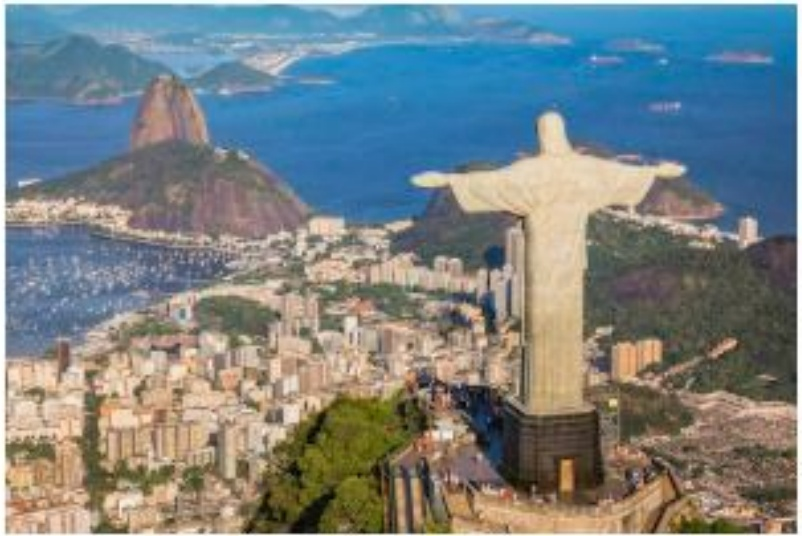

<details>
<summary>natural_image</summary>

Aerial view of the Christ the Redeemer in Rio de Janeiro, featuring its iconic red star and surrounding urban landscape with islands (no visible text or symbols)
</details>

## Announcements

ICLR 2026

April 23-27, 2026

Rio de Janeiro, Brazil

We need qualified reviewers! Please fill up this reviewer volunteer form if interested!
• LLM Usage Policies at ICLR 2026

| Reviewer Guide |
| --- |
| Author Guide |
| Area Chair Guide |
| Senior Area Chair Guide |

## Author Guide

ir ICLR 2026 we are asking authors to submit paper abstracts by the earlier abstract submission deadline of September 19 2025, anywhere on earth (AoE). The full paper ember 24, 2025 A0E. Abstracts and papers must be submitted using the conference submission system at: https://openreview.net/group?id=ICLR.cc/2026/Conference. Please keep re final and we cannot make any accommodations for missing the abstract deadline or paper deadline. It is key that authors submit genuine and informative abstracts that reflect ission, as abstracts will be used in reviewer bidding before the final paper submission deadline. Placeholder or duplicate abstracts will be removed. However, titles and abstracts

may de eaiteo derore tne submission deadline. Author order may be edited after the abstract deadline, but new authors cannot be added.

No changes to authors are permitted after the submission deadline.

No changes to title are permitted after the submission deadline until the end of the discussion period.

## Submission instructions

## Deadlines

Authors must submit paper abstracts by the abstract submission deadline of Sept 19, 2025 A0E. Please note that no authors can be added after the abstract submission deadline (author order can be changed after the abstract submission deadline up to the full paper deadline). Also, please make sure that all authors have an OpenReview profile with the latest information. Abstracts submitted by the abstract submission deadline must be genuine: placeholder or duplicate abstracts will be removed.

The full paper submission deadline is Sept 24, 2025 11:59pm A0E. Abstracts and papers must be submitted using the conference submission system at: https://openreview.net/group?id=ICLR.cc/2026/Conference. The submission site will be open on September 13. 2025. Supplementary material is due at the same time as the main paper.

## Double-blind submission and Anonymity

ICLR 2026 is double blind, which means that all submitted papers should be anonymous. Any paper where author identity is revealed in either the main text or the supplementary material will be desk rejected. Note that related arxiv papers by the same authors do not break anonymity: if cited, these should be cited in third person.

## Paper length

At the time of submission, the main text should be 9 pages or fewer. During the discussion/rebuttal phase and for the camera ready, the page limit will be increased to 10 pages to allow for new results/discussions. This limit will be strictly enforced. Papers with main text beyond the page limit will be desk-rejected.

The list of references does not count towards the page limit, and unlimited additional pages are allowed for the bibliography/references.

Authors may use as many pages of appendices (after the bibliography) as they wish, but reviewers are not required to read the appendix.

Style files and Templates : To prepare your submission to ICLR 2026, please use the LaTeX style files provided at:

## Supplementary Materials

Supplementary (text) submission: We encourage authors to submit a single file (paper + supplementary text). Supplementary text should appear after the references. Please mark the supplementary material clearly (e.g. as an appendix).

Supplementary code and other supplementary materials: Source code associated with a paper can be uploaded as part of the supplementary material. Code submission gives more information to reviewers, especially for replicability of the paper. We encourage all authors to submit code as part of their submission. Note that reviewers are encouraged, but not required to review supplementary material during the review process.

## Under review as a conference paper at ICLR 2026

# FORMATTING INSTRUCTIONS FOR ICLR 2026 CONFERENCE SUBMISSIONS

## Anonymous authors

Paper under double-blind review

## ABSTRACT

The abstract paragraph should be indented 1/2 inch (3 picas) on both left and righthand margins. Use 10 point type, with a vertical spacing of 11 points. The word ABSTRACT must be centered, in small caps, and in point size 12. Two line spaces precede the abstract.The abstract must be limited toone paragraph.

## 1 SUBMISSION OF CONFERENCE PAPERS TO ICLR2026

ICLR requires electronic submissions, processed by https : //openreview . net/See ICLR's website for more instructions.

If your paper is ultimately accepted, the statement \iclrfinalcopy should be inserted to adjust the format to the camera ready requirements.

The format for the submissions is a variant of the NeurIPS format. Please read carefully the instructions below, and follow them faithfully.

## 1.1 STYLE

Papers to be submitted to ICLR 2026 must be prepared according to the instructions presented here.

Authors are required to use the ICLR LTEX style files obtainable at the ICLR website. Please make sure you use the current files and not previous versions. Tweaking the style files may be grounds for rejection.

## Конференция

Подготовка в LaTeX формате, который у каждой конференции свой
Нормативы по объему
Подача в виде PDF из LaTeX файла
Обычно доп информация в апендиксе в основном файле

## The home of scientific and technical writing

Create complex, beautifully formatted documents with ease.

Collaborate with anyone, work from anywhere.


## Get started fast

No downloads, no setup, and no need to know LaTeX before you start.

Visual Editor and Code Editor
Thousands of free templates
Detailed guidance and LaTeX learning
Stellar support from real-life TeXperts

Explore features→


## Proposed Methodology: Dynamic Learning Rates

Our proposed methodology introduces a complex adaptive learning rate mechanism, as detailed by the following equation:

```latex
\begin{equation}
    \eta_t = \frac{\eta_}(1 |
\end{equation}
```

where n, represents the learning rate at iteration t, q is the initial learning rate, C is a decay parameter, and t is the iteration index.

## Experimental Setup and Dataset Selection

To rigorously evaluate the effectiveness of our proposed adaptive learning rate mechanism, we conducted experiments using three benchmark datasets: MNIST, CIFAR-10, and ImageNet. The chosen datasets repeesent diverse challenges and application scenarios, providing a comprehensive assessment of our methodology

## Results and Analysis

The experimental results. presented in  uaboesperimrntal\_resuits, highlight the superior convergence speed and improved accuracy achieved by our adaptive learning rate mechanism

Experimental Results

| Dataset | Convergence Time (epochs) | Accuracy (%) |
| --- | --- | --- |
| MNIST | 150 | 98.5 |
| CITAR-10 | 200 | 91.2 |
| ImageNet | 50 | 76.8 |

## Significance of Dynamic Learning Rates

The dynamic learning rate mechanism proposed in this paper significantly enhances

## Overleaf

+ Не требует установки
+ Коллаборация в реальном времени
+ Шаблоны для журналов
+ BibTeX/CSL интеграция

- Ограниченный бесплатный
тариф
- Зависимость от интернета

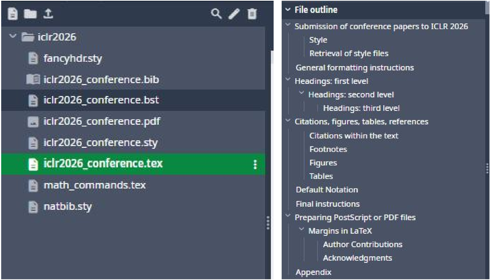

## LaTeX and Markdown online

Collaborative, free and reliable.

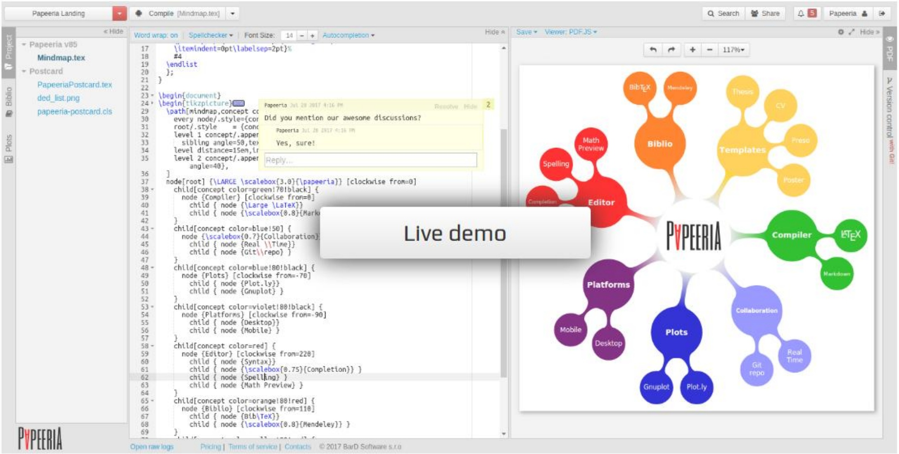

<details>
<summary>flowchart</summary>

```mermaid
graph TD
  subgraph Module
    PYPEERIA["PVPEERIA"]
    COMPILER["Compiler"]
    LATEX["LATEX"]
    Markdown["Markdown"]
    RealTime["Real Time"]
    GitRepo["Git repo"]
    Plot.ly["Plot.ly"]
    Gruplot["Gruplot"]
    Desktop["Desktop"]
    Mobile["Mobile"]
  end

  subgraph Editor
    Editor["Editor"]
    Spelling["Spelling"]
    MathPreview["Math Preview"]
  end

  subgraph Platforms
    Platforms["Platforms"]
    Mobile["Mobile"]
    Desktop["Desktop"]
  end

  subgraph Templates
    Templates["Templates"]
    BVIBIO["Biblio"]
    BBTX["BibtX"]
    Mendaley["Mendaley"]
    Thesis["Thesis"]
    CV["CV"]
    Preso["Preso"]
    Poster["Poster"]
  end

  subgraph Live demo
  PYPEERIA --> COMPILER
  COMPILER --> LATEX
  COMPILER --> Markdown
  COMPILER --> RealTime
  COMPILER --> GitRepo
  COMPILER --> PlotLy["Plot.ly"]
  COMPILER --> Gruplot
  COMPILER --> Desktop
  COMPILER --> Mobile
  end

  subgraph Code
    PYPEERIA["PVPEERIA"]
    COMPILER -.-> BVIBIO
    COMPILER -.-> Mendaley
    COMPILER -.-> Thesis
    COMPILER -.-> CV
    COMPILER -.-> Preso
    COMPILER -.-> Poster
    COMPILER -.-> Spelling
    COMPILER -.-> MathPreview
    COMPILER -.-> Editor
  end

  subgraph Code
    PYPEERIA["PVPEERIA"]
    COMPILER -.-> BVIBIO
    COMPILER -.-> Mendaley
    COMPILER -.-> Thesis
    COMPILER -.-> CV
    COMPILER -.-> Preso
    COMPILER -.-> Poster
    COMPILER -.-> Spelling
    COMPILER -.-> MathPreview
    COMPILER -.-> Editor
  end

  subgraph Code
    PYPEERIA["PVPEERIA"]
    COMPILER -.-> BVIBIO
    COMPILER -.-> Mendaley
    COMPILER -.-> Thesis
    COMPILER -.-> CV
    COMPILER -.-> Preso
    COMPILER -.-> Poster
    COMPILER -.-> Spelling
    COMPILER -.-> MathPreview
    COMPILER -.-> Editor
  end

  subgraph Code
    PYPEERIA["PVPEERIA"]
    COMPILER -.-> BVIBIO
    COMPILER -.-> Mendaley
    COMPILER -.-> Thesis
    COMPILER -.-> CV
    COMPILER -.-> Preso
    COMPILER -.-> Poster
    COMPILER -.-> Spelling
    COMPILER -.-> MathPreview
    COMPILER -.-> Editor
  end

  subgraph Code
    PYPEERIA["PVPEERIA"]
    COMPILER -.-> BVIBIO
    COMPILER -.-> Mendaley
    COMPILER -.-> Thesis
    COMPILER -.-> CV
    COMPILER -.-> Preso
    COMPILER -.-> Poster
    COMPILER -.-> Spelling
    COMPILER -.-> MathPreview
    COMPILER -.-> Editor
  end

  subgraph Code
    PYPEERIA["PVPEERIA"]
    COMPILER -.-> BVIBIO
    COMPILER -.-> Mendaley
    COMPILER -.-> Thesis
    COMPILER -.-> CV
    COMPILER -.-> Preso
    COMPILER -.-> Poster
    COMPILER -.-> Spelling
    COMPILER -.-> MathPreview
    COMPILER -.-> Editor
  end

  subgraph Code
    PYPEERIA["PVPEERIA"]
    COMPILER -.-> BVIBIO
    COMPILER -.-> Mendaley
    COMPILER -.-> Thesis
    COMPILER -.-> CV
    COMPILER -.-> Preso
    COMPILER -.-> Poster
    COMPILER -.-> Spelling
    COMPILER -.-> MathPreview
    COMPILER -.-> Editor
  end
```
</details>

Jake Kirilenko

Saint-Petersburg State University, Russia


This great application made lots of thesis and term work papers of our school significantly nicer...99

More user reviews...

## First time here?

## Sign Up now!

## Already registered?

## Sign In

## Follow Papeeria:


You're using Papeeria Desktop Switch to Mobile

## PVPEERIA

+ Простота,
+ Совместная работа

-Ограниченные шаблоны
-Меньше инструментов
-Медленная компиляция

## Authorea похожий инструмент

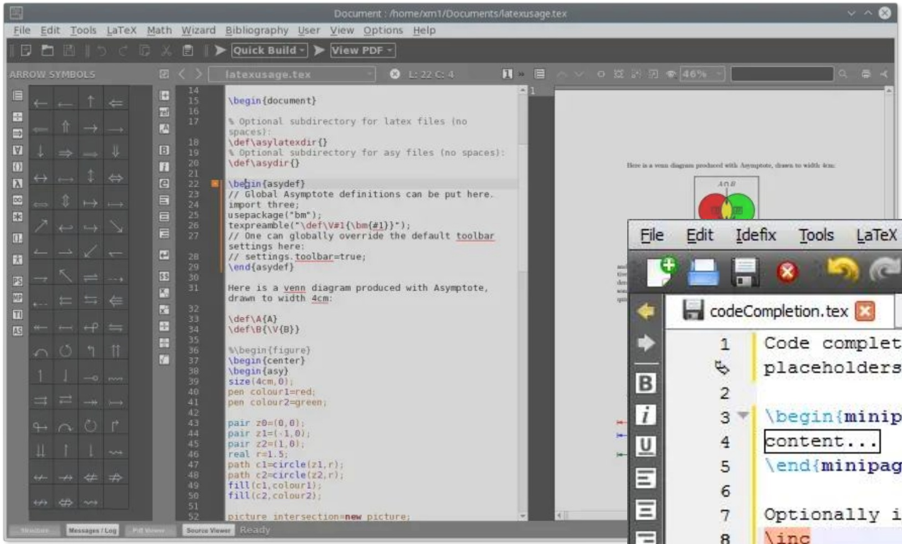

<details>
<summary>text_image</summary>

\begin{document}
% Optional subdirectory for latex files (no spaces):
\def\asylatexdir{}
% Optional subdirectory for asy files (no spaces):
\def\asydir{}
\begin{asydef}
// Global Asymptote definitions can be put here.
import three;
usepackage("bm");
texpreamble("\def\V#1{\bm{#1}}");
// One can globally override the default toolbar
settings here;
// settings.toolbar=true;
\end{asydef}
Here is a venn diagram produced with Asymptote,
drawn to width 4cm:
\def\A{A}
\def\B{\V{B}}
%\begin{figure}
\begin{center}
\begin{asy}
size(4cm,0);
pen colour1=red;
pen colour2=green;
pair z0=(0,0);
pair z1=(-1,0);
pair z2=(1,0);
real r=1.5;
path c1=circle(z1,r);
path c2=circle(z2,r);
fill(c1,colour1);
fill(c2,colour2);
picture intersection=new picture;
</details>

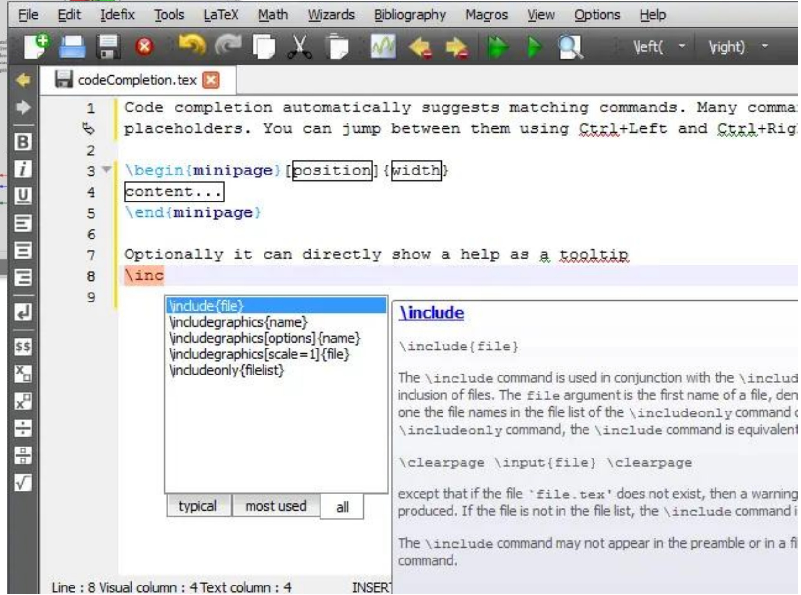

<details>
<summary>text_image</summary>

codeCompletion.tex
1 Code completion automatically suggests matching commands. Many comma
2 placeholders. You can jump between them using Ctrl+Left and Ctrl+Right
3 \begin{minipage}[position]{width}
4 content...
5 \end{minipage}
6
7 Optionally it can directly show a help as a tooltip
8 \inc
9
#include{file}
\includegraphics{name}
\includegraphics[options]{name}
\includegraphics[scale=1]{file}
\includeonly{filelist}
typical most used all
\include
\include{file}
The \include command is used in conjunction with the \include
inclusion of files. The file argument is the first name of a file, den
one the file names in the file list of the \includeonly command c
\includeonly command, the \include command is equivalent
\clearpage \input{file} \clearpage
except that if the file `file.tex' does not exist, then a warning
produced. If the file is not in the file list, the \include command i
The \include command may not appear in the preamble or in a fi
command.
Line : 8 Visual column : 4 Text column : 4 INSERT
</details>

## TeXstudio / TeXmaker / TeXworks

• Полный контроль над сборкой
• Подсветка синтаксиса, автодополнение
• Встроенный PDF-viewer
• Не требуют интернета

• Нужно установить TeX Live / MiKTeX
• Нет онлайн-совместной работы
• Интерфейс консервативный

## Менеджмент научной литературы

## Менеджмент литературы — ключевой навык

Оформление библиографии — обязательный критерий при приёме статьи.
У 60 % статей в первые рецензии замечания касаются именно ссылок.
Менеджеры литературы — “система координат” научного текста.
Хорошее цитирование = доверие редакции и читателей.

| × | Cite |
| --- | --- |
| MLA | Yao, Yifan, et al. "A survey on large language model (llm) security and privacy: The good, the bad, and the ugly." High-Confidence Computing 4.2 (2024): 100211. |
| APA | Yao, Y., Duan, J., Xu, K., Cai, Y., Sun, Z., &amp; Zhang, Y. (2024). A survey on large language model (llm) security and privacy: The good, the bad, and the ugly. High-Confidence Computing, 4(2), 100211. |
| Chicago | Yao, Yifan, Jinhao Duan, Kaidi Xu, Yuanfang Cai, Zhibo Sun, and Yue Zhang. "A survey on large language model (llm) security and privacy: The good, the bad, and the ugly." High-Confidence Computing 4, no. 2 (2024): 100211. |
| Harvard | Yao, Y., Duan, J., Xu, K., Cai, Y., Sun, Z. and Zhang, Y., 2024. A survey on large language model (llm) security and privacy: The good, the bad, and the ugly. High-Confidence Computing, 4(2), p.100211. |
| Vancouver | Yao Y, Duan J, Xu K, Cai Y, Sun Z, Zhang Y. A survey on large language model (llm) security and privacy: The good, the bad, and the ugly. High-Confidence Computing. 2024 Jun 1;4(2):100211. |
|  | BibTeX EndNote RefMan RefWorks |

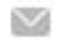

## Какой стиль копировать?

MLA Yao, Yifan, et al. "A survey on large language model (llm) security and privacy: The good, the bad, and the ugly." High-Confidence Computing 4.2 (2024): 100211.

APA Yao, Y., Duan, J., Xu, K., Cai, Y., Sun, Z., & Zhang, Y. (2024). A survey on large language model (llm) security and privacy: The good, the bad, and the ugly. High-Confidence Computing. 4(2), 100211.

Yao, Yifan, Jinhao Duan, Kaidi Xu, Yuanfang Cai, Zhibo Sun, and Yue Zhang. "A survey on large language model (llm) security and privacy: The good, the bad, and the ugly." High-Confidence Computing 4, no. 2 (2024): 100211.

Harvard Yao, Y., Duan, J., Xu, K., Cai, Y., Sun, Z. and Zhang, Y., 2024. A survey on large language model (llm) security and privacy: The good, the bad, and the ugly. High-Confidence Computing. 4(2), p.100211.

Yao Y, Duan J, Xu K, Cai Y, Sun Z, Zhang Y. A survey on large language model (llm) security and privacy: The good, the bad, and the ugly. High-Confidence Computing. 2024 Jun 1;4(2):100211.

BibTeX

EndNote

RefMan

RefWorks

## Стили цитирования из Google Scholar

| Стиль | Особенности | Где применяется |
| --- | --- | --- |
| MLA(Modern Language Association)9th edition | "et al." после первого автораНазвание в кавычкахФормат: (Автор Страница)Том.Номер (Год): страницы | Гуманитарные наукиЛитератураЙскусство |
| APA(American Psychological Association)7th edition | Амперсанд (&amp;) перед последним авторомГод в скобках после авторовФормат: (Автор, Год)Название без кавычек, курсив журнала | ПсихологияСоциальные наукиОбразование |
| Chicago(Chicago Manual of Style)17th edition | Все авторы полностью"and" перед последним автором"по." для номера выпускаДва варианта: сноски или автор-дата | ИсторияИскусствоГуманитарные науки |
| Harvard(Harvard Referencing Style) | Строчное "and" между авторамиГод после авторов через запятуюФормат: (Автор Год: Страница)"р." перед номером страницы | Естественные наукиСоциальные наукиБизнес |
| Vancouver(Vancouver Referencing Style) | Только инициалы без точекНет запятых между авторамиПолная дата публикацииНумерация в тексте [1], [2], [3]... | МедицинаБиологияЗдравоохранение |

## Ручное форматирование

Трудно исправлять и обновлять.
Ошибки в фамилиях, журналах, DOI.
Несогласованность с цитатами в тексте.
Проблемы при импорте в издательские системы (Editorial Manager, ScholarOne).

## Путь ссылки

От находки до списка литературы


## Нашли

Google Scholar, OpenAlex, Semantic Scholar, база вуза

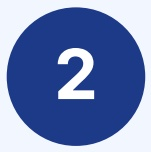

## Сохранили

Одной кнопкой в Zotero; проверили автора, название, DOI


## Процитировали

Ссылку вставил плагин в Word или Google Docs, либо \cite в LaTeX


## Выбрали стиль

Nature, IEEE или ГОСТ: по требованию журнала


## Получили список

Список литературы собрался автоматически и обновляется сам

Если шаг делать руками, появляются ошибки

Задача менеджера литературы: чтобы руками вы не делали ничего

## Файл .bib

```bib
@article{ivanov2024review,
author = {Ivanov, Ivan and Smith, Anna},
title = {Title of the article},
journal = {Journal Name},
year = {2024},
doi = {10.xxxx/xxxxx}
}
```

## Что это

Текстовый файл со списком источников в формате BibTeX. Одна запись — один источник

## Ключ записи

По нему цитируем в тексте: \cite{ivanov2024review}. Поля записи: автор, название, журнал, год, DOI

## Как связан с менеджером литературы

## Zotero

библиотека источников

## Экспорт

в файл library.bib

## Overleaf

\cite{ключ} в тексте

## PDF

список литературы

Meet your smartest sidekick yet: EndNote Research Assistant - 15% off until 10/17. Don't miss out!

## Building ideas, one citation at a time

A smarter reference manager — EndNote will help you summarize, translate, organize and cite with ease.

Buy EndNote


Try EndNote for free


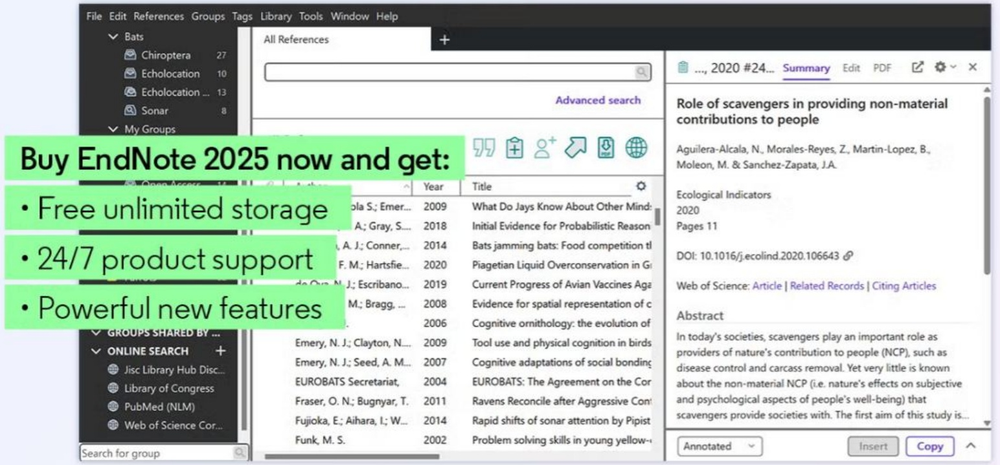

<details>
<summary>text_image</summary>

File Edit References Groups Tags Library Tools Window Help
Bats
Chiroptera 27
Echolocation 10
Echolocation ... 13
Sonar 8
My Groups
All References
+
Advanced search
... , 2020 #24... Summary Edit PDF
Role of scavengers in providing non-material contributions to people
Aguilera-Alcala, N., Morales-Reyes, Z., Martin-Lopez, B.,
Moleon, M. & Sanchez-Zapata, J.A.
Ecological Indicators
2020
Pages 11
DOI: 10.1016/j.ecolind.2020.106643
Web of Science: Article | Related Records | Citing Articles
Abstract
In today's societies, scavengers play an important role as providers of nature's contribution to people (NCP), such as disease control and carcass removal. Yet very little is known about the non-material NCP (i.e. nature's effects on subjective and psychological aspects of people's well-being) that scavengers provide societies with. The first aim of this study is...
Annotated Insert Copy
Buy EndNote 2025 now and get:
• Free unlimited storage
• 24/7 product support
• Powerful new features
Search for group
GROUPS SHARED BY ...
ONLINE SEARCH +
Jisc Library Hub Disc...
Library of Congress
PubMed (NLM)
Web of Science Cor...
Year Title
Eola S.; Emer... 2009 What Do Jays Know About Other Mind:
A.; Gray, S.... 2018 Initial Evidence for Probabilistic Reason
A. J.; Conner,... 2014 Bats jamming bats: Food competition tl
F. M.; Hartsfie... 2020 Piagetian Liquid Overconservation in G
J.; Escribano... 2019 Current Progress of Avian Vaccines Aga
M.; Bragg, ... 2008 Evidence for spatial representation of c
. 2006 Cognitive ornithology: the evolution of
Emery, N. J.; Clayton, N.... 2009 Tool use and physical cognition in birds
Emery, N. J.; Seed, A. M... 2007 Cognitive adaptations of social bonding
EUROBATS Secretariat, 2004 EUROBATS: The Agreement on the Cor
Fraser, O. N.; Bugnyar, T. 2011 Ravens Reconcile after Aggressive Con
Fujioka, E.; Aihara, I.; W... 2014 Rapid shifts of sonar attention by Pipist
Funk, M. S. 2002 Problem solving skills in young yellow-
</details>


Millions of researchers at the world's top universities and organisations trust their work to EndNote

## EndNote


нтеграция с Microsoft Word

Поддержка более 7000 стилей цитирования
Расширенные возможности поиска и организации
Прямой поиск в онлайн-базах данных из программы
Неограниченное хранилище в облачной версии
Синхронизация EndNote Desktop и EndNote Online
Групповая работа над проектами


орого (от \$250 за лицензию или \$100/год подписка)

Сложный интерфейс для новичков
Требует времени на изучение
Только Windows и Mac (нет Linux)
Избыточен для простых задач
Бесплатная базовая версия (EndNote Basic) сильно урезана

## Mendeley Reference Manager for Desktop

Download now for Windows

Windows 10 and above See release notes

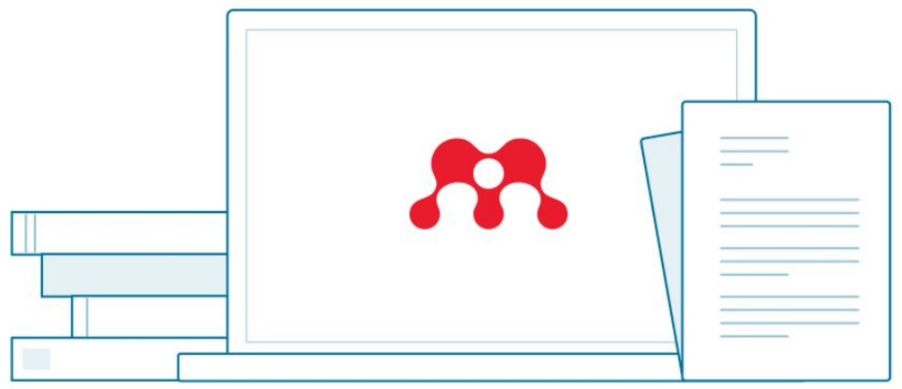

<details>
<summary>natural_image</summary>

Illustration of a laptop with abstract red molecular icon on screen, surrounded by document sheets (no text or symbols)
</details>

Other Systems:


Mendeley Reference Manager for MacOS


Mendeley Reference Manager for Linux


<details>
<summary>natural_image</summary>

Illustration of a man standing under a leafy tree labeled 'NON SOLUS' with grapevines, no text or symbols present.
</details>

ELSEVIER

Your new Mendeley Reference Manager

## Mendeley


## есплатный базовый план (2 ГБ)

Встроенный PDF-ридер с аннотациями и заметками
Рекомендации статей на основе вашей библиотеки
Интеграция с Word и LibreOffice
Автоматическое извлечение метаданных из PDF
Мобильные приложения для iOS и Android
Интеграция с Elsevier и ScienceDirect
Статистика чтения
Работает на Windows, Mac, Linux


Принадлежит издательству Elsevier
Ограничения в бесплатной версии
Медленная синхронизация больших библиотек
Менее гибкая настройка стилей цитирования
Проблемы с поддержкой кириллицы в некоторых случаях
Закрытый исходный код

## Your personal research assistant

Zotero is a free, easy-to-use tool to help you collect, organize, annotate, cite, and share research.


## Download

Available for Mac, Windows, Linux, iOS, and Android

Just need to create a quick bibliography? Try ZoteroBib.


## Zotero


олностью бесплатный и open-source

Браузерное расширение для быстрого сохранения источников
Автоматическое извлечение метаданных из веб- страниц, PDF
Интеграция с Word, LibreOffice, Google Docs
Синхронизация между устройствами (300 МБ)
Групповые библиотеки для совместной работы
Поддержка всех основных стилей цитирования
Работает на Windows, Mac, Linux
Возможность добавлять заметки и теги


граниченное бесплатное облачное хранилище (300 МБ)

Нет встроенного PDF-ридера с продвинутыми функциями аннотирования

## Демонстрация работы Zotero