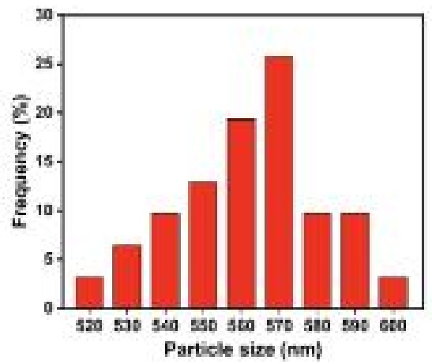
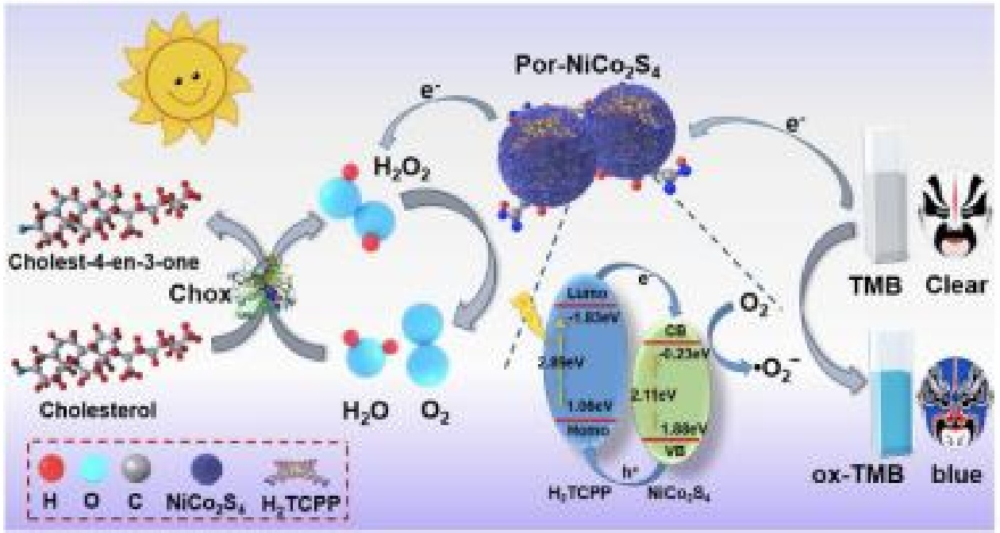
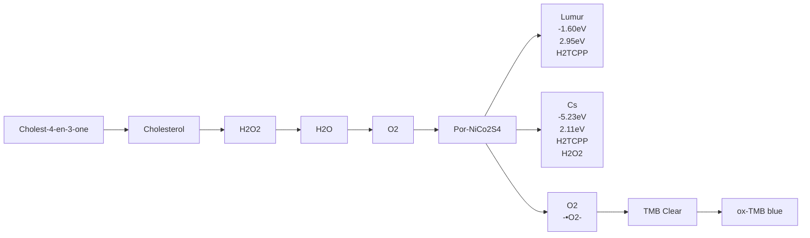
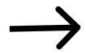

## Управление научными исследованиями

Занятие 5

Юлия Разливина

м.н.с. ПИШ ИТМО

Центр ИИ в Химии ПИШ ИТМО

## Этика научных публикаций

## Почему этика публикаций это важно?

60% РЕТРАКЦИЙ

(отзывов статей) связаны с прямым нарушением публикационной этики (плагиат, фальсификация, фабрикация данных)

\$1,5 МЛН. Примерная стоимость научного гранта, ДОЛЛАРОВпотерянного из-за фальсификации данных

## Последствия нарушения этики

Подрыв доверия общественности, государства и коллег ко всей научной сфере.
Отзыв грантов, прекращение финансирования исследований, потеря инвестиций.
Уничтожение личной репутации автора, репутации университета, запрет на публикации.

## Основные принципы этики публикаций

Честность (Honesty)
Прозрачность (Transparency)
Ответственность (Responsibility)
Уважение авторства (Respect for authorship & contributorship)
Объективность (Objectivity )

Эти принципы — ориентир для авторов, рецензентов и редакторов: они помогают сохранять доверие к науке и минимизировать риск злоупотреблений ( COPE, ICMJE).

## Честность (Honesty)

Не подделывать данные, не «подгонять» результаты под гипотезу, не удалять неудобные наблюдения без документированного обоснования.
Честность применима ко всем этапам: дизайн, сбор данных, анализ, интерпретация, отчётность.
Если обнаружены ошибки после публикации — честный путь = уведомить редакцию и при необходимости опубликовать исправление или ретракцию.

## Прозрачность (Transparency)

Описывать методику достаточно подробно, чтобы другие могли воспроизвести работу; публиковать по возможности сырые данные и код (или указывать, где они доступны).
Прозрачность включает полное раскрытие источников финансирования, договорённостей с промышленными партнёрами и использование предварительных версий (preprints).
Журналы и издательства ожидают, что авторы заполняют декларации о финансировании/конфликтах (ICMJE disclosure form и аналогичные).

## Ответственность (Responsibility)

Авторы обязаны гарантировать, что вклад каждого автора достоверно отражён (см. критерии ICMJE). Ответственность — не только право на авторство, но и обязательство отвечать за части работы.
Редакторы и рецензенты также несут ответственность: обеспечивать честный и конфиденциальный рецензентский процесс, не использовать приватную информацию в личных целях. COPE рекомендует ясные процессы рассмотрения жалоб и прозрачное документирование решений.

## Уважение авторства (Respect for authorship & contributorship)

Автором считается тот, кто одновременно
(1) внёс существенный вклад в концепцию/дизайн/анализ,
(2) участвует в написании/критической доработке,
(3) одобряет финальную версию,
(4) принимает ответственность за работу.
Тех, кто не выполняет эти критерии, следует благодарить в примечании.

## Объективность (Objectivity)

Рецензенты и редакторы должны давать аргументированную критику и избегать предвзятости; результаты должны интерпретироваться с учётом ограничений и возможных альтернативных объяснений.
Важная часть объективности — декларирование всех потенциальных конфликтов интересов, чтобы читатель мог оценить возможную смещение (bias). ICMJE даёт форму и рекомендации по раскрытию финансовых и нефинансовых отношений.

## Плагиат

## Плагиат

Присвоение чужих идей, данных или текста без указания источника.

| Тип | Пример |
| --- | --- |
| Текstuальный | Копирование без кавычек |
| Мозаичный | Вставка фраз из разных источников |
| Идейный | Использование концепции без ссылки |
| Переводной | Перевод чужой статьи как своей |
| Автоплагиат | Повтор публикации тех же данных, текста или рисунков под видом новой работы. |

Оригинальный текст из статьи:

Источник: Johnson, M. (2023). The impact of social media on adolescent mental health. Journal of Youth Studies, 26(4), 456-472.

Оригинальный отрывок:

"Recent studies have demonstrated that excessive social media use among teenagers is strongly correlated with increased rates of anxiety and depression. The constant comparison with peers and exposure to cyberbullying create a toxic environment that can significantly harm adolescent psychological wellbeing."

## Пример A:

Recent research has shown that too much social media use among teens is strongly connected with higher rates of anxiety and depression. The continuous comparison with peers and exposure to cyberbullying create a harmful environment that can seriously damage teenage psychological health.

## Пример B:

According to Johnson (2023), "excessive social media use among teenagers is strongly correlated with increased rates of anxiety and depression" (p. 458). This correlation is particularly concerning given the widespread adoption of social platforms among young people.

## Пример C:

Research indicates that excessive social media engagement can negatively impact adolescent mental health, with studies showing correlations between heavy platform use and elevated anxiety levels (Johnson, 2023).

## Последствия плагиата

Ретракция статьи
Потеря репутации
Возврат грантов

По инициативе Комиссии РАН по противодействию фальсификации научных исследований и «Диссернета» из российских журналов было отозвано более 2500 статей, содержащих плагиат и другие нарушения этики. Д-р Сонг был уличен в текстуальном плагиате, то есть в прямом копировании значительных фрагментов текста из ранее опубликованных чужих научных статей. В 2018 году четыре его статьи были отозваны из высокорейтинговых международных журналов, включая издание с высоким Импакт-фактором.

## Переиспользование материалов, изображений и публикаций

Использование частей собственных или чужих публикаций (текста, таблиц, графиков, фото, схем) в новой статье.

Может быть:

самоцитирование с переработкой ;
дословное копированиеДаже если вы автор исходной статьи, права часто принадлежат издателю, а не вам.

Нужно запрашивать разрешение на использование части статьи.

Требуется разрешение от правообладателя (автора или издателя).

Даже если изображение слегка изменено — это адаптация, а не новое произведение.

В подписях обязательно указывают:

“Reproduced from [Author et al., Journal, Year] with permission from [Publisher].”

или

“Adapted from ... under CC BY license.”

## Авторские права и лицензии

После публикации автор обычно подписывает Copyright Transfer Agreement (CTA).

Издатель становится правообладателем (Springer, Elsevier, Wiley и др.).

Любое повторное использование (в книге, другой статье, на сайте) требует:

разрешения издателя;
указания источника и лицензии.

Исключение — публикации под открытыми лицензиями (Open Access), особенно Creative Commons (CC BY и др.).

## Как запросить разрешение

Использовать системы разрешений, например:

Elsevier RightsLink (via Copyright Clearance Center)
Springer Nature Rights & Permissions
Wiley Author Services

## Указать:

какую фигуру / таблицу вы хотите использовать;
цель использования (новая публикация, презентация, диссертация);
будет ли коммерческое использование.

table 0.95

Table Si Tyss of buffer suluiurs wih üfferesi pll.

| pH | the buffer solution |
| --- | --- |
| 2.0—5.0 | acetate buffer solution |
| 6.0—8.0 | phosphate buffer solution |
| 9.0—10 | Tris-HCl buffer solution |

figure 0.95

histogram

| Particle size (nm) | Frequency (%) |
| --- | --- |
| 520~530 | ~3 |
| 530~540 | ~6.5 |
| 540~550 | ~9.5 |
| 550~560 | ~13 |
| 560~570 | ~19.5 |
| 570~580 | ~25.5 |
| 580~590 | ~9.5 |
| 590~600 | ~9.5 |
| 600~610 | ~3 |

Fear St-Thesgedrrbuien efiraecef the Por-NiCeS

proves that Por-NiCo2S4 can realize the electron transfer between H2O2

scheme 0.94cidase-like activity. Thus, the

$$
E _ {C J} = E _ {T B} - E _ {I}
$$

flowchart

Scheme 2. Schentatic illustration of Por-NiCo-S. as a peroxidase mimic for H₂O, and cholesterol detection

Figure S4. YOLOv8 model performance in classifying tables, figures, and schemes on the test set. Adapted with permission from He, Y. et al. 5,10,15,20-tetrakis (4-carboxylphenyl) porphyrin functionalized NiCo2S4 yolk-shell nanospheres: Excellent peroxidase-like activity, catalytic mechanism and fast cascade colorimetric biosensor for cholesterol. Sensors and Actuators B: Chemical 326, 128850 (2021).[1] Copyright 2021 Elsevier.

## MANAGE ACCOUNT

<table><tr><td>Order Date</td><td>Order Number</td><td>Order Total</td><td>Original Price</td><td>Order Status</td><td></td></tr><tr><td>25 Feb 2025</td><td>1581813</td><td>0.00 USD</td><td>0.00 USD</td><td>Closed - Zero</td><td>View details</td></tr><tr><td>25 Feb 2025</td><td>1581812</td><td>0.00 USD</td><td>0.00 USD</td><td>Closed - Zero</td><td>View details</td></tr><tr><td colspan="6">1 - 2 of 2 orders</td></tr></table>

## View & Search Orders

| Search: | Order Number | Search |
| --- | --- | --- |

| 1 - 2 of 2 orders | Orders placed in last year |
| --- | --- |

| Order Date | Order Number | Order Total | Original Price | Order Status |  |
| --- | --- | --- | --- | --- | --- |
| 25 Feb 2025 | 1581813 | 0.00 USD | 0.00 USD | Closed - Zero | View details |
| 25 Feb 2025 | 1581812 | 0.00 USD | 0.00 USD | Closed - Zero | View details |

| Publication Title | Nanoscale | Publication Type | e-Journal |
| --- | --- | --- | --- |
| Article Title | Insight into the mechanism ... | Start Page | 9062 |
| Author / Editor | Royal Society of Chemistry (... | End Page | 9074 |
| Date | 01/01/2009 | Issue | 19 |
| Language | English | Volume | 7 |
| Country | United Kingdom of Great Bri... | URL | http://www.rsc.org/Publishi... |
| Rightsholder | Royal Society of Chemistry |  |  |

<table><tr><td>Portion Type</td><td>Chart/graph/table/figure</td><td></td><td></td><td></td><td></td></tr><tr><td rowspan="2">Number of Charts / Graphs / Tables / Figures Requested</td><td rowspan="2">1</td><td>Title</td><td>Agent-based Multimodal Inf...</td><td>Expected Publication Date</td><td>2025-03-31</td></tr><tr><td>Author</td><td>Julia Razlivina</td><td rowspan="2">Available in the Following Markets</td><td>-</td></tr><tr><td>Format (select all that apply)</td><td>Electronic</td><td>Publisher</td><td>Springer Nature</td><td></td></tr><tr><td>Who Will Republish the Content?</td><td>Publisher, STM</td><td></td><td></td><td>Expected Size of the New Work (number of pages)</td><td>12</td></tr><tr><td>STM Signatories</td><td>Springer Nature</td><td colspan="4">ADDITIONAL DETAILS</td></tr><tr><td>Duration of Use</td><td>Life of current edition</td><td rowspan="2">The Requesting Person / Organization to Appear on the License</td><td rowspan="2">ITMO University</td><td></td><td></td></tr><tr><td>Lifetime Unit Quantity</td><td>Up to 499</td><td></td><td></td></tr></table>

<table><tr><td>Title, Description or Numeric Reference of the Portion(s)</td><td>Fig. 5</td><td>Title of the Article / Chapter the Portion Is From</td><td>Insight into the mechanism ...</td></tr><tr><td>Editor of Portion(s)</td><td>Dalui, Amit; Pradhan, Bapi; T...</td><td>Author of Portion(s)</td><td>Dalui, Amit; Pradhan, Bapi; T...</td></tr><tr><td>Volume / Edition</td><td>7</td><td rowspan="2">Issue, if Republishing an Article From a Serial</td><td rowspan="2">19</td></tr><tr><td rowspan="2">Page or Page Range of Portion</td><td rowspan="2">9062-9074</td></tr><tr><td>Publication Date of Portion</td><td>2015-05-21</td></tr></table>

Total Items: 1

Subtotal: 0.00 USD

Order Total: 0.00 USD

## Самоцитирование и дублирование

Самоцитирование — использование собственных публикаций как источников.
Норма → в разумных пределах.

! При подаче в формы раскрывать была ли часть работы где-то опубликована

## Оправдано

повторение метода, теоретической модели, предшествующих результатов

## Злоупотребление

- искусственное завышение цитируемости
- публикация «серии» почти идентичных статей

## Авторство

Кто считается автором

Вклад в идею, дизайн, сбор или анализ данных
Написание/редактирование текста
Утверждение финальной версии
Ответственность за целостность

Кто не является автором

Администратор проекта
Техник без аналитического вклада
Лаборант, если не участвовал в интерпретации данных

## Проблемы авторства

Gift authorship — включение «по должности», покупка авторства
Ghost authorship — вклад без указания, не указали автора
Order disputes — споры о порядке

## Как честно распределить авторство?

## Общие правила порядка авторов

Первый автор (First author)

Чаще всего — основной исполнитель: тот, кто провёл большую часть экспериментов/анализа и написал черновик статьи.

Соавторы в середине списка

Располагаются по степени вклада: чем меньше вклад, тем ближе к концу списка.

Последний автор (Senior / Corresponding author)

Обычно — руководитель проекта, PI, научный консультант или руководитель лаборатории.

Отвечает за стратегию, концепцию, финансирование, надзор.

## CRediT taxonomy

Conceptualization (Формулирование идей, целей и задач исследования)
Data curation(Управление данными: сбор, организация, валидация)
Formal analysis (Применение статистических и аналитических методов)
Writing (Подготовка, написание и редактирование текста)
Supervision (Научное руководство и контроль проекта)
Funding acquisition (Получение финансирования для исследования)

## Как определить порядок на практике

Обсудить на старте проекта (или при начале написания статьи).
Документировать вклад.
Рассмотреть равенство вклада — можно отметить «These authors contributed equally».
Не включать формально: человек, не внёсший существенный интеллектуальный вклад, должен быть в разделе Acknowledgments, а не в списке авторов.
Избегать gift и ghost авторства — нарушение этики.

## Author information

These authors contributed equally: Yan C. Leyva, Marcelo D. T. Torres.

## Contributions

M.D.T.T., Y.C.L., C.A.B. and C.d.l.F.-N. conceptualized and designed the study. M.D.T.T. performed experiments and interpreted the data. Y.C.L., C.A.O. and C.A.B. performed the computational investigation and interpreted the data. All authors wrote and revised the manuscript.

## Конфликты интересов

## Конфликты интересов

Конфликт интересов возникает, когда личные, финансовые или профессиональные интересы автора, рецензента или редактора могут повлиять (или восприниматься как влияющие) на интерпретацию, анализ или представление результатов исследования.

## Конфликты интересов

Финансовый конфликт — зарплата, грант, акции, патенты, гонорары.
‍Личные отношения — родство, дружба, профессиональные связи.
Академический / карьерный интерес — конкуренция между группами, давление на публикацию ради отчётности.
Институциональный — участие в совете журнала, работа в спонсирующей организации.
Идеологический — убеждения или активизм, способные повлиять на интерпретацию данных.

## Как правильно декларировать конфликт интересов

Заполнить Conflict of Interest Disclosure Form (ICMJE или форма журнала) и поле Conflict of Interest/Competing interests .
Указать источники финансирования в Acknowledgments.
Отдельно отметить участие компаний или спонсоров.
При отсутствии конфликта — обязательно написать:

“The authors declare no conflicts of interest.”

или

“The authors declare no competing financial interests.”

## Как правильно декларировать конфликт интересов

## Acknowledgements

C.d.l.F.-N. holds a Presidential Professorship at the University of Pennsylvania. Research reported in this publication was supported by NIH R35GM138201 and DTRA HDTRA1-21-1-0014. We thank M. Goulian for donating the following strains: E. coli AIC221 (E. coli MG1655 phnE\_2::FRT (control strain for AIC222)) and E. coli AIC222 (E. coli MG1655 pmrA53 phnE\_2::FRT (polymyxin resistant)). We thank de la Fuente Lab members for insightful discussions. Molecules were rendered using the PyMOL Molecular Graphics System v.3.1.1, Schrödinger.

## Как правильно декларировать конфликт интересов

Competing interests

C.d.l.F.-N. is a co-founder of, and scientific advisor to, Peptaris, Inc., provides consulting services to Invaio Sciences, and is a member of the Scientific Advisory Boards of Nowture S.L., Peptidus, European Biotech Venture Builder, the Peptide Drug Hunting Consortium (PDHC), ePhective Therapeutics, Inc. and Phare Bio. M.D.T.T. is a co-founder and scientific advisor to Peptaris, Inc. All other authors declare no competing interests.

## Конфликты интересов у рецензентов и редакторов

ецензенты должны отказываться от оценки, если:

работают в той же группе или недавно сотрудничали;
имеют финансовые или личные отношения с авторами;
конкурируют в той же теме.

Редакторы обязаны перенаправлять рукописи другому редактору при потенциальном конфликте

## Как читать статьи?

## Структура

Title, author, affiliationWhat is this paper about? Who has written this paper?
Abstract What did you do in a nutshell?
Introduction What is the problem?
Related works What works tackle a similar problem and how do they differ?
Methods How did you solve the problem?
Results What did you find out?
Discussion What does that mean?
Conclusion How does it all fit together?
Acknowledgments Who helped you during your research?
References Whose work did you refer to?

## Title, Author, Affiliation

Первое впечатление о работе
Позволяет быстро понять тему исследования

Название - краткое (обычно 10-15 слов), точное описание содержания. Должно содержать ключевые слова для поиска

Авторы - перечислены в порядке вклада (первый автор обычно сделал основную работу)

Аффилиация - институты, университеты или организации, где работают авторы

Контакты - email для корреспонденции/запросов по статье/данным

## Abstract (Аннотация)

Краткое изложение всей статьи в 150-300 словах, позволяющее читателю понять суть работы за минуту.

Контекст - почему это важно

Цель - что исследовали

Методы - как исследовали (кратко)

Результаты - что нашли (ключевые находки)

Выводы - что это значит

## Introduction(Введение)

Подготовить читателя к пониманию исследования, объяснить контекст и мотивацию.

Широкий контекст - общая область исследования

Сужение фокуса - конкретная проблема

Пробел в знаниях - что неизвестно или нерешено

Цель исследования - что вы собираетесь сделать

Гипотеза (если применимо)

Краткий обзор подхода - как вы это делаете

В большинстве журналов включает часть с Related works

## Related Works (Обзор литературы)

Показать, что вы знаете область исследования и понимаете, где находится ваша работа в контексте существующих знаний.

Критический анализ предыдущих исследований

Сравнение различных подходов

Идентификация пробелов в существующих работах

Позиционирование вашего вклада

Четко прописывается отличие от вашей работы

## Methods (Методы)

Описать, как проводилось исследование с достаточной детальностью для воспроизведения.

Дизайн исследования - общий подход

Материалы - что использовалось (оборудование, датасеты, реагенты)

Процедуры - пошаговое описание действий

Измерения - что и как измерялось

Анализ данных - статистические методы, алгоритмы

Валидация - как проверялась достоверность

Прошедшее время и пассивный залог (традиционно) или активный (современный тренд)
Достаточная детальность для воспроизведения
Логическая последовательность

## Results (Результаты)

Представить что вы обнаружили, без интерпретации (это для Discussion)

Ключевые находки в логической последовательности

Таблицы, графики, диаграммы с данными

Статистические показатели

Описание паттернов в данных

От основных результатов к второстепенным
От простого к сложному
В соответствии с поставленными целями

## Discussion (Обсуждение)

Интерпретировать результаты, объяснить их значение и поместить в более широкий контекст.

Краткое резюме главных находок

Интерпретация - что означают результаты

Сравнение с литературой - согласие/расхождение с предыдущими работами

Объяснение неожиданных результатов

Ограничения исследования - честное признание слабых мест

Практическое значение - применения и последствия

Будущие направления - что исследовать дальше

Не преувеличивайте значимость
Не игнорируйте ограничения
Связывайте с введением - отвечают ли на поставленные вопросы?

## Conclusion (Заключение)

Краткое, ясное заявление о главных выводах и их значении.

Основные находки в 3-5 пунктах

Ответы на исследовательские вопросы из введения

Главный вклад в область

Практическое значение

Призыв к действию или направления будущих исследований

Краткое описание результатов и выводов по ним

## Acknowledgments (Благодарности)

Признание вклада людей и организаций, не являющихся авторами.

Финансирование - гранты, спонсоры (обязательно!)
Технический вклад - помощь с экспериментами, анализом
Предоставление ресурсов -оборудование, материалы, данные
Интеллектуальный вклад - консультации, обсуждения
Редактирование - языковая помощь

Краткое описание результатов и выводов по ним

## References (Список литературы)

Указать источники, на которые вы ссылались, позволяя читателям проверить информацию и углубиться в тему.

Точность - каждая ссылка должна быть верной

Релевантность - цитируйте только то, что действительно использовали

Полнота - признавайте предыдущие работы

Актуальность - включайте современные источники

Первоисточники - цитируйте оригинальные работы, не вторичные обзоры

## Supplementary Materials/Appendices

Дополнительные материалы

Детальные протоколы
Дополнительные данные
Код и скрипты
Большие таблицы

## Conflict of Interest Statement

Декларация финансовых или личных конфликтов

## Data/Code Availability Statement

Где и как можно получить доступ к данным

## Структура для чтения

Title, author, affiliationWhat is this paper about? Who has written this paper?
Abstract What did you do in a nutshell?
Introduction What is the problem?
Related works What works tackle a similar problem and how do they differ?
Methods How did you solve the problem?
Results What did you find out?
Discussion What does that mean?
Conclusion How does it all fit together?
Acknowledgments Who helped you during your research?
References Whose work did you refer to?

# Трехпроходная стратегия

Проход 1: Обзор (5-10 минут)

Понять, стоит ли статья вашего времени

Title & Abstract — полностью

Заголовки всех разделов — просто просмотрите

Все рисунки и графики — подписи и легенды

Conclusion — полностью

## Трехпроходная стратегия

Проход 1: Обзор

Понять, стоит ли статья вашего времени

Title & Abstract — полностью

Заголовки всех разделов — просто просмотрите

Все рисунки и графики — подписи и легенды

Conclusion — полностью

О чём статья

Главные результаты

Новизну вклада

Стоит ли углубляться

## Трехпроходная стратегия

## Проход 2: Понимание сути

## Понять содержание, но не детали

Читайте более внимательно, но пропускайте

доказательства/технические детали

Introduction — полностью, помечайте ключевые ссылки

Results — фокус на графиках и таблицах, текст бегло

Discussion — основные интерпретации

Methods — общая схема, без деталей протокола

## Трехпроходная стратегия

## Проход 2: Понимание сути

## Понять содержание

Читайте более внимательно

Introduction — полностью, помечайте ключевые ссылки

Results — фокус на графиках и таблицах, текст оснонвые

блоки

Discussion — основные интерпретации

Methods — общая схема, детали блоков

Понять основную

методологию

Оценить качество

доказательств

Решить, нужен ли проход 3

## Трехпроходная стратегия

## Проход 3: Глубокое понимание

## Полное понимание, критическая оценка, воспроизведение

Читаем все с доп материалами если:

Статья напрямую связана с вашей работой
Вы пишете обзор литературы
Хотите воспроизвести результаты
Готовитесь к рецензированию

## Визуальные элементы — ваш друг

Рисунки — несут 70% информации

Таблицы — ключевые данные

Схемы — понимание методологии

Уравнения — математическая суть

## Читаем не только журналы

## Конференционные статьи часто:

Представляют одну центральную идею
Фокусируются на новизне, а не полноте
Содержат предварительные результаты
Менее детальный Related Work
Упрощённый Methods (детали в supplementary)
Меньше экспериментов и ablation studies

## Журнальные статьи:

Более всесторонние
Больше экспериментов и анализа
Детальное обоснование
Подробный обзор литературы
Более строгая валидация

## Читаем конференционные статьи

## Проход 1: Быстрая оценка

## Полное понимание, критическая оценка, воспроизведение

Title
Abstract - Понять идею
Графические элементы(рисунки максимально информативны, их мало, Figure 1 - это архитектура/главная идея, таблицы с результатами - ключевые числа)
Introduction (конец с описание подхода, остальное опустить)
Conclusion (короткий о выводах работы)

## Читаем конференционные статьи

## Проход 2: Понимание сути

## Полное прочтение

Читаем все основные блоки
Определяем основной вклад, сравнение с бейзлайнами
Смотрим отсылки на релевантные материалы в Appendices